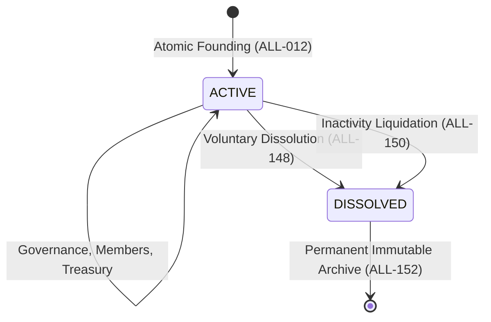
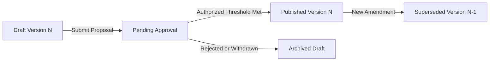

# B-09 — Alliances: Foundations, Player-Defined Constitutions, Governance Rules, Permissions, Treasury, and Cross-System Specification

**Version:** 2.8 • **Created:** 2026-10-31 • **Revised:** 2026-11-03 • **Stage 2, Prompt 09B-M** • **Authoritative Canonical Rulebook**
**Status:** **Phase 09B Alliance specification and documentation: ACCEPTED. Accepted at the specification/documentation level (D-142 / DD-165).** Acceptance follows the independent acceptance review and the 09B-N/09B-O/09B-P corrections. It is **not** production implementation, live-game integration testing, release or operational readiness, and it authorizes no new capability and resolves no unresolved decision. **Prompt 09C is registered as the next planning prompt with canonical deliverable `docs/stage-2/16_alliances_workflows_acceptance.md`, but it has not started; no new 09B redesign or research is authorized and no accepted rule may be modified.** All policy decisions under `UD-040` through `UD-049` remain strictly **Open (Owner-Reserved)** awaiting explicit owner approval, except the partial authorizations recorded in `D-140`, clarified by the owner in Prompt 09B-J, narrowed for role-based tax management in Prompt 09B-L (`UD-045` remains Open beyond that narrow scope), and the purpose-limited operational-funding boundary specified in `ALL-220`–`ALL-226` under `D-141`, a later amendment to `D-140`. The AOP labels, the four-category mechanics and the permission name are project technical design choices made under `D-014`, not owner selections, and no cost schedule, fee, amount or office is approved. These authorizations do not resolve the underlying UDs. `UD-046` still reserves treasury ownership, custody, general withdrawal, general spending beyond the narrow operational mechanism, unrestricted transfers or distributions, capacity and dual-approval policy; the Alliance Receiving Ledger is a receiving and accounting record, not a treasury resolution. `UD-047` still reserves collective diplomatic positions and delegation. `UD-044` still reserves appeal policy. `UD-040` still reserves multi-Alliance membership; 09B-K adds only a reversible provisional tax-attribution safeguard, not a decision. `UD-039` is resolved by `D-137` and amended by `D-140` only to create a separate alliance treaty object; zero diplomatic delegation remains binding. All candidate formulas (`F-AL-001` through `F-AL-005`) and numerical parameters are non-authoritative proposals subject to Prompt 14 calibration and owner determination, except the owner-authorized tax, donation and operational-funding arithmetic shapes. **09B-J supersedes the earlier per-policy owner-consent tax interpretation with a Politics & War-style per-turn production tax, corrects the NAP membership rule so a nation may remain a non-covered member, makes blocked-attack audit mandatory, and extends C25 to appeal-entitlement statements. 09B-K completes the final correction: C25 detects positive appeal grants semantically, `ALF-21`/`ALF-23`/`ALF-24` are rewritten to the production-tax and receipt model, `REQ-626` names the then-credit-only Alliance Receiving Ledger (superseded in 09B-L by the four-category receipt/accounting record), multiple-membership ambiguity uses a visible recorded 0% fallback while `UD-040` stays Open, and later same-turn stages consume only post-tax net. 09B-L reconciles `ALL-006`–`ALL-008`, `ALL-087`–`ALL-088` and §14 with the automatic production tax; specifies purpose-limited operational funding without general treasury powers; records the narrow role-based tax-management authorization under `UD-045`; makes bracket assignment per-Alliance; replaces the record-only treaty contradiction with the registered `AT-E00`/`AT-E01` effect catalogue; and strengthens C25 against retained, preserved, reviewable and avenue-of-appeal formulations. 09B-M restores `D-140` to its five-capability text, records the later operational-funding authorization as `D-141`, distinguishes receipt accounting, allocation, approved operational expenditure and general treasury authority, and states that no AOP purpose has an approved cost schedule or is currently spendable, so tax and donation value remains in the ARL. See [`16_alliances_project_wide_consistency_audit.md`](16_alliances_project_wide_consistency_audit.md). No owner-reserved status was converted into a full resolution.**
**Parent task:** Stage 2, **Prompt 09 — Alliances and Coalitions**. This document is the **B-09** canonical rulebook of **Prompt 09B**; it builds on Prompt 09A research and prepares the foundation for Prompt 09C.
**Evidence base:** Research report [`research/09A_alliance_research.md`](research/09A_alliance_research.md) v1.4, integration matrix [`research/09A_alliance_integration_matrix.md`](research/09A_alliance_integration_matrix.md) v1.4, source register [`research/09A_alliance_sources_findings.md`](research/09A_alliance_sources_findings.md) v1.1, and reference review [`research/09A_alliance_reference_review.md`](research/09A_alliance_reference_review.md) v1.1. Research and comparative evidence from Politics & War provide comparative analysis; this document establishes the binding canonical rules for Nation Supremacy.
**Formulas:** Calculations are registered in [`16_alliances_formula_register.md`](16_alliances_formula_register.md) (`F-AL-001` through `F-AL-008`). `F-AL-001`–`F-AL-005` remain candidate; `F-AL-006`–`F-AL-008` are the owner-authorized arithmetic shapes for automatic per-turn production taxation, voluntary donations and purpose-limited operational funding. This document states the rules; the formula register specifies the mathematics, including the multiple-membership 0% safeguard, production-chain examples A–G, Crowns/maintenance examples H–L and the operational-funding reconciliation.
**Integration contracts:** Full 21-field integration contracts (20 specification fields plus the `AX` identifier) covering all 30 cross-system interactions are defined in [`16_alliances_integration_contracts.md`](16_alliances_integration_contracts.md) (`AX-01` through `AX-30`), restored to their canonical Prompt 09A identities under Prompt 09B-C, corrected under Prompt 09B-E, authority-audited under Prompt 09B-F, extended under Prompt 09B-I with `AX-27` through `AX-30`, clarified under Prompt 09B-J, completed under Prompt 09B-K, and reconciled with operational funding under Prompt 09B-L.
**Identifier spaces:** Rules **`ALL-001` through `ALL-226`**; formulas **`F-AL-001` through `F-AL-008`**; decisions **`D-135` through `D-141`** and **`DD-151` through `DD-164`**; failure codes **`ALF-01` through `ALF-29`**; requirements **`REQ-534` through `REQ-653`**. None reuses an existing `TR-`, `ECN-`, `URB-`, `DMP-`, `MKT-`, `DIP-`, `AT-`, `F-TM-`, or `F-DP-` identifier.

**Authority vocabulary.** Every rule in this document is read through four labels, and the label governs what may be relied on:

| Label | Meaning | Binding? |
|---|---|---|
| **Approved constraint** | An owner-approved rule or a decision recorded as Approved. A canonical rule inherited from another subsystem (for example `B-08`, `REQ-176`, `REQ-530`, `ACC-001`, `TR-024`) binds this document at the interface even where its requirement remains Provisional; the rule text labels that case **binding inherited** rather than Approved | Yes at the interface; a later document may not override it, and the requirement's Provisional status is unchanged |
| **Confirmed design** | A Category B autonomous design decision under `D-014`, recorded as a `D-` row and not owner-reserved | Yes as design; changeable only by a later recorded decision |
| **Candidate proposal** | A researched design, parameter or recommendation awaiting the named owner decision or Prompt 14 calibration | No; illustrative and non-enforceable |
| **Owner-reserved** | A question in `UD-040`–`UD-049`, marked "Yes — owner" in the unresolved-decision register | No; nothing here approves it |

A candidate proposal is never promoted by being repeated in another document. Promotion requires an explicit owner approval recorded in the decision registers, followed by a status update in this rulebook. Where a rule below mixes an approved constraint with a candidate mechanism, the approved part remains binding and the candidate part is expressly marked as such.

---

## 1. Purpose, Scope, and Architectural Principles

### 1.1 Purpose
B-09 defines the foundational architecture, governance mechanics, player-authored constitutional framework, custom position and permission matrix, treasury management, and cross-system integration rules for alliances in Nation Supremacy.

The central design principle of the Alliance System is:
> **The alliance belongs to its players. Its constitution, political structure, government, leadership arrangements, and internal laws are determined by the alliance's members, not imposed by Nation Supremacy.**

Nation Supremacy provides neutral administrative infrastructure: tools to publish constitutions, record decisions, administer custom offices, execute granular technical permissions, and record auditable governance transactions. Alliance treasury pools are candidate architecture under `UD-046`, not a provided feature. The game never prescribes a mandatory political model, ideology, universal constitution, mandatory leader office, heir office, council structure, fixed political hierarchy, or artificial constitution deadline.

### 1.2 In Scope
- Founding registration, validation, naming rules, and bootstrap administration (`ALL-011`–`ALL-017`); eligibility, fees and the single-alliance rule are candidate only (`UD-040`).
- Alliance lifecycle states: `ACTIVE`, `DISSOLVED`, and atomic transition boundaries (`ALL-018`–`ALL-023`).
- Open-ended, player-authored constitutional principles and 4-tier governance taxonomy (`ALL-024`–`ALL-030`).
- Constitution drafting, versioning, approval evidence, publication, and immutable archival (`ALL-031`–`ALL-037`).
- Player-defined amendment procedures and non-retroactivity (`ALL-038`–`ALL-043`); any native ballot tool is candidate scope (`UD-042`).
- Government structural agnosticism, neutral building blocks, and optional templates (`ALL-044`–`ALL-050`).
- Leadership organization, administrative primary contacts, voluntary transfers, dormancy triggers, and contingency (`ALL-051`–`ALL-058`); succession and vacancy mechanics are candidate (`UD-043`).
- Custom offices, departmental structures, and flexible precedence levels (`ALL-059`–`ALL-065`).
- Granular candidate capability catalogue, least-privilege design, and anti-escalation guards (`ALL-066`–`ALL-078`, `UD-045`).
- Membership lifecycle states (`APPLICANT`, `ACTIVE_MEMBER`, `FORMER_MEMBER`) and recruitment (`ALL-079`–`ALL-086`); roster caps and cooldowns are candidate (`UD-044`).
- Member baseline rights: inviolable national wealth, diplomatic sovereignty, and freedom of exit (`ALL-087`–`ALL-092`, `ALL-145`).
- Treasury conservation and audit invariants (`ALL-095`–`ALL-101`); entity ownership, custody, capacity, general deposits, general withdrawals and approvals are owner-reserved (`UD-046`).
- Purpose-limited operational funding from the Alliance Receiving Ledger to registered platform cost destinations, with no ownership, custody, general withdrawal or distribution right (`ALL-220`–`ALL-226`, §29.7).
- Candidate deposit, capacity and rate-limit proposals (`F-AL-001`, `ALL-102`–`ALL-108`, `UD-046`).
- Candidate general withdrawal workflows and optional multi-signature safeguards (`F-AL-005`, `ALL-109`–`ALL-116`, `UD-046`).
- Candidate grants/no-engine-loans policy (`ALL-117`–`ALL-121`, `UD-046`).
- Alliance diplomacy: non-binding published positions, strict preservation of national diplomatic authority (B-08 / REQ-530), no delegation, and a **separate** B-09 Alliance-to-Alliance treaty object authorized by `D-140` (`ALL-122`–`ALL-128`, `ALL-196`–`ALL-208`; positions are candidate under `UD-047`).
- Candidate governance voting tools and binding limits (`ALL-129`–`ALL-135`, `UD-042`/`UD-049`).
- Military coordination: strategic planning, readiness visibility, and national command sovereignty (`ALL-136`–`ALL-141`); execution deferred to Prompt 10.
- Disputes, internal discipline, sanctions boundaries, and due process records (`ALL-142`–`ALL-147`).
- Alliance dissolution, asset disposition, member release, and permanent archival (`ALL-148`–`ALL-153`); dissolution and disposition mechanics remain candidate.
- Security architecture, threat catalog (`R-AL-01`–`R-AL-18`), and immutable audit logging (`ALL-154`–`ALL-160`).
- Asynchronous system notifications, candidate bulletin tools, and zero-chat invariant (`ALL-161`–`ALL-164`, `UD-049`).
- External Discord link: optional static link, zero-API boundary, candidate validation recommendation (`ALL-165`–`ALL-168`, `UD-048`).
- Cross-system integration contracts (`AX-01` through `AX-30`, `ALL-169`–`ALL-171`).
- Automatic member taxation, voluntary donations and purpose-limited operational funding: current-turn production withholding, player-authored brackets and role permissions, an Alliance Receiving Ledger that receives and accounts for credits, registered operational expenses, and the donation settlement path (`ALL-179`–`ALL-195`, `ALL-220`–`ALL-226`, §29.1–§29.2, §29.7; `D-140`/`D-141`, `UD-046` Open). No AOP purpose has an approved cost schedule, so no operational purpose is currently spendable.
- Same-Alliance attack prohibition and NAP attack validation: server-side checks at every attack entry point with mandatory blocked-attempt audit (`ALL-206`–`ALL-215`, §29.3–§29.4; `D-140`; Prompt 10 implementation).
- Authoritative status of unresolved decisions (`UD-039` resolved by `D-137`; owner-reserved `UD-040`–`UD-049`, `ALL-172`–`ALL-174`).
- Handoff requirements and release gates for Prompt 09C (`ALL-175`–`ALL-178`).

### 1.3 Out of Scope — Deliberately Not Designed Here
| Excluded Capability | Subsystem Owner | Governing Constraint |
|---|---|---|
| Real-time in-game chat, direct messaging, typing indicators, read receipts | Excluded from Project | `D-133`, `DD-147` |
| Discord bots, OAuth account linking, role sync, or bidirectional API | External Platform | `DD-148`, `ALL-165` |
| War declarations, tactical battle resolution, casualties, ground combat | Military (Prompt 10) | `D-023`, `REQ-591` |
| National warehouse inventory rules, domestic production, resource decay | Economy (Prompt 04) | `REQ-141`, `REQ-142`, `ECN-` |
| Bilateral national treaties (NAP, Consultation, Aid) and personal posture | Diplomacy (Prompt 08) | `D-123`, `D-126`, `B-08` |
| Global Trade public market listings, automated order clearing, fees | Trade (Prompt 07) | `D-122`, `DD-136`, `MKT-` |
| Production code, database migrations, UI components, background workers | Forbidden in Stage 2 | `D-012`, Prompt 09B Scope |

### 1.4 Foundational Rules
- **`ALL-001` (Authoritative Document):** This document is the canonical specification for the Alliance System foundations. In any conflict between this document and research summaries, this document prevails.
- **`ALL-002` (Specification-Only Governance):** No gameplay code, database schema, or executable software is authorized by this specification. All mechanisms described herein are design specifications subject to Prompt 09C operational workflows and Prompt 14 calibration.
- **`ALL-003` (Turn Lattice Synchronization):** All formal state transitions (founding, admission, departure, leadership change, constitutional amendment, treasury execution, dissolution) execute at two-hour turn boundaries as defined by `TR-024` (slot arithmetic) and `TR-029` (boundary assignment), preserving atomic database transactions.
- **`ALL-004` (Sovereignty Protection):** No alliance action, constitutional provision, officer decree, or collective vote may compromise or bypass a player's national sovereignty, account security, or discretionary diplomatic authority established under `B-08`.
- **`ALL-005` (Audit Trail Invariant):** Every state-altering action in the Alliance System produces an immutable, cryptographically verifiable audit record containing timestamp, actor ID, action type, parameters, and outcome.

---

## 2. System Ownership Boundaries

- **`ALL-006` (Owning Subsystem Boundaries):**
  1. *Account & Identity:* Owned by `B-01`. Alliance tracks membership links; it cannot alter account credentials, authentication, or ban states.
  2. *National Economy:* Owned by `B-04`. National treasuries, warehouses, tax income and production remain under national control. The Alliance's automatic per-turn production tax is a narrowly authorized source withholding from eligible current-turn production (`ALL-179`–`ALL-187`); it is not a change to any national or municipal tax rate and it never reaches an opening balance or existing stockpile. The Alliance Receiving Ledger is a separate receiving and accounting record. Treasury ownership, custody, capacity and general withdrawal remain owner-reserved under `UD-046`, and this document establishes no ownership interest in any pool. Purpose-limited operational funding (`ALL-220`–`ALL-226`) may debit only the ARL, only for a supported Alliance purpose, and creates no general treasury right.
  3. *City & Production:* Owned by `B-05`. The Alliance cannot alter municipal infrastructure, national or municipal tax rates, or resource yields. It may apply only its own authorized production-tax brackets to eligible current-turn production under `ALL-179`–`ALL-187`.
  4. *Trade & Markets:* Owned by `B-07`. Global Trade listings and market orders remain national actions. Alliances cannot intermediate trades or bypass trade restrictions.
  5. *Diplomacy:* Owned by `B-08`. Posture and treaties remain sovereign national rights. Alliances cannot force national diplomatic commitments.
  6. *Military Execution:* Owned by Prompt 10. Military units, command structures, and combat operations remain national assets.
- **`ALL-007` (Non-Interference Invariant):** An alliance officer, rank, or majority vote possesses zero mechanical capability to force a member nation to spend existing national resources, build infrastructure, accept a treaty, list a market lot, or declare war. The authorized automatic withholding of the Alliance's tax from eligible current-turn production (`ALL-179`–`ALL-187`) is a source tax on new production, not a forced spend of existing national wealth. It does not permit confiscation of existing wealth, access to national stockpiles, unauthorized withdrawals, unapproved spending or transfers, or any change to national financial policy.
- **`ALL-008` (Resource Isolation and Authorized Tax Exception):** Automatic Alliance tax withholding from eligible current-turn production (`ALL-179`–`ALL-187`) is a specifically authorized exception to the general rule that transfers of existing national value to or from an alliance are voluntary, explicit and executed through canonical Economy transfer mechanics (`ECN-212`, `TR-060`). Voluntary donations are player-initiated and confirmed under `ALL-188`–`ALL-195`. Every other transfer of existing national balances or stockpiles to or from an alliance is voluntary and explicit; no confiscation, unauthorized withdrawal or access to national stockpiles exists. Purpose-limited operational funding (`ALL-220`–`ALL-226`) debits only the ARL, never a national balance.
- **`ALL-009` (Global Trade Protection):** Alliance membership does not alter Global Trade access, market order limits, or verification gates (`G-1` through `G-6`, `D-122`, `DD-136`).
- **`ALL-010` (Contract Traceability):** Every cross-system data exchange is governed by the 30 integration contracts (`AX-01` through `AX-30`) detailed in [`16_alliances_integration_contracts.md`](16_alliances_integration_contracts.md).

---

## 3. Alliance Founding and Registration

- **`ALL-011` (Founding Registration and Candidate Eligibility):** Founding is an action of, and only of, the authenticated owner of an active nation (`REQ-002`, `ACC-001`); a bot, administrator acting for a player, delegated account or third party cannot found an alliance, and the founder does not thereby acquire authority over any other nation. The following are **candidate eligibility proposals only**, awaiting owner decision `UD-040` and not in force:
  1. The nation is unaffiliated with any alliance (`REQ-566`).
  2. The nation is not serving a candidate founding or rejoin cooldown (`F-AL-004`, also `UD-044`).
  3. The nation holds liquid crowns at least equal to a candidate founding fee (`F-AL-002`).
  No eligibility rule beyond the approved identity constraint may be described as approved until `UD-040` is resolved.
- **`ALL-012` (Atomic Founding Transaction):** Alliance founding executes as a single atomic transaction at a turn boundary:
  1. If a founding fee is approved and configured under `UD-040`, debit it from the founding nation's treasury (`ECN-212`, candidate `F-AL-002`); otherwise no fee is charged.
  2. Create the alliance record with status `ACTIVE`.
  3. Assign the founding nation as an `ACTIVE_MEMBER`.
  4. Assign the founding nation as the initial Primary Administrative Contact under the candidate bootstrap baseline (`ALL-015`); the confirmed structural constraint is only that an alliance must have at least one active Primary Administrative Contact.
  5. Establish the initial bootstrap governance container, without creating a mandated political office.
  6. Emit audit event `AUD-AL-001`.
- **`ALL-013` (Identity and Naming Uniqueness — Candidate Parameters):** Naming must be unique under a normalised comparison and text must pass universal moderation. The candidate baseline parameters (name 3–32 characters, tag 2–5 alphanumerics in brackets, description up to 2,000 characters) are provisional and unapproved; only uniqueness and moderation are constraints.
  1. *Alliance Name:* unique across active and dissolved alliances, case-insensitive, moderated.
  2. *Alliance Tag:* globally unique and moderated.
  3. *Description:* optional text, length cap to be calibrated.
- **`ALL-014` (Naming Collision Handling):** If a proposed name or tag collides with an existing active or reserved historical alliance identity, the founding transaction is rejected with failure code `ALF-01` (`NAME_COLLISION`), and no crowns are debited.
- **`ALL-015` (Bootstrap Primary Contact):** The binding structural constraint is that every active alliance has at least one active member designated the Primary Administrative Contact — a technical communication endpoint that receives engine notices and anchors root administrative configuration. It is not a political office, carries no inherent authority over members, and does not make its holder a "Leader". Under the **candidate bootstrap baseline** (`UD-040`), the founding nation is designated the initial contact; the title, selection method, term and transfer method remain player-defined (`ALL-051`).
- **`ALL-016` (Founding Fee Treatment — Candidate):** If a founding fee is approved under `UD-040`, candidate proposal `F-AL-002` would treat it as a sunk administrative creation fee absorbed by the economy, never refunded on dissolution or contact transfer. No fee, amount or refund rule is in force today.
- **`ALL-017` (Bootstrap Mode and Constitutional Flexibility):** A newly founded alliance operates under basic bootstrap settings until its members choose to publish a formal constitution. There is NO artificial deadline (e.g. 12 turns) forcing alliances to draft a constitution on pain of system alerts or penalties. Alliances are free to operate indefinitely under bootstrap governance or author a constitution when they deem appropriate.

---

## 4. Alliance Lifecycle States

- **`ALL-018` (Lifecycle States):** An alliance exists in exactly one of two formal states:
  1. `ACTIVE`: The alliance is fully operational. Members may join, leave, deposit, disburse, and participate in governance.
  2. `DISSOLVED`: The alliance has ceased operations. Its roster is released, assets dispersed, and records permanently archived.
- **`ALL-019` (Single-Alliance Candidate Baseline):** A candidate architectural baseline under owner decision `UD-040` would permit a nation to belong to, and hold office in, at most one alliance at a time (`REQ-566`), rejecting a second acceptance with `ALF-06`. It is not an approved invariant, and no text may state that multi-alliance membership is prohibited until `UD-040` resolves it.
- **`ALL-020` (Dissolution Trigger Boundaries):** Transition to `DISSOLVED` occurs atomically at turn boundaries:
  1. Revoke all active member permissions.
  2. Terminate all pending applications, proposals, and governance ballots.
  3. Dispose of any remaining pool by the disposition rule that `UD-046` may approve, if any; candidate disposition options are listed in `ALL-149` and none is in force.
  4. Release the alliance tag and record the transition in the public registry.
  5. Set lifecycle state to `DISSOLVED`.
- **`ALL-021` (Member Release on Dissolution):** Upon dissolution, all members are immediately released from membership. Former members incur no exit penalties and are eligible to apply to or found another alliance after the candidate cooldown (`F-AL-004`, pending owner decision `UD-044`).
- **`ALL-022` (Historical Preservation):** Dissolved alliances remain searchable in the historical registry. Dissolution date, founder, last administrative contact, peak member count, and final published constitution version are preserved permanently.
- **`ALL-023` (Inactivity vs Dissolution):** Inactivity of individual officers triggers administrative contingency workflows (`ALL-055`), not automatic dissolution, provided at least one active member remains.

---

## 5. Player-Authored Constitution Principles

### 5.1 Open-Ended Governance Architecture
Under owner-approved decision `D-135`, Nation Supremacy adopts an open-ended, player-authored constitutional model. The game provides a robust, neutral document-recording facility and flexible governance tools.

- **`ALL-024` (Constitutional Sovereignty):** The alliance constitution belongs entirely to its members. The game engine does not mandate, suggest, or score political ideologies, governmental branches, or legislative structures.
- **`ALL-025` (Four-Tier Governance Taxonomy):** To eliminate ambiguity between prose and software mechanics, every provision in an alliance's governance framework is categorized into exactly one of four tiers:
  1. **Documented Constitutional Rule (Tier 1):** Player-authored text recorded in the published constitution (e.g. philosophical preamble, internal codes of honor, diplomatic doctrine). The platform stores and renders this text verbatim.
  2. **System-Enforceable Governance Control (Tier 2):** Mechanical controls actually provided by the engine, where the relevant feature is approved (e.g. permission assignments; withdrawal controls only after `UD-046`; ballot majorities only if `UD-042` approves ballots). The engine enforces only what exists; a constitution cannot summon an unbuilt control.
  3. **Internal Political Agreement (Tier 3):** Organizational agreements not mechanically enforced by the engine (e.g. "Members should donate 10% of wood production weekly", "Officers must hold voice briefings on Discord"). Adherence is voluntary and managed politically by players.
  4. **Global Platform Rule (Tier 4):** Inviolable game rules that cannot be overridden by any constitution (e.g. no chat `D-133`, single account invariant `ACC-001`, national sovereignty `B-08`, no resource minting `REQ-176`).
- **`ALL-026` (No Natural Language Execution):** The game engine never parses constitutional prose using NLP, heuristics, or AI to infer gameplay rules. Mechanical effects occur exclusively through explicit configuration of System-Enforceable Governance Controls (`ALL-025` Tier 2).
- **`ALL-027` (Universal Safety Boundaries):** Any constitutional clause purporting to authorize the following is null, void, and unexecutable by the engine:
  1. Seizure of a member's private national treasury or warehouse inventory.
  2. Compulsory submission to national military commands or automated battle deployment.
  3. Overriding a national leader's bilateral treaty decisions or diplomatic posture.
  4. Bypassing market trade verification gates or trading fees.
  5. Bypassing game-wide cooldowns, turn boundary execution, or rate limits.
- **`ALL-028` (Non-Retroactivity of Amendments):** Constitutional amendments apply strictly prospectively from their published turn boundary. An amendment cannot retroactively invalidate past lawful transactions, penalize past actions, or modify historical audit logs.
- **`ALL-029` (Open Document Structure):** The candidate constitution editor accepts structured markdown with optional player-defined sections (Preamble, Government Structure, Bill of Rights, Legislative Code, Treasury Guidelines, Foreign Policy). The candidate 50,000-character cap is a provisional technical parameter, not an approved limit.
- **`ALL-030` (Platform Neutrality):** The game maintains absolute ideological neutrality. An alliance may style itself as a direct democracy, absolute monarchy, oligarchic council, corporate syndicate, military junta, or feudal federation without engine penalties or bonuses.

---

## 6. Constitution Lifecycle and Versioning

- **`ALL-031` (Constitution Publishing):** An alliance may publish a player-authored constitution at any time following founding. Publication is open-ended and player-driven; the platform provides neutral drafting, versioning, diffing, and storage facilities without requiring a mandatory constitution upon creation.
- **`ALL-032` (Draft Staging):** Members holding the `MANAGE_CONSTITUTION` permission may draft new versions. A draft is private to the alliance administration until formally submitted for approval. Only one active draft may be in review at any given time.
- **`ALL-033` (Submission and Review):** When a draft is submitted, it enters `PENDING_APPROVAL` status. The system generates a cryptographic content hash (SHA-256) and a line-by-line diff against the current published version.
- **`ALL-034` (Approval Evidence Record):** To transition a draft to `PUBLISHED`, the system requires verifiable evidence that the alliance's system-configured approval condition was satisfied (e.g. executive sign-off, council consensus, or governance vote passing).
- **`ALL-035` (Turn Boundary Activation):** Approved amendments do not take effect immediately mid-turn. They activate at the subsequent turn boundary ($T+1$), ensuring all members and subsystems receive a consistent state.
- **`ALL-036` (Immutable Version Archive):** Every published version is assigned an incremental integer version number (`v1.0`, `v2.0`, `v3.0`). Once published, a version record is permanently read-only and archived in the immutable version history table (`REQ-547`).
- **`ALL-037` (Draft Withdrawal):** The author of a draft or an authorized administrative officer may withdraw a pending draft before final approval, transitioning the draft to `WITHDRAWN` status.

---

## 7. Constitution Amendments and Verification

- **`ALL-038` (Amendment Procedure):** An alliance configures its technical amendment procedure through native governance settings according to its player-authored constitution:
  1. *Executive Approval:* Requires sign-off by designated administrative officers.
  2. *Council Approval:* Requires sign-off by a designated custom officer rank or council.
  3. *Democratic Ballot (Candidate — `UD-042`):* If native ballots are approved, requires a governance ballot satisfying configured quorum and approval thresholds (`ALL-131`).
  4. *Custom Rules:* Alliances define custom thresholds without engine enforcement of a single universal procedure.
- **`ALL-039` (Verification Engine):** When an amendment approval action is attempted, the engine evaluates:
  1. Whether the initiating actor possesses required permissions.
  2. Whether the required approval threshold (votes or sign-offs) has been fully recorded.
  3. Whether the content violates universal platform safety rules (`ALL-027`).
- **`ALL-040` (Draft Diff Presentation):** The platform generates a standardized visual and text diff highlighting added, modified, and deleted text, accessible to all active members throughout the review period.
- **`ALL-041` (Supersession Invariant):** Publication of Version $N$ immediately and atomically marks Version $N-1$ as `SUPERSEDED`. Only exactly one version is `ACTIVE` at any moment in time.
- **`ALL-042` (Disputed Amendments):** If internal political disputes arise regarding an amendment's legitimacy, the platform records and enforces the technical artifact version that satisfied technical verification (`ALL-039`). That is a record of which stored version passed the configured check, not a finding on political legitimacy. The game does not adjudicate political disputes.
- **`ALL-043` (Audit Trail of Amendments):** The system records an immutable audit entry (`AUD-AL-005`) documenting the amendment ID, prior version, new version, diff hash, voting tally/sign-off ledger, approving actors, and activation turn timestamp.

---

## 8. Government and Political Flexibility

- **`ALL-044` (Structural Agnosticism):** Nation Supremacy treats all alliance governmental structures with equal technical support. The engine provides primitive building blocks: offices, precedence tiers and permissions; ballots are candidate scope under `UD-042`, and treasury controls are candidate architecture under `UD-046`.
- **`ALL-045` (Neutral Building Blocks):**
  1. *Offices:* Named positions with configurable display titles and assigned permissions.
  2. *Precedence Tiers:* Flexible ordering for anti-escalation enforcement and contingency order.
  3. *Ballots (candidate, `UD-042`):* If approved, structured native voting mechanisms with customizable questions, options, quorums, and thresholds.
  4. *Multi-Signature Gates:* A candidate optional control for high-impact actions, available only if approved under `UD-046`.
- **`ALL-046` (Optional Constitution Templates):** For onboarding convenience, the platform provides optional starter templates:
  - *Template A (Executive Republic):* Elected Leader, appointed Cabinet, legislative council.
  - *Template B (Direct Democracy):* All major decisions and amendments decided by member ballot.
  - *Template C (Founder Autocracy):* Concentrated authority in founder/leader office with advisory officers.
  - *Template D (Federal Council):* Equal representation across member departments.
  *Rule:* Templates are purely educational starting text. Alliances may edit, delete, or rewrite any template text without restriction.
- **`ALL-047` (No Gameplay Penalties or Buffs):** No alliance constitution confers numerical economic, military, or diplomatic bonuses (e.g. no "+5% production for Republics"). Political governance is a player-driven social institution, not an RPG skill tree.
- **`ALL-048` (Separation of Title from Power):** A constitutional display title (e.g. "Grand Marshal", "High Chancellor") carries zero inherent mechanical power. Mechanical authority derives exclusively from explicit technical permissions assigned to the office (`ALL-066`).
- **`ALL-049` (Multi-Leader Configurations):** If an alliance constitution specifies a triumvirate, co-presidency or governing council, candidate technical permissions would be distributed across multiple holders of that position, and the alliance may configure optional multi-signature controls **only if** `UD-046` approves them. No structure is mandated and no multi-signature rule is in force.
- **`ALL-050` (Platform Integrity Primacy):** Where player-authored political arrangements conflict with the engine's data model or safety invariants, the engine's technical constraints prevail unconditionally.

---

## 9. Leadership Roles, Succession, and Vacancy

- **`ALL-051` (Executive Organization and Primary Contact):** An alliance may organize its executive structure according to its own player-defined constitution (e.g. single leader, governing council, co-chairs, triumvirate, or secretary-general). The engine imposes no mandatory "Leader" office, heir office, council structure, or authoritarian hierarchy (`D-135`). To satisfy system-level technical requirements (receiving official engine notifications, serving as point of contact for platform communications, and anchoring root administrative configuration), every alliance designates at least one active member as the Primary Administrative Contact. This role is strictly a technical system communication endpoint, NOT a compulsory political office, carries no inherent executive or political authority over alliance members, and confers no automatic constitutional supremacy. The title, selection method, and term of this role are defined entirely by the alliance's constitution.
- **`ALL-052` (Succession Planning):** An alliance may optionally establish succession rules or designate successors according to its player-authored constitution. The engine does not impose a mandatory "Heir" office or predefined succession model. Designations, lines of succession, or election triggers are recorded in the alliance governance configuration and can be updated at any time in accordance with the alliance's constitutional procedures.
- **`ALL-053` (Voluntary Executive Transfer):** An officer or Primary Administrative Contact may transfer their responsibilities in accordance with the alliance's constitutional procedures. The transfer should be atomic, log `AUD-AL-002`, and avoid duplicating authority; the exact transfer workflow and eligibility rules remain candidate under `UD-043`. A contact transfer does not transfer any member nation's sovereignty or diplomacy.
- **`ALL-054` (Administrative Vacancy and Contingency):** The binding constitutional principle is that any vacancy is governed first by the alliance's player-authored constitution (`D-135`, `DD-151`); the succession and stewardship policy itself remains owner-reserved under `UD-043`, and the engine does not impose a universal model. The following additional fallback is a **candidate proposal under `UD-043`** and is not in force:
  1. Governance authority transfers according to the alliance's constitutional contingency rule.
  2. If no contingency rule exists, a candidate fallback would allow an active holder of an administrative capability to assume operational stewardship.
  3. A further candidate fallback would allow the longest-tenured active member to initiate a stewardship claim where no administrative officer exists.
  4. If zero active members remain, the abandoned-alliance path is considered under `ALL-150`, itself candidate.
  No rank, tenure, seniority or "heir" rule is approved by this rule.
- **`ALL-055` (Administrative Inactivity Vacancy — Candidate):** Under candidate proposal `F-AL-003` (subject to owner decision `UD-043`), an alliance could define its own dormancy vacancy window (240 turns is a candidate baseline; `D-028` account dormancy of 168 turns is a confirmed external constraint and floor, not an alliance inactivity rule):
  1. The administrative contact role would be declared `VACANT` by the candidate workflow.
  2. If a constitutionally configured successor exists, the candidate workflow would elevate that successor.
  3. If none is configured, a candidate stewardship claim could be initiated.
  4. A dormant former officer would be demoted only on the successful candidate transition.
  Nation dormancy (`D-028`, 168 turns) remains an account-level lattice rule and must not be confused with alliance-office inactivity policy, which is player-defined and owner-reserved under `UD-043`.
- **`ALL-056` (Leadership Removal and Accountability):** Executive officers and primary contacts are accountable to their alliance and may be removed according to player-defined constitutional procedures (for example a member vote, council consensus, or term expiry). The engine imposes no universal impeachment threshold, fixed council sign-off, recall structure or removal model; any native ballot used to conduct a removal is candidate scope under `UD-042`/`UD-049`. Removal mechanics and their verification remain candidate under `UD-043`.
- **`ALL-057` (Competing Succession Claims — Audit Evidence Only):** If competing succession, leadership or stewardship claims arise, the platform records each claim, its actor, the turn and a timestamp as immutable audit evidence and preserves that evidence for review. Timestamp order, transaction order or completion of a technical workflow is evidence only: it does **not** decide which claim prevails, recognise a successor or steward, assign or transfer any office, or establish political authority. The platform does not adjudicate the merits of off-platform claims or Discord debates. Any rule for resolving competing claims remains owner-reserved under `UD-043` and is not in force.
- **`ALL-058` (Protection Against Orphaned Alliances — Design Objective):** The design objective, subject to the candidate mechanics in `ALL-054`/`ALL-055` and owner decision `UD-043`, is that an alliance containing at least one active member should not become permanently locked or administratively orphaned through leadership abandonment. "Should not" is a goal, not a guarantee; no fallback power is granted until `UD-043` is resolved.

---

## 10. Custom Positions, Tiers, and Departments

- **`ALL-059` (Custom Position Definition):** Alliances may define custom positions to represent their organizational structure (`D-139`). The game imposes no artificial cap of 20 positions and no fixed 1–10 rank tier system with 10 reserved for a single leader. Each position record contains:
  1. Position ID (unique within alliance).
  2. Display Title (3 to 32 characters, moderated).
  3. Description (up to 256 characters).
  4. Precedence Level (relative integer hierarchy for anti-escalation enforcement).
  5. Department assignment (optional string tag).
  6. Assigned Permissions set.
- **`ALL-060` (Departmental Organization):** Alliances may organize positions into functional departments (e.g. Treasury, Foreign Affairs, Defense, Recruitment, Internal Affairs). Department tags are organizational metadata for UI grouping and audit clarity.
- **`ALL-061` (Multiple Position Holders):** Positions may be assigned to multiple active members, or restricted to a single holder, as configured by the alliance administration.
- **`ALL-062` (Precedence Hierarchy and Anti-Escalation Safeguards):** The engine enforces strict anti-escalation invariants based on configured precedence levels:
  1. An officer cannot promote, demote, or assign permissions to any member whose position has equal or higher precedence.
  2. An officer cannot remove or discipline any member of equal or higher precedence.
  3. An officer cannot assign permissions that their own positions do not possess (privilege escalation prevention).
  4. Anti-escalation is a technical safety invariant, not a political mandate.
- **`ALL-063` (Position Creation and Deletion):** Members with `MANAGE_ROLES` permission may create or modify positions. A position cannot be deleted while active members are assigned to it; members must be reassigned first.
- **`ALL-064` (Display Title Customization):** Positions support custom titles reflecting the alliance's flavor (e.g. "Archon", "Tribune", "Director", "Commissar", "Ambassador"). Custom titles do not alter underlying engine permissions.
- **`ALL-065` (Historical Assignment Tracking):** The system maintains an auditable history of every position assignment, promotion, demotion, and resignation (`REQ-558`).

---

## 11. Permission System and Least-Privilege Architecture

The proposed candidate permission engine outlines granular capabilities categorized across functional domains. The final capability catalogue, delegation limits, and whether each candidate capability ships remain open owner decisions under `UD-045`.

**Reading rules `ALL-066`–`ALL-078`.** They describe the candidate model, not an approved permission system. The only binding statements in this section are the security constraints inherited from approved architecture: every privileged action is authorized server-side at execution time (`REQ-004`, restated in `ALL-071`), and every permission mutation is audited (the audit duty in `ALL-075`, following `REQ-027`). Capability names, role-only assignment, least-privilege defaults, anti-escalation, absence of a wildcard and permission unions are candidate design choices pending `UD-045`. In particular, `roles.manage` is not an approved capability and no officer bundle is approved.

| Domain | Permission Code | Description | Authorized Scope |
|---|---|---|---|
| **Identity** | `EDIT_PROFILE` | Edit alliance description, flag, and public notices | Metadata and visuals only |
| | `MANAGE_CONSTITUTION` | Create and edit draft constitutions | Staging drafts; cannot publish alone |
| | `PUBLISH_CONSTITUTION` | Authorize and publish approved constitution amendments | Requires verified amendment condition |
| | `MANAGE_DISCORD_LINK` | Update or remove static Discord invite URL | URL allowlist sanitized only |
| **Membership** | `VIEW_APPLICANTS` | Inspect pending member applications | Read-only applicant data |
| | `ACCEPT_APPLICANTS` | Approve applicant into active membership | Grants `ACTIVE_MEMBER` status |
| | `REJECT_APPLICANTS` | Decline pending application | Cleans up applicant record |
| | `REMOVE_MEMBERS` | Expel an active member per constitutional procedures | Triggers member release; logs audit |
| **Governance**| `MANAGE_ROLES` | Create, modify, and assign custom positions per constitutional rules | Subject to anti-escalation security invariants |
| | `INITIATE_VOTE` | Create and open a candidate governance ballot (if approved under UD-042) | Configures parameters and options |
| | `CLOSE_VOTE` | Tally and close an active ballot upon expiry (if approved under UD-042) | Automated or manual trigger |
| | `MANAGE_SUCCESSION` | Configure successor or succession procedures per constitutional rules | Authorized position only |
| **Treasury**  | `VIEW_TREASURY` | Inspect pooled resource balances and transaction ledger | Read-only treasury balances |
| | `PROPOSE_WITHDRAWAL` | Initiate a withdrawal proposal from alliance pool | Moves funds to reserved status |
| | `APPROVE_WITHDRAWAL` | Authorize a pending withdrawal proposal | Secondary signature validation |
| | `EXECUTE_WITHDRAWAL` | Trigger execution of authorized disbursement | Transfers funds to recipient |
| | `MANAGE_CAPACITY` | Configure pool capacity settings (if approved under UD-046) | Parameter modification |
| **Announcements**| `POST_ANNOUNCEMENT`| Publish asynchronous bulletin to notice board (if approved under UD-049) | Internal announcement creation |
| | `DELETE_ANNOUNCEMENT`| Remove an active bulletin from the board (if approved under UD-049) | Notice board maintenance |
| **Diplomacy** | `MANAGE_FOREIGN_POLICY`| Formulate and update collective diplomatic stances | Stance publishing (non-binding internal declaration only) |
| **Military**  | `VIEW_READINESS` | Inspect opt-in member military readiness overview | Aggregate readiness review |
| | `COORDINATE_DEFENSE`| Publish strategic defense alerts and target notices | Planning bulletins only |
| | `MANAGE_COALITIONS`| Record coalition alignments and shared pacts | Metadata declarations only |

- **`ALL-066` (Orthogonal Permissions):** Permissions are independent capabilities. Granting one permission never automatically grants another.
- **`ALL-067` (Role-Based Assignment Only):** Permissions are assigned to custom positions, never directly to individual player accounts (`REQ-552`). A player exercises permissions solely by holding an active position.
- **`ALL-068` (Least-Privilege Default):** Newly created positions possess zero permissions by default. Every capability must be explicitly granted by an authorized administrator.
- **`ALL-069` (Anti-Escalation Boundary):** A member holding `MANAGE_ROLES` cannot:
  1. Grant permissions to any position that they do not personally hold in their own positions.
  2. Edit, reorder, or delete positions that have equal or higher precedence than their own.
  3. Promote themselves or another player to a position of equal or higher precedence.
- **`ALL-070` (No Wildcard Super-Permission):** The engine contains no `ADMIN_ALL` or wildcard permission. Every discrete system verb checks a specific permission code.
- **`ALL-071` (Execution-Time Verification):** Permissions are verified server-side at execution time (`TR-060`), not cached from UI render state (`REQ-553`).
- **`ALL-072` (Separation of Treasury Duties — Candidate):** The candidate catalogue separates `PROPOSE_WITHDRAWAL` and `APPROVE_WITHDRAWAL`, and candidate rule `ALL-111` would prevent one account from performing both on the same proposal. Whether these capabilities ship at all, and whether separation or dual approval is enforced, remains owner-reserved under `UD-046`; no separation-of-duties guarantee is in force.
- **`ALL-073` (Temporary Delegation Proposal):** Candidate specifications outline a time-bounded temporary delegation mechanism (up to 12 turns, `REQ-561`). However, temporary delegation remains an unapproved candidate proposal linked to owner-reserved decision `UD-045` and cannot be authorized or executed as an approved mechanic pending explicit owner resolution.
- **`ALL-074` (Permission Revocation Atomicity):** Revoking a permission or removing a member from a position invalidates all unexecuted proposals authorized solely by that member.
- **`ALL-075` (Audit of Permission Mutations):** Every role creation, modification, assignment, and revocation records: timestamp, acting officer, affected role, target member, permission diff, and justification (`AUD-AL-004`).
- **`ALL-076` (Proposed Capability Architecture):** The candidate permissions defined above provide a proposed architectural model for least-privilege access control (`REQ-560`). The final permission catalogue and delegation model remain open owner decisions under `UD-045`.
- **`ALL-077` (Re-Authentication for High-Risk Actions):** Executing high-risk operations (e.g. alliance dissolution, root administrative transfer, publishing constitutional amendments) requires explicit confirmation or 2FA verification (`REQ-558`).
- **`ALL-078` (Permission Precedence Resolution):** If a member holds multiple positions within an alliance, their active permission set is the mathematical union ($\bigcup$) of permissions granted across all held positions.

---

## 12. Membership Lifecycle and Admission

- **`ALL-079` (Membership States):** A nation account's relationship to an alliance is represented by exactly one of three states:
  1. `APPLICANT`: Nation has submitted an application; pending review.
  2. `ACTIVE_MEMBER`: Nation is an active member with the internal standing its alliance's constitution defines. Specific member rights and protections are owner-reserved under `UD-044`, except the binding sovereignty protections in `ALL-087`–`ALL-092` and `ALL-145`.
  3. `FORMER_MEMBER`: Nation has departed or the alliance has dissolved; an expelled state applies only if an expulsion mechanism is approved under `UD-044`.
- **`ALL-080` (Application Submission):** An eligible unaffiliated nation owner may submit an application (`AX-09`, `REQ-562`). The application record stores: nation ID, application turn, optional pitch text (up to 1,000 characters), and status (`PENDING`).
- **`ALL-081` (Voluntary Application Revocation):** An applicant may withdraw their pending application at any time prior to review without penalty or cooldown (`REQ-563`).
- **`ALL-082` (Application Review):** Officers holding the candidate `ACCEPT_APPLICANTS` or `REJECT_APPLICANTS` capabilities may review pending applications:
  1. *Acceptance:* Atomically transitions the applicant to `ACTIVE_MEMBER`, assigns the alliance's configured default member position (which need not be a political rank), and starts the membership tenure record.
  2. *Rejection:* Transitions status to `REJECTED` and notifies the applicant. The candidate baseline applies no cooldown to a rejected applicant; any cooldown rule remains open under `UD-044`.
- **`ALL-083` (Direct Recruitment Invitations — Candidate Parameter):** Officers holding `ACCEPT_APPLICANTS` may extend direct invitations to unaffiliated nations. The candidate baseline expiry of 24 turns (48 hours) is a provisional parameter, not an approved rule; the nation may accept or decline at its sole discretion.
- **`ALL-084` (Application Expiry — Candidate Parameter):** The candidate baseline expires an unanswered application after 36 turns (72 hours). The exact expiry is provisional and unapproved; it must not be presented as a fixed rule.
- **`ALL-085` (Roster Capacity — Candidate Parameter):** No member cap is approved. A candidate provisional guard, pending `UD-044` and infrastructure measurement, would cap an alliance at 250 active members and reject further applications with `ALF-07` (`ALLIANCE_ROSTER_FULL`). The value is illustrative only and creates no approved limit.
- **`ALL-086` (Applicant Privacy):** The list of applicants to an alliance is private to the alliance administration (`AX-10`). Foreign nations and ordinary members cannot view applicant identities until formally admitted.

---

## 13. Member Rights and National Protections

- **`ALL-087` (Inviolability of National Wealth — Authorized Production-Tax and Donation Exceptions Only):** An alliance possesses zero mechanical authority to seize, garnish, or access a member nation's existing liquid crowns, warehouse commodities, or city production. The only authorized debits are (a) the automatic per-turn tax on **production generated during the turn**, collected at source under an active bracket and valid role permission (`ALL-179`–`ALL-187`), and (b) a voluntary donation that the nation's owner personally initiates and confirms (`ALL-188`–`ALL-195`). Neither exception creates a general access right, a right to reach opening balances or existing stockpiles, an unrestricted confiscation power, or authority over reserved assets; every other extraction is prohibited (`ALL-006`, `REQ-176`, `REQ-618`).
- **`ALL-088` (No Unauthorized Compulsory Extraction):** The engine provides no automated tax, recurring tribute debit or other compulsory transfer unless an active tax bracket and a valid role-held permission under `ALL-181`–`ALL-183` apply to an active member at the frozen turn snapshot. The tax is limited to current-turn production (`ALL-180`); it never reaches an opening balance or existing stockpile. Absent a valid bracket, rate and membership, the assessment is zero under the explicit 0% fallback. Every other transfer from a nation to an alliance is voluntary, one-time and player-initiated (`ALL-102`, `ALL-188`). No AI, platform, officer acting outside a valid permission, constitution default or candidate parameter may create, raise or apply a tax (`REQ-618`, `REQ-622`).
- **`ALL-089` (National Command Independence):** Member nations retain 100% discretionary control over their military recruitment, deployment, and war participation (`ALL-136`). An alliance cannot commit a member's troops or declare wars on their behalf.
- **`ALL-090` (Sovereign Diplomatic Autonomy):** Bilateral treaties signed by a member nation (such as NAPs or Trade Pacts) remain sovereign and binding. An alliance cannot invalidate or breach a member's personal treaty (`B-08`, `AX-15`).
- **`ALL-091` (Unblockable Freedom of Exit):** Every member nation possesses an absolute, unblockable right to depart an alliance voluntarily at any time (`REQ-567`). No alliance officer, constitution, rank, or penalty setting can prevent or lock a player from leaving.
- **`ALL-092` (Post-Exit Cooldown Proposal):** Under candidate proposal `F-AL-004` (subject to owner decision `UD-044`), departing an alliance voluntarily triggers a recommended 12-turn (24-hour) rejoin cooldown. During this period, the nation cannot apply to or found another alliance, mitigating raiding and espionage churning. This cooldown remains an unapproved candidate baseline awaiting owner decision.
- **`ALL-093` (Withdrawn — Former Exit-Asset Clause):** Withdrawn by `D-140` at the owner's direction. The identifier is retained only for continuity and audit. It grants no right, protection, authority or confiscation power. The independent protections in `ALL-087`, `ALL-142` and `ALL-145` govern national assets on exit.
- **`ALL-094` (Audit Visibility — Provisional):** The design intent is that a member can inspect the public governance log, published constitution and, where a pool exists, treasury transaction history of their alliance (`REQ-612`, provisional). The visibility classes of `REQ-057` still apply; this is a proposed transparency rule, not an approved right to see restricted data.

---

## 14. Alliance Treasury and Shared Resource Ownership

The treasury sections distinguish the small set of binding constraints from the large set of unapproved architecture. **Inherited constraints (binding through their owning subsystem):** value conservation and no minting (`REQ-176`, `ECN-213`), national wealth inviolability (`ALL-087`), voluntary transfers through canonical Economy mechanics (`ALL-008`), and complete audit of value movement (`ALL-101`, `REQ-027`). **Owner-authorized narrow mechanisms:** automatic current-turn production tax (`ALL-179`–`ALL-187`), voluntary donations (`ALL-188`–`ALL-195`) and purpose-limited operational funding (`ALL-220`–`ALL-226`). The **Alliance Receiving Ledger** (`ALL-187`) is the receiving and accounting record for those credits; it is not a treasury pool, and its four accounting categories (`RECEIVED`, `AVAILABLE`, `RESERVED`, `EXPENDED`) establish no ownership or custody. Operational funding may debit only `AVAILABLE` ARL value, only for a registered platform purpose (`AOP-01`–`AOP-04`), and only to a registered platform cost destination; it is not a general withdrawal and cannot pay a nation, member, officer or other player. **Owner-reserved under `UD-046`:** who owns the pool entity, whether a general-use pool exists at all, custody, dedicated capacity, member-based capacity, overflow rejection, general withdrawal workflows, general spending beyond the narrow operational mechanism, unrestricted transfers and distributions, reservation of general funds, dual approval, mandatory signatures and every monetary or percentage threshold. Nothing in §§14–17 or §29.7 converts a candidate, a narrow operational expense or an accounting category into a treasury resolution.

- **`ALL-095` (Treasury Conservation and Candidate Ownership):** Any alliance pool must conserve value under `REQ-176` and must remain auditable. The candidate architecture proposes an audited entity pool; whether such a pool is entity-owned, alliance-owned, escrow-held or not introduced at all remains owner-reserved under `UD-046`. No ownership interest is established here.
- **`ALL-096` (Capacity — Candidate):** Candidate proposal `F-AL-001` would define dedicated pool capacities (`AX-08`). National warehouse limits (`REQ-141`, `REQ-142`) do not govern an alliance pool, but the proposition that a pool exists and has its own capacity is itself unapproved under `UD-046`.
- **`ALL-097` (Segregated Pools — Candidate):** The candidate architecture maintains one ledger balance per commodity (Crowns, Energy, Minerals, Manufacturing, Agriculture) with no mixing or automatic conversion. Segregation is a proposed accounting model, not an approved rule.
- **`ALL-098` (Absolute Non-Minting Invariant — Binding Inherited Constraint):** No alliance pool may mint, fabricate or generate resources. Every asset credited must originate from a verified, debited national transfer (`REQ-176`, `ECN-213`). This constraint is inherited from the Economy authority and may not be relaxed by a constitution, ballot or officer action.
- **`ALL-099` (No Automated Banking — Provisional):** The candidate design provides no passive interest, investment return or holding fee, and treats any pool as a custody and disbursement account. No interest or yield mechanic may be added without an owner decision; the negative constraint is provisional, not a promise of a feature.
- **`ALL-100` (Embezzlement Resistance — Objective and Candidate Controls):** The design objective is that no single compromised account can silently liquidate a pool. Candidate controls include capability separation, optional dual approval above a threshold, reservation, recipient validation, spending freeze and audit (`ALL-111`, `ALL-113`–`ALL-116`). None of these controls is approved or enforced until `UD-046` is resolved; the platform does not presently "prevent" single-actor liquidation by an approved rule.
- **`ALL-101` (Transparency of Treasury Ledgers — Binding Inherited Audit Constraint):** Every transaction affecting an alliance pool records timestamp, transaction ID, actor, resource type, quantity, source, destination and authorization references (`AUD-AL-006`), consistent with the platform audit spine (`REQ-027`).

---

## 15. Deposits and Resource Contributions

- **`ALL-102` (Voluntary Deposits — Candidate Terms):** Deposits, if a pool is approved under `UD-046`, are voluntary national transfers initiated by the nation's owner. The candidate default would make a completed deposit irrevocable and prevent unilateral reclaim after debit; irrevocability is part of the unapproved `UD-046` package.
- **`ALL-103` (Deposit Execution — Candidate):** A deposit would execute through canonical Economy transfer logic (`ECN-212`, `TR-060`):
  1. Verify the donor nation has sufficient unreserved balance.
  2. Debit the donor nation.
  3. Apply whatever capacity policy `UD-046` may approve, if any; the candidate `F-AL-001` capacity is not in force.
  4. Credit the alliance pool.
  5. Record the transaction in the audit ledger.
  Steps 1–2 and 5 describe inherited binding Economy and audit constraints (their underlying requirements remain Provisional); steps 3–4 presuppose the unapproved pool.
- **`ALL-104` (Dedicated Pool Capacity Proposal):** `UD-046` and `AX-08` govern whether an alliance pool has dedicated capacity. Candidate `F-AL-001` proposes limits; final capacity remains owner-reserved. National warehouse rules (`REQ-141`, `REQ-142`) do not govern an alliance pool, but that distinction decides nothing about whether pool capacity exists.
- **`ALL-105` (Over-Capacity Deposits — Candidate):** Under candidate `F-AL-001` (pending `UD-046`), an over-capacity deposit would be rejected with `ALF-02` (`TREASURY_CAPACITY_EXCEEDED`). No overflow rule is approved, and no deposit may be described as guaranteed to fail for capacity today.
- **`ALL-106` (No Informal Discord Pledges — Confirmed Boundary):** Promises made in external channels have no mechanical standing. The game recognizes an asset only through a native, authenticated action. This boundary follows `D-133` and the ownership rules and creates no Discord integration.
- **`ALL-107` (Contribution Reporting — Candidate):** A candidate optional report would summarize cumulative per-member contributions for internal alliance use. It is not a required feature and confers no rights.
- **`ALL-108` (Deposit Rate Limiting — Candidate Parameter):** The candidate baseline allows a member at most 10 deposit transactions per turn boundary to prevent flooding. The number is illustrative, unapproved and subject to Prompt 14 and `UD-046`.

---

## 16. Withdrawals, Disbursements, and Multi-Signature Controls

The mechanisms in this section are **general treasury withdrawals and disbursements**. They remain candidate under `UD-046` and are not in force. They are distinct from purpose-limited operational funding (`ALL-220`–`ALL-226`), which is not a withdrawal: it may debit only the Alliance Receiving Ledger, only to a registered platform cost destination, and never to a member, officer, nation or other player.

- **`ALL-109` (Two-Phase Withdrawal Workflow Proposal):** Under candidate treasury architecture (`UD-046`), disbursements from the Alliance Treasury are recommended to follow a two-phase proposal and execution workflow:
  1. *Phase 1 (Proposal):* An authorized officer (`PROPOSE_WITHDRAWAL`) submits a withdrawal proposal specifying: resource type, quantity, recipient nation ID, and purpose.
  2. *Phase 2 (Authorization & Execution):* A second authorized officer (`APPROVE_WITHDRAWAL`) approves the proposal. Once authorized, the transaction is executed by an officer holding `EXECUTE_WITHDRAWAL` (or automatically executed at the turn boundary).
- **`ALL-110` (Multi-Signature Dual Authorization Threshold Proposal):** Under candidate formula `F-AL-005` (pending owner decision `UD-046`), multi-signature authorization (two distinct player sign-offs) is proposed for any withdrawal where:
  - Currency disbursement exceeds candidate threshold 50,000 crowns, OR
  - Resource quantity exceeds candidate threshold 10% of active pool balance.
  *Note:* Specific dual-signature thresholds and withdrawal authorization models remain open owner decisions under `UD-046` and are not approved or enforced rules.
- **`ALL-111` (Self-Approval Prohibition — Candidate):** The candidate withdrawal model would prevent the proposing officer from approving the same proposal and require two distinct active member accounts where dual approval applies. Whether dual approval exists, and to what it applies, is owner-reserved under `UD-046`; no such rule is enforced today.
- **`ALL-112` (Recipient Validation — Candidate):** A candidate withdrawal model would limit recipients to an active member nation or a designated foreign sovereign nation, with banned, inactive or nonexistent nations rejected (`ALF-03`). Economic disbursement to a foreign nation is a transfer of already-owned resources only: it creates no treaty, no diplomatic representation, no consent and no authority to act for either nation (`B-08`, `REQ-530`).
- **`ALL-113` (Proposal Expiry and Cancellation — Candidate):** The candidate baseline expires an unauthorized proposal after 24 turns (48 hours) and allows cancellation before execution. The window is a provisional parameter under `UD-046`, not an approved rule.
- **`ALL-114` (Balance Reservation — Candidate):** The candidate model moves a proposed quantity to `RESERVED` on creation and releases it on cancellation or expiry. Reservation is part of the unapproved `UD-046` architecture.
- **`ALL-115` (Atomic Execution and Credit — Candidate):** A candidate execution would deduct the reserved quantity, credit the recipient through canonical Economy transfer (`ECN-212`) and log `AUD-AL-007`. The transfer and audit steps are inherited constraints; the reserved-quantity step depends on `UD-046`.
- **`ALL-116` (Emergency Spending Freeze — Candidate):** The candidate model allows an authorized administrator, or whatever governance mechanism the alliance has lawfully configured, to activate a `SPENDING_FREEZE` during a security investigation. It does not mandate a council, and the freeze mechanism remains part of `UD-046`.

---

## 17. Grants and Loans Architecture

Grants and loans are **general disbursements or distributions** and remain candidate under `UD-046`; none is authorized by the narrow operational funding mechanism in §29.7. Operational funding may not be used to make a grant, loan, transfer or distribution to a member, officer, nation or other player.

- **`ALL-117` (Development Grants — Candidate):** If pool disbursement is approved under `UD-046`, an alliance could issue non-repayable development grants to member nations (`AX-11`, `REQ-575`) as completed disbursements. The grant mechanism is candidate and creates no entitlement.
- **`ALL-118` (No Engine-Enforced Loans — Provisional Constraint):** The design excludes automated, engine-enforced loans, interest schedules, debt garnishment and collateral seizure from the core engine. This is a provisional scope constraint pending `UD-046`; it deliberately creates no debt mechanic.
- **`ALL-119` (Private Credit as Social Agreement — Confirmed Boundary):** If players choose to lend to one another, the arrangement is a Tier 3 internal political agreement (`ALL-025`). Repayment is social; the engine performs no automated debit.
- **`ALL-120` (No Involuntary Debt Slavery — Binding Sovereignty Constraint):** An alliance cannot place a member nation into negative balances or confiscate future tax revenue to recover an internal debt. This follows national wealth inviolability (`ALL-087`).
- **`ALL-121` (Grant Transparency — Candidate):** If grants are approved, each disbursement would record a purpose category and remain visible in audit. The reporting fields are candidate; the general audit duty in `ALL-101` is a binding inherited constraint.

---

## 18. Alliance Diplomacy and External Relations

- **`ALL-122` (Sovereignty Over Bilateral Treaties):** In strict accordance with `B-08` (`D-123`, `D-126`) and `REQ-530`, alliances possess zero mechanical authority to override, alter, or sign bilateral treaties on behalf of individual member nations. Silence never constitutes consent; failure to respond is never approval; alliance majorities never automatically bind sovereign nations.
- **`ALL-123` (Separate Alliance Treaty Object — `D-140` Amendment of `D-137`):** `D-137`'s no-object path is amended by `D-140` only to authorize a **separate** Alliance-to-Alliance treaty object owned by B-09 (`AT-T01`–`AT-T05`). It does not reuse, copy, extend or modify the B-08 nation treaty object; the parties are alliances, and a member nation is never a party by implication. Bilateral nation treaties (NAP `DP-T01`, Consultation `DP-T02`, Aid `DP-T03`) remain exclusively between sovereign nation pairs (`DIP-146`–`DIP-149`). Zero diplomatic delegation remains binding: an alliance approves a treaty through its lawful process, and the treaty binds an affected member nation only through that nation owner's explicit authenticated consent (`ALL-196`–`ALL-207`). Non-binding collective positions remain candidate under `UD-047`.
- **`ALL-124` (Collective Diplomatic Positions — Candidate):** A candidate feature under `UD-047` would let an alliance publish a non-binding diplomatic *position* toward a foreign nation or alliance. It is an informational publication only: it does not bind a member, does not create a treaty, does not alter posture, does not authorize negotiation, and does not create a deliberation or messaging channel. It remains unapproved first-release scope.
- **`ALL-125` (No Delegation of Diplomatic Authority — Confirmed Binding Constraint, `D-137`; `REQ-530` Provisional):** In strict accordance with B-08 (`DIP-015`, `DIP-148`, `D-126`) and `REQ-530`, the authenticated owner of the active nation is the sole diplomatic authority. There is **no delegation** of diplomatic authority to another player, an AI, an alliance office, an alliance diplomatic representative, an alliance leader, or an administrator acting for the nation. No alliance role or capability grants authority to conduct treaty negotiations, submit proposals, sign agreements or alter diplomatic posture for a member nation. A nation's consent to an alliance constitution, policy, position or majority decision creates **zero** diplomatic agency for any third party, and silence never constitutes consent.
- **`ALL-126` (No Alliance-Level Embargo Override — Binding Constraint):** An alliance position or declaration of hostility or boycott does not mechanically impose an embargo (`DP-A01`). Embargoes remain sovereign national acts executed individually by the nation owner.
- **`ALL-127` (Alliance Foreign Bulletins — Candidate):** If the bulletin tool is approved under `UD-049`, an alliance could publish foreign-affairs notices articulating doctrine or alignments. Such notices are informational, create no obligation, and are not treaty acts.
- **`ALL-128` (Audit of Diplomatic Positions — Conditional):** If collective positions or foreign bulletins are approved, every publication would be recorded in the public alliance log (`AUD-AL-008`). The audit duty applies only when the underlying feature is approved.

---

## 19. Collective Decisions and Native Governance Voting (Candidate Architecture — Pending UD-042 / UD-049)

- **`ALL-129` (Candidate Native Structured Ballots):** To evaluate governance models without relying on unverified third-party platforms, candidate technical specifications provide an optional asynchronous voting system. This feature remains an unapproved candidate proposal awaiting owner scope decisions `UD-042` and `UD-049`; it is NOT committed first-release scope.
- **`ALL-130` (Ballot Types — Candidate):** In the candidate model, an authorized officer (`INITIATE_VOTE`) could open ballots for:
  1. *Constitutional Amendment:* Approval of a staged constitution draft.
  2. *Leadership Selection / Transition:* Selection or removal of administrative officers per constitutional rules, and only if the owner has approved the underlying leadership rule under `UD-043`.
  3. *Policy Resolution:* Non-binding policy guidance or strategic priorities.
  4. *Major Expenditure:* Approval of large-scale treasury disbursements.
- **`ALL-131` (Ballot Parameters and Quorums — Candidate):** If native ballots are approved, a ballot would define a voting window (the candidate range of 12–72 turns is illustrative), eligible voters (all active members, or a configured subset), a quorum percentage and a passing threshold. No fixed quorum, majority, window or eligibility rule is approved; the alliance would configure them under `UD-042`.
- **`ALL-132` (Voting Integrity and Secret Ballots — Candidate):**
  1. One Nation, One Vote: Each active member nation casts exactly one vote.
  2. Cryptographic Secret Ballot: Individual vote choices are private; aggregate totals are public upon ballot closure.
  3. Immutability: Once cast, a vote cannot be altered or retracted.
- **`ALL-133` (Automated Turn-Boundary Tallying — Candidate):** In the candidate model, when a ballot's duration expires, the engine would tally results atomically at the turn boundary:
  1. Verify quorum was satisfied.
  2. Calculate percentage of affirmative votes.
  3. If passed, trigger the configured downstream action (e.g. publish a constitution or, only if the owner has approved a leadership rule under `UD-043`, record an officer transition).
  4. If quorum failed or threshold not met, mark ballot `REJECTED`.
- **`ALL-134` (Binding Scope of Ballots — Candidate and Binding Inherited Limits):** If native ballots are approved, an outcome could bind only the alliance's own technical records and positions, and — once `UD-046` establishes ownership — the resources the alliance actually controls. A ballot can never bind a member nation's private treasury, cities, military, treaties or diplomacy, and can never override a global platform rule (`ALL-027`). The binding inherited limit is the sovereignty boundary; the ballot's binding effects are candidate.
- **`ALL-135` (Permanent Ballot Archival — Candidate):** In the candidate model, all closed ballots, vote counts, quorum statistics, and certified outcomes are permanently archived in the alliance public record (`AUD-AL-009`).

---

## 20. Military Coordination and National Sovereignty

- **`ALL-136` (National Military Sovereignty):** Military forces belong exclusively to sovereign player nations (`Prompt 10 interface`, `B-02`). An alliance does not own, build, or deploy military units.
- **`ALL-137` (Readiness and Opt-In Visibility):** Alliances may maintain an opt-in military readiness overview. Member nations may choose to share aggregate readiness statistics (e.g. mobilization tier, defense status) with alliance coordinators.
- **`ALL-138` (Strategic Planning Bulletins — Candidate):** If the bulletin tool is approved under `UD-049`, an authorized coordinator holding `COORDINATE_DEFENSE` could publish non-binding strategic notices. Such a notice is a coordination guide, creates no order and triggers no automated action; it cannot command a member nation.
- **`ALL-139` (Operations Points Inviolability):** Under `D-015`, Operations Points (OP) remain national resources. An alliance possesses no pooled Operations Points and cannot spend or transfer OP between member nations.
- **`ALL-140` (War Execution Deferred):** In accordance with `REQ-591` and project boundaries, collective war execution, formal coalition declarations, and defensive pact mechanics are deferred to **Prompt 10 (Warfare and Military Systems)**.
- **`ALL-141` (No Automated War Drag):** A member nation entering a bilateral war does not automatically drag the entire alliance into active warfare at the engine level. Mutual assistance remains a voluntary coordination action between players.

---

## 21. Disputes, Sanctions, and Internal Discipline

- **`ALL-142` (Three-Tier Disciplinary Taxonomy):** When internal disputes arise, disciplinary responses are categorized into three distinct categories:
  1. *Internal Political Consequence:* Social censure, loss of favor, or Discord demotion managed by players outside the engine.
  2. *Supported Game Action:* Demotion of precedence tier, revocation of technical permissions, or — only if an expulsion mechanism is approved under `UD-044` — expulsion from the alliance executed through the designated capability (`ALL-062`, `ALL-082`).
  3. *Prohibited Action:* Confiscation of private national assets, trade blacklisting via engine bypass, or extortion. The platform strictly prohibits and prevents all such actions.
- **`ALL-143` (Due Process and Internal Complaints):** An alliance constitution may specify complaint and tribunal procedures. The platform supports record-keeping; any native ballot used for a tribunal decision is candidate under `UD-042`, and the game never adjudicates the merits (`ALL-042`).
- **`ALL-144` (Expulsion Authority and Precedence — Candidate):** The candidate capability model would require `REMOVE_MEMBERS` and a strictly higher precedence than the target. Expulsion authority, capability names and precedence mechanics remain candidate under `UD-044`/`UD-045`.
- **`ALL-145` (Expulsion Effect and Asset Protection):** If an expulsion mechanism is approved under `UD-044`, it would end membership and set `FORMER_MEMBER`; any rejoin cooldown is candidate under `UD-044`. Expulsion leaves the player's national cities, inventory, treasury and treaties intact — that protection is a binding inherited constraint under Provisional requirements (`ALL-087`, `ALL-142`, `ALL-145`). Expulsion never transfers national assets or authorizes confiscation.
- **`ALL-146` (No Ban on Communication):** An alliance has no mechanical capability to block a former member from playing Nation Supremacy or interacting in global markets.
- **`ALL-147` (Disciplinary Audit Logging):** Every demotion, position removal, and member expulsion records the acting officer, target member, stated justification, and timestamp (`AUD-AL-010`).

---

## 22. Alliance Dissolution and Historical Archival

- **`ALL-148` (Voluntary Dissolution — Candidate Procedures):** Dissolution authority is defined by the alliance's own constitution; the engine mandates no Leader, founder or council role. Candidate procedure options, pending `UD-043`/`UD-044`, include a confirmed order by an actor the constitution authorizes, a ballot meeting the alliance's configured threshold, or a default fallback. No option is approved and no threshold is fixed; `REQ-540` must be read as requiring constitution-defined authority, not Leader-only authority.
- **`ALL-149` (Treasury Disposition — Candidate):** If a pool exists, disposition at dissolution would follow the alliance's constitution and whatever ownership rule is eventually approved under `UD-046`. Candidate options include pro-rata distribution to active members, return to a constitutionally designated recipient, or a defined sink; none is approved. Dispersal must respect recipient national storage rules (`ECN-`) and cannot mint value.
- **`ALL-150` (Abandoned-Alliance Cleanup — Candidate):** A candidate provisional threshold would treat an alliance as abandoned when every member account has been dormant beyond 360 turns (30 days) and no active member remains. The 360-turn value is illustrative and unapproved under `UD-043`; the account-level `D-028` 168-turn dormancy rule is separate and approved. No automatic dissolution rule is in force.
- **`ALL-151` (Tag Release — Candidate Parameter):** The candidate baseline reserves a dissolved alliance's name and tag for 30 days before release to prevent immediate impersonation. The period is provisional; name reservation policy itself is not owner-approved.
- **`ALL-152` (Permanent Historical Archival — Binding Inherited Archival Constraint):** The alliance record transitions to `DISSOLVED`. Founding date, dissolution date, constitution archive and final roster remain permanently viewable in the historical registry (`REQ-021`, `REQ-027`).
- **`ALL-153` (Dissolution Audit Event — Binding Inherited Audit Constraint):** The system emits a high-priority audit event (`AUD-AL-011`) certifying the dissolution, any liquidated assets and member release counts.

---

## 23. Security Architecture, Abuse Prevention, and Audit

### 23.1 Alliance Threat Catalog (`R-AL-01` through `R-AL-18`)
| Risk ID | Threat Scenario | Primary Mitigation Mechanism | Responsible Subsystem |
|---|---|---|---|
| `R-AL-01` | Unauthorized treasury draining by rogue officer | Candidate capability separation and optional dual approval (`F-AL-005`, `ALL-110`) under `UD-046`; binding inherited backstop is complete audit (`ALL-101`) | Alliance Treasury |
| `R-AL-02` | Privilege escalation via role creation | Candidate precedence boundary; no assignment above the actor's own capability set (`ALL-062`) | Permissions |
| `R-AL-03` | Hostile leadership takeover / coup | Player-authored removal procedures (`ALL-056`); any threshold is candidate under `UD-043` | Governance |
| `R-AL-04` | Fraudulent constitution modification | Draft hashing, diff presentation and, if ballots are approved, vote verification (`ALL-039`) | Constitution Engine |
| `R-AL-05` | Infinite resource minting via deposit loop | Strict value conservation; atomic debits matching credits (`REQ-176`, `ALL-098`) | Economy Interface |
| `R-AL-06` | Infiltration and multi-account espionage hopping | Candidate rejoin cooldown (`F-AL-004`) under `UD-044`; binding inherited records and audit of membership changes | Membership Engine |
| `R-AL-07` | Sybil alliance proliferation and tag hoarding | Naming uniqueness and audit; any founding fee is candidate under `UD-040` | Registration |
| `R-AL-08` | Predatory lending and automated debt slavery | No engine-enforced loans or automatic debt garnishment (`ALL-118`, provisional); national wealth inviolable | Treasury Architecture |
| `R-AL-09` | Extortion via member asset lockup | Unblockable freedom of voluntary exit (`ALL-091`) | Member Rights |
| `R-AL-10` | Bypassing bilateral diplomatic embargoes | Restricted-pair and embargo screening on transfers (`AX-17`); no alliance trade channel | Diplomacy Interface |
| `R-AL-11` | Weaponized domestic instability | Zero mechanical impact on member population approval or stability (`AX-13`) | Domestic Interface |
| `R-AL-12` | Coercive military deployment | National command sovereignty; zero automated alliance war dragging (`ALL-141`) | Military Interface |
| `R-AL-13` | Discord impersonation and phishing links | Candidate URL validation recommendation (`ALL-166`) under `UD-048`; external-platform warning; server never fetches the link | Interface Security |
| `R-AL-14` | Replay attacks on governance votes | If ballots are approved, one registration per ballot per nation (`ALL-132`); no ballot exists otherwise | Voting Engine |
| `R-AL-15` | Orphaned alliance lockup on leader abandonment | Candidate vacancy window and fallback (`F-AL-003`, `ALL-055`) under `UD-043`; binding inherited audit of contact changes | Contingency Engine |
| `R-AL-16` | Bypassing Global Trade release gates | Exclusion of alliance market channels (`AX-26`, `ALL-009`) | Trade Interface |
| `R-AL-17` | Retroactive law enforcement | Strict non-retroactivity of constitutional amendments (`ALL-028`) | Constitution Engine |
| `R-AL-18` | Concealment of administrative abuse | Immutable, append-only audit logging (`AX-21`, `ALL-005`) | Platform Audit |
| `R-AL-19` | Covert taxation or a silent deduction outside current-turn production | Frozen bracket and role permission (`ALL-179`, `ALL-183`, `ALL-184`), current-turn production base (`ALL-180`), atomic source withholding (`ALL-185`), member notice and statement (`ALL-186`) and immutable tax audit (`AUD-AL-013`) | Member Economy / Audit |
| `R-AL-20` | Forged, replayed or double-settled donation | Authenticated confirmation (`ALL-190`), canonical atomic transfer (`ALL-191`), idempotency key (`ALL-192`) and immutable receipt (`ALL-193`) | Member Economy / Audit |
| `R-AL-21` | Treaty-consent bypass or an attack routed around the alliance/NAP check | Recorded covered set and non-covered membership (`ALL-199`, `ALL-204`), structured effects only (`ALL-203`), no waiver (`ALL-208`), independent cumulative checks in one server-side validator at submission and execution (`ALL-210`–`ALL-213`) with mandatory `AUD-AL-017` block audit (`ALL-214`) | Diplomacy / Military Interface |

### 23.2 Audit Event Ledger (`AUD-AL-001` through `AUD-AL-019`)
All state-altering actions emit an immutable audit event to the platform audit spine (`B-12`):
- `AUD-AL-001`: Alliance Founding and Registration.
- `AUD-AL-002`: Administrative Contact Transition and Executive Transfer.
- `AUD-AL-003`: Role Assignment, Promotion, and Demotion.
- `AUD-AL-004`: Permission Matrix Modification.
- `AUD-AL-005`: Constitution Amendment Publication.
- `AUD-AL-006`: Alliance Treasury Deposit Transaction.
- `AUD-AL-007`: Alliance Treasury Withdrawal Disbursement (candidate under `UD-046`; not an operational expense).
- `AUD-AL-008`: Collective Diplomatic Stance Update.
- `AUD-AL-009`: Governance Ballot Outcome Certification.
- `AUD-AL-010`: Member Sanction and Expulsion.
- `AUD-AL-011`: Alliance Dissolution and Asset Liquidation.
- `AUD-AL-012`: Official Asynchronous Bulletin Publication.
- `AUD-AL-013`: Member Tax Bracket, Rate, Assignment and Collection Lifecycle (no per-policy national-owner consent).
- `AUD-AL-014`: Voluntary Donation Transfer, Duplicate Replay and Receipt.
- `AUD-AL-015`: Alliance-to-Alliance Treaty Proposal, Approval, Amendment, Termination and Breach.
- `AUD-AL-016`: Alliance NAP Nation Consent and Covered-Nation Scope Change.
- `AUD-AL-017`: Same-Alliance or Alliance-NAP Attack Block.
- `AUD-AL-018`: Attack-Validation Integration Evidence (Prompt 10 handoff).
- `AUD-AL-019`: Purpose-Limited Operational Funding Authorization, Reservation, Settlement, Release, Rejection and Reconciliation.

### 23.3 Alliance Security Rules (`ALL-154` through `ALL-160`)
These rules close the identifier gap in the declared `ALL-001`–`ALL-178` space and state the security baseline without creating treasury or governance policy.

- **`ALL-154` (Immutable Audit Spine — Binding Inherited Audit Constraint):** Every privileged alliance act — founding, contact transition, position or permission change, constitution publication, pool transfer, operational-funding authorization, reservation, settlement, release or rejection, expulsion, dissolution and bulletin publication — writes an append-only audit record. Correction is a new disclosed event, never a rewrite or deletion (`REQ-021`, `REQ-027`, `AX-21`).
- **`ALL-155` (Abuse Throttles — Candidate Parameters):** Applications, invitations, deposits, withdrawal proposals, operational-funding authorizations, role changes and bulletins are subject to per-actor and per-alliance rate limits. The exact limits are candidate operational parameters for Prompt 09C and Prompt 14; no numeric limit in this document is an approved rule.
- **`ALL-156` (Data Minimization and Field Visibility — Binding Inherited Privacy Constraint):** Applicant and member data uses the existing visibility classes (`REQ-057`), not a parallel privacy model. Applicant lists are visible only to holders of `VIEW_APPLICANTS`; public profiles expose only fields deliberately classified public; no analytics, advertising or content logging is added (`REQ-023`, `AX-10`).
- **`ALL-157` (Anti-Sybil and Collusion Reuse — Binding Inherited Boundary; `REQ-043` Provisional):** Alliance roles, votes and offices attach only to verified nation owners under the one-account/one-nation rules (`ACC-001`, `REQ-043`, `REQ-061`). Alliance-specific alternate-account detection is not invented here; the global collusion policy (`REQ-031`) and moderation process apply unchanged, and no alliance setting can authorize a multi-account exception.
- **`ALL-158` (Moderation Interface — Binding Inherited Moderation Constraint):** Alliance names, descriptions, positions and any approved bulletin content are subject to the global moderation rules (`REQ-025`, `REQ-026`). An alliance officer has no power to suspend a player account; reports follow the platform evidence-and-appeal path.
- **`ALL-159` (Transfer Screening — Binding Inherited Transfer Constraint):** Any transfer into or out of an alliance container passes the same Economy and Diplomacy checks as a national transfer, including restricted-pair and embargo rules (`D-035`, `DD-052`, `AX-17`). An alliance pool is never a channel for evading a national trade restriction. A purpose-limited operational expense pays only a registered platform cost sink and is therefore not a player-to-player transfer, but it still passes its purpose, schedule, destination, permission and audit checks and may not be used to disguise a restricted transfer.
- **`ALL-160` (Sensitive-Action Confirmation — Provisional):** Dissolution, Primary Administrative Contact transfer, permission-matrix changes affecting treasury or roles, and any approved withdrawal execution should require explicit re-confirmation. The exact confirmation mechanism is a provisional UX/security recommendation for Prompt 09C, not an approved 2FA mandate.

---

## 24. Notifications, Bulletins, and Asynchronous Communication (Candidate Scope — Pending UD-049)

- **`ALL-161` (Zero Real-Time Chat Invariant):** In strict adherence to owner-approved decision `D-133` and `DD-147`, Nation Supremacy contains zero real-time in-game chat, direct messaging, typing indicators, read receipts, or WebSocket messaging channels.
- **`ALL-162` (Official Asynchronous Bulletins Proposal):** Candidate specifications outline internal asynchronous bulletins where officers holding `POST_ANNOUNCEMENT` may publish structured notices. Announcements remain an unapproved candidate tool awaiting owner scope decision `UD-049`.
- **`ALL-163` (Event Notification Feed — Candidate Surface):** The candidate design provides structured system notifications to active members for membership changes, constitution publication, office changes and, where approved, ballots or significant disbursements. The notification surface, retention and delivery channel remain candidate scope under `UD-049`; no message-authoring or chat surface is created.
- **`ALL-164` (Moderation of Public Announcements):** Publicly visible alliance descriptions and bulletins are subject to automated profanity filtering and player reporting mechanisms to enforce universal community standards.

---

## 25. External Discord Link Integration

- **`ALL-165` (Optional Static Link — Provisional):** `DD-148` records a **provisional** recommendation that an alliance may display one optional, static Discord invite URL on its profile. It is not approved first-release scope: whether the link ships, its visibility default, and its validation policy remain owner-reserved under `UD-048`. Discord is never required for membership or gameplay.
- **`ALL-166` (URL Validation — Candidate Recommendation):** A candidate technical recommendation under `UD-048` would accept only `https` URLs on a host allowlist (initially `discord.gg` and `discord.com/invite/`), reject script payloads and redirect wrappers, and reject an invalid URL with `ALF-04` (`INVALID_DISCORD_URL`). The allowlist is illustrative and unapproved; `DD-148` remains Provisional.
- **`ALL-167` (Zero API Boundary — Owner-Confirmed Boundary, `D-133`):** The game engine maintains zero connection to the Discord API. There is no bot, OAuth token exchange, account linking, member synchronization, role mirroring or webhook messaging (`D-133`, `DD-147`). No future alliance feature may add one without an owner decision.
- **`ALL-168` (Disclaimer of External Responsibility — Owner-Confirmed Boundary, `D-133`):** The UI indicates that Discord is a third-party platform. Nation Supremacy does not moderate, monitor or guarantee external servers, and an external agreement has zero mechanical authority in the game.

---

## 26. Cross-System Integration Summary

The Alliance System interacts with the wider Nation Supremacy architecture through 30 formally defined integration contracts (`AX-01` through `AX-30`), fully specified in [`16_alliances_integration_contracts.md`](16_alliances_integration_contracts.md):

- **`ALL-169` (Contract Compliance Invariant):** All cross-system operations must conform strictly to their respective AX integration contract. No alliance feature may bypass subsystem authority boundaries.
- **`ALL-170` (Subsystem Contract Ledger):**
  - *Account, Identity & Core Lifecycle (`AX-01`, `AX-02`, `AX-03`, `AX-04`, `AX-05`):* Manages founding eligibility, one-player-one-nation applied to roles, dormancy/reroll integration, office vacancy, and capability grants.
  - *Economy, Treasury & Storage (`AX-06`, `AX-07`, `AX-08`, `AX-11`):* Manages treasury deposits, withdrawals/grants/loans, dedicated storage limits (`AX-08` / `UD-046`), and city development support programmes.
  - *Membership & Visibility (`AX-09`, `AX-10`, `AX-12`):* Manages membership applications, field-level data visibility, and readiness declarations.
  - *Domestic Politics Non-Interference (`AX-13`, `AX-14`):* Enforces zero impact on population/approval and domestic election/crisis independence.
  - *Diplomacy & External Relations (`AX-15`, `AX-16`, `AX-17`, `AX-29`):* Preserves bilateral treaty persistence across roster changes, defines a candidate non-binding collective position under `UD-047`, enforces embargo/restricted-pair checks, and specifies the separate Alliance-to-Alliance treaty and NAP object. No delegation; no B-08 object reuse (`D-137`, `D-140`).
  - *Member Economy (`AX-27`, `AX-28`):* Automatic per-turn taxation of current-turn production under a frozen per-Alliance bracket and role permissions, voluntary donations into the Alliance Receiving Ledger, and the purpose-limited operational-funding boundary from `AVAILABLE` ARL value to registered platform cost sinks under `D-141`, without deciding `UD-046` ownership, custody, capacity, general withdrawal, general spending, distributions or dual approval; no approved cost schedule exists, so no purpose is currently spendable.
  - *Military and Attack Validation (`AX-18`, `AX-30`):* War and coordination information (deferred to Prompt 10) plus the mandatory independent and cumulative same-alliance and Alliance-NAP attack checks every Prompt 10 attack path must call, with mandatory `AUD-AL-017` block audit.
  - *External Communication & Bulletins (`AX-19`, `AX-20`):* Governs a candidate static Discord invite URL (zero API) under `UD-048` and candidate asynchronous bulletins under `UD-049`.
  - *Platform Governance & Safety (`AX-21`, `AX-22`, `AX-23`, `AX-24`, `AX-25`):* Governs immutable audit logging, chronicle aggregates (deferred), fair-play/moderation (deferred), notification surfaces (deferred), and formula registration (`F-AL-001`–`F-AL-005` candidate; `F-AL-006`–`F-AL-008` owner-authorized arithmetic).
  - *Trade & Markets (`AX-26`):* Protects Global Trade independence and market gate preservation (`G-1` through `G-6`).
- **`ALL-171` (Conflict Resolution Rule):** In any apparent conflict between an Alliance requirement and a binding inherited subsystem rule (e.g. Economy, Diplomacy, Account), the underlying subsystem rule governs unconditionally.

---

## 27. Unresolved Design Decisions Status

- **`ALL-172` (Constitutional and Architectural Framework):** Prompt 09B establishes the foundational framework for open-ended constitutions under owner-approved decision `D-135` / `DD-151`. Candidate architectures for permissions, treasury and lifecycle are prepared for owner evaluation. `UD-012` is resolved structurally by this rulebook; `UD-039` is resolved by `D-137` and narrowly amended by `D-140` for the separate Alliance-to-Alliance treaty object. Explicit owner reservations `UD-040` through `UD-049` remain Open, subject only to the partial authorizations in `D-140` for automatic per-turn production taxation, voluntary donations, alliance treaties and the same-alliance attack ban, the narrow tax-management permission authorization within `UD-045`, and the purpose-limited operational-funding boundary authorized by `D-141`, a later amendment to `D-140` (its AOP labels and mechanics are project design choices and no cost schedule is approved); `UD-045`, `UD-046` and `UD-047` retain every unlisted question.
- **`ALL-173` (Authoritative UD-012 and UD-039 through UD-049 Reconciliation Ledger):** In strict accordance with D-014 and the authoritative unresolved decision register (`05_unresolved_design_decisions.md`), `UD-040` through `UD-049` are explicitly reserved for owner decision (`Yes — owner`) and remain Open. `UD-012` is resolved by B-09 §5–§11 (the architecture creates no mandatory office and no pool; policy is split to UD-041, UD-043 and UD-046). `UD-039` is resolved by the Category B decision `D-137`. No autonomous approval of an owner-reserved question is claimed. Technical recommendations, provisional parameters and alternative designs are non-authoritative baselines:

| Decision ID | Canonical Subject & Scope | Authority Classification | Status in Register | Prompt 09B-F Audit Treatment & Decision Record |
|---|---|---|---|---|
| **UD-012** | How are alliance roles, pool draws and succession governed? | Category B resolved by B-09 §5–§11 | **Resolved by B-09** | Roles and permissions are open-ended and least-privilege; no office is mandatory and no pool is created. Office template, succession/removal and pool policy remain owner-reserved under `UD-041`, `UD-043` and `UD-046`. |
| **UD-039** | Do alliance treaties reuse the B-08 object, and may an alliance delegate diplomacy? | Category B resolved by `D-137`; the non-delegation part is a confirmed B-08 / `D-137` constraint (`REQ-530` remains Provisional) | **Resolved by `D-137`; amended by `D-140`** | **No B-08 reuse, separate object now authorized:** `D-137`'s no-object path is amended by `D-140` only to create a separate Alliance-to-Alliance treaty object owned by B-09 (`ALL-196`). The B-08 nation object is not reused, copied or mutated, and bilateral nation treaties remain exclusively between sovereign nations. The authenticated owner remains the sole diplomatic authority; zero delegation to another player, AI, alliance office, representative, leader or administrator (`ALL-125`, `ALL-217`). No nation is bound by an alliance treaty without its owner's explicit consent. |
| **UD-040** | Who may found an alliance, at what cost and with what eligibility, and may a nation belong to more than one? | Owner-Reserved (Category D / A) | **Open** | **Candidate recommendations only:** single-alliance baseline (`REQ-566`), founder-as-initial-contact bootstrap, and 100,000-crown founding fee (`F-AL-002`) are proposals. The founder does **not** become a "first Leader" by rule. Decision remains Open. |
| **UD-041** | Which default government model and office set ships first? | Owner-Reserved (owner decision) / Binding inherited (`D-135`, `DD-151`) | **Open** | **Constitutional agnosticism preserved (`D-135`, `DD-151`):** no mandatory government model, Leader, Heir, council or fixed office structure. Primary Administrative Contact is a technical communication endpoint, not a political office. Starter templates are optional illustration only; the default model remains Open. |
| **UD-042** | Is there a charter, and are internal votes native or external? | Owner-Reserved (Category D / Scope) | **Open** | **Charter framework decided (`D-135`):** player-authored text may be stored and rendered verbatim; no alliance must adopt a charter. Native voting/ballots are **not** committed first-release scope and are documented only as candidate architecture. |
| **UD-043** | How are succession, resignation, removal and inactivity handled? | Owner-Reserved (Category D) | **Open** | **Candidate succession architecture:** candidate fallback and the 240-turn office-vacancy proposal (`F-AL-003`) are unapproved and strictly distinguished from account dormancy (`D-028`, 168 turns). No longest-tenure or automatic-stewardship rule is approved. |
| **UD-044** | What are member rights, the expulsion/appeal path and rejoin cooldown? | Owner-Reserved (owner decision) / Binding inherited sovereignty (Provisional) | **Open** | **Sovereignty invariants preserved:** unblockable voluntary exit and national wealth inviolability. The 12-turn rejoin cooldown (`F-AL-004`), roster cap, appeal procedure and expulsion mechanics are candidate and remain Open. |
| **UD-045** | How granular are capabilities, and what delegation limits apply? | Owner-Reserved (Category D) | **Open — narrow partial authorization** | **Narrow partial authorization (`09B-L`):** role-based tax-management permissions only — bracket creation, editing and deletion; Crowns and resource rate configuration; member bracket assignment and reassignment; and relevant reporting access (`REQ-622`, `AX-27`, `DD-164`). **Still Open:** every other capability granularity, custom office, temporary delegation, anti-escalation scope and governance question. No fixed ranks, mandatory hierarchy or rank-based capability caps are created, and the narrow tax set is not a treasury or governance permission. |
| **UD-046** | Who owns treasury, who authorises withdrawals, what storage limits apply, and is dual approval required? | Owner-Reserved (owner decision) / Binding inherited (`REQ-176`, Provisional) | **Open — narrow partial specification** | **Authorized and specified (`D-140`, clarified `09B-L`):** automatic per-turn taxation of current-turn production (`ALL-179`–`ALL-187`, `AX-27`), voluntary donations into the Alliance Receiving Ledger (`ALL-188`–`ALL-195`, `AX-28`), ARL accounting in `RECEIVED`/`AVAILABLE`/`RESERVED`/`EXPENDED` (`ALL-187`, `ALL-225`), and the single purpose-limited operational debit to a registered platform cost sink (`ALL-220`–`ALL-226`, `F-AL-008`, `AX-27`). **Still Open and not decided:** ownership, custody, pool existence, dedicated capacity (`F-AL-001`, `AX-08`), member-based capacity, overflow rejection (`ALF-02`), general withdrawal, general spending beyond the closed operational registry, unrestricted transfers, distributions to members or external recipients, dual approval and every threshold (`F-AL-005`). **Candidate, not approved:** all ownership, capacity and general withdrawal architecture. The ARL assumes no capacity limit, and taxation/donations create no general ownership or withdrawal right. |
| **UD-047** | May an alliance take collective diplomatic positions, or delegate member diplomacy? | Owner-Reserved (Category D) / Confirmed B-08 / `D-137` constraint | **Open** | **Partial authorization by `D-140`:** a separate Alliance-to-Alliance treaty and NAP framework is authorized (`ALL-196`–`ALL-208`, `AX-29`), with coverage exactly the recorded consenting set; a nation whose owner declines remains a non-covered member and is never refused admission. **Still Open:** binding collective diplomatic positions and any delegation model. **Non-delegation confirmed:** national diplomatic authority is non-delegable (`D-137`; `REQ-530` Provisional) and silence is not consent. No position, vote or office creates diplomatic agency; an alliance treaty binds no nation without that owner's consent, and free text never executes. |
| **UD-048** | What visibility and validation apply to the Discord invite link? | Owner-Reserved (Category D) / Category B (security recommendation) | **Open** | **Provisional recommendation only:** `DD-148` is Provisional and recommends one optional static link with an allowlist; nothing is approved or enforced. Visibility default, allowlist hosts and validation policy remain Open. Discord is never required. |
| **UD-049** | Are announcements and formal votes in the first alliance release? | Owner-Reserved (Category D / Scope) | **Open** | **Scope treatment:** asynchronous bulletins and native votes are candidate; neither is committed first-release scope. System event notification is also candidate. |

- **`ALL-174` (Numerical Tuning Authority):** Every number in this document — 100,000 crowns, 240 turns, 12 turns, 24/36 turns, 360 turns, 250 members, 10 deposits, 50,000 crowns, 10%, any quorum or duration — is an illustrative candidate parameter, not an approved rule. The 09B-I/09B-J taxation, donation and treaty rules create **no** default rate, bracket, office, frequency, cap, fee, donation limit, treaty term or threshold: every such value is supplied by the adopting players or awaits Prompt 14 calibration. Final values require the named owner decision and Prompt 14 calibration.

---

## 28. Prompt 09C Handoff and Release Gates

- **`ALL-175` (Handoff Scope):** Prompt 09B establishes the foundations, governance rules and cross-system specifications. Prompt 09C is the registered third stage of the Alliance sequence, **not started**, and would be responsible for:
  1. Detailed operational workflows and state-transition diagrams.
  2. Edge-case analysis (concurrency, split votes, race conditions, leadership abandonment).
  3. Player experience, interface specifications and asynchronous interaction flows.
  4. Acceptance criteria and a release-gate verification matrix, consistent with the owner decision still open under `UD-040`–`UD-049`.
  5. QA test suites, negative testing scripts and formal Stage 2 sign-off.
- **`ALL-176` (Core Invariants for Prompt 09C):** Prompt 09C must preserve these binding constraints:
  - Constitutions remain open-ended and player-authored (`D-135`).
  - Treasury value is never minted and every movement is audited (`REQ-176`, `ECN-213`, `ALL-101`); ownership, capacity and withdrawal policy remain owner-reserved (`UD-046`) and must not be described as settled.
  - National sovereignty, wealth, military command and bilateral diplomatic authority remain inviolable (`B-08`, `REQ-530`, `D-137`); no diplomatic delegation exists.
  - No real-time chat, Discord bot, Discord API, OAuth, webhook, account linking or mandatory Discord membership (`D-133`, `DD-147`, `ALL-167`).
  - No mandatory Leader, Heir, council, rank tier or government model (`D-135`, `DD-151`).
- **`ALL-177` (Non-Implementation Invariant):** Prompt 09C remains a documentation, specification and validation task. It does not authorize production gameplay coding.
- **`ALL-178` (Current Status and Handoff State):** Phase 09B Alliance specification and documentation: ACCEPTED. Accepted at the specification/documentation level (D-142 / DD-165). Production implementation, live-game integration testing and release remain pending; no unresolved decision is closed. Prompt 09C is registered next with canonical deliverable `16_alliances_workflows_acceptance.md` but has not started.

### 28.1 Research Enrichment Evaluation — Seventeen Areas

This ledger records how the Prompt 09A evidence was evaluated for each mandated area and what Prompt 09B did with it. It adds no rule and approves no policy; the authority column uses the vocabulary at the top of this document, and "Open under `UD-04x`" means owner-reserved and not in force. The test column names the `[C##]` check groups in `docs/qa_backups/09B_validate_alliance_semantic.py` and the negative cases in its test suite. The Prompt 09B-F project-wide consistency audit is recorded separately in [`16_alliances_project_wide_consistency_audit.md`](16_alliances_project_wide_consistency_audit.md); it confirms this ledger and changes no status.

| # | Area | 09A position and gap left for design | 09B treatment and rationale | Authority | Affected rules / requirements / contracts / tests |
|---|---|---|---|---|---|
| 1 | Founding | 09A documented Politics & War founding practice and the account/nation identity constraint; eligibility, fee and multi-membership policy were unresolved. | 09B fixes only authenticated-owner founding, atomic creation and failure rollback; eligibility, fee and single-membership remain candidate under `UD-040`; founding creates no office and no "first Leader". | Binding inherited identity; Candidate parameters; Open under `UD-040` | `ALL-011`–`ALL-017`; `REQ-534`–`REQ-539`; `AX-01`, `AX-02`; C01/C06/C09 |
| 2 | Membership | 09A mapped recruitment and application flows, but roster cap, expiry, rejection cooldown and multi-alliance rules had no policy. | 09B defines three membership states, atomic acceptance, revocation and exit; every cap, expiry and cooldown is labelled candidate under `UD-040`/`UD-044`. | Approved structural states; Candidate parameters; Open under `UD-040`/`UD-044` | `ALL-079`–`ALL-086`; `REQ-562`–`REQ-570`; `AX-09`; C09/C16 |
| 3 | Identity | 09A found naming uniqueness and moderation to be platform practice, with no authorised parameter set. | 09B binds uniqueness and moderation; name/tag lengths and description cap are candidate illustration, and collision rejection is atomic. | Binding inherited moderation; Candidate parameters | `ALL-013`, `ALL-014`; `REQ-537`–`REQ-539`; `AX-10`; C10/C11 |
| 4 | Member status | 09A exposed applicant/member distinctions but not the enforceable visibility and sovereignty boundaries. | 09B separates applicant, active and former states, keeps applicant lists private, and guarantees member rights, unblockable exit and intact national property. | Approved structural rights; Provisional transparency | `ALL-079`, `ALL-086`–`ALL-094`; `REQ-567`, `REQ-588`, `REQ-593`; `AX-09`, `AX-10`, `AX-13`; C10/C12 |
| 5 | Governance | 09A compared native and external governance; charter storage and native voting remained scope questions. | 09B stores player-authored text verbatim, forbids prose-to-mechanic parsing and prescribes no amendment procedure; native votes stay candidate under `UD-042`/`UD-049`. | Confirmed open-ended model (`D-135`); Candidate ballots; Open under `UD-042` | `ALL-024`–`ALL-050`, `ALL-129`–`ALL-135`; `REQ-540`, `REQ-546`, `REQ-547`; `AX-14`, `AX-20`; C10/C11 |
| 6 | Leadership | 09A inventoried Politics & War positions; no mandatory office or succession rule was authorised. | 09B imposes no Leader, Heir, council or template; the Primary Administrative Contact is a technical endpoint; succession, vacancy and removal are candidate under `UD-041`/`UD-043`. | Confirmed neutrality; Candidate succession; Open under `UD-041`/`UD-043` | `ALL-051`–`ALL-058`; `REQ-542`–`REQ-550`; `AX-04`, `AX-05`; C10/C11 |
| 7 | Permissions | 09A produced a complete permission inventory and a least-privilege conclusion, but granularity and delegation limits were open. | 09B adopts independent capabilities, execution-time checks and anti-escalation as design constraints; catalogue contents and delegation limits remain Open under `UD-045`. | Confirmed least-privilege design; Open catalogue under `UD-045` | `ALL-066`–`ALL-078`; `REQ-552`–`REQ-561`; `AX-05`; C10/C11 |
| 8 | Treasury | 09A established value conservation and separated national warehouse capacity from any pool; ownership, capacity, withdrawals and signatures were unresolved. | 09B keeps conservation and audit binding, presents general pool and withdrawal architecture only as candidate, and adds a narrow purpose-limited operational funding mechanism (`ALL-220`–`ALL-226`) that debits only `AVAILABLE` ARL value to registered platform cost sinks. Ownership, custody, capacity, general withdrawal, general spending, distributions and dual approval remain Open under `UD-046`; national warehouse rules do not govern a pool. | Binding inherited conservation; Owner-authorized narrow operational funding; Candidate general architecture; Open under `UD-046` | `ALL-095`–`ALL-121`, `ALL-220`–`ALL-226`; `REQ-571`–`REQ-578`, `REQ-648`–`REQ-653`; `AX-06`–`AX-08`, `AX-11`, `AX-27`; C14/C22/C32 |
| 9 | Diplomacy | 09A recommended alliance-level analysis and left `UD-039` open on treaty reuse. | 09B-I amends `D-137` by `D-140`: a separate Alliance-to-Alliance treaty object and NAP framework is authorized; the B-08 object is not reused, every affected nation owner must consent, and zero delegation remains. Non-binding collective positions remain candidate under `UD-047`; silence is never consent. | Confirmed `D-137`; Authorized separate object `D-140`; Candidate positions; Open under `UD-047` | `ALL-122`–`ALL-128`, `ALL-196`–`ALL-208`; `REQ-579`–`REQ-585`, `REQ-633`–`REQ-644`; `AX-15`–`AX-17`, `AX-29`; C08/C12/C29 |
| 10 | Collective discussion | 09A found discussion concentrated on Discord and did not authorise native deliberation or votes. | 09B offers only a candidate asynchronous ballot model, adds no chat, and states that no vote or majority can bind a sovereign nation or exercise diplomacy. | Candidate; Open under `UD-042`/`UD-049` | `ALL-129`–`ALL-135`; `REQ-580`, `REQ-586`; `AX-20`; C05/C09 |
| 11 | Announcements | 09A noted bulletin use but no release-scope decision or delivery mechanism. | 09B describes bulletins as candidate asynchronous records under `UD-049`; no push channel, socket or external API is authorised. | Candidate; Open under `UD-049` | `ALL-161`–`ALL-164`; `REQ-586`, `REQ-606`; `AX-20`, `AX-24`; C05/C19 |
| 12 | Inactivity | 09A identified officer-abandonment risk but alliance office dormancy had no rule; account dormancy is external. | 09B separates confirmed `D-028` account dormancy from candidate alliance vacancy and cleanup; no automatic stewardship or longest-tenure rule is created. | Confirmed `D-028`; Candidate vacancy; Open under `UD-043` | `ALL-023`, `ALL-054`, `ALL-055`, `ALL-150`; `REQ-548`; `AX-03`, `AX-04`; C10/C11 |
| 13 | Security | 09A catalogued external-platform, credential and espionage risks without a threat or audit register. | 09B adds an 18-threat catalog and a 12-event audit ledger under 09B-F; 09B-I extends them to 21 threats and 18 events, and 09B-L adds `AUD-AL-019` for operational funding. Sensitive-action confirmation remains provisional; immutable audit is binding. | Binding inherited audit; Owner-authorized prevention rules for taxation/donations/attacks; Owner-authorized narrow operational funding; Provisional confirmation | `ALL-005`, `ALL-154`–`ALL-160`, `ALL-179`–`ALL-226`; `REQ-595`, `REQ-597`, `REQ-609`–`REQ-613`, `REQ-618`–`REQ-653`; `AX-21`–`AX-25`, `AX-27`–`AX-30`; C10/C13/C27–C34 |
| 14 | Dissolution | 09A noted abandoned alliances but no archival, asset or name-reuse rule. | 09B requires an explicit confirmed dissolution, preserves page and history, releases members without penalty and forbids silent asset burning; the abandonment threshold is candidate. | Approved structural act; Candidate threshold; Open under `UD-043`/`UD-046` | `ALL-148`–`ALL-153`; `REQ-540`, `REQ-541`; `AX-02`; C10/C14 |
| 15 | Integrations | 09A listed subsystem touchpoints but not their authority, failure or traceability fields. | 09B-I specifies all 30 `AX` contracts with 21 fields, maps each to its owning subsystem and marks deferred, provisional and candidate interfaces as such. `AX-27`–`AX-30` add taxation, donations, alliance treaties and attack validation. | Mixed: binding inherited where the owning rule binds; Open where the contract depends on a reserved decision; owner-authorized where `D-140` authorizes the capability | `ALL-169`–`ALL-171`; cross-system requirements; `AX-01`–`AX-30`; C02–C07/C20 |
| 16 | UX | 09A documented friction and accessibility concerns but screens and workflows were outside 09B scope. | 09B fixes only UX constraints — no mandatory Discord or second account, plain-language copy, confirmation of destructive acts, neutral office vocabulary — and defers interface specification to Prompt 09C. | Approved boundary; Provisional UX recommendation; Deferred to 09C | `ALL-160`, `ALL-175`; `REQ-614`–`REQ-617`; `AX-24`; C19 |
| 17 | Scalability | 09A had no load model, and member, history and audit volumes were unmeasured. | 09B requires bounded request/response operations, paginated reads, declared retention and per-turn caps, but approves no numeric limit; calibration is deferred to infrastructure measurement and Prompt 14. | Provisional; no numeric cap approved | `ALL-003`; `REQ-604`–`REQ-608`, `REQ-613`; `AX-21`; C19/C22 |
| 18 | Member economy and treaties (09B-I, clarified 09B-J and 09B-L) | 09A measured taxation, donations and treaty practice but had no owner authorization for alliance-level tools; `D-137` had refused an alliance treaty object. | 09B-I authorized the five capabilities under `D-140`; 09B-J supersedes the 09B-I assessment shape: taxation is now automatic per-turn collection from current-turn production with player-created brackets, per-asset rates 0–100%, role permissions, a frozen cutoff and an ARL without per-policy owner consent. 09B-L makes assignment per-Alliance, adds purpose-limited operational funding without general withdrawal, records the narrow `UD-045` tax-permission authorization, registers `AT-E00` record-only versus `AT-E01` NAP, and keeps NAP coverage as the recorded consenting set with non-covered membership allowed. Only structured treaty effects execute; every blocked attack writes a mandatory audit event. `UD-046`/`UD-047` remain Open for every unlisted question. | Owner-authorized capability (`D-140`, clarified 09B-J/09B-L); Player-defined parameters; `UD-046`/`UD-047` remain Open | `ALL-179`–`ALL-226`; `REQ-618`–`REQ-653`; `AX-27`–`AX-30`; C27–C34 |

No area in the original seventeen justified a new mandatory feature. Areas whose evidence was insufficient were left as candidate or owner-reserved rather than filled with invented policy. Row 18 records the separate 09B-I owner instruction and its 09B-J and 09B-L clarifications and is not a retroactive change to the 09A evidence assessment.

---

## 29. Member Taxation, Voluntary Donations, Alliance Treaties, NAPs and Attack Validation

This section records the five owner-authorized changes from Prompt 09B-I and the Prompt 09B-J and Prompt 09B-K clarifications, plus the separate narrow operational-funding boundary recorded by `D-141` from the later Prompt 09B-L instruction. It does not resolve `UD-040`, `UD-043`, `UD-044`, `UD-046` or `UD-047` beyond the exact capabilities stated here, and `UD-045` is only partially authorized for the narrow role-based tax-management permissions in `ALL-183`/`ALL-216`. Member taxation is an **automatic per-turn tax on current-turn production**, using player-created brackets, per-asset rates and role-based permissions; it does not require per-policy approval by each nation's owner. Bracket assignment is per Alliance, so one nation may hold a separate bracket in each Alliance it belongs to without any double deduction. Voluntary donations remain separate. The Alliance Receiving Ledger receives and accounts for credits in `RECEIVED`/`AVAILABLE`/`RESERVED`/`EXPENDED` categories and does not decide treasury ownership, custody, capacity, general withdrawal, general spending, distributions or dual approval. Receipt accounting, allocation, approved operational expenditure and general treasury authority are distinct concepts under §29.7: `D-141` authorizes only the narrow purpose-limited operational-funding boundary, no cost schedule is approved, and no operational purpose is currently spendable, so tax and donations are received and accounted while every actual expenditure is blocked pending the required approvals. The Alliance-to-Alliance treaty object is authorized but grants no delegation of national diplomatic authority, no binding collective position and no automatic war entry; `AT-E00` is explicitly record-only and `AT-E01` is the only registered executable effect. Every numeric parameter remains player-defined or candidate; no default rate, fee, limit, duration or threshold is created by this section.

### 29.1 Member Taxation

- **`ALL-179` (Automatic Per-Turn Production Tax — Binding Owner-Authorized Constraint):** Every active member nation of an alliance is taxed automatically on the eligible production it generates during each turn, at the bracket and rates effective for that turn. The tax is an internal alliance economic rule adopted and administered through the alliance's player-authored constitution and role permissions. It is not a national diplomatic act, not a manual invoice, not a one-time levy and not a charge against an existing stockpile, and it does **not** require the member nation's owner to approve each policy version or rate change. Only a nation that is an active member at the turn snapshot is taxable; an applicant, a former member or any non-member is never taxed by that alliance. No AI, automated agent, platform action, candidate parameter or fixed office may set, raise or apply a tax outside a valid role permission (`REQ-618`). Multi-alliance membership remains Open under `UD-040`: this rule assumes neither that a nation has one alliance nor that multiple membership is permitted, and it creates no priority between alliances. A single eligible production event is never deducted by more than one alliance, and multiple membership never authorizes multiple deductions (`REQ-618`, `REQ-625`).
- **`ALL-180` (Taxable Base — Current-Turn Production Only):** The taxable base is exactly the production generated during the turn. For Crowns, it is the gross national tax income computed at P3.1 by `ECN-094`/`ECN-146` before any alliance deduction. For each stored resource, it is the gross output posted by the authoritative B-04 production event in P3.3 extraction or P3.5 processing before the alliance deduction. **Not taxable:** opening Crown balances, existing warehouse stockpiles, output carried from an earlier turn, voluntary donations, gifts, aid, reparations, market purchases or sale proceeds, trade receipts, rewards, and any other inflow the economy does not classify as current-turn production. The tax is never applied to the post-tax balance or to inventory a second time. Power (GU) is a flow, not a stored taxable resource. The taxable set follows B-04's stored-resource roster, so a future stored production resource is included automatically at a 0% rate until an authorized actor configures it (`REQ-619`). Tax is assessed at the production event before any later same-turn stage can consume the output. Later P3 stages may consume only the post-tax net that remains available. Existing stockpiles consumed later are not taxable, an input consumed in processing is not taxed again, and the newly generated output is taxed once under its own rate (`REQ-619`, `REQ-624`). For Crowns, the P3.1 tax is deducted before P3.2 maintenance: maintenance is charged from the nation's unreserved post-tax Crowns, including any opening balance, and that spending is not a second tax event. An opening balance is not taxed merely because maintenance later consumes it. If the post-tax unreserved balance cannot cover maintenance, the existing P3.2 insufficient-funds rule in `ECN-147`/`ECN-147a` applies; a 100% Alliance Crowns rate can therefore leave only the opening balance for maintenance, and no negative balance, debt or Alliance advance is created by this section. Crowns and maintenance examples H–L are in `F-AL-006`.
- **`ALL-181` (Player-Created Brackets and Per-Asset Rates):** A tax bracket is a named, versioned alliance object (`tax_bracket_id`) holding a separate rate for Crowns and for each taxable resource. Rates are integer basis points from **0 through 10,000 inclusive (0% through 100%)**, where 10,000 basis points is 100%; any integer is valid, so 10%, 20%, 30%, 37%, 55%, 73% and 100% are equally permitted. Rates are **not** restricted to 10-percentage-point increments and are never silently rounded to an unrelated fixed bracket. One bracket may set different rates for different assets. A new bracket starts with every rate at 0% until an authorized actor sets it. There is no universal default rate, no engine-supplied bracket, no mandatory bracket name or count and no fallback assessment other than the explicit 0% rule in `ALL-182`. The illustrative bracket names in the prompt and examples are not game defaults (`REQ-620`).
- **`ALL-182` (Per-Alliance Member Assignment and Explicit 0% Fallback):** At most one active bracket assignment exists per member nation **per Alliance** at a given effective turn. Each assignment record identifies its Alliance and its bracket; a bracket belongs to exactly one Alliance and is valid only within that Alliance. Holding a bracket in one Alliance creates no bracket, rate or assignment in another. Different members may hold different brackets, and different Alliances may assign the same nation to different brackets. An unassigned member, an assignment to a deleted or invalid bracket, or an asset with no configured rate is taxed at **0%** by that Alliance for that asset until a valid assignment or rate is made. The 0% fallback is explicit, visible to the member and recorded; it is never an engine-invented rate. Membership alone does not create a rate. Assignment, reassignment and removal require the tax-assignment permission and are versioned; deleting an Alliance bracket affects only that Alliance's assignments. When a nation belongs to multiple Alliances, each assignment is evaluated for its own Alliance under the one-collection, no-priority and ambiguous-attribution safeguards of `ALL-185`; no combination may deduct more than 100% of a production event, and an ambiguous applicable claim still produces the recorded 0% safeguard. This rule neither permits nor prohibits multiple membership and leaves `UD-040` Open (`REQ-621`).
- **`ALL-183` (Role-Based Tax Permissions — No Fixed Office):** The player-authored constitution and permission system decide which roles receive these separately configurable permissions: create a tax bracket; edit a bracket; delete a bracket; set the Crowns rate; set an individual resource rate; assign a nation to a bracket; change a nation's assignment; view aggregate tax reports; and view member-level contribution history. No fixed office — Leader, Treasurer, President, officer or equivalent — is mandatory or automatically granted these powers, and no mandatory government hierarchy is created. A tax-management action succeeds only when the authenticated account holds the required active permission for that alliance; no AI, automated agent, platform action or unauthorized office may change a bracket, rate or assignment (`REQ-622`).
- **`ALL-184` (Deterministic Turn Snapshot and Non-Retroactivity):** The applicable membership, bracket assignment, bracket version and every rate are read from one immutable snapshot taken when the turn is frozen for settlement. A change committed **before** the freeze applies to that turn; a change committed **after** the freeze applies to the next turn. That is the single deterministic cutoff rule. A completed turn is never recomputed under a later bracket, rate or assignment, and a mid-calculation edit cannot create inconsistent treatment. The snapshot identifier is recorded on every collection and shown to affected members (`REQ-623`).
- **`ALL-185` (Automatic Collection, Formula, Atomicity and Idempotency):** The alliance tax is collected at source inside the same economic settlement as the production it taxes. Crowns are taxed immediately after P3.1 credits gross national tax income and before P3.2; each resource is taxed immediately after its production event posts gross output in P3.3 or P3.5 and before any later P3 sub-phase can consume it. For each asset with one or more production events in the turn, index the events `j = 1..m` in the deterministic P3 order and let `C_j = Σ_{k≤j} g_k` be cumulative gross through event `j`, with `D_0 = 0` and `D_j = floor(C_j × rate_bp / 10,000)`. The tax at event `j` is `TaxAtEvent_j = D_j − D_{j−1}`, and the tax already collected for the turn before event `j` is `D_{j−1}`. The end-of-turn tax is `D_m = floor(total gross × rate_bp / 10,000)`, so `Σ TaxAtEvent_j = D_m`. A single-event asset, including Crowns in P3.1, uses `m = 1` and reduces to `floor(gross × rate_bp / 10,000)`. Each event's tax is never negative and never exceeds that event's gross; the turn total never exceeds total gross; a 100% rate is valid and leaves zero net. Independent per-event floors are not used because they under-collect when several small events each carry a fractional remainder. The tax amount is credited to the Alliance Receiving Ledger and the net amount to the nation in the same atomic transaction, with `RESOURCE_PRODUCED` or `TAX_INCOME` for gross, `TRANSFER_OUT` from the nation and `TRANSFER_IN` to the ledger under one `transfer_id`. Production and tax post together or not at all; there is no partial collection, negative balance, debt, garnishment, forced sale, charge against existing stock or loss of untaxed production. Each posting carries a deterministic idempotency key over turn, nation, asset, production event and snapshot; a retry with the same key is a no-op returning the original receipt, and a duplicate key with different values aborts the settlement as a defect. One nation-turn can never be taxed twice through retries, reconnects, duplicate events or checkpoint recovery (`REQ-624`). Across all alliances, one eligible production event is deducted at most once and the same asset can never lose more than 100% of its gross production, regardless of membership count or collection attempts. Multiple membership never authorizes multiple deductions and no alliance is preferred over another. If the alliance or bracket applicable to an asset and turn cannot be established unambiguously because of multiple membership or conflicting attribution, the provisional safeguard is an explicit, visible and recorded 0% Alliance-tax fallback for that asset and turn: gross production is credited in full, is not delayed, reduced or destroyed, no alliance is credited, and normal collection resumes at the first later turn with unambiguous attribution. This safeguard is reversible, creates no priority between alliances and does not resolve `UD-040` (`REQ-624`, `REQ-625`).
- **`ALL-186` (Reports, Versioned Changes and Membership Boundaries):** Every collection produces a per-asset receipt and a per-turn member statement showing: nation; turn; gross eligible Crowns production; gross production of each taxable resource; for each asset produced more than once, the production-event sequence, each event's gross, cumulative gross, cumulative tax due, tax at the event, tax already collected for the turn and the end-of-turn total; effective bracket and version; snapshot identifier; percentage for each asset; total tax collected and net retained for each asset; amount credited to the Alliance Receiving Ledger; membership-attribution status with any multiple-membership safeguard reason; and collection status with any retry or failure detail. The member can see which policy and bracket applied, and authorized roles can inspect aggregate and member-level records within their permissions. Every bracket edit, rate change, assignment change and deletion is versioned with actor, time, prior and new values and effective turn; historical collections retain the old version and are never rewritten. Deleting a bracket in use requires prior reassignment of every assigned member or an acknowledged, recorded fallback to 0%. A nation joining after the snapshot is taxed from the next turn, a nation leaving before the snapshot is not taxed for that turn, and a nation leaving after the snapshot remains taxed for that turn's already-generated production; it is removed at the next snapshot. A rejoining nation requires a fresh valid assignment. Multi-alliance membership remains Open under `UD-040`; this rule does not decide it and no production event is ever taxed twice by the same alliance or by more than one alliance. A member and the authorized roles can see when a turn was settled under the 0% multiple-membership safeguard, which asset and turn were affected, and the recorded reason; a safeguarded turn is not retroactively re-taxed when attribution is later resolved. Records are immutable and survive later edits or deletions (`AUD-AL-013`) (`REQ-625`).
- **`ALL-187` (Alliance Receiving Ledger — Receipt, Accounting and Purpose-Limited Funding Boundary; `UD-046` Preserved):** Tax and donation receipts credit one **Alliance Receiving Ledger** (ARL) object that records each receipt, its source, amount, asset, turn, transfer identifier and audit reference. The ARL keeps four distinguishable accounting categories per asset: `RECEIVED` (cumulative credited receipts), `AVAILABLE` (unreserved, unexpended value available for allocation to an approved operational purpose), `RESERVED` (value allocated to a pending authorized operational expense) and `EXPENDED` (cumulative settled operational expenses), with `AVAILABLE = RECEIVED − RESERVED − EXPENDED`. The ARL is a receiving and accounting record. It creates no ownership interest, custody right, capacity threshold, general withdrawal path, general spending or distribution power, dual-approval rule or governance office; those remain **Open under `UD-046`**. The **only** debit path defined here is the purpose-limited operational funding mechanism in `ALL-220`–`ALL-226`, authorized by `D-141`, which may debit `AVAILABLE` value solely to a registered platform cost destination for a registered operational purpose and may never pay a nation, member, officer or other player. No approved cost schedule exists today, so no purpose is currently spendable and every actual debit is blocked pending that approval; this is a specification dependency, not a working spending feature. No receipt may be rejected, destroyed or lost because an approved capacity model does not exist, and this specification assumes no capacity limit. Receipts are append-only; no role, office, AI, platform action or administrator may rewrite, hide or delete a receipt, or redirect a settled expense. A general withdrawal, general spending, distribution or transfer capability beyond `ALL-220`–`ALL-226` requires an explicit owner decision under `UD-046` and a separate approved specification. Nothing here may be described as settling `UD-046` (`REQ-625`, `REQ-648`).

### 29.2 Voluntary Donations

- **`ALL-188` (Voluntary, Player-Initiated and Distinct from Tax):** A donation is a one-time transfer from a nation to the alliance's Alliance Receiving Ledger (`ALL-187`), initiated and confirmed personally by the donating nation's authenticated owner. A donation is never mandatory, never scheduled, never automatically withdrawn, never inferred from membership and never created by a tax bracket. A compulsory deduction may not be labelled, recorded or displayed as a donation. Taxes and donations are separate objects with separate records; donated assets are not current-turn production and are never taxed as production (`REQ-626`).
- **`ALL-189` (Asset and Amount Selection):** The donor selects the asset and the amount. A donation may be crowns or a supported warehouse resource, in integer units, subject only to the donor's unreserved balance and the asset being supported by the receiving ledger. The Alliance Receiving Ledger assumes no capacity limit while `UD-046` is Open; it must not reject a valid donation because an unapproved capacity model is absent. A donation may not create debt, promise a future payment, mix unsupported assets or transfer reserved value.
- **`ALL-190` (Confirmation and Identification):** Before execution, the confirmation shows the donor nation, the receiving alliance, the asset, the exact amount, the turn, that the transfer is irrevocable once settled, and that no fee is charged unless an approved fee rule exists. The donor confirms with an authenticated action. A donation is not executed from a bare link, an unauthenticated request or a third-party instruction.
- **`ALL-191` (Atomic Transfer and Conservation):** A donation executes through the canonical B-04 transfer contract (`ECN-212`, `TR-060`): the donor is debited and the Alliance Receiving Ledger is credited by the same amount under one `transfer_id`, with matched ledger events. A donation mints nothing and destroys nothing. If the donor lacks unreserved value, the asset is unsupported or the atomic credit fails, the whole donation fails atomically and neither side moves; no capacity assumption may cause rejection.
- **`ALL-192` (Duplicate Protection):** Each confirmed donation carries an idempotency key generated for that confirmation. A retried request with the same key returns the original receipt and does not debit the donor a second time. A duplicate is detected by the key, not by matching amounts, so two genuinely separate donations of the same amount remain possible. A settlement retry computes the same event keys and is a no-op.
- **`ALL-193` (Receipt, History and Audit):** The donor and the receiving alliance each receive an immutable receipt and can view the donation history allowed by their visibility classes. Each record names the donor, receiving alliance, asset, amount, turn, `transfer_id` and idempotency reference. The audit spine records the transfer and any failure (`AUD-AL-014`). No donation is hidden from the donor or from the platform audit.
- **`ALL-194` (No Invented Limits, Fees or Relabelling):** No universal donation cap, minimum, cooldown, fee or frequency is created. Any such limit requires an explicit owner decision and may not be presented as existing by default. An alliance may not relabel a compulsory deduction as a donation, and a donation may not be used to bypass an embargo, a restricted-pair rule or a market release gate (`G-1`–`G-6`).
- **`ALL-195` (No General Withdrawal Authority — `UD-046` Preserved):** A donation credits the Alliance Receiving Ledger but does not decide treasury ownership, custody, capacity or general withdrawal policy. A donation is not a deposit that authorizes any officer to withdraw, spend, transfer, distribute or redirect the value to a player; general withdrawals and distributions remain owner-reserved under `UD-046`. The only permitted debit of donated value is the purpose-limited operational expense in `ALL-220`–`ALL-226`, which pays a registered platform cost destination for a registered purpose only when that purpose has an approved cost schedule. No such schedule is approved today, so donated value remains in the ARL and no actual debit is available. The donation receipt confers no ownership interest, withdrawal right or transferable claim on the donor after settlement (`REQ-632`).

### 29.3 Alliance-to-Alliance Treaties

- **`ALL-196` (Separate Treaty Object — `D-140`):** The Alliance-to-Alliance treaty object is a B-09 object identified by `alliance_agreement_id`. Its parties are exactly two active alliances. It does not reuse, copy, extend, mutate or masquerade as a B-08 nation agreement; it has its own identifiers (`AT-T01`–`AT-T05`), lifecycle, consent record and audit. A member nation is never a party by implication, and membership alone creates no obligation. `D-140` amends only the no-object component of `D-137`; zero diplomatic delegation remains binding (`REQ-633`).
- **`ALL-197` (Registered Type Catalogue, Structured Effects and Non-Executable Prose):** The registered treaty types are: `AT-T01` non-aggression pact; `AT-T02` mutual-defence pact; `AT-T03` economic and trade cooperation pact; `AT-T04` diplomatic cooperation pact; and `AT-T05` player-defined pact. Every treaty selects exactly one **registered structured effect** from the table below. `AT-E01` is the only executable effect approved today and is valid only for `AT-T01`. `AT-E00` is an explicitly supported **record-only** effect: a treaty carrying it is a valid diplomatic record, can be created, stored, displayed and retained, and executes no mechanic. `AT-T02`, `AT-T03`, `AT-T04` and `AT-T05` may select `AT-E00` for now; mutual-defence, economic, trade and diplomatic-cooperation obligations remain descriptive or record-only until a separate effect is approved and registered. `AT-T01` must select `AT-E01` and cannot be record-only, because an NAP that does not block attacks would misstate its own effect. A type or effect that is unknown, unregistered, not allowed for its type or not selected explicitly is rejected with `ALF-25`; the treaty is not stored as a valid treaty. Player-authored terms and custom pact wording are descriptive only: free text is never parsed into an executable game rule, and it cannot create an attack restriction, financial power, withdrawal right, distribution, diplomatic delegation or any other engine behaviour. `AT-T05` custom wording cannot invent a type or effect, and unsupported wording has no mechanical force. Only a structured supported effect triggers mechanics; no descriptive clause may add, remove or modify one (`REQ-634`).

**Structured Treaty-Effect Catalogue (`AT-E00`–`AT-E01`).** This is the closed set of currently supported executable or record-only effects. Adding an effect requires an owner decision, a new `AT-E` identifier, requirements, an `AX` contract, formula/validation coverage and tests; an unregistered effect cannot be selected.

| Effect ID | Effect | Allowed Treaty Types | Structured Inputs | Parties and Members | Required National Owner Consent | Effective Period | Server-Side Enforcement | Termination and Expiry | Audit | Requirements and Contracts | Test Coverage |
|---|---|---|---|---|---|---|---|---|---|---|---|
| `AT-E00` | Record-only diplomatic record; no mechanic executes | `AT-T02`, `AT-T03`, `AT-T04`, `AT-T05` | Treaty type, title, descriptive terms, both alliance parties, affected members, recorded record-only status | Two active alliances; covered-member list is informational only and creates no obligation | Not required for a record-only effect, because it binds no nation and changes no mechanic; a listed member may request removal from the informational list | From activation to expiry or termination; no automatic effect | None; display and archive only, and no attack, financial, trade, diplomatic or governance rule may read it | Any expiry or termination under `ALL-201`/`ALL-205`; no retroactive effect | `AUD-AL-015` | `REQ-634`, `REQ-640`; `AX-29` | C30; record-only lifecycle and non-execution tests |
| `AT-E01` | NAP: covered nations of either party may not attack covered nations of the other party while active | `AT-T01` only | Recorded covered-nation consent set for each side, both alliance approvals, activation turn, expiry or open-ended term, version | Two active alliances; only explicitly consenting nations are covered; non-covered members remain non-covered | Yes, explicit authenticated consent of each covered nation's owner for the exact version; silence or membership never consents | From recorded activation to expiry or termination | Mandatory server-side check at submission and execution on every attack path (`ALL-206`, `ALL-210`, `ALL-213`, `AX-30`); fail-closed | Amendment, mutual termination or breach under `ALL-201`; expiry or dissolution under `ALL-205`; no revival or retroactivity | `AUD-AL-015`, `AUD-AL-016`; blocked attacks `AUD-AL-017` | `REQ-642`–`REQ-644`; `AX-29`, `AX-30` | C30, C31; treaty, coverage, expiry, multi-membership and server-enforcement tests |
- **`ALL-198` (Alliance Authority and Approval):** An authorized alliance actor proposes a treaty only as the alliance's player-authored constitution permits. Each alliance approves the exact version through its lawful process; a native ballot may authorize that approval only if native ballots are approved under `UD-042` and in release scope under `UD-049`. The counterparty alliance must also approve. No alliance leader, officer, majority, AI or administrator can approve for a member nation, and no approval creates diplomatic agency for any nation (`REQ-635`).
- **`ALL-199` (Explicit Nation Consent and Non-Covered Membership):** Every affected nation is named in the treaty scope, and its authenticated owner must explicitly consent to the exact version before the treaty binds that nation. Silence, inactivity, dormancy, default membership, an inferred agreement, a constitution clause, a ballot, an alliance office or a majority never counts as consent. A nation owner may refuse or withhold consent without losing membership, being denied admission, incurring a cooldown, fine or punishment, or losing any other membership right while `UD-044` remains Open; that nation simply remains a **non-covered member** of the alliance for that treaty. Consent is per version and per alliance; a nation in multiple alliances consents separately to each (`REQ-636`).
- **`ALL-200` (Record, Versioning and Lifecycle):** The object records: `alliance_agreement_id`; type; both alliance parties; proposal and terms; each alliance's approval; each affected nation's consent; the covered-nation scope; activation turn; expiry or open-ended term; termination or breach; and the affected members at each change. Terms are immutable after submission; a material change creates a new version and fresh approvals and consents. There is no silent renewal, evergreen clause or negative-option consent (`REQ-637`).
- **`ALL-201` (Amendment, Termination and Breach):** A material amendment requires both alliances' approvals and fresh consent from every affected nation. Mutual termination ends the treaty at a boundary without breach. A unilateral breach ends the effect, is recorded publicly with the breaker, type, version and turn, and creates no confiscation, fine, freeze or automatic retaliation. No discretionary exception, waiver or side agreement may suspend a mandatory treaty effect while the treaty is active (`REQ-638`).
- **`ALL-202` (No National Treaty Override):** An Alliance-to-Alliance treaty cannot sign, amend, suspend, terminate or override a member nation's B-08 treaty. National treaties persist through alliance join, leave, transfer and dissolution (`AX-15`). Where an alliance treaty and a national treaty both restrict an act, the stricter restriction applies; where only the national treaty applies, it binds its own parties. No alliance treaty grants authority to negotiate or act for a nation (`REQ-639`).
- **`ALL-203` (Effects Limited to Registered Structured Terms):** Only `AT-T01` selecting `AT-E01` creates the mandatory cross-Alliance attack restriction in `ALL-206`. `AT-T02`, `AT-T03`, `AT-T04` and `AT-T05` currently select only `AT-E00` and therefore execute no mechanic; a future type-specific effect must be separately registered in the catalogue with its own requirements, contract and tests before it can execute. No type restricts an attack unless it validly selects `AT-E01`. Mutual defence creates no automatic war entry, no automatic troop deployment and no war drag; obligations are voluntary for each nation unless a separate owner-approved rule says otherwise. Economic and trade terms may not bypass `G-1`–`G-6`, create a tariff or fee, open a market channel or move value without the canonical transfer and owner confirmation. Diplomatic cooperation creates no binding collective position and no delegation. Free-text clauses never execute; descriptive wording cannot create a hidden attack ban, financial authority, withdrawal right, distribution or diplomatic agency (`REQ-640`).
- **`ALL-204` (Membership-Change Coverage, No Automatic Extension and Non-Covered Members):** Treaty coverage is a named set of consenting nations. A nation joining an alliance that is party to an active treaty is not covered unless its authenticated owner explicitly consents to the exact version. **A nation must not be refused admission, removed, fined, punished or made ineligible merely because its owner declines or withholds treaty consent.** It joins or remains as a **non-covered member**: membership and consent to a particular Alliance-to-Alliance treaty are distinct. An active NAP covers only the nations in its recorded consenting scope; a new member is never added automatically and the NAP does not become invalid because a non-covered member joins. The treaty blocks attacks only between covered nations of the two parties, so the non-covered member is neither protected nor restricted by that NAP. Leaving, transfer or removal ends that nation's coverage at the membership-change boundary; a rejoining nation requires fresh consent. Coverage never extends by default to a successor, a replacement nation or a new alliance (`REQ-641`).
- **`ALL-205` (Expiry, Dissolution and No Retroactivity):** Expiry is automatic at the recorded turn. Dissolution of either party alliance terminates the bilateral treaty **as a whole** at the defined dissolution boundary; no successor alliance inherits it by implication. A terminated, expired or breached treaty has no retroactive effect and cannot be revived by editing it. A new treaty is a new object (`REQ-637`).
- **`ALL-206` (Active NAP Attack Prohibition):** While an Alliance A–Alliance B `AT-T01` NAP is active, no covered member nation of A may attack any covered member nation of B, and no covered member of B may attack any covered member of A. The prohibition covers every attack method and interface, including a war declaration, a raid, a missile or strategic strike, an air or naval strike, an artillery bombardment, a blockade or any future hostile action type. The attack is rejected before execution by a server-side validator at every supported entry point, not by UI hiding, a client check, a treaty display or an honour system. The player receives a clear reason naming the active treaty and the covered nation. Every rejected attempt writes a **mandatory** audit event (`AUD-AL-017`), independent of any optional audit setting (`REQ-642`).
- **`ALL-207` (NAP Consent and Record):** An `AT-T01` requires both alliances' approvals and explicit authenticated consent from every affected nation owner; silence never accepts. The record stores both alliances, the proposal, both approvals, every nation consent, the covered-nation scope, activation, expiry, termination and the affected members at each change. A NAP cannot activate with an empty, inferred or incomplete consent set, and its covered set is exactly the recorded consenting nations (`REQ-643`).
- **`ALL-208` (No Discretionary Exception While Active):** While an `AT-T01` is active, no alliance leader, officer, ballot, majority, AI, administrator or player may waive its attack prohibition for a particular attack. The only lawful changes are an amendment under `ALL-201` or termination under `ALL-201`/`ALL-205`. A purported exception is void and does not validate an attack (`REQ-644`).

### 29.4 Same-Alliance Attack Prohibition and Attack Validation

- **`ALL-209` (Mandatory Same-Alliance Ban — Binding Owner-Authorized Constraint):** Two nations that share at least one active alliance membership must not attack each other. The prohibition is independent of the alliance constitution, any treaty, any office, any majority and any player preference; no alliance setting may opt out. A nation in multiple alliances is covered for every shared membership. If the nations share no active alliance, this rule does not apply, and any treaty or other rule is evaluated separately (`REQ-645`).
- **`ALL-210` (All Attack Paths and One Server-Side Validator):** The ban applies to every attack method and interface: war declaration, raid, missile or strategic strike, air strike, naval strike, artillery bombardment, blockade, any special operation that applies hostile force or damage, and every future attack type. All paths must call one canonical server-side attack-validation function before an attack is accepted or executed. A path that bypasses the validator is a defect; hiding an attack button, filtering a list or relying on a client-side check is not enforcement (`REQ-645`).
- **`ALL-211` (Validation Timing and Fail-Closed Behaviour):** The validator runs when the attack is submitted and again at execution or settlement. It reads the current membership records, not a cached roster. If the nations share an active alliance at either check, the attack fails closed with a clear reason and no partial execution, no resource consumption and no damage. If membership changed between checks, the execution check governs; a nation that left before execution is no longer blocked by this rule, and a nation that joined before execution is blocked. A blocked attempt is not retroactively punished (`REQ-646`).
- **`ALL-212` (Membership-Change and Multi-Alliance Coverage):** Join, leave, transfer, expulsion (only if approved under `UD-044`), dissolution and rejoin are reflected at the boundary at which they take effect. If either nation is in multiple alliances, the ban applies when any active membership is shared. Coverage is not inferred from an application, an invitation, a pending transfer, a dissolved alliance, an expired treaty or a former membership. `UD-040`'s multi-membership policy remains Open; this rule defines the attack result for every membership combination without deciding that policy.
- **`ALL-213` (Prompt 10 Integration Contract):** B-10 (Warfare and Military Systems) does not yet exist. This section is a binding design contract for Prompt 10: every attack action must call the same-Alliance validator and every applicable Alliance `AT-T01` NAP check **independently** before execution, must reject before consuming resources or applying damage, and must surface the blocking rule and covered nation to the player. The two checks are cumulative and neither replaces the other: leaving a shared alliance does not bypass a still-active NAP, and an expired NAP does not permit an attack between nations that still share an alliance. No runtime enforcement is claimed until Prompt 10 implements and tests every entry point (`AX-30`, `REQ-647`).
- **`ALL-214` (Mandatory Attack Audit and Explanation):** A blocked attack returns a plain-language reason: the nations share an alliance, or an active Alliance NAP covers them, with the alliance or treaty identifier and the boundary at which the restriction was evaluated. **Every** blocked attempt under `ALL-206` or `ALL-209` writes a mandatory audit event (`AUD-AL-017`) containing the attacker, defender, attempted attack type, turn, blocking rule, treaty or alliance identifier and covered-nation scope; the event is not conditional on optional audit settings. The reason never reveals a private treaty term beyond the fact and type needed to explain the block.
- **`ALL-215` (No Confiscation or Retaliation for a Blocked Attack):** A blocked attack consumes no crowns, resources, readiness or Operations Points, moves no value and damages no unit. The platform does not confiscate, fine, freeze or retaliate against a player for attempting a blocked attack; the block is a prevention rule, not a sanction.

### 29.5 Authority, Audit and Preservation Ledger

- **`ALL-216` (Partial Authorizations — `UD-045`, `UD-046` and `UD-047`):** `D-140`, as clarified by the owner in Prompt 09B-J and bounded by the Prompt 09B-K arithmetic safeguards, authorizes exactly five capabilities: automatic per-turn member taxation of current-turn production under player-created brackets, 0–100% player-defined rates and role-based permissions; voluntary donations; a separate Alliance-to-Alliance treaty object with structured effects and NAP enforcement; and the same-alliance attack ban. `D-141` records the later Prompt 09B-L instruction and authorizes only the narrow purpose-limited operational-funding boundary from the Alliance Receiving Ledger to registered platform cost destinations (`ALL-220`–`ALL-226`); no cost schedule is approved, so no operational purpose is currently spendable. Within `UD-045`, only the following **narrow partial authorization** is recorded: roles may be granted the separate permissions to create, edit or delete a tax bracket; set Crowns or resource rates; assign, reassign or remove a member's bracket within that Alliance; and view the relevant aggregate and member-level tax reports. The remaining permission catalogue, delegation rules and governance questions stay Open under `UD-045`. `UD-046` remains Open for treasury ownership, custody, pool existence, capacity, general withdrawal workflows, general spending beyond `ALL-220`–`ALL-226`, unrestricted transfers or distributions to players, reservation of general funds, dual approval and every threshold. `UD-047` remains Open for binding collective diplomatic positions and any delegation model; no delegation is granted. No UD is fully resolved, and no rule here may be read as resolving it.
- **`ALL-217` (`D-137` Amendment Boundary):** `D-140` amends `D-137` only by adding the separate alliance treaty object. It does not reverse the zero-delegation rule, the B-08 ownership of nation treaties, the prohibition on administering a member's diplomacy or the principle that silence is never consent. `D-137` remains authoritative for everything outside that narrow amendment.
- **`ALL-218` (Preserved Owner Decisions and Gates):** `D-122`, `DD-136`, `REQ-513`, release gates `G-1`–`G-6`, `D-135`, `DD-151`, `B-08`, `REQ-530`, `D-123`–`D-132` and the `UD-040`–`UD-049` reservations are preserved. All existing approved authentication, authorization, audit, privacy and transaction-integrity requirements remain in force. No new alliance capability may weaken them.
- **`ALL-219` (Audit Events and Non-Implementation Status):** Member-tax bracket, assignment and collection events use `AUD-AL-013`; donation lifecycle events use `AUD-AL-014`; treaty lifecycle and NAP consent events use `AUD-AL-015` and `AUD-AL-016`; same-alliance and NAP attack blocks use the mandatory `AUD-AL-017`; attack-validation integration evidence uses `AUD-AL-018`; operational funding authorization, settlement, rejection and reconciliation events use `AUD-AL-019`. These are specifications, not implemented features. Prompt 09C remains a documentation and validation task; this section authorizes no production gameplay coding and makes no runtime or independent-acceptance claim.

### 29.6 New Failure Codes

The new rules use the following additional failure codes; none reuses an existing `ALF-01`–`ALF-20` code:

| Code | Meaning |
|---|---|
| `ALF-21` | Tax bracket, rate or assignment change rejected because the authenticated actor lacks the required active alliance permission or the change fails authorization or version validation; no collection occurred |
| `ALF-22` | Tax policy is missing a required term or supplies no assessment basis |
| `ALF-23` | Tax assessment or atomic settlement failed for a current-turn production event because its authoritative gross record or frozen turn snapshot is missing, incomplete or inconsistent, or the paired ledger postings could not be committed; no existing stockpile or balance is charged, no partial collection exists and a retry cannot create a second charge |
| `ALF-24` | Donation rejected because the asset is unsupported or invalid, the donor lacks sufficient unreserved value, authenticated authorization or confirmation is missing, failed or stale, a duplicate settlement conflicts with the original receipt, or the atomic Alliance Receiving Ledger credit fails; an exact replay returns the original receipt and no destination-capacity limit exists |
| `ALF-25` | Alliance treaty approval, nation consent or covered-nation scope is incomplete |
| `ALF-26` | Attack blocked because the nations share an alliance or an active Alliance NAP covers them |
| `ALF-27` | Operational expenditure rejected because the purpose is unknown, unregistered or not allowed; the approved cost schedule or amount is missing or exceeded; the destination is not the registered platform cost sink; the authorization record is missing, stale or invalid; or the authenticated actor lacks the active operational-expenditure permission; nothing moved |
| `ALF-28` | Operational expenditure rejected because the ARL `AVAILABLE` balance for the asset is insufficient after subtracting `RESERVED` and `EXPENDED`; no debt, negative balance or charge against another category is created |
| `ALF-29` | Operational expenditure settlement failed because the atomic ARL debit and cost posting could not be committed, or an idempotency key was reused with conflicting values; no partial payment, duplicate payment or silent loss exists |

### 29.7 Purpose-Limited Operational Funding (`ALL-220`–`ALL-226`)

This subsection specifies a narrow capability authorized by `D-141`: the Alliance Receiving Ledger may pay a **registered platform cost** for a **registered Alliance operational purpose**, under a valid authorization record and permission check. It is not a general treasury, does not decide ownership or custody, does not create a withdrawal right and cannot pay a player. Receipt accounting, allocation, approved operational expenditure and general treasury authority are distinct: only the third concept is a payment, and the fourth is not available. No cost schedule is approved today, so no operational purpose is currently spendable and every actual payment is blocked pending that approval. The arithmetic is registered as `F-AL-008`; the failure codes are `ALF-27`–`ALF-29`; the audit event is `AUD-AL-019`.

- **`ALL-220` (Purpose-Limited Operational Funding — Scope and Distinctions):** The following four concepts are distinct and may not be collapsed:
  1. *Receipt accounting:* the ARL records tax and donation credits in `RECEIVED` and reports `AVAILABLE` value under `ALL-187` and `ALL-225`. This is bookkeeping only: it creates no ownership, custody, capacity or spending right and moves no value out of the ARL.
  2. *Allocation:* a valid purpose-bound authorization marks a specific amount of `AVAILABLE` value as `RESERVED` under `ALL-222`–`ALL-223`. Allocation transfers no ownership and pays nobody; it only prevents the reserved value from being promised twice.
  3. *Approved operational expenditure:* settlement debits `RESERVED`, records `EXPENDED` and pays the exact registered platform cost sink for a registered purpose under `ALL-221`–`ALL-225`. It is the only debit path. It requires an approved purpose, an active approved cost schedule naming the asset and exact amount, a registered sink, a complete authorization and an active `AUTHORIZE_OPERATIONAL_EXPENDITURE` permission.
  4. *General treasury authority:* ownership, custody, pool existence, capacity, general withdrawal, general spending, unrestricted transfers, distributions to players, grants, loans, aid, dual approval and every treasury office are **not** part of this mechanism. They remain Open under `UD-046` and are not available.
  **Current availability:** no `AOP-01`–`AOP-04` purpose has an approved cost schedule. Therefore `Valid(q) = 0` for every purpose today: tax and donations are received and accounted, their assets remain in the ARL, allocation and settlement are specified but no operational purpose is currently spendable, and every actual expenditure is blocked pending the required approvals. This is a specification dependency, not a working spending feature. Operational funding debits only the ARL. It never debits a national balance, never charges a member, never creates debt and never gives the Alliance a claim on national wealth. No role, office, AI, automated agent, administrator or candidate parameter may spend outside this mechanism (`REQ-648`).
- **`ALL-221` (Registered Operational Purpose Registry — Closed Set):** An operational purpose must be one of the following registered purposes, each valid only when its cost schedule has been separately approved:
  | Purpose ID | Registered purpose | Cost destination | Availability |
  |---|---|---|---|
  | `AOP-01` | Alliance registration or renewal administrative fee | Platform cost sink | **Proposed; unavailable.** Requires an approved registration or renewal fee under `UD-040`; no fee or cost schedule is approved here |
  | `AOP-02` | Alliance name or tag change administrative fee | Platform cost sink | **Proposed; unavailable.** Requires an approved identity-change fee; no fee or cost schedule is approved here |
  | `AOP-03` | Alliance bulletin or publication fee | Platform cost sink | **Proposed; unavailable.** Requires the bulletin tool to be approved under `UD-049` and an approved publication fee; neither is approved here |
  | `AOP-04` | Alliance facility upkeep | Platform cost sink | **Proposed; unavailable.** Requires a separate Alliance facility specification, its upkeep cost and its owner decision; none is approved here |
  A purpose has an approved **cost schedule** naming its purpose ID, asset, fixed amount or deterministic formula, version, effective turn and the exact platform cost sink. No amount, asset or formula is supplied by this document; an absent, unapproved or expired cost schedule makes the purpose unavailable. Every `AOP-01`–`AOP-04` row is a valid proposed-purpose record but is currently unavailable, and no purpose is spendable until its cost schedule is approved. The registry is closed: adding a purpose requires an explicit owner decision and a new `AOP-` identifier with requirements, contract, validation and tests. No purpose may name a nation, member, officer, alliance, donor, third party or any player-controlled account as recipient, and no purpose may pay a grant, loan, aid, reparation, refund, dividend, salary, prize or private debt (`REQ-649`).
- **`ALL-222` (Authorization Record, Permission and Validation):** An operational expense requires an immutable **authorization record** containing `authorization_id`, `alliance_id`, `purpose_id`, asset, exact amount, `cost_schedule_id` and version, exact destination (the registered platform cost sink), authorizing actor, creation turn, idempotency key and status. It is valid only when the authenticated actor holds the active `AUTHORIZE_OPERATIONAL_EXPENDITURE` permission for that Alliance, the purpose is registered and currently available, the cost schedule is active and the amount matches it exactly, the destination is the registered sink, the asset is supported and the ARL has sufficient `AVAILABLE` value. No fixed office is required or automatically granted this permission; the player-authored constitution assigns it. This specification imposes **no** dual-signature requirement and does not invent a second approver; if the owner later approves a dual-approval policy under `UD-046`, it would apply only through a separate rule. A member nation's owner is not asked to consent because no national value is debited. An invalid, stale, unauthorized, misdirected or unmatched authorization is rejected with `ALF-27`; nothing is reserved and nothing moves (`REQ-650`).
- **`ALL-223` (Atomic Settlement, Reservation and Receipt):** A valid authorization moves the exact amount from `AVAILABLE` to `RESERVED`; settlement debits `RESERVED`, records the same amount under `EXPENDED`, posts the payment to the registered platform cost sink and writes the receipt and audit event in one atomic transaction under one `transfer_id`. If settlement cannot complete, the reservation is released, `AVAILABLE` is restored, nothing is paid and the failure is `ALF-29`. An amount exceeding `AVAILABLE` after subtracting `RESERVED` and `EXPENDED` is rejected with `ALF-28`; no negative balance, debt, overdraft, forced sale, cross-asset substitution or charge to another category exists. Each expense is a single one-time settlement: no subscription, standing debit, scheduled renewal or automatic recurring withdrawal is created, and a repeated cost requires a fresh authorization and a fresh receipt. The idempotency key makes retries no-ops returning the original receipt; a conflicting reuse of the same key aborts with `ALF-29`, so a valid expense is paid at most once. The receipt names the purpose, cost schedule version, asset, amount, authorization, turn, `transfer_id`, destination and audit reference, and is visible to the member and authorized roles within their permissions (`REQ-651`).
- **`ALL-224` (No General Withdrawal, Distribution or Player Recipient):** Operational funding may not withdraw, transfer, distribute or redirect ARL value to a nation, member, officer, donor, another alliance, an external player or any player-controlled account. It may not fund a grant, loan, aid payment, reparation, refund, dividend, salary, prize, compensation or private debt; it may not be exchanged for national currency or assets, used as collateral, transferred as a claim, or used to bypass an embargo, restricted-pair rule or market gate (`G-1`–`G-6`). It may not pay a general withdrawal, a discretionary disbursement, an embezzlement path or any purpose outside `AOP-01`–`AOP-04`. A purported player payment is not an operational expense and is rejected with `ALF-27`. This prohibition applies to every role, office, ballot, majority, AI, administrator and constitution clause; no alliance rule can convert it into a distribution power (`REQ-652`).
- **`ALL-225` (Accounting Categories, Reporting and No Capacity Limit):** The ARL reports, per asset:
  - `RECEIVED`: cumulative tax receipts, voluntary donations and any other credit established by an owner-approved rule, each with its source record; this is receipt accounting only;
  - `AVAILABLE`: unreserved and unexpended value available for allocation by a valid authorization, subject to an approved purpose and active cost schedule; `AVAILABLE` is not spendable by itself;
  - `RESERVED`: value allocated to a pending valid authorization; allocation transfers no ownership and pays nobody;
  - `EXPENDED`: cumulative settled operational expenses, the only category that represents an actual payment.
  The invariant is `AVAILABLE = RECEIVED − RESERVED − EXPENDED`, with every category non-negative and conserved per asset; `RESERVED` and `EXPENDED` cannot be spent again. A reconciliation shows each receipt, authorization, settlement, release and failure, and the platform cost schedule each expense used. Corrections are new disclosed events, never rewrites. No artificial capacity limit exists: a valid receipt or expense is never rejected because a capacity model is absent, and no capacity number is approved here. Members and authorized roles can view the categories and history allowed by their permissions; the platform audit can view all records. Every authorization, settlement, release and rejection is linked to `AUD-AL-019`, and no expenditure is hidden or netted invisibly (`REQ-653`).
- **`ALL-226` (`UD-046` Boundary and Non-Implementation Status):** The following boundary is binding:
  | Concept | Status after Prompt 09B-M |
  |---|---|
  | Receive and account for tax/donation credits in the ARL | Specified; owner-authorized by `D-140`; receipt accounting only |
  | Allocate `AVAILABLE` value to a valid purpose-bound authorization | Specified narrow mechanism; owner-authorized boundary by `D-141`; no purpose is currently available |
  | Pay a registered platform cost for an approved `AOP-01`–`AOP-04` purpose | Specified narrow mechanism; owner-authorized boundary by `D-141`; **currently unavailable** because no cost schedule is approved and no purpose is spendable |
  | General treasury authority (ownership, custody, capacity, general withdrawal, general spending, distributions, dual approval) | **Open under `UD-046`**; not specified and not available |
  | General withdrawal from an Alliance pool | **Open under `UD-046`**; not specified and not available |
  | General spending beyond `AOP-01`–`AOP-04` | **Open under `UD-046`**; not specified and not available |
  | Unrestricted transfer or distribution to a player | **Open under `UD-046`**; prohibited through operational funding |
  | Ownership of the ARL or any pool | **Open under `UD-046`**; no ownership is established |
  | Custody of assets | **Open under `UD-046`**; the ARL is an accounting record |
  | Capacity limits, reservation of general funds, dual approval, treasury offices | **Open under `UD-046`**; none is approved |
  | Role-based tax-management permissions | Narrow partial authorization recorded under `UD-045`; the wider catalogue and delegation remain Open |
  Nothing in `ALL-220`–`ALL-225` resolves `UD-046`, `UD-045` or any other reserved decision, and no category, receipt or expense may be described as a treasury pool owned by the Alliance. Because no cost schedule is approved, no operational purpose is currently spendable and no actual expenditure path is available; this is a specification dependency, not an implemented spending feature. No runtime implementation is claimed: the mechanism is a specification awaiting later engineering, and Prompt 09C is registered next but has not started.

