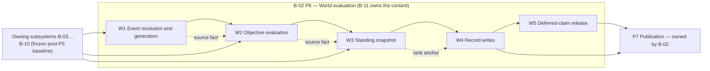
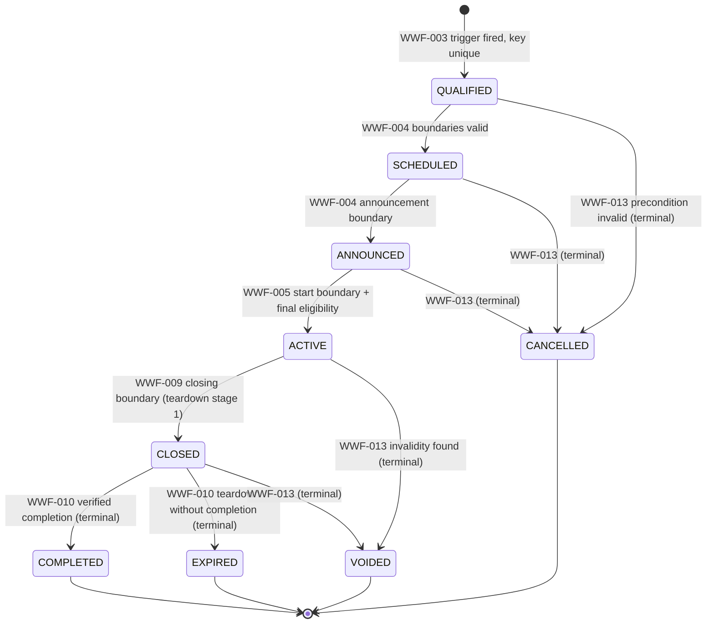
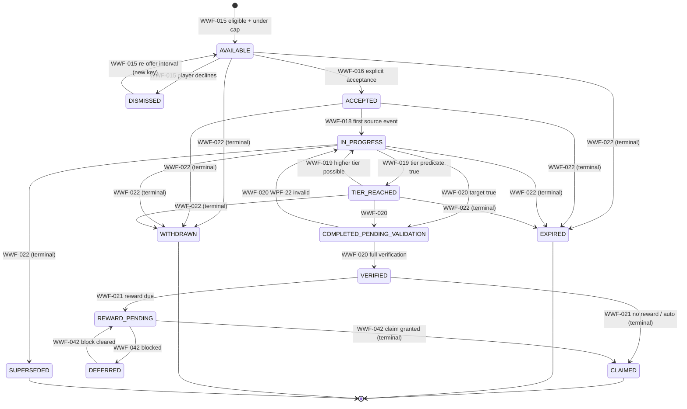
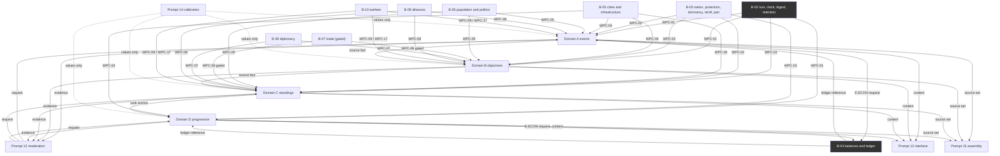

# B-11 — world events, objectives, rankings and progression: workflows, cross-system integration and acceptance

**Version:** 1.0 · **Created:** 2026-11-05 · **Completed:** 2026-11-06 · **Stage 2, Prompt 11C**
**Status:** **Acceptance specification — design only.** Every workflow, journey, edge case, threat and test below is a **specification artefact**. `Definition: COMPLETE` and `Execution: NOT RUN` are the only honest values anywhere in this document. **No test below has been executed as a runtime test.** Nothing here is release-approved, balanced, playtested, deployed or implemented. Specification acceptance and runtime implementation are separated throughout and are reconciled once, in §32 and §34.
**Authority:** [B-11](18_world_events_objectives_rankings_progression.md) **v1.0** owns the 723 `WEP-` rules; the [B-11 formula register](18_world_events_objectives_rankings_progression_formula_register.md) **v1.0** owns every calculation (50 `F-WEP-` IDs — 49 active, `F-WEP-048` retired). [B-02](07_core_gameplay_loop_symbolic_world_and_turn_system.md) owns the turn, the phases and P7 publication; [B-03](09_account_onboarding_nation_creation_and_progression.md) owns nation, protection, dormancy, retirement, reroll and pair states; [B-04](10_economy_resources_treasury_and_finances.md) owns balances and the ledger; [B-05](11_cities_infrastructure_production_and_research.md), [B-06](12_population_and_domestic_politics.md), [B-07](13_trade_and_markets.md), [B-08](15_diplomacy.md), [B-09](16_alliances.md) and [B-10](17_warfare_and_settlements.md) each own their own domain. **This document** owns the B-11 player journeys (`WJ-`), system workflows (`WWF-`), edge cases (`WEE-`), acceptance tests (`WTA-`), threats (`WTS-`), and the integration, ownership, gate and traceability ledgers. **It adds no mechanic, no value, no reward class, no punishment, no screen and no change to B-02…B-10.** Where a workflow and a rule disagree, B-11 wins and this document is corrected — `WEP-710`.
**Identifier spaces created by 11C:** `WJ-###` journeys · `WWF-###` workflows · `WEE-###` edge cases · `WTA-###` acceptance tests · `WTS-###` threats · `WEG-###` integration and specification gaps · `P11C-01`…`P11C-20` acceptance gates. Two ordinary decisions are recorded: **D-162 / DD-210**. Each was verified absent from the repository before adoption (§1.6).
**Preserved identifiers, unchanged:** `WEP-001`…`WEP-723` · `F-WEP-001`…`F-WEP-050` (49 active + the retired `F-WEP-048`) · `WPC-01`…`WPC-17` · `WPF-01`…`WPF-40` · `WPA-01`…`WPA-50` · `REQ-704`…`REQ-763` · `D-144`…`D-161` / `DD-192`…`DD-209` · `UD-024` (Resolved by `D-158`) · `UD-040`…`UD-049` (Open, owner-reserved) · `UD-050`, `UD-051` (Open, evidence) · `WAR-`, `ALL-`, `AX-`, `DIP-`, `DP-`, `MKT-`, `ECN-`, `URB-`, `DMP-`, `TR-`, `NAT-`, `ONB-`, `RRL-` as owned by their subsystems. `WRF-15`–`WRF-19` stay unallocated gaps and are not reused here.
**Companions:** [B-11 rulebook](18_world_events_objectives_rankings_progression.md) · [B-11 formula register](18_world_events_objectives_rankings_progression_formula_register.md) · [11B acceptance source](18_world_events_objectives_rankings_progression_acceptance_source.md) · [11B crosswalk](18_world_events_objectives_rankings_progression_acceptance_crosswalk.md) · [11A research](research/11A_world_events_objectives_rankings_progression_research.md) · [11A integration and risk registers](research/11A_integration_and_risk_registers.md) · [requirements](03_requirements_traceability.md) · [decisions](04_approved_and_provisional_decisions.md) · [unresolved decisions](05_unresolved_design_decisions.md) · [Stage 2 handoff](00_stage_2_handoff.md) · [prompt roadmap](01_stage_2_prompt_roadmap.md) · [progress log](06_stage_2_progress_log.md) · validator [`../qa_backups/11C_validate_b11_workflows.py`](../qa_backups/11C_validate_b11_workflows.py).

---

## 0. How to read this document

**0.1 What Prompt 11C is.** `WEP-703` defers to 11C the player journeys, the trigger-to-completion workflows, edge-case execution, concurrency and recovery workflows, the full acceptance matrix and workflow-level bidirectional traceability. `WEP-709` states the required products. This document discharges those two rules and nothing else.

**0.2 What it is not.** Not an implementation plan with a chosen technology. Not a database schema. Not an API definition. Not a screen design (`WEP-633` assigns that to Prompt 13). Not a moderation policy (`WEP-632` assigns enforcement to Prompt 12). Not a calibration document (`WEP-634` assigns numbers to Prompt 14). Not a security audit of running software — no running software exists.

**0.3 The one-sentence contract for a developer.** Implement exactly what `WEP-001`…`WEP-723` say, sequenced as the `WWF-` workflows say, verified by the `WTA-` tests, and stop at any `BLOCKED` row until the named owner decision exists. If this document and the rulebook disagree, the rulebook wins.

**0.4 Status vocabulary.** Used with the exact meanings below and checked by the validator.

| Term | Meaning in this document |
|---|---|
| **Specified** | A rule or workflow exists in a canonical document. |
| **Test-designed** | A `WTA-` row states a reproducible test. It has **not** been executed. |
| **Document-checked** | A Python validator in `docs/qa_backups/` inspected the text and its cross-references. |
| **Runtime-tested** | **Never claimed.** No game code exists. |
| `Definition: COMPLETE` | The test row is fully written. |
| `Execution: NOT RUN` | No build has ever executed it. The only permitted execution value today. |
| Gate `PASS` | Documentary evidence exists, resolves, and demonstrates the criterion. |
| Gate `PARTIAL` | Partly evidenced; the missing element is named. |
| Gate `FAIL` | The evidence contradicts the criterion. |
| Gate `BLOCKED` | An owner decision or an unavailable dependency prevents assessment. |
| Gate `NOT RUN` | No assessment was performed; the reason is named. |
| Gate `NOT APPLICABLE` | The criterion does not apply; the reason is named. |

**0.5 Fixed constraints this document may not vary.** (1) Documentation only — no code, migration, deployment or hosting change. (2) No provisional value is promoted; `F-WEP-011`, `F-WEP-021`, `F-WEP-029`, `F-WEP-030`, `F-WEP-033` and `F-WEP-046` stay Provisional and Prompt 14 owns them (`WEP-588`, `WEP-700`). (3) `F-WEP-048` stays retired and unused (`WEP-683`). (4) The six reward classes are exactly `RECOGNITION`, `RECORD`, `AUTHORSHIP`, `COSMETIC`, `TITLE`, `MATERIAL` (`WEP-499`). (5) No owner-reserved decision is resolved: `UD-040`…`UD-049`, plus `UD-017`, stay Open (`WEP-697`). (6) Global Trade gates `G-1`…`G-3`, `G-5`, `G-6` stay not met and `G-4` partial; no rule lifts them (`WEP-062`, `WEP-716`). (7) `k = 5` is the only privacy threshold (`WEP-069`, `WEP-659`). (8) No new `WPF-` code, `WPA-` event, event class, objective category, standing, progression layer or honour class is invented (`WEP-071`, `WEP-203`, `WEP-326`, `WEP-423`, `WEP-497`, `WEP-674`). (9) Git state is untouched: no commit, checkpoint, staging or cleanup is part of this prompt.

**0.6 Prefix adoption record.** Before adoption, `WJ-`, `WWF-`, `WEE-`, `WTA-`, `WTS-`, `WEG-`, `WIG-` and `P11C-` were searched across `docs/` and `prototypes/` and returned zero existing uses. `WIG-` was then **not** adopted: every genuine B-11 integration already has a `WPC-` contract, and creating a parallel contract namespace would duplicate an existing identifier space, which §13 forbids (D-162 / DD-210 record the same no-extension discipline on the failure-code side). `WIG-` therefore remains unallocated and may not be used by any workflow, test or implementation.

---

## 1. Source inventory and authority

**1.1 Documents read in full for this pass.** [B-11 rulebook](18_world_events_objectives_rankings_progression.md) (723 rules, 29 sections); [B-11 formula register](18_world_events_objectives_rankings_progression_formula_register.md) (50 IDs, 20 mandatory fields each); [11B acceptance source](18_world_events_objectives_rankings_progression_acceptance_source.md); [11B crosswalk](18_world_events_objectives_rankings_progression_acceptance_crosswalk.md) (52 gates); [11A integration and risk registers](research/11A_integration_and_risk_registers.md) (40 `11A-INT` rows, 28 `11A-RK` risks, 30 `11A-CR` candidates, 16 `11A-OPEN`); [requirements](03_requirements_traceability.md) (`REQ-704`…`REQ-763`, each pre-assigned to an 11C validation family); [unresolved decisions](05_unresolved_design_decisions.md) (`UD-050`, `UD-051` rows); [B-02 turn system](07_core_gameplay_loop_symbolic_world_and_turn_system.md); [B-03](09_account_onboarding_nation_creation_and_progression.md); [B-04](10_economy_resources_treasury_and_finances.md); the four prior workflows-and-acceptance companions [14](14_market_workflows_and_acceptance.md), [15](15_diplomacy_workflows_acceptance.md), [16](16_alliances_workflows_acceptance.md), [17](17_warfare_workflows_acceptance.md); [stage-1/08 security report](../stage-1/08_security_privacy_fair_play_and_trust.md) (`TH-`, `SEC-`, `ST-`); [stage-1/11](../stage-1/11_free_tier_feasibility_results.md) and [stage-1/12](../stage-1/12_nation_supremacy_deployment_and_resource_separation.md) (prototype permission evidence); the `prototypes/supabase-feasibility/migrations/` SQL.

**1.2 Source-of-truth hierarchy applied.** (1) owner-fixed Category A constraints and owner-reserved decisions; (2) accepted B-02…B-10 rules; (3) approved B-11 decisions `D-144`…`D-161` and `DD-192`…`DD-209`; (4) approved requirements and formula registers; (5) approved integration contracts `WPC-01`…`WPC-17`; (6) this workflow and acceptance layer; (7) prototype and implementation evidence; (8) research and recommendations. `WEP-006` fixes the same order inside B-11; this document sits at level 6 and never overrides levels 1–5.

**1.3 A prototype never overrides a specification.** The Supabase feasibility prototype (§16.6) is level-7 evidence. Its observed permission behaviour is reported as what it *is*; it does not authorise a B-11 rule and does not launder a B-11 defect.

**1.4 Contradictions found in the sources.** Three were found; none is resolved by inventing a gameplay rule.

| # | Conflict | Location A | Location B | Disposition |
|---|---|---|---|---|
| 1 | The B-11 rulebook states "49 active, 1 retired" in the status surfaces while §4.1 of the Prompt 11C brief states **43 active Structural / 6 Provisional / 1 Retired**. | [formula register §1 counts](18_world_events_objectives_rankings_progression_formula_register.md) | brief §4.1 | **No conflict once read against the register.** "49 active + 1 retired" counts IDs; "43 structural + 6 provisional" classifies the 49 active ones by field 20. Both are in the same register line and both are preserved verbatim here. `B11-53` derives them from field 20. |
| 2 | The rulebook's closed code set `WPF-01`…`WPF-40` (`WEP-674`) contains no code for **"the actor is not authorised"**, which `WEP-656` requires to be refused. Prose demands a refusal; the register offers no dedicated code. | `WEP-656` | `WEP-669`, `WEP-674` | **Existing approved intent resolves the refusal, not the code.** `WEP-113`/`WEP-569` (a transition writes exactly one mutation or none), `WPF-13` (invalid transition, "That action is not possible now") and `WPA-50` `SECURITY_BLOCK_RECORDED` together specify the behaviour. 11C reuses them (§19.4) and registers the missing distinct code as gap **`WEG-01`** for the rulebook's owner to decide. No code is invented. The choice is recorded as **D-162 / DD-210**. |
| 3 | The Prompt 11C brief §4.5 calls the Supabase profile-UPDATE behaviour a known defect; [Report 11 §16](../stage-1/11_free_tier_feasibility_results.md) and [Report 12 §4](../stage-1/12_nation_supremacy_deployment_and_resource_separation.md) both record "8/8 permission checks passed" and "a signed-in player cannot move a treasury". | migrations `0001_schema.sql:70-76`, `0003_grants_and_rls.sql:14` | stage-1 Reports 11 and 12 | **Both are true and they do not contradict.** The tested denial is `nations.treasury` (table-level grant denied). The `feasibility.profiles` table carries its own `treasury bigint` column with `grant update … to authenticated` and a **row-scoped** policy. 11C states the architectural implication in §16.6 and refuses to describe the prototype as security-verified. Reports 11/12 are historical measurement records and are not rewritten. |

**1.5 What 11C received (`WEP-708`).** Four domain rule families; twelve state machines with their invalid transitions; the event taxonomy (4 classes × 5 triggers) and the closed effect catalogue (`E-INFO`, `E-OBJ`, `E-RANK`, `E-ACH`, `E-HIST`, `E-ECON`, `E-POL`); twelve objective categories and the thirteen-state objective lifecycle; ten standings plus `WSE`; eight progression layers; six reward classes and five recognition objects; the P6 `W1→W2→W3→W4→W5` order and P7 publication; `WPC-01`…`WPC-17`; forty `WPF-` codes; fifty `WPA-` events; the visibility matrix; 50 formula IDs; the provisional parameter list; and `UD-050`/`UD-051`.

**1.6 Formula classification carried forward, unaltered.**

| Classification | Count | IDs |
|---|---|---|
| Formula IDs total | 50 | `F-WEP-001`…`F-WEP-050` |
| Active | 49 | all but `F-WEP-048` |
| Retired | 1 | `F-WEP-048` (contribution allocation — no lawful use case) |
| Active **Structural** | 43 | the register's field-20 `Structural` rows |
| …of which contain a Prompt 14 parameter | 20 | `F-WEP-003`, `004`, `005`, `007`, `009`, `010`, `012`, `015`, `016`, `019`, `024`, `025`, `031`, `034`, `035`, `036`, `040`, `042`, `043`, `050` |
| …of which contain none | 23 | the remaining structural rows |
| **Provisional** | 6 | `F-WEP-011`, `F-WEP-021`, `F-WEP-029`, `F-WEP-030`, `F-WEP-033`, `F-WEP-046` |

No 11C workflow, test or gate promotes a Provisional formula, and no 11C row calibrates a number. Prompt 14 retains sole ownership (`WEP-706`).

---

## 2. System overview

**2.1 Four domains, one model.** `WEP-039` fixes Domain A (events), Domain B (objectives), Domain C (standings), Domain D (progression) inside one architecture with one data-ownership model, one eligibility model and one P6 evaluation order.

**2.2 The order is normative, not a suggestion.** `WEP-050`/`WEP-606` fix it; `WEP-608` forbids reading a later step early: W1 must not read W2 results, W2 must not read W3 ranks, W3 must not read W4 grants, W4 must not read W5 releases. A rule that needs a later result defers it to the next turn. Every workflow in §6–§10 is written against this constraint, and `WTA-140`…`WTA-143` exist specifically to break it.

**2.3 Nothing is visible before P7.** `WEP-610`/`WEP-571`. A sealed `W3` snapshot is system-visible only; a `CLOSED` instance is not a published result; a `COMPLETED_PENDING_VALIDATION` objective grants nothing. This is a hard presentation rule and drives the journey terminal states in §5.

**2.4 B-11 writes its own records and requests everyone else's.** `WEP-165` and the ownership matrix (`WEP-595`, reproduced and extended in §13) mean: B-04 writes the ledger, B-05 writes infrastructure, B-06 writes political terms, B-10 writes campaign records, B-02 writes the digest and owns retention, B-03 owns identity and eligibility states. B-11 stores a **reference and a derived result**, never a shadow copy (`WEP-045`, `WEP-596`).

**2.5 Fail closed, always.** `WEP-048`. Missing, stale, ambiguous or baseline-inconsistent input produces a `WPF-` code, releases a reservation only where the code says so, writes no partial record and changes no state. `WEP-569` generalises it to every transition.

**2.6 Twelve state machines.** `WEP-567` names them; `WEP-572` states that the listed invalid transitions are exhaustive and that **an unlisted transition is also invalid** — the tables permit only what they list. §11 restates each machine as an executable transition table with the workflow that owns each row.

**2.7 What B-11 may never do.** Derived from the Category A block (`WEP-055`…`WEP-070`) and restated here as implementation stop-lines: no second scheduler and no minute-based window (`WEP-005`); no presence requirement, streak or login reward (`WEP-056`); no loss through absence (`WEP-057`); no hostile use against a protected nation (`WEP-058`); no discretionary action on a player's behalf (`WEP-059`, `WEP-014`); no second active nation on one account (`WEP-060`); no age, tenure, purchase or alliance-membership merit (`WEP-061`); no trade statistic before the gate (`WEP-062`); no direct `approval` or `leadership_state` write (`WEP-063`); no city or facility damage (`WEP-064`); no exact military value (`WEP-065`); no Alliance military power, member-funded prize or binding order (`WEP-066`); no OP grant, refund, conversion or transfer (`WEP-067`); nothing purchasable (`WEP-068`); no second privacy threshold (`WEP-069`).

---

## 3. Actors and permission model

**3.1 Actor inventory.** These are the only actors B-11 recognises. No new role is created by this document.

| Actor | Symbol in this document | Authority in B-11 | Explicitly not permitted |
|---|---|---|---|
| Nation owner (player) | `PLAYER(nation)` | Accept, dismiss, withdraw, claim, create a challenge — **for their own nation only** (`WEP-656`) | Force a system transition; write a grant, a snapshot, an eligibility state or another nation's record |
| Another nation | `OTHER` | Reads published aggregates and public snapshots | Any write; any read of a private offer, progress or reward |
| Alliance officer | `OFFICER` | B-09 permissions only; sees a member's own contribution where B-09 allows | Create or alter an event, fund a prize, command, or read a non-member value |
| Turn engine (system) | `SYS(P6)` | The sole initiator of system state transitions (`WEP-111`) | Exercise a discretionary player choice (`WEP-014`, `WEP-059`) |
| Definition authority | `AUTH` | Publish, supersede and retire a **definition version** outside the turn (`WEP-573`, `WEP-576`, step `W0`) | Mutate an instance, a result, a snapshot or a grant |
| Operator / administrator | `ADMIN` | Read the operator console (`WEP-673`); request a suspension through the registered evidence path (`WEP-111`) | **Write a grant or a snapshot** — corrections use the correction path only (`WEP-656`, `WEP-200`) |
| Moderator (Prompt 12) | `MOD` | Hold, suspend, disqualify, invalidate a grant **on evidence** | Be enacted by B-11 as a punishment (`WEP-400`, `WEP-655`) |
| Owning subsystem | `OWNER(B-04…B-10)` | Mutate its own field on a validated B-11 request (`WEP-165`) | Be bypassed by a direct B-11 write (`WEP-597`) |
| B-02 retention/recovery job | `SYS(B-02)` | Own compaction, the recovery scheduler and the checkpoints (`WEP-615`) | Re-run a completed B-11 W-step for a new grant |

**3.2 Permission matrix — who may cause which transition.** Derived directly from `WEP-111`, `WEP-248` and `WEP-656`; a cell marked ✗ is refused with `WPF-13` and recorded with `WPA-50`.

| Action | `PLAYER` | `AUTH` | `SYS(P6)` | `ADMIN` | `MOD` | `OWNER` |
|---|---|---|---|---|---|---|
| Publish / supersede / retire a definition version | ✗ | ✓ (W0) | ✗ | ✗ | ✗ | ✗ |
| Generate or qualify an event instance | ✗ | ✗ | ✓ W1 | ✗ | ✗ | ✗ |
| Advance an event instance state | ✗ | ✗ | ✓ W1 | ✗ | ✗ | ✗ |
| Join / withdraw from an instance (own nation) | ✓ | ✗ | ✗ | ✗ | ✗ | ✗ |
| Create a challenge | ✓ | ✗ | ✗ | ✗ | ✗ | ✗ |
| Accept / dismiss an objective offer (own nation) | ✓ | ✗ | ✗ | ✗ | ✗ | ✗ |
| Record objective progress, tier, expiry, withdrawal, supersession | ✗ | ✗ | ✓ W2 | ✗ | ✗ | ✗ |
| Verify a completion | ✗ | ✗ | ✓ W2 | ✗ | ✗ | ✗ |
| Seal / publish a snapshot | ✗ | ✗ | ✓ W3 / P7 | ✗ | ✗ | ✗ |
| Grant an achievement, milestone, honour | ✗ | ✗ | ✓ W4 | ✗ | ✗ | ✗ |
| Claim a discretionary reward | ✓ | ✗ | ✗ | ✗ | ✗ | ✗ |
| Auto-grant a recognition or record reward | ✗ | ✗ | ✓ W4/W5 | ✗ | ✗ | ✗ |
| Release a deferred claim | ✗ | ✗ | ✓ W5 | ✗ | ✗ | ✗ |
| Suspend / disqualify a participant | ✗ | ✗ | on `MOD` evidence | ✗ | request | ✗ |
| Append a correction to a published record | ✗ | ✗ | ✓ (own defect) | ✗ | ✓ (invalid grant) | ✓ (source defect) (`WEP-494`) |
| Mutate a B-04…B-10 field | ✗ | ✗ | ✗ | ✗ | ✗ | ✓ (`WEP-165`) |

**3.3 Sovereignty rule.** `WEP-014` and `WEP-059` are the spine of the whole objective and reward design: **silence is never consent**. No notification delivery, digest line, timer, default or prior participation may accept an objective, join an event, choose a reward, accept a treaty, spend treasury or claim a discretionary reward. `WEP-253` and `WEP-263` restate it at the transition level, and `WEP-536` forbids even a satisfied-condition auto-claim of a material reward, a title or an authorship unlock. Tests `WTA-090`…`WTA-094` exist to prove this cannot be bypassed.

**3.4 Scope split.** `WEP-031`/`WEP-443`/`WEP-496`: nation-scope objects are forfeited on reroll and retained as history; account-scope objects survive a reroll only when non-transferable **and** not re-earnable, and may never carry a material reward a replacement nation could use (`WEP-496`). Eligibility attaches to the nation, not the account (`WEP-138`).

**3.5 Permission changes during an active workflow.** `WEP-142` revalidates eligibility at six boundaries — qualification, announcement, activation, participation acceptance, completion verification and reward grant — and a cached result is never authoritative across a boundary (`WEP-558`). `WEP-141`/`WEP-153` decide the outcome: an existing participant is **not** removed for a later eligibility change except dormancy (presentation only), retirement (record retained) or a Prompt 12 suspension, and earned progress is never confiscated. `WEP-143`/`WEP-315` forbid punishing a player for a system-side change.

**3.6 Revoked or moved authority.** A revoked session cannot carry a pending discretionary action, because acceptance requires a **recorded player action** (`WEP-147`, `WEP-235`) validated at the boundary it takes effect. A nation whose ownership changes is handled by B-03; B-11 stores only the reference and re-reads it (`WEP-596`). There is no delegation of a B-11 action to an officer, an alliance or an automated agent (`WEP-059`; `WEP-262` forbids making membership a requirement).

## 4. Canonical semantics every workflow inherits

**4.1 The five identity keys.** `WEP-641` is the normative key table. Every workflow below states which key it consumes; no workflow may invent one.

| Key | Form | Uniqueness scope | Duplicate behaviour | Rule |
|---|---|---|---|---|
| Occurrence key | `hash(definition_id, definition_version, discriminator)` | one event instance | return existing, `WPA-25` | `WEP-087`, `WEP-115` |
| Participation key | `(instance_id, nation_id)` | one instance | return existing, `WPF-14`/`WPA-27` | `WEP-151`, `WEP-152` |
| Objective-instance key | `(definition_id, version, nation_id, offer_ordinal)` | nation + definition | return existing | `WEP-641` |
| Progress key | `(objective_instance_id, tier_id, source_event_key)` | instance + tier | reject, `WPF-21` | `WEP-265`, `WEP-272` |
| Completion key | `(instance_id, completion_ordinal)` | instance | return existing, `WPA-28` | `WEP-297`, `WEP-313` |
| Achievement key | `(nation_id, achievement_id, achievement_version, scope_key, tier_id)` | nation + object | return existing, `WPA-28` | `WEP-033`, `WEP-042` |
| Snapshot key | `(turn_id, standing_id)` | turn + standing | return sealed, `WPA-29` | `WEP-381`, `WEP-390` |
| Reward key | `achievement_key + reward_id` | nation + object | return existing, `WPA-30` | `WEP-510`, `WEP-524` |
| Season key | `(season_id, transition)` | season | return existing | `WEP-641` |
| Correction key | `(corrects_record_id, correction_seq)` | record | return existing | `WEP-038`, `WEP-641` |

**4.2 Fingerprint.** `WEP-034`: the frozen hash of the authoritative input set, recorded with every snapshot, progress record and grant. A replay with the same inputs and the same fingerprint **MUST** produce the same result; a mismatch is an integrity failure (`WEP-646`), the artefact is withheld and investigated, and nothing is published.

**4.3 Time is turns or named boundaries only.** `WEP-005`, `WEP-226`, `WEP-528`, `WEP-609`, `WEP-299`. A rule expressed in minutes is invalid. This is not stylistic: it is the anti-manipulation control behind `WEP-410` and `WEP-056`, because a wall-clock window would reward presence.

**4.4 Determinism.** `WEP-035`, `WEP-118`, `F-WEP-000d`. No B-11 calculation reads wall-clock time, login state, latency, request arrival order or environment entropy. The only permitted randomness is a seeded lottery over **equal, eligible** candidates, keyed `(turn_id, allocation_id)`, with published odds (`WEP-126`, `WEP-127`, `WEP-130`, `F-WEP-000e`).

**4.5 Recognition objects and reward classes stay distinct.** Five recognition objects (`WEP-025`): achievement, milestone, seasonal award, historical honour, standing. Six reward classes (`WEP-499`): `RECOGNITION`, `RECORD`, `AUTHORSHIP`, `COSMETIC`, `TITLE`, `MATERIAL`. One verified completion may emit several objects (`WEP-488`) and each has its own key, but **only one material grant may attach to one fact** (`WEP-556`), and the material grant is the single ledgered one (`WEP-504`, `WEP-549`). A journey that conflates an object with a reward class is a defect.

**4.6 Withheld, coarsened, `k = 5`.** `WEP-036`, `WEP-037`, `WEP-044`, `WEP-069`, `WEP-659`…`WEP-650`. Publication of an aggregate figure requires at least five contributing entities; complementary suppression applies to the published **set**, not only to the individual figure; cross-turn and cross-table differencing that isolates a nation below `k` is prohibited. A nation's **own** public rank is not an aggregate (`WEP-660`).

**4.7 Append-only records and corrections.** `WEP-043`, `WEP-038`, `WEP-197`, `WEP-200`, `WEP-495`, `WEP-583`. Nothing published is edited or deleted in place. `class P` = permanent (event, objective, standing, achievement, honour records — `WEP-680`); `class S` = routine lines that compact under B-02's job. A correction appends and marks the original `corrected_by`; a redaction is a disclosed overlay.

**4.8 Retired formula.** `F-WEP-048` (contribution allocation) is retired with no lawful use case (`WEP-683`). No workflow, test, journey, integration row or implementation instruction below may execute it, cite it as a calculation, or reintroduce a proportional collective material allocation, an Alliance-funded collective prize, an inter-nation prize pool, or any alternative contribution-allocation mechanism that routes around `WEP-066`, `WEP-541` and `ALL-224`. `WTA-005`, `WTA-105` and validator check `11C-24` enforce this.

**4.9 Provisional formulas are not approved.** The six Provisional rows in §1.6 are used by the workflows that need them, always with the label. No workflow may treat a Provisional formula as settled, and no gate may read a Provisional value as calibrated (`WEP-588`, `WEP-702`, `WEP-721`).

**4.10 Atomic operation set.** `WEP-643` names the seven operations that are one transaction: objective completion + recognition; achievement grant + reward entitlement; reward grant + ledger event; snapshot seal + rank order; event completion + result + reward record; season close + reset + archive; correction + reference. `WEP-530` adds the failure form: if any part fails, none applies, and B-11 records `DEFERRED` with the code.

---

## 5. Player and operator journeys

Every journey is written to the seventeen-field form required by this prompt. A journey names its entry condition, its terminal state, and the rules that authorise every step; nothing in a journey is invented behaviour.

### 5.1 Domain A — World Events

**WJ-001 — Discover, read, join and complete a world-scope state event.**

| Field | Content |
|---|---|
| Journey ID | `WJ-001` |
| Actor | `PLAYER(nation)` with a nation past its first completed boundary |
| Goal | Reach `COMPLETED` on one `EV-STATE`/`WORLD` instance and see the verified result and any earned recognition after P7 |
| Entry condition | P6 W1 qualifies an `EV-STATE` instance whose trigger is a published `WORLD_STATE` threshold crossing (`WEP-074`, `WEP-119`, `WEP-120`) |
| Preconditions | Definition in `TEMPLATE_PUBLISHED` with a complete field set and an inertness statement (`WEP-083`, `WEP-180`); nation is neither dormant nor retired (`WEP-136`, `WEP-137`); participation requires a discretionary commitment, so the event is **not** auto-joined (`WEP-145`) |
| Main flow | 1 W1 qualifies the instance and pins the definition version (`WEP-088`). 2 W1 schedules start, closing and teardown boundaries (`WEP-101`, `WEP-185`). 3 W1 announces into the bounded digest at the announcement boundary (`WEP-102`, `WEP-611`). 4 The player reads the rules, eligibility, timing, effect list and reward classes — information only (`WEP-154`). 5 At the start boundary W1 performs the final eligibility check and activates (`WEP-103`, `WEP-142`). 6 The player sends an explicit join; W1 writes the participation record with the acceptance key (`WEP-147`). 7 Ordinary play produces authoritative source facts in B-04…B-10. 8 W2 credits `E-OBJ` progress only through the keyed progress record (`WEP-159`, `WEP-265`). 9 At the closing boundary W1 moves the instance to `CLOSED`; accepted in-flight actions may still resolve (`WEP-104`, `WEP-185`). 10 At the teardown boundary W1 re-reads the authoritative source, checks the fingerprint and verifies the completion predicate (`WEP-181`, `WEP-182`). 11 `COMPLETED` with result and non-material rewards final (`WEP-105`). 12 W4 writes the recognition records; W5 releases any entitlement (`WEP-606`). 13 P7 publishes the digest, the record and any standing entry (`WEP-610`) |
| Alternate flow | Informational or recognition-only events may include an eligible nation automatically (`WEP-145`); a player who never joins sees the announcement and the public result and is recorded as a spectator, never a participant (`WEP-519`); a tiered definition may award a partial tier without blocking a later tier (`WEP-183`) |
| Failure flow | Ineligible join → `WPF-08`, no state change, reservation released (`WEP-144`); join after the freeze → `WPF-15`, nothing moves (`WEP-155`); second participation on the instance → `WPF-14`, existing record returned (`WEP-151`); completion cannot be verified → stays `CLOSED`, `WPF-18`, no false completion (`WEP-182`) |
| State transitions | Instance `QUALIFIED → SCHEDULED → ANNOUNCED → ACTIVE → CLOSED → COMPLETED`; participation `NOT_JOINED → JOINED → COMPLETED`; terminal state `COMPLETED` (one of four terminal instance states, `WEP-099`) |
| Data involved | Event definition version; event instance; occurrence key; eligibility-set fingerprint; participation record; progress records; result record; recognition records; class-P event history (`WEP-086`, `WEP-194`) |
| System dependencies | B-02 (P6 phase, P7 digest, retention — `WPC-01`, `WPC-10`); B-03 (protection, dormancy, retirement — `WPC-02`); the owning subsystem of every effect (`WPC-03`…`WPC-09`); `F-WEP-001`, `002`, `005`, `006`, `010`, `012` |
| Security checks | Server-authoritative action; nation ownership; participation key uniqueness; eligibility revalidated at six boundaries; frozen baseline and fingerprint; effect validation before mutation (`WEP-142`, `WEP-167`, `WEP-656`) |
| Notifications | Existing bounded digest only; announcement is information, not consent; no second notification channel (`WEP-102`, `WEP-611`) |
| Audit records | `WPA-04`, `WPA-05`, `WPA-06`, `WPA-07`, `WPA-14`, `WPA-08`, `WPA-09` per effect, `WPA-10`, `WPA-41` per eligibility evaluation, `WPA-48` |
| Recovery behaviour | An interruption in W1 resumes from the last completed W-step checkpoint; a completed transition is not repeated and an interrupted one is re-evaluated idempotently (`WEP-187`, `WEP-570`, `WEP-613`); a `WPF-09` close failure retries next turn keeping `ACTIVE` (`WEP-669`) |
| Requirements | `REQ-704`, `REQ-705`, `REQ-706`, `REQ-708`, `REQ-710`, `REQ-736`, `REQ-737`, `REQ-738`, `REQ-739`, `REQ-741`, `REQ-761` |
| Tests | `WTA-001`…`WTA-004`, `WTA-012`, `WTA-030`, `WTA-050`, `WTA-060`, `WTA-090`, `WTA-120`, `WTA-140` |

**WJ-002 — Seasonal calendar event and season rollover.**

| Field | Content |
|---|---|
| Journey ID | `WJ-002` |
| Actor | `SYS(P6)` for the transition; `PLAYER(nation)` as a seasonal participant |
| Goal | A season opens, a seasonal `EV-CAL` instance runs against a `season_id`, and the season closes atomically with the champion recorded permanently and seasonal progress reset |
| Entry condition | A `SCHEDULED_INSTANT` trigger derived from the world clock (`WEP-073`, `WEP-080`, `WEP-121`); the season open boundary (`WEP-471`) |
| Preconditions | Season stored as identifier plus opening and closing boundaries only — no world instance, no parallel national state (`WEP-474`, `WEP-082`); a nation is a seasonal participant when eligible at the opening boundary and not dormant or retired (`WEP-140`); joining needs no acceptance because a season is a standing window, not a discretionary commitment (`WEP-140`) |
| Main flow | 1 `SEASON_SCHEDULED`. 2 At the opening boundary the season goes `SEASON_OPEN` and writes `WPA-39`. 3 W1 generates the seasonal instance with the occurrence key carrying the boundary slot (`WEP-087`). 4 Seasonal objective progress accrues under `WEP-214` scoped to `season_id`. 5 The seasonal standing derives from the in-season turn snapshots, not live state (`WEP-414`, `WEP-385`). 6 At the closing boundary the close is one atomic transition (`WEP-471`). 7 Only seasonal standings and seasonal objective progress reset (`WEP-415`, `WEP-466`). 8 The champion is written as a permanent honour with the season ID, the standing, the date and the final result (`WEP-416`). 9 `SEASON_ARCHIVED` stores the final standing, champion, definition version and participating population (`WEP-470`). 10 P7 publishes; event history survives the season (`WEP-201`) |
| Alternate flow | A non-participating nation simply sees the rollover announcement; a cross-season comparison is labelled a record comparison, not a standing, and displays the definition version (`WEP-422`) |
| Failure flow | An interrupted close resumes from the checkpoint and never half-resets — either the whole seasonal scope resets or none of it does (`WEP-475`); a rule that would erase a chronicle entry, event record, achievement or milestone is invalid, not a failure (`WEP-420`); `SEASON_CLOSED → SEASON_OPEN` on the same season ID is invalid (`WEP-581`) |
| State transitions | Season `SEASON_SCHEDULED → SEASON_OPEN → SEASON_CLOSED → SEASON_ARCHIVED` (terminal); instance states as in `WJ-001`; **no** national-state transition occurs |
| Data involved | Season identifier and boundaries; seasonal instance; seasonal progress records; in-season snapshots; champion honour; season archive header |
| System dependencies | B-02 clock and retention (`WPC-01`, `WPC-10`); B-11 Domain C and D; `F-WEP-043`, `F-WEP-021` (Provisional weights), `F-WEP-025` |
| Security checks | Atomicity of the close (`WEP-643`); no seasonal state reset of cities, infrastructure, population, treasury, research, diplomacy, alliance or military state (`WEP-421`, `WEP-476`); no carryover unless a definition declares it with a cap, default zero (`WEP-472`) |
| Notifications | Bounded digest rollover line only |
| Audit records | `WPA-39`, `WPA-05`, `WPA-06`, `WPA-08`, `WPA-10`, `WPA-48` |
| Recovery behaviour | Resume from last checkpoint; a replay of the same `(season_id, transition)` returns the existing record (`WEP-641`) |
| Requirements | `REQ-725`, `REQ-744`, `REQ-753`, `REQ-729`, `REQ-761` |
| Tests | `WTA-031`, `WTA-032`, `WTA-100`, `WTA-101`, `WTA-144`, `WTA-155` |

**WJ-003 — Challenge creation, reservation, claim, expiry and release.**

| Field | Content |
|---|---|
| Journey ID | `WJ-003` |
| Actor | `PLAYER(nation)` as creator; `PLAYER(counterparty)` as claimant |
| Goal | A player-created `EV-CHAL` object runs to a claimed outcome or to `EXPIRED`, with the stake released in every non-claim branch and never silently forfeited |
| Entry condition | `PLAYER_INITIATED` trigger (`WEP-080`, `WEP-075`) |
| Preconditions | Definition declares target condition, counterparty, reserved stake, expiry boundary, independence proof requirement, no-self-claim rule and release rule (`WEP-091`); creator is neither the claimant nor a restricted pair of the claimant; no identical active triple exists (`WEP-096`); a challenge is never a world event and never binds a third party who did not accept it (`WEP-075`) |
| Main flow | 1 Creation validates the triple and calls the owning subsystem's existing reservation mechanism to reserve the stake (`WEP-092`, `WEP-546`). 2 The instance is generated with the challenge ID as the occurrence discriminator (`WEP-087`). 3 The counterparty is informed through the digest; information is not consent (`WEP-154`). 4 Before any claim is credited, W1 records the pair-state check and the declared-relationship check (`WEP-094`). 5 The claimant performs an explicit action; the claim is keyed. 6 Completion verifies the source fact and the keys (`WEP-182`). 7 The stake resolves as a disclosed, keyed, ledgered material reward through B-04's `REWARD` path or the reservation is released (`WEP-163`, `WEP-092`) |
| Alternate flow | The counterparty ignores the challenge: expiry at the stated boundary releases the reservation and records `EXPIRED`; expiry is not a penalty and progress records remain (`WEP-106`, `WEP-093`); the creator may withdraw, releasing the stake |
| Failure flow | Self-claim or restricted-pair claim → `WPF-10`, no claim, reservation released (`WEP-094`); a duplicate identical active challenge → `WPF-11` (`WEP-096`); a challenge that would move value between restricted parties or around the trade gate, protection, pair restrictions, the Global Trade gate or the attack-prevention layers is **invalid** and is not created (`WEP-075`, `WEP-095`); a retroactive extension by the creator is refused (`WEP-093`) |
| State transitions | `QUALIFIED → ACTIVE → CLOSED → COMPLETED` on a claim, or `ACTIVE → CLOSED → EXPIRED`; `QUALIFIED/SCHEDULED → CANCELLED` if invalid before activation (`WEP-574`) |
| Data involved | Challenge definition; challenge ID as discriminator; reservation reference; independence-proof record; claim record; release record |
| System dependencies | B-04 or the owning subsystem for the reservation (`WPC-03`); B-03 pair and protection state (`WPC-02`, `WPC-12`); Prompt 12 owns collusion enforcement (`WPC-13`) |
| Security checks | Independence proof **before** credit; no transfer-channel use; reservation released on every non-claim exit; the stake is never a B-11 balance (`WEP-546`) |
| Notifications | Digest notice to the counterparty; no broadcast of a private challenge (`WEP-662` — challenge participant lists are parties-only) |
| Audit records | `WPA-04`, `WPA-07`, `WPA-14`, `WPA-09`, `WPA-10` or `WPA-11`, `WPA-50` on a refused claim |
| Recovery behaviour | Idempotent claim key; a replay returns the original outcome; a crash between reservation and instance write is caught by the atomicity rule and reserves nothing |
| Requirements | `REQ-711`, `REQ-706`, `REQ-709`, `REQ-730`, `REQ-763` |
| Tests | `WTA-013`…`WTA-016`, `WTA-061`, `WTA-091`, `WTA-106`, `WTA-117` |

**WJ-004 — Commemorative world anchor and a disclosed first-N honour.**

| Field | Content |
|---|---|
| Journey ID | `WJ-004` |
| Actor | `SYS(P6)`; `PLAYER(nation)` as the anchor nation |
| Goal | A `WORLD_ANCHOR` `EV-COMM` occurrence creates a permanent honour and one chronicle entry, and a disclosed first-N honour is granted only inside its published closure |
| Entry condition | A one-time world-state anchor fires (`WEP-076`, `WEP-080`, `WEP-097`) |
| Preconditions | The definition declares the world-state predicate, the once-only anchor, the honour class and the closed-eligibility policy, and records whether the honour is world-state-triggered or disclosed first-N (`WEP-097`); a first-N honour may be granted only if the N, the window and the start boundary were published **before** the first grant (`WEP-098`, `WEP-464`) |
| Main flow | 1 W1 detects the anchor predicate against the frozen baseline. 2 The instance qualifies once; the occurrence key retires the key for non-recurring definitions (`WEP-122`). 3 The honour is granted with `honour_key` and its inertness statement (`WEP-463`, `WEP-493`). 4 `E-HIST` writes a class-P chronicle entry with instance, version, participants drawn from public data, result and turn (`WEP-162`, `WEP-681`). 5 W4 writes the record; P7 publishes |
| Alternate flow | A world-state anchor (always attainable in principle) is preferred over first-N; a new nation can still attain every permanent honour class except a disclosed first-N (`WEP-481`) |
| Failure flow | A closed honour that becomes unobtainable **without** prior disclosure is invalid (`WEP-098`); a re-crossing of the anchor predicate does not re-grant — the key is exhausted (`WEP-120`, `WEP-455`) |
| State transitions | `QUALIFIED → ANNOUNCED → ACTIVE → CLOSED → COMPLETED`; honour `NOT_QUALIFIED → QUALIFIED → GRANTED` (`WEP-579`) |
| Data involved | Anchor predicate; occurrence key with the world-state discriminator; honour record; chronicle entry |
| System dependencies | B-02 history class (`WPC-10`); B-05 development state as the anchor source (`WPC-04`) |
| Security checks | Once-only enforcement by key; disclosure ordering checked before grant; no material grant attached to an anchor unless separately authorised (`WEP-541`) |
| Notifications | One bounded digest line; a milestone is not re-published every turn while the state stays above the threshold (`WEP-453`, `WEP-611`) |
| Audit records | `WPA-04`, `WPA-06`, `WPA-10`, `WPA-48` |
| Recovery behaviour | A replay returns the existing honour; no re-grant path exists (`WEP-116`) |
| Requirements | `REQ-704`, `REQ-716`, `REQ-732`, `REQ-754` |
| Tests | `WTA-017`, `WTA-018`, `WTA-070`, `WTA-102` |

**WJ-005 — A protected nation in a non-hostile event, and a hostile effect refused.**

| Field | Content |
|---|---|
| Journey ID | `WJ-005` |
| Actor | `PLAYER(nation)` under B-03 newcomer protection; `OTHER` nation attempting a hostile effect |
| Goal | The protected nation appears in a non-hostile standing and participates in a non-hostile event, while every hostile targeting attempt is blocked with no state change |
| Entry condition | The nation carries a B-03 protection state (`WEP-058`, `WEP-134`) |
| Preconditions | Protection is read from B-03 at qualification, activation **and** reward validation — three separate reads, never one cache (`WEP-134`, `WEP-142`, `WEP-560`); no B-11 parallel protection, cooldown, immunity or "safe" flag may exist (`WEP-566`) |
| Main flow | 1 W1 evaluates eligibility; the nation is inside the non-hostive set (`WEP-134`). 2 The nation joins an informational or development event. 3 W2 records progress. 4 W3 includes it in a non-hostile standing — protection is never a reason to exclude (`WEP-373`). 5 Reward validation re-reads protection and grants a non-hostile reward (`WEP-518`) |
| Alternate flow | A non-hostile recognition is granted while the nation is protected; the same nation is still ineligible as a hostile target throughout (`WEP-058`) |
| Failure flow | Any hostile event effect or hostile objective condition targeting the protected nation fails the **cumulative** attack-prevention validator set — the same set a direct action must pass (B-03 pair, B-08 NAP, B-09 Alliance NAP, B-09 same-Alliance ban) — returns `WPF-33`, releases the reservation, moves nothing and writes `WPA-50` (`WEP-178`, `WPC-12`) |
| State transitions | None for the blocked attempt (`WEP-569`); the participant's own transitions continue unchanged |
| Data involved | Protection state reference; cumulative validator result set; evidence record |
| System dependencies | B-03 (`WPC-02`), B-08 (`WPC-07`), B-09 (`WPC-08`), the attack-prevention set (`WPC-12`) |
| Security checks | Server-side, cumulative, re-run at every boundary; no partial effect is written (`WEP-167`); a blocked effect is recorded, not silently dropped (`WEP-657`) |
| Notifications | The blocked actor is told the action is not allowed against that nation, with no private data and no enumeration surface (`WEP-672`, `WEP-666`) |
| Audit records | `WPA-50`, `WPA-41` |
| Recovery behaviour | Not retryable except after a state change (`WPF-33` is "No" in the retry column of `WEP-669`); the earlier pass is never treated as a guarantee (`WEP-142`) |
| Requirements | `REQ-706`, `REQ-719`, `REQ-721`, `REQ-759`, `REQ-763` |
| Tests | `WTA-019`, `WTA-020`, `WTA-062`, `WTA-107`, `WTA-118`, `WTA-119` |

**WJ-006 — Withdrawal, re-entry and the participation freeze.**

| Field | Content |
|---|---|
| Journey ID | `WJ-006` |
| Actor | `PLAYER(nation)` |
| Goal | Withdraw before the freeze with nothing lost beyond an explicitly conditional prize, and re-enter only where the definition permits |
| Entry condition | The player holds a `JOINED` participation record on an `ACTIVE` instance |
| Preconditions | The freeze boundary is published with the event; for any event with a deciding snapshot or single-winner selection, participation closes one turn before that decision (`WEP-155`); re-entry is permitted only if declared and only before the freeze (`WEP-150`) |
| Main flow | 1 The player sends an explicit withdrawal before the freeze. 2 W1 releases any uncommitted stake and records `WITHDRAWN` (`WEP-149`). 3 Progress already verified as a record is preserved. 4 Where the definition declares re-entry, the player sends a new join; W1 writes a **new** participation record against the **same** occurrence key (`WEP-150`). 5 Progress is neither reset nor duplicated. 6 The instance proceeds as in `WJ-001` |
| Alternate flow | A player who never acts is unaffected: the freeze limits when an action may be accepted, never requires presence (`WEP-156`); an ignored event expires normally and grants nothing (`WEP-146`) |
| Failure flow | Any action after the freeze → `WPF-15`, nothing moves and any reservation is released (`WEP-155`); withdrawal after the freeze is refused; a withdrawal is **not** a failure (`WEP-149`) |
| State transitions | Participation `JOINED → WITHDRAWN → JOINED` (only via a declared re-entry); instance unchanged by withdrawal |
| Data involved | Participation records (two, keyed distinctly), release record, preserved progress records, freeze boundary |
| System dependencies | B-04 for stake release (`WPC-03`); B-02 for the boundary arithmetic (`WPC-01`) |
| Security checks | Ownership of the withdrawal; the participation key scope; the freeze is enforced server-side against the turn, not against a client clock (`WEP-005`) |
| Notifications | Owner-visible only (`WEP-648` row "Event participation") |
| Audit records | `WPA-15`, `WPA-14`, `WPA-41` |
| Recovery behaviour | A duplicate withdrawal is idempotent; the freeze rejection is not retryable, which is the design intent (`WEP-669`) |
| Requirements | `REQ-739`, `REQ-711`, `REQ-730`, `REQ-707` |
| Tests | `WTA-021`, `WTA-022`, `WTA-063`, `WTA-092`, `WTA-121` |

### 5.2 Domain B — Objectives

**WJ-007 — Offer to acceptance to progress to verification to a claimed material reward.**

| Field | Content |
|---|---|
| Journey ID | `WJ-007` |
| Actor | `PLAYER(nation)` |
| Goal | Complete one discretionary `OBJ-DEV` national objective and claim its disclosed material reward with exactly one ledger event |
| Entry condition | The definition is `OBJ_PUBLISHED`, the nation is eligible, and the outstanding-set cap is not exceeded (`WEP-233`, `WEP-254`) |
| Preconditions | The definition declares all `WEP-220` fields including a **named owned progress source**, a measurement method that is an `F-WEP-` reference or a declared deterministic lookup, and an inertness statement (`WEP-222`, `WEP-223`, `WEP-229`); the reward class and quantity are disclosed before the grant or claim (`WEP-511`) |
| Main flow | 1 W2 offers the objective within the bounded outstanding set (`WEP-254`). 2 The player reads the terms — the time limit, the reward class, the cancellation rule (`WEP-256`). 3 The player sends an explicit acceptance; the acceptance record states the turn, the definition version and the terms, and the clock starts **here** (`WEP-235`, `WEP-226`, `WEP-278`). 4 Ordinary play produces an authoritative source event owned by B-05 (`WEP-266`). 5 W2 appends a progress record keyed `(objective_instance_id, tier_id, source_event_key)` with the fingerprint (`WEP-265`). 6 A tier predicate becomes true → `TIER_REACHED` with a keyed tier award (`WEP-237`). 7 The completion predicate becomes true → `COMPLETED_PENDING_VALIDATION`; **no reward and no standing input in this state** (`WEP-238`). 8 W2 verification re-reads the source, the key, the window and the duplicate checks → `VERIFIED` (`WEP-239`, `WEP-283`). 9 W4 writes the recognition objects and the reward **entitlement** → `REWARD_PENDING` (`WEP-239`, `WEP-606`). 10 The player sends an explicit claim — a material reward is discretionary and never auto-claimed (`WEP-536`). 11 W5 executes one atomic transaction: B-11 reward record + B-04 `REWARD` ledger event and balance change + audit event (`WEP-529`). 12 `CLAIMED`; P7 publishes |
| Alternate flow | A non-material objective moves `VERIFIED → CLAIMED` (or an archived terminal record) with no reward step (`WEP-242`); a recognition or record reward may be automatic (`WEP-527`) |
| Failure flow | Duplicate source event → `WPF-21`, adds nothing (`WEP-272`); verification fails → return `IN_PROGRESS`, `WPF-22`, no reward, and the player is not penalised (`WEP-285`); B-04 rejects the ledger transaction → the reward is `DEFERRED` with `WPF-30`, **no balance change and no partial record**, and the instance remains complete (`WEP-544`, `WEP-530`); a claim before `VERIFIED` is refused (`WEP-520`) |
| State transitions | Instance `AVAILABLE → ACCEPTED → IN_PROGRESS → TIER_REACHED → IN_PROGRESS → COMPLETED_PENDING_VALIDATION → VERIFIED → REWARD_PENDING → CLAIMED` (terminal for this instance); claim machine `NOT_ELIGIBLE → ELIGIBLE → CLAIM_PENDING → GRANTED` (`WEP-582`) |
| Data involved | Objective definition version; objective instance; acceptance record; keyed progress records; tier record; completion record; entitlement record; reward record; B-04 ledger reference; WSE effect (none — a reward never gates eligibility, `WEP-372`) |
| System dependencies | B-05 (`WPC-04`); B-04 (`WPC-03`); B-03 eligibility (`WPC-02`); B-02 W-step and P7 (`WPC-01`); `F-WEP-017`, `018`, `019`, `020`, `023`, `045`, `046` (Provisional), `047`, `049` |
| Security checks | No user-submitted value is authoritative (`WEP-266`); acceptance requires a recorded player action (`WEP-263`); the achievement key is checked **before** the grant **and again inside** the ledger transaction (`WEP-543`, `WEP-535`); conservation is checked at P7 (`WEP-617`) |
| Notifications | Digest offer line; owner-visible claim notice stating class, quantity and key, never another nation's reward (`WEP-663`) |
| Audit records | `WPA-17`, `WPA-19`, `WPA-20`, `WPA-21`, `WPA-22`, `WPA-23`, `WPA-24`, `WPA-16`, `WPA-41`, `WPA-42` |
| Recovery behaviour | A failed grant is retried at the next W5 **with the same key**; repeated failure keeps the entitlement `DEFERRED` and reports it to the player and the operator console — never silently discarded (`WEP-534`, `WEP-612`); a `DEFERRED → REWARD_PENDING` re-check occurs at every boundary (`WEP-241`) |
| Requirements | `REQ-712`, `REQ-713`, `REQ-714`, `REQ-715`, `REQ-742`…`REQ-747`, `REQ-755`, `REQ-756`, `REQ-757`, `REQ-758` |
| Tests | `WTA-033`…`WTA-036`, `WTA-051`, `WTA-071`, `WTA-093`, `WTA-110`, `WTA-122`, `WTA-130`, `WTA-141` |

**WJ-008 — Penalty-free dismissal and a later re-offer.**

| Field | Content |
|---|---|
| Journey ID | `WJ-008` |
| Actor | `PLAYER(nation)` |
| Goal | Decline an offer with zero consequence and be offered it again after the published interval, on a fresh instance |
| Entry condition | The offer is in `AVAILABLE` |
| Preconditions | Dismissal is not failure, forfeits nothing, does not lower a standing and does not consume the outstanding cap permanently (`WEP-234`); ignoring an offer is a valid play that never blocks another objective or a basic action (`WEP-255`) |
| Main flow | 1 The player dismisses; W2 records `DISMISSED` (`WEP-577`). 2 The offer leaves the outstanding set. 3 After the published interval and under the cap, W2 re-offers as a **new** instance with a new key (`WEP-264`, `WEP-301`). 4 The player may accept now or dismiss again |
| Alternate flow | Acknowledgement without dismissal: viewing the offer, receiving a digest line or opening a notification does **not** transition `AVAILABLE` (`WEP-253`) |
| Failure flow | `DISMISSED → ACCEPTED` directly is invalid and fails `WPF-19` (`WEP-251`) — acceptance requires the re-offer step; old progress is never restored by a re-offer (`WEP-264`) |
| State transitions | `AVAILABLE → DISMISSED → AVAILABLE` (new offer, new instance key) — the only permitted "earlier state" return in the objective machine (`WEP-247`, `WEP-577`) |
| Data involved | Dismissal record; new offer record; `F-WEP-024` repeat cooldown |
| System dependencies | B-11 Domain B only |
| Security checks | Ownership; the re-offer interval is a turn count, not a wall clock (`WEP-005`) |
| Notifications | None on dismissal |
| Audit records | `WPA-18`, then `WPA-17` on the re-offer |
| Recovery behaviour | Idempotent dismissal; a replay returns the existing record |
| Requirements | `REQ-712`, `REQ-745`, `REQ-714` |
| Tests | `WTA-037`, `WTA-094`, `WTA-123` |

**WJ-009 — Auto-tracked recognition with no acceptance.**

| Field | Content |
|---|---|
| Journey ID | `WJ-009` |
| Actor | `SYS(P6)`; `PLAYER(nation)` receives the record |
| Goal | A recognition-only milestone is derived from owning state and written without any player action, commitment or spend |
| Entry condition | The definition is recognition-only: completion writes a record and grants nothing discretionary (`WEP-257`) |
| Preconditions | The progress source is a named field owned by B-03…B-10 or B-11 (`WEP-222`); auto-tracking starts from the nation's first completed boundary or the publication boundary, **whichever is later** (`WEP-258`); pre-nation and pre-publication activity never counts |
| Main flow | 1 W2 reads the owning subsystem's published state. 2 The threshold predicate is evaluated against `F-WEP-040`/`F-WEP-041`. 3 Crossing writes one milestone record (`WEP-447`). 4 If notable, `E-HIST` writes a chronicle entry (`WEP-162`, `WEP-681`). 5 W4 confirms the permanent record; P7 publishes one digest line. 6 The milestone is **not** re-published every turn while the state stays above the threshold (`WEP-453`) |
| Alternate flow | Where the recognition carries a material reward, the reward is claimed explicitly — auto-tracking never auto-claims (`WEP-257`, `WEP-536`) |
| Failure flow | A material reward that is not claimed stays `DEFERRED`/`REWARD_PENDING` and never expires through absence (`WEP-240`, `WEP-525`); an oscillating state does not re-award the same milestone because the measure is edge-triggered (`WEP-455`, `WEP-120`) |
| State transitions | Progress machine `NOT_STARTED → COUNTING → TIER_MET → COMPLETE` (`WEP-578`); the milestone itself is a record, not a machine state; achievement machine `NOT_QUALIFIED → QUALIFIED → GRANTED` if a keyed achievement also applies |
| Data involved | Milestone ID, threshold series, source field reference, scope, display class (`WEP-447`) |
| System dependencies | B-05 (`WPC-04`), B-04 (`WPC-03`), B-02 history (`WPC-10`); `F-WEP-040`, `F-WEP-041` |
| Security checks | State-derived only — a milestone cannot be claimed, purchased, or awarded by an action that does not change state (`WEP-450`); no ranking weight, reward, resource, yield, military capability or protection (`WEP-451`) |
| Notifications | One digest line on crossing |
| Audit records | `WPA-20`, `WPA-48` |
| Recovery behaviour | A replay with the same milestone key writes nothing |
| Requirements | `REQ-716`, `REQ-726`, `REQ-753`, `REQ-745` |
| Tests | `WTA-038`, `WTA-039`, `WTA-103`, `WTA-124` |

**WJ-010 — Tiered objective: partial credit without rounding up.**

| Field | Content |
|---|---|
| Journey ID | `WJ-010` |
| Actor | `PLAYER(nation)` |
| Goal | Earn a lower tier, keep going, and have partial credit recorded as partial rather than presented as completion |
| Entry condition | The definition declares a tier set (`WEP-220`) |
| Preconditions | A tier award is keyed separately and does not block a later tier (`WEP-183`); partial credit is recorded, not rounded up |
| Main flow | 1 W2 evaluates the tier predicate. 2 `TIER_REACHED` writes a keyed tier record with its own achievement key (`WEP-237`, `WEP-434`). 3 The instance returns to `IN_PROGRESS` because a higher tier is possible (`WEP-577`). 4 Further source events accrue. 5 The full target predicate fires `COMPLETED_PENDING_VALIDATION` then `VERIFIED` |
| Alternate flow | A multi-condition objective records each condition separately and completes only when all are satisfied under the published operator; a partial tier may be awarded for a subset if declared (`WEP-270`) |
| Failure flow | A tier-award duplicate → `WPF-21`; `EXPIRED → ACCEPTED` and `CLAIMED → IN_PROGRESS` are invalid (`WEP-251`) |
| State transitions | `IN_PROGRESS ⇄ TIER_REACHED` (the only forward-then-backward pair besides dismissal), then `TIER_REACHED → COMPLETED_PENDING_VALIDATION → VERIFIED` |
| Data involved | Per-tier keys; per-tier progress records; tier award records |
| System dependencies | B-11 Domain B; the source subsystem; `F-WEP-019`, `F-WEP-018` |
| Security checks | One key per tier means one grant per tier — a higher tier cannot re-pay a lower one (`WEP-548`) |
| Notifications | Owner-visible tier line |
| Audit records | `WPA-21`, `WPA-20` |
| Recovery behaviour | Idempotent per tier |
| Requirements | `REQ-712`, `REQ-746`, `REQ-747`, `REQ-754` |
| Tests | `WTA-040`, `WTA-072`, `WTA-125` |

**WJ-011 — Expiry during progress, and a late source event.**

| Field | Content |
|---|---|
| Journey ID | `WJ-011` |
| Actor | `PLAYER(nation)`; `SYS(P6)` |
| Goal | Reach `EXPIRED` without penalty, keep the recorded progress as history, and prove that a late source event does not reopen the instance |
| Entry condition | The declared window ends before completion (`WEP-306`) |
| Preconditions | A time limit starts at the acceptance boundary, not at publication (`WEP-226`); a wall-clock deadline is invalid (`WEP-226`) |
| Main flow | 1 Progress accrues normally. 2 At the window boundary W2 moves the instance to `EXPIRED` and writes `WPA-25`. 3 Progress records remain as history (`WEP-276`, `WEP-306`). 4 In a later turn the owning subsystem emits a qualifying source event. 5 W2 evaluates it, finds the instance terminal, and records it as **unapplied** rather than reopening (`WEP-276`). 6 A completed-but-deferred reward, if one existed before expiry, stays valid and claimable (`WEP-243`, `WEP-192`, `WEP-525`) |
| Alternate flow | A repeatable definition may be re-offered after the published interval, starting at zero (`WEP-298`, `WEP-301`); a long-term objective with no declared expiry simply stays open (`WEP-260`) |
| Failure flow | Any attempt to accept or progress an `EXPIRED` instance fails `WPF-19`/`WPF-24`; expiry never confiscates a deferred claim (`WEP-192`) |
| State transitions | `IN_PROGRESS → EXPIRED` (terminal); a terminal state never reopens (`WEP-247`) |
| Data involved | Expiry boundary; unapplied-event record; preserved progress records; entitlement records |
| System dependencies | Source subsystem; B-02 boundary arithmetic |
| Security checks | Terminality is enforced server-side at the transition, not in the UI (`WEP-113`) |
| Notifications | Owner-visible expiry line stating what happened, which rule applied, what did not change and what may be done next (`WEP-316`) |
| Audit records | `WPA-25`, `WPA-20` (unapplied) |
| Recovery behaviour | A replay cannot revive the instance; `EXPIRED → ACCEPTED` is in the invalid catalogue (`WEP-251`) |
| Requirements | `REQ-714`, `REQ-746`, `REQ-756`, `REQ-719` |
| Tests | `WTA-041`, `WTA-042`, `WTA-111`, `WTA-126` |

**WJ-012 — Withdrawal by the system, supersession by a mechanic change, and event cancellation.**

| Field | Content |
|---|---|
| Journey ID | `WJ-012` |
| Actor | `SYS(P6)`; `AUTH` retiring a source mechanic |
| Goal | Close an objective honestly when the world changed underneath it, without erasing what the player already earned |
| Entry condition | The source is retired, the linked event is cancelled, an invalidity is found, or the referenced mechanic changed (`WEP-244`, `WEP-245`, `WEP-310`) |
| Preconditions | Every definition carries the ID of the mechanic it references (`WEP-231`); when that mechanic changes the definition MUST be re-validated, re-versioned or retired, and a stale definition is `SUPERSEDED`, not silently kept (`WEP-231`, `11A-RK-024`) |
| Main flow | 1 W2 detects the trigger. 2 The instance moves to `WITHDRAWN` or `SUPERSEDED` with a recorded reason. 3 Earned tiers remain as records. 4 A material reward already earned remains claimable (`WEP-244`, `WEP-310`). 5 The player may be offered the replacement definition (`WEP-245`, `WEP-577`) |
| Alternate flow | Event-linked objective: cancelling the event withdraws the objective without penalty (`WEP-259`, `WEP-310`); voluntary abandonment by the player is recorded as a withdrawal **by the player**, not a failure, and forfeits no existing record or earned tier (`WEP-307`) |
| Failure flow | Continuing the instance under old semantics is prohibited (`WEP-245`); a `SUPERSEDED` instance must not return to `IN_PROGRESS` (`WEP-251`) |
| State transitions | any non-terminal except `CLAIMED` → `WITHDRAWN`; any non-terminal → `SUPERSEDED` (both terminal) |
| Data involved | Reason record; review record (`WEP-577` "Review record"); replacement offer |
| System dependencies | The owning subsystem whose mechanic changed; B-11 Domain B |
| Security checks | No silent continuation; a system transition is never player consent (`WEP-248`) |
| Notifications | Owner-visible withdrawal/supersession line with the reason (`WEP-316`) |
| Audit records | `WPA-26`, `WPA-27` |
| Recovery behaviour | The replacement is a new instance with a new key; no progress is inherited (`WEP-301`) |
| Requirements | `REQ-713`, `REQ-714`, `REQ-744`, `REQ-747` |
| Tests | `WTA-043`, `WTA-044`, `WTA-112`, `WTA-145` |

**WJ-013 — A collective `OBJ-ALL` objective with its individual equivalent.**

| Field | Content |
|---|---|
| Journey ID | `WJ-013` |
| Actor | `PLAYER(nation)` inside an Alliance, and the same player without one |
| Goal | Take part in a collective objective at honour-only aggregate, while the individually completable equivalent grants the same recognition class |
| Entry condition | An `OBJ-ALL` definition is published (`WEP-212`) |
| Preconditions | **Every** `OBJ-ALL` definition MUST declare an individual equivalent with the same recognition class, and the equivalent MUST NOT require membership; the validator checks the pairing (`WEP-261`, `F-WEP-026`); no objective may require joining an alliance, a group, a region or any player-created association (`WEP-262`) |
| Main flow | 1 W2 evaluates the alliance-scope aggregate population. 2 If `k ≥ 5` is satisfiable, the collective form may publish; otherwise the public form is withheld and only the members' private records remain (`WEP-079`, `WEP-320`). 3 The member's own contribution is visible to that member and to an authorised officer under B-09 permissions (`WEP-654`). 4 The equivalent individual objective completes independently and carries the same recognition class |
| Alternate flow | A nation that never joins an Alliance completes the individual equivalent with nothing lost (`WEP-218`) |
| Failure flow | Aggregate below `k` → `WPF-36`, withheld, not zero-ranked (`WEP-379`); a definition that funds a prize, creates a command role or exposes a member value is **invalid** (`WEP-212`, `WEP-066`) |
| State transitions | Two independent objective instances (collective record + individual instance) |
| Data involved | Alliance member count at the boundary; aggregate population; withheld-publication record; individual-equivalent key |
| System dependencies | B-09 (`WPC-08`); `F-WEP-026`, `F-WEP-037`; **`F-WEP-048` is retired and must not be used to allocate anything** |
| Security checks | No member-level value in the public record (`WEP-079`, `WEP-654`); no Alliance-funded collective prize and no inter-nation prize pool (`WEP-066`, `WEP-541`) |
| Notifications | Aggregate-only public line; private lines to members |
| Audit records | `WPA-17`, `WPA-46`, `WPA-19` |
| Recovery behaviour | A re-evaluation at the next boundary may publish if the population grows; nothing is lost while withheld |
| Requirements | `REQ-712`, `REQ-742`, `REQ-748` (**Open — `UD-050`**), `REQ-720`, `REQ-721` |
| Tests | `WTA-045`, `WTA-046`, `WTA-108`, `WTA-127`, `WTA-160` |

### 5.3 Domain C — Rankings

**WJ-014 — First boundary, `UNRANKED` to `ELIGIBLE`, and reading a published standing.**

| Field | Content |
|---|---|
| Journey ID | `WJ-014` |
| Actor | `PLAYER(nation)` — a new nation |
| Goal | Move from `UNRANKED` to `ELIGIBLE` at the first completed boundary and read a standing that discloses its denominator, window and eligibility set |
| Entry condition | The nation's first completed turn boundary (`WEP-133`, `WEP-368`) |
| Preconditions | Before that boundary the nation is `UNRANKED`, may play, build and receive informational events, and MUST NOT enter a competitive standing or receive a competitive award (`WEP-368`, `WEP-133`, `WEP-374`); no provisional rank, handicap or catch-up is given (`WEP-374`, `D-021`) |
| Main flow | 1 The first boundary completes. 2 W3 evaluates `WSE` → `ELIGIBLE` if data is complete (`WEP-369`). 3 W3 seals one snapshot per standing per turn keyed `(turn_id, standing_id)` (`WEP-381`). 4 The snapshot records the baseline fingerprint, inputs by source, the computed metric, the normalisation denominator, the rank order, the tie group, the excluded set with reasons, the rounding, the seed reference and the audit ID (`WEP-382`). 5 P7 publishes rank, percentile, denominator population and window (`WEP-324`, `WEP-359`). 6 The player reads their own position and the comparison |
| Alternate flow | Incomplete data → `PROVISIONAL` for **that standing only**, marked, never zero-filled and never silently dropped (`WEP-348`, `WEP-375`); a nation below the published participation floor is `UNRANKED` for that standing, not penalised (`WEP-377`) |
| Failure flow | A standing input invalid → `WPF-29`, that standing is withheld for the turn and no partial rank is published (`WEP-637`); a definition/source version conflict → `WPF-34`, no snapshot |
| State transitions | `WSE` `UNRANKED → ELIGIBLE` (`WEP-367`); snapshot `SEALED → PUBLISHED` (`WEP-580`); a status change is recorded with the reason and the turn (`WEP-376`) |
| Data involved | `WSE` state record; snapshot; eligible-set fingerprint (`WEP-559`); excluded set with reasons |
| System dependencies | B-02 P6/P7 (`WPC-01`); owning subsystems for every input (`WPC-03`…`WPC-09`); `F-WEP-027`, `F-WEP-028`, `F-WEP-038` |
| Security checks | Every input names its owner and source field — an input without provenance withholds the standing (`WEP-599`); no B-11 field stores a shadow copy (`WEP-596`) |
| Notifications | Digest ranking movement only where published; one bounded line (`WEP-611`) |
| Audit records | `WPA-41`, `WPA-40` per W-step checkpoint, `WPA-48`; a withheld standing records `WPF-29` |
| Recovery behaviour | A replay returns the sealed snapshot and writes `WPA-29` (`WEP-390`) |
| Requirements | `REQ-717`, `REQ-718`, `REQ-749`, `REQ-750`, `REQ-751`, `REQ-759`, `REQ-761` |
| Tests | `WTA-047`, `WTA-048`, `WTA-073`, `WTA-113`, `WTA-142` |

**WJ-015 — A tie group, and the four-step hierarchy resolving one winner.**

| Field | Content |
|---|---|
| Journey ID | `WJ-015` |
| Actor | `PLAYER(nation)` ×2 tied; `SYS(P6)` |
| Goal | Publish a shared rank honestly, and — only where a single holder is structurally required — resolve it through the published hierarchy in order |
| Entry condition | Two or more eligible entities have equal metric values at the sealed snapshot (`WEP-392`) |
| Preconditions | The tie rule is declared in the standing definition and is visible in the player-facing explanation (`WEP-340`, `WEP-397`) |
| Main flow | 1 W3 assigns the **same** rank to equal values, the next rank becomes the next ordinal (1, 2, 2, 4), and the tie group is published — a tie is information, not an error (`WEP-392`). 2 If exactly one holder is required, step 2 applies the standing's declared secondary published metric (`WEP-393`). 3 Still unresolved → the nation that **first reached the tied value in a published snapshot** wins; the archive makes this auditable (`WEP-394`). 4 Still unresolved and still required → a seeded lottery keyed `(turn_id, allocation_id)` with published odds and the seed reference (`WEP-395`). 5 W4 records the award; P7 publishes the hierarchy trail (`WEP-397`) |
| Alternate flow | A shared honour is preferred wherever the honour class permits it (`WEP-398`) |
| Failure flow | Any of the prohibited devices — operator identity, account age, insertion order, database row order, hash order, client-supplied order, alliance membership, nation age as merit, or an undisclosed value — is a defect, not a fallback (`WEP-396`); a later tie-break rule never rewrites a published result (`WEP-399`) |
| State transitions | snapshot `SEALED → PUBLISHED`; no object changes type (`WEP-489`) |
| Data involved | Metric values; tie group; secondary metric; first-sustained archive reference; seed and allocation ID |
| System dependencies | B-02 seed (`WPC-01`); `F-WEP-038` |
| Security checks | The selection MUST NOT read any value a player can influence (`WEP-127`); the odds and the seed reference are published (`WEP-126`) |
| Notifications | Published tie group and the resolving basis |
| Audit records | `WPA-40`, `WPA-48`, `WPA-16` where a material award follows |
| Recovery behaviour | A replay with the same turn ID reproduces the same selection (`WEP-130`) |
| Requirements | `REQ-751`, `REQ-717`, `REQ-718`, `REQ-761` |
| Tests | `WTA-049`, `WTA-074`, `WTA-114`, `WTA-128`, `WTA-143` |

**WJ-016 — Dormancy, presentation exclusion and return.**

| Field | Content |
|---|---|
| Journey ID | `WJ-016` |
| Actor | `PLAYER(nation)` becoming dormant, then returning |
| Goal | Disappear from public standings and public participant lists, lose nothing, and return at the next snapshot with no decay |
| Entry condition | B-03 marks the nation dormant (`WEP-136`, `WEP-561`) |
| Preconditions | Dormancy is a **presentation rule**; it causes no loss of resource, progress, honour, ownership or title, and a deferred claim never expires because of absence (`WEP-057`, `WEP-525`) |
| Main flow | 1 W3 reads B-03 and marks `WSE` → `EXCLUDED` (`WEP-371`). 2 The nation is removed from public standings and public event participation lists (`WEP-136`). 3 Its earned progress, honours and deferred claims remain. 4 An existing event participant is **not** removed from its record — only hidden from the public list (`WEP-141`, `WEP-153`). 5 On reactivation the nation re-enters at the next snapshot under the normal rules (`WEP-136`, `WEP-376`) |
| Alternate flow | Retirement instead of dormancy: removed from current participation and current standings, historical records remain attributed to the retired identity, and the replacement starts with no event, objective or nation-scope honour credit (`WEP-137`, `WEP-202`, `WEP-562`) |
| Failure flow | Any decay, tax, demotion, forfeiture or expiry caused by absence is invalid (`WEP-482`); abandonment cannot freeze an unbeatable position because the nation is not displayed and its window contribution ages out (`WEP-411`) |
| State transitions | `WSE` `ELIGIBLE → EXCLUDED → ELIGIBLE`; `EXCLUDED` is a presentation state, not a punishment (`WEP-371`) |
| Data involved | `WSE` state-change records with reason and turn; preserved entitlement records |
| System dependencies | B-03 (`WPC-02`, `WPC-11`) |
| Security checks | No B-11 rule may convert dormancy into a penalty (`WEP-315`) |
| Notifications | None to a dormant nation; the return notice is the ordinary P7 digest |
| Audit records | `WPA-41`, `WPA-49` on retirement cleanup |
| Recovery behaviour | A `WPF-39` reroll/retirement cleanup conflict produces no partial cleanup and enters recovery (`WEP-669`) |
| Requirements | `REQ-719`, `REQ-727`, `REQ-759`, `REQ-730` |
| Tests | `WTA-052`, `WTA-053`, `WTA-109`, `WTA-146` |

**WJ-017 — Post-publication correction, dispute and the evidence handoff.**

| Field | Content |
|---|---|
| Journey ID | `WJ-017` |
| Actor | `SYS(P6)` for a B-11 defect; `OWNER(B-0x)` for a source defect; `MOD` for an invalid grant; a disputing `PLAYER` |
| Goal | Correct a published result by appending, never by rewriting, and give Prompt 12 everything needed to reconstruct the disputed turn |
| Entry condition | A faulty input, a source correction, an invalidity finding, or a player dispute |
| Preconditions | The correction states the faulty input, the corrected input, the reason, the authority and the new result (`WEP-389`); the original remains visible as `corrected_by` (`WEP-197`) |
| Main flow | 1 The need is detected. 2 A **new** snapshot is created with `corrects_snapshot_id`; the original stays published (`WEP-383`, `WEP-580`). 3 The correction does not rewrite a historical award that was already granted (`WEP-389`). 4 W4 appends the corrected record and `WPA-36`/`WPA-37`. 5 B-11 records the inputs, fingerprint and population so Prompt 12 can reconstruct the result (`WEP-412`). 6 Prompt 12 decides whether manipulation occurred — B-11 never does (`WEP-412`, `WEP-400`) |
| Alternate flow | Redaction for a privacy or legal reason uses the authorised path and writes a disclosed redaction record (`WPA-38`); it changes neither the underlying grant nor the standing at the time (`WEP-198`) |
| Failure flow | Editing, deleting or re-ranking a published result is prohibited for any administrator, player, alliance officer or automated job (`WEP-200`); a `PUBLISHED → SEALED` transition is invalid (`WEP-580`); a `WPF-38` retention conflict keeps the record permanent |
| State transitions | correction machine `RECORDED → CORRECTED` or `RECORDED → REDACTED`; snapshot machine restarts at `SEALED` on a **new** snapshot ID |
| Data involved | Original snapshot; correction snapshot; reason, authority, turn; evidence bundle for Prompt 12 |
| System dependencies | B-02 retention (`WPC-10`); Prompt 12 (`WPC-13`) |
| Security checks | Correction authority is split by defect owner (`WEP-494`); the key `(corrects_record_id, correction_seq)` prevents a duplicate correction (`WEP-641`) |
| Notifications | A disclosed correction line |
| Audit records | `WPA-36`, `WPA-37`, `WPA-38`, `WPA-50` where a hold applies |
| Recovery behaviour | A correction is idempotent per key; the source fact always wins a disagreement and is recorded as a conflict (`WEP-290`) |
| Requirements | `REQ-732`, `REQ-741`, `REQ-750`, `REQ-763` |
| Tests | `WTA-054`, `WTA-055`, `WTA-115`, `WTA-131`, `WTA-161` |

### 5.4 Domain D — Progression

**WJ-018 — A capstone completion emitting a milestone, a historical honour and one chronicle entry.**

| Field | Content |
|---|---|
| Journey ID | `WJ-018` |
| Actor | `PLAYER(nation)`; `SYS(P6)` |
| Goal | One B-05 capstone completion emits several recognition objects at once, each keyed, with **at most one** material grant and no new capability |
| Entry condition | A published B-05 capstone-programme completion record exists (`WEP-457`, `WPC-04`) |
| Preconditions | Each layer has one key and one record; the same fact is not stored twice under two layers without a stated purpose (`WEP-432`, `WEP-490`); the emission declares persistence, eligibility closure and reassignment (`WEP-025`) |
| Main flow | 1 W2 references the completion as an authoritative source fact (`WEP-266`). 2 W3 may include it as a declared `ST-DEV` input (`WEP-160`, `WEP-327`). 3 W4 emits: a milestone record (`milestone_key`), a historical honour (`honour_key`), and — where the definition declares it — an achievement (`achievement_key`) (`WEP-487`, `WEP-488`). 4 `E-HIST` writes one chronicle entry meeting the `WEP-681` notability bar: what, who from public identity, when by turn and UTC, the rule ID and the source record, in one sentence (`WEP-681`). 5 One audit record lists every key emitted and the single material grant, so a later audit can prove no double payment (`WEP-555`). 6 P7 publishes |
| Alternate flow | A definition may emit zero material rewards — and the default for a capstone is recognition only (`WEP-501`, `WEP-514`) |
| Failure flow | A second material grant for the same fact → `WPF-31` undeclared stacking (`WEP-552`, `WEP-556`); a permanent yield multiplier, free city, free facility, free technology or permanent military modifier is invalid **regardless of how it is labelled** (`WEP-176`); the capstone must not become a wonder mechanic (`WEP-457`) |
| State transitions | Progress `NOT_STARTED → TIER_MET → COMPLETE`; achievements `QUALIFIED → GRANTED`; no machine advances another out of order (`WEP-584`) |
| Data involved | Milestone, honour, achievement, chronicle records; the multi-object audit row |
| System dependencies | B-05 (`WPC-04`); B-02 history (`WPC-10`); `F-WEP-039`, `040`, `041`, `042`, `050` |
| Security checks | State-derived only (`WEP-450`); no reward snowball — a reward never increases the rate at which further rewards are earned (`WEP-479`) |
| Notifications | One digest line; not re-published while the state persists (`WEP-453`) |
| Audit records | `WPA-21`, `WPA-23`, `WPA-48`, and the multi-object key audit row required by `WEP-555` |
| Recovery behaviour | Every object is keyed; a replay writes nothing new (`WEP-116`) |
| Requirements | `REQ-716`, `REQ-726`, `REQ-732`, `REQ-753`, `REQ-754`, `REQ-758` |
| Tests | `WTA-056`, `WTA-075`, `WTA-116`, `WTA-129`, `WTA-147` |

**WJ-019 — A deferred claim held across absence and released at W5.**

| Field | Content |
|---|---|
| Journey ID | `WJ-019` |
| Actor | `PLAYER(nation)`; `SYS(P6)` at W5 |
| Goal | An entitlement blocked by a state or a failed grant is preserved indefinitely and released exactly once, with no re-run of its source |
| Entry condition | A reward cannot be granted at completion, or a state blocks collection (`WEP-191`, `WEP-241`) |
| Preconditions | W5 is the **only** place a deferred entitlement is released (`WEP-612`); deferral preserves the entitlement, grants nothing early and re-checks at every boundary (`WEP-241`) |
| Main flow | 1 At completion the grant fails; the instance is `COMPLETED` with a deferred reward record and `DEFERRED`/`REWARD_PENDING` state with `WPF-30` (`WEP-191`, `WEP-544`). 2 The event is **never** re-run to obtain the reward (`WEP-191`). 3 At each subsequent W5 the entitlement re-checks eligibility, source state, the key and ledger availability (`WEP-612`). 4 When the block clears, W5 executes the single atomic grant transaction (`WEP-529`). 5 `GRANTED`; one ledger event; `WPA-16`. 6 The player is notified |
| Alternate flow | The player never claims: the entitlement persists and does not expire through absence; if a choice is required and not made, the default is "no choice", not forfeiture (`WEP-525`); an incomplete claim missing a required selection is `DEFERRED`, not rejected (`WEP-526`) |
| Failure flow | A timed W5 attempt elsewhere is invalid — W5 only (`WEP-612`); the event remaining complete while only the grant is deferred is the designed outcome, not a partial failure (`WEP-544`) |
| State transitions | `REWARD_PENDING → DEFERRED → REWARD_PENDING → CLAIMED`; claim machine `ELIGIBLE → DEFERRED → CLAIM_PENDING → GRANTED` (`WEP-577`, `WEP-582`) |
| Data involved | Entitlement record; deferral records; ledger reference; `WPA-34`/`WPA-35` recheck trail |
| System dependencies | B-04 (`WPC-03`); B-12 evidence path where the block is a hold |
| Security checks | Same key on every retry (`WEP-670`); the key check runs before the grant and again inside the ledger transaction (`WEP-543`) |
| Notifications | `DEFERRED` notice with the reason and the fact that nothing is lost (`WEP-316`, `WPF-30` player meaning) |
| Audit records | `WPA-24`, `WPA-34`, `WPA-35`, `WPA-16` |
| Recovery behaviour | Repeated failure keeps the entitlement `DEFERRED` and reports to the player **and** the operator console — never silently discarded (`WEP-534`) |
| Requirements | `REQ-715`, `REQ-756`, `REQ-757`, `REQ-758`, `REQ-730` |
| Tests | `WTA-057`, `WTA-058`, `WTA-132`, `WTA-148`, `WTA-162` |

**WJ-020 — Reroll: the nation/account scope split executed.**

| Field | Content |
|---|---|
| Journey ID | `WJ-020` |
| Actor | `PLAYER(nation)` rerolling; `SYS` executing `WPC-11` |
| Goal | Retire the old nation's current participation and current standing, keep its history attributed, forfeit nation-scope objects, keep qualifying account-scope objects, and give the replacement nation a clean start |
| Entry condition | B-03 completes a reroll or retirement (`WEP-630`, `WPC-11`) |
| Preconditions | Every B-11 object declares its scope (`WEP-031`); an account-scope object survives only when non-transferable **and** not re-earnable, and may not carry a material reward a replacement nation could use (`WEP-031`, `WEP-496`) |
| Main flow | 1 B-03 owns the reroll; B-11 consumes it. 2 Current participation is removed and current standings drop the retired nation (`WEP-137`, `WEP-562`). 3 Historical snapshots remain; the historical event record stays attributed to the retired identity and is **not** transferred (`WEP-202`, `WEP-562`). 4 Nation-scope achievements, milestones and honours are forfeited and retained as history (`WEP-443`, `WEP-452`). 5 An account-scope continuity milestone persists and grants no value to the replacement (`WEP-458`). 6 The replacement starts with no event credit, no objective credit and no nation-scope honour (`WEP-137`). 7 A public retirement event is written; `WPA-49` records the cleanup |
| Alternate flow | A deferred claim attached to a nation-scope object follows the nation-scope rule; an account-scope entitlement never converts into a transferable asset (`WEP-496`, `WEP-512`) |
| Failure flow | A partial cleanup → `WPF-39`, "no partial cleanup", enter recovery (`WEP-669`); laundering identity so honours follow the player rather than the nation is a registered risk (`11A-RK-027`) and is handled by the scope rules plus Prompt 12 |
| State transitions | Instance/record attribution only; no new state is created for reroll |
| Data involved | Scope classification per object (`F-WEP-044`); historical snapshot headers; retirement event |
| System dependencies | B-03 (`WPC-11`) |
| Security checks | No transfer of a nation-scope entitlement to a replacement; no re-earning of an account-scope object (`WEP-496`) |
| Notifications | Public retirement record; owner-visible replacement notice |
| Audit records | `WPA-49`, `WPA-41` |
| Recovery behaviour | Resume from the last checkpoint; idempotent per `(season_id, transition)`-style key |
| Requirements | `REQ-727`, `REQ-728`, `REQ-730`, `REQ-754` |
| Tests | `WTA-059`, `WTA-076`, `WTA-133`, `WTA-163` |

**WJ-021 — Claiming an authorship unlock, the highest-value class.**

| Field | Content |
|---|---|
| Journey ID | `WJ-021` |
| Actor | `PLAYER(nation)` |
| Goal | Unlock a right to name, describe or present one's own nation within B-03's existing identity fields, with the inertness statement visible, and grant no capability |
| Entry condition | A declared condition is verified and the authorship reward is emitted (`WEP-430`, `WEP-502`) |
| Preconditions | Authorship is the highest-value reward class (`WEP-054`, `WEP-430`); it is **discretionary**, so B-11 must not claim it on the player's behalf even when the condition is satisfied (`WEP-536`); it is never purchasable (`WEP-068`) |
| Main flow | 1 W4 writes the entitlement with its reward key. 2 P7 notifies the owner with the class and the inertness statement (`WEP-511`, `WEP-493`). 3 The player claims explicitly. 4 The right applies within B-03's existing identity rules; B-03 owns those fields (`WEP-502`, `WPC-02`) |
| Alternate flow | A per-session authorship right expires at its declared boundary; a permanent one is an honour or a record, not an event effect (`WEP-170`) |
| Failure flow | Any authorship variant that grants a policy, a government, a capability or a mechanical advantage is invalid (`WEP-502`); a "supporter" authorship variant sold for money or an external benefit is invalid (`WEP-068`) |
| State transitions | `VERIFIED → REWARD_PENDING → CLAIMED`; claim `ELIGIBLE → CLAIM_PENDING → GRANTED` |
| Data involved | Authorship reward record; B-03 identity field references (never copied) |
| System dependencies | B-03 identity (`WPC-02`) |
| Security checks | Explicit claim; no auto-claim; single key |
| Notifications | Owner-visible entitlement notice with the inertness statement |
| Audit records | `WPA-24`, `WPA-16` (non-material grant), `WPA-48` |
| Recovery behaviour | Idempotent per reward key |
| Requirements | `REQ-715`, `REQ-755`, `REQ-756`, `REQ-726` |
| Tests | `WTA-077`, `WTA-095`, `WTA-149` |

### 5.5 Administrative and operational journeys

**WJ-022 — Definition publication, version supersession and retirement by the definition authority.**

| Field | Content |
|---|---|
| Journey ID | `WJ-022` |
| Actor | `AUTH` — the definition authority; **not** an administrator and **not** a player |
| Goal | Publish a complete definition version, supersede it cleanly, and retire it without touching any live instance or published record |
| Entry condition | A new or changed event/objective/standing definition is required |
| Preconditions | All `WEP-083` (event) or `WEP-220` (objective) or `WEP-340` (standing) fields present, the inertness statement present, and every formula reference resolving (`WEP-573`, `WEP-576`); an event class must be one of four and a trigger one of five, with the class–trigger matrix satisfied (`WEP-071`, `WEP-080`, `WEP-081`) |
| Main flow | 1 `W0` — outside the turn — the authority validates the field set, formula resolution, category legality and, for `OBJ-ALL`, the individual-equivalent pairing (`WEP-576`, `F-WEP-026`). 2 The version seals and `WPA-01` writes. 3 A later version publishes → the earlier becomes `TEMPLATE_SUPERSEDED`/`OBJ_SUPERSEDED` with a `supersedes` reference (`WEP-084`, `WEP-221`). 4 Instances already generated keep their original version and outcome (`WEP-084`, `WEP-088`). 5 Retirement stops **new** instances only (`WEP-089`) |
| Alternate flow | Generation always uses the latest `TEMPLATE_PUBLISHED` version **at the qualification boundary**; a version published after the frozen baseline is not used until the next turn (`WEP-125`) |
| Failure flow | Missing field, unresolved formula, or no inertness statement → `WPF-01`/`WPF-17`, the definition is not published (`WEP-573`); a class–trigger mismatch → `WPF-02`; an out-of-range parameter → `WPF-03`; a retired or superseded definition asked to generate → `WPF-04` |
| State transitions | `TEMPLATE_DRAFT → TEMPLATE_PUBLISHED → TEMPLATE_SUPERSEDED` or `TEMPLATE_RETIRED`; `OBJ_DRAFT → OBJ_PUBLISHED → OBJ_SUPERSEDED/OBJ_RETIRED` |
| Data involved | Definition row and version; supersedes chain; review record; parameter set |
| System dependencies | B-11 definition tables; the formula register |
| Security checks | Only `AUTH` publishes (`WEP-573` initiator column: "System/authority"); an administrator may not substitute a player action; a definition may not state a prohibited effect — the inertness statement is the check (`WEP-180`, `WEP-229`) |
| Notifications | None required to players until an instance announces |
| Audit records | `WPA-01`, `WPA-02`, `WPA-03` |
| Recovery behaviour | Field correction then re-validation (`WEP-573` recovery column) |
| Requirements | `REQ-705`, `REQ-734`, `REQ-735`, `REQ-743`, `REQ-718`, `REQ-749` |
| Tests | `WTA-064`, `WTA-065`, `WTA-078`, `WTA-150`, `WTA-164` |

**WJ-023 — Suspension, voiding and failed-job recovery around a live instance.**

| Field | Content |
|---|---|
| Journey ID | `WJ-023` |
| Actor | `MOD` requesting on evidence; `SYS(P6)` enacting; `SYS(B-02)` owning recovery |
| Goal | Suspend a participant, void an invalid instance, and recover an interrupted W-step without duplicating a completed transition or clawing back a valid grant |
| Entry condition | A registered evidence path identifies an invalid instance or participant, or a turn fails mid-W-step |
| Preconditions | Only the P6 world-evaluation step initiates a system transition; Prompt 12 **requests**, it does not mutate event state directly (`WEP-111`); the recovery job is B-02's and B-11 supplies idempotent steps only (`WEP-615`) |
| Main flow | 1 `MOD` supplies an evidence ID. 2 W1 moves a participant `JOINED → SUSPENDED` with `WPA-31`; nothing is confiscated and the player sees "under review; nothing is lost" (`WPF-32`). 3 If the hold is lifted, `SUSPENDED → JOINED` with `WPA-32`; if invalidated on evidence, `SUSPENDED → DISQUALIFIED` with `WPA-33` (`WEP-575`). 4 For an instance-wide invalidity found after activation, W1 moves `ACTIVE/CLOSED → VOIDED` with a recorded reason and `WPA-13`. 5 New grants stop; grants already made remain valid unless Prompt 12 invalidates them with evidence — **B-11 never claws back a valid grant on its own** (`WEP-108`, `WEP-189`). 6 Separately, a W-step crash makes the turn `INTERRUPTED`; recovery resumes from the last completed checkpoint (`WEP-613`, `WEP-570`) |
| Alternate flow | Cancellation **before** activation writes a cancellation record and no participant record; a repeated cancellation request is idempotent (`WEP-107`, `WEP-190`) |
| Failure flow | A voided instance is not replayed as a new occurrence with the same key (`WEP-189`); a `VOIDED → COMPLETED` transition is invalid (`WEP-114`); a `WPF-40` phase/checkpoint conflict releases reservations and enters recovery |
| State transitions | Instance `ACTIVE → VOIDED` (terminal); participation as above; turn `INTERRUPTED → resumed from checkpoint` |
| Data involved | Evidence ID; hold record; correction record; W-step checkpoint rows |
| System dependencies | B-02 recovery (`WPC-01`); Prompt 12 (`WPC-13`) |
| Security checks | B-11 flags, records and defers; it does not suspend, ban, mute, confiscate or publicly shame — a Prompt 12 hold is recorded as `SUSPENDED`/`EXCLUDED` with an evidence ID, not as a B-11 punishment (`WEP-655`, `WEP-400`) |
| Notifications | Owner-visible review notice; no public shaming |
| Audit records | `WPA-31`, `WPA-32`, `WPA-33`, `WPA-13`, `WPA-12`, `WPA-40`, `WPA-50` |
| Recovery behaviour | A completed transition is not repeated; an interrupted one is re-evaluated idempotently (`WEP-187`); a replay of a completed turn produces the same records and no new grants (`WEP-614`) |
| Requirements | `REQ-736`, `REQ-741`, `REQ-756`, `REQ-761`, `REQ-763` |
| Tests | `WTA-066`, `WTA-067`, `WTA-115`, `WTA-134`, `WTA-135`, `WTA-151`, `WTA-165` |

**WJ-024 — Audit inspection: reconstructing one operation from records alone.**

| Field | Content |
|---|---|
| Journey ID | `WJ-024` |
| Actor | `ADMIN` / `MOD` reading the operator console |
| Goal | Reconstruct an entire event, objective, standing or grant operation — inputs, decisions, keys, mutations and refusals — from the append-only record set |
| Entry condition | An inspection, dispute or recovery review |
| Preconditions | Every audit event records the event ID, turn, phase, object ID, object type, key, rule ID, actor (system/player/operator), before/after reference, reason code and visibility (`WEP-677`); the audit stream is append-only and never edited or deleted (`WEP-675`, `WEP-678`) |
| Main flow | 1 Read `WPA-` rows for the object. 2 Follow the occurrence, participation, progress, completion, achievement, snapshot and reward keys. 3 Read `WPA-40` phase checkpoints to place each write in the W-step order. 4 Read `WPA-41` eligibility evaluations to see why an entity was included or excluded (`WEP-565`). 5 Read `WPA-50` to see blocked attempts. 6 Read the fingerprint and the seed reference to reproduce the calculation (`WEP-034`, `WEP-130`) |
| Alternate flow | A player-facing equivalent is the public record plus the rule explanation (`WEP-397`, `WEP-316`) — never the audit row (`WEP-679`) |
| Failure flow | A missing audit row for a permanent record is a `WEP-618` P7 invariant break, not a logging nuisance; a snapshot whose seal contents mismatch on reopen is an integrity failure — withheld and investigated (`WEP-646`) |
| State transitions | None — read-only |
| Data involved | All `WPA-01`…`WPA-50` rows in scope; fingerprints; seed references; key chains |
| System dependencies | B-02 audit spine — a `WPA-` event references the B-02 turn and phase (`WEP-602`) |
| Security checks | The audit stream is `MODERATOR`/`ADMIN` only (`WEP-679`); the operator console may see the code, object ID, turn, key and evidence reference, but **not** a private balance or an exact military value that B-11 itself may not store (`WEP-673`); a B-11 evidence record is not part of a public profile (`WEP-665`) |
| Notifications | None |
| Audit records | Reading is not a B-11 mutation; Prompt 12 owns privileged-read auditing — gap `WEG-04` |
| Recovery behaviour | Not applicable |
| Requirements | `REQ-763`, `REQ-732`, `REQ-761` |
| Tests | `WTA-079`, `WTA-136`, `WTA-137`, `WTA-166` |

**WJ-025 — Scheduled processing and the free-tier evidence plan.**

| Field | Content |
|---|---|
| Journey ID | `WJ-025` |
| Actor | `SYS(P6)` inside B-02's single `pg_cron`-driven turn; `SYS(B-02)` retention job |
| Goal | Run W1…W5 within the existing turn budget, prove no B-11 job scans full history mid-turn, and produce the storage and duration evidence Stage 3 still owes |
| Entry condition | Each 2-hour UTC boundary |
| Preconditions | B-11 creates no cron job, no timer service and no second turn loop (`WEP-005`); snapshot and rollup computation is bounded by the **archived-snapshot model** — no B-11 job may scan full operational history during a turn (`WEP-391`); compaction is B-02's idempotent daily job (`WEP-391`, `WPC-10`) |
| Main flow | 1 The turn freezes the post-P5 baseline. 2 W1…W5 execute in order, each committing and writing a `WPA-40` checkpoint (`WEP-613`). 3 Weekly/monthly/seasonal views derive from archived turn snapshots, never from live state (`WEP-356`, `WEP-385`). 4 Rollups apply their declared window, aggregation, missing-turn treatment and rounding (`WEP-386`). 5 P7 publishes and reconciles B-11 material effects against B-04's `ECN-111` identity (`WEP-617`) |
| Alternate flow | A standing that cannot seal is withheld for the turn while every other standing publishes normally (`WEP-637`) |
| Failure flow | Any W-step failure makes the turn `INTERRUPTED`; recovery resumes from the last checkpoint, never restarts (`WEP-613`, `WEP-614`); a conservation mismatch **fails the invariant check and is reported, never silently corrected** (`WEP-617`) |
| State transitions | Turn `INTERRUPTED`/`COMPLETED` — owned by B-02 |
| Data involved | Baseline fingerprint; checkpoint rows; sealed snapshots; rollups; conservation totals |
| System dependencies | B-02 (`WPC-01`, `WPC-10`); B-04 (`WPC-03`) |
| Security checks | Exactly-once is **not** promised as a primitive; effective-once is achieved by keys, fingerprints, sealed snapshots, forward-only cursor and checkpoints (§18) |
| Notifications | None beyond P7 |
| Audit records | `WPA-40` per W-step; `WPA-48` |
| Recovery behaviour | B-02's recovery job; B-11 contributes idempotent steps only (`WEP-615`) |
| Requirements | `REQ-729`, `REQ-761`, `REQ-733`, `REQ-762` |
| Tests | `WTA-080`, `WTA-138`, `WTA-152`, `WTA-167`; evidence plan §23.4 |

## 6. Workflow record schema

**6.1 Every `WWF-` record supplies these fourteen fields, in this order.** A record missing one is a specification defect and validator check `11C-07` fails it. The fields are the union of this prompt's Task B.5 cross-system requirements and the lifecycle list in `WEP-709`.

| Field | Meaning |
|---|---|
| ID and purpose | `WWF-###` plus the behaviour owned |
| Initiator and permissions | Which actor may start it; `✗` list |
| Trigger and phase | The event or boundary that starts it, and the P6 W-step (or `W0`) |
| Receiving system / source of truth | Who consumes it and which subsystem owns the authoritative value |
| Required input | Logical inputs — the fields, not a physical schema |
| Output | What the workflow produces |
| State changes | Exact from→to rows, drawn only from §12 |
| Validation | Checks that must pass before any mutation |
| Mutation / transaction | Which subsystem writes what, and what is one transaction |
| Failure | `WPF-` code and the state impact |
| Audit | `WPA-` events written |
| Retry / recovery / idempotency | Key used, retry policy, recovery path |
| Trace | `WEP-` rules, `WPC-`/formula IDs, `REQ-` rows, decisions |
| Tests | `WTA-` rows that exercise it |

**6.2 Workflow inventory.** **50** records, `WWF-001`…`WWF-050`, contiguous with no unallocated gap: Domain A `001`–`013`, Domain B `014`–`025`, Domain C `026`–`034`, Domain D `035`–`041`, cross-system and operational `042`–`050`. `WWF-051` onward is unallocated and may not be used by any implementation without a new 11C-class pass.

**6.3 No workflow may add a rule.** `WEP-710`: if a workflow reveals a missing rule, the rule is added to B-11 first and the workflow follows. Where 11C found a genuinely missing rule it did **not** add it; it registered the gap in §26 and marked the dependent rows conditional.

---

## 7. Domain A — World Event lifecycle workflows

### WWF-001 — Event definition authoring and field validation

| Field | Content |
|---|---|
| ID and purpose | `WWF-001` — build a complete, validatable `EV-*` definition version |
| Initiator and permissions | `AUTH` only; `PLAYER` ✗, `ADMIN` ✗, `SYS(P6)` ✗ |
| Trigger and phase | `W0`, outside the turn |
| Receiving system / source of truth | B-11 Domain A owns definitions; the formula register owns every arithmetic the definition cites |
| Required input | All eighteen `WEP-083` fields: definition ID, version, class, scope, trigger, parameter set, eligibility rule reference, start condition, end condition, effect list, reward list, visibility, recurrence policy, occurrence cap, teardown policy, notability class, audit requirements, inertness statement |
| Output | A `TEMPLATE_DRAFT` row ready for publication, or a rejection |
| State changes | none → `TEMPLATE_DRAFT` |
| Validation | Class ∈ {`EV-CAL`,`EV-STATE`,`EV-CHAL`,`EV-COMM`} (`WEP-071`); trigger ∈ the five (`WEP-080`); class–trigger matrix satisfied (`WEP-081`); scope ∈ {`WORLD`,`NATION`,`ALLIANCE`} (`WEP-072`); every effect ∈ the seven classes (`WEP-157`); every reward class ∈ the six (`WEP-499`); every formula ID resolves (`WEP-684`); an inertness statement exists (`WEP-180`); no window expressed in minutes (`WEP-005`); no prohibited effect (`WEP-176`, `WEP-177`, `WEP-178`, `WEP-063`, `WEP-064`, `WEP-067`) |
| Mutation / transaction | One definition row; publication is a separate workflow (`WWF-002`) |
| Failure | `WPF-01` invalid or incomplete definition; `WPF-02` class–trigger mismatch; `WPF-03` invalid parameter; `WPF-17` missing inertness statement |
| Audit | `WPA-01` on publication |
| Retry / recovery / idempotency | Correct fields, then re-validate (`WEP-573`); definition ID is stable across versions (`WEP-221`) |
| Trace | `WEP-071`…`WEP-084`, `WEP-180`; `WPC-15`; `REQ-705`, `REQ-734`, `REQ-735`; `D-146`, `D-152`, `D-154`; `F-WEP-001` |
| Tests | `WTA-064`, `WTA-078`, `WTA-150`, `WTA-164`, `WTA-168` |

### WWF-002 — Definition publication, supersession and retirement

| Field | Content |
|---|---|
| ID and purpose | `WWF-002` — seal a version so it may generate instances, supersede an old version, or retire a definition |
| Initiator and permissions | `AUTH`; only `TEMPLATE_PUBLISHED` may generate (`WEP-085`) |
| Trigger and phase | `W0` |
| Receiving system / source of truth | B-11 Domain A; instances pin their own version |
| Required input | A validated draft; the prior published version ID |
| Output | `TEMPLATE_PUBLISHED`, plus a `supersedes` link on the new version and `TEMPLATE_SUPERSEDED` on the old |
| State changes | `TEMPLATE_DRAFT → TEMPLATE_PUBLISHED`; `TEMPLATE_PUBLISHED → TEMPLATE_SUPERSEDED`; `TEMPLATE_PUBLISHED → TEMPLATE_RETIRED` |
| Validation | Field and formula check; version ordering; for retirement an active-instance check (`WEP-573`) |
| Mutation / transaction | Version sealed in one transaction with its audit row (`WEP-113`) |
| Failure | `WPF-01` not published; `WPF-02` retirement attempted while an active instance requires it — the rule is that retirement does **not** cancel active instances, so this is a reason-code rejection, not a cascade (`WEP-089`) |
| Audit | `WPA-01`, `WPA-02`, `WPA-03` |
| Retry / recovery / idempotency | Keep the old version on failure; a published version is immutable (`WEP-084`) |
| Trace | `WEP-084`, `WEP-085`, `WEP-089`, `WEP-125`, `WEP-221`; `REQ-705`, `REQ-735`; `D-154` |
| Tests | `WTA-065`, `WTA-078`, `WTA-150`, `WTA-169` |

### WWF-003 — Trigger evaluation and instance qualification

| Field | Content |
|---|---|
| ID and purpose | `WWF-003` — turn a fired trigger into exactly one instance |
| Initiator and permissions | `SYS(P6)` only; no human author at runtime (`WEP-051`, `WEP-118`) |
| Trigger and phase | P6 **W1**, before objective evaluation (`WEP-117`, `WEP-607`) |
| Receiving system / source of truth | B-02 supplies the frozen post-P5 baseline, turn ID and seed; B-03 supplies eligibility states; B-11 owns the instance |
| Required input | Published `TEMPLATE_PUBLISHED` rows; trigger records; occurrence discriminators; turn ID; frozen seed; eligibility inputs |
| Output | One `QUALIFIED` instance with a unique occurrence key, or a recorded skip |
| State changes | — → `QUALIFIED` |
| Validation | Trigger fired; key unique (`WEP-574`); predicate transitioned false→true against the frozen baseline and does **not** re-fire while true (`WEP-119`); edge-triggered, so an oscillation may re-fire only within the published occurrence cap (`WEP-120`); cap enforced **before** generation (`WEP-123`); `single_active` check (`WEP-124`) |
| Mutation / transaction | One instance record + one audit row, one transaction |
| Failure | `WPF-05` duplicate key → return the existing instance, write `WPA-25`, do not reset progress or re-grant (`WEP-115`); `WPF-02` invalid class/trigger; `WPF-03` missing parameter component |
| Audit | `WPA-04`; a cap-produced omission writes the recorded skip `WPA-26`-form generation-skip, never a silent omission (`WEP-123`) |
| Retry / recovery / idempotency | The occurrence key **is** the idempotency key; a replay returns the existing instance (`WEP-641`) |
| Trace | `WEP-087`, `WEP-117`…`WEP-131`; `WPC-01`, `WPC-02`; `REQ-704`, `REQ-736`, `REQ-737`; `D-146`, `D-150`; `F-WEP-001`, `F-WEP-009` |
| Tests | `WTA-001`, `WTA-017`, `WTA-170`, `WTA-171`, `WTA-172` |

### WWF-004 — Boundary scheduling and announcement

| Field | Content |
|---|---|
| ID and purpose | `WWF-004` — fix start, closing, teardown and announcement boundaries, then publish the instance into the bounded digest |
| Initiator and permissions | `SYS(P6)` |
| Trigger and phase | P6 W1 |
| Receiving system / source of truth | B-02 owns the clock and P7 publication; B-11 owns the instance |
| Required input | Definition recurrence policy; turn ID; the published schedule; visibility class |
| Output | `SCHEDULED`, then `ANNOUNCED`, with the freeze boundary published alongside (`WEP-155`) |
| State changes | `QUALIFIED → SCHEDULED → ANNOUNCED` |
| Validation | Boundary arithmetic valid; teardown boundary **later** than the end boundary (`WEP-101`, `WEP-185`); announcement boundary reached; visibility class permits the audience (`WEP-102`) |
| Mutation / transaction | Schedule fields, then one announcement record; each with its audit row |
| Failure | `WPF-06` invalid boundary arithmetic → not scheduled; `WPF-07` announcement/visibility failure → not announced, **retry next turn** (`WEP-574` recovery column) |
| Audit | `WPA-05`, `WPA-06` |
| Retry / recovery / idempotency | Announcement is information, not consent (`WEP-102`); a repeat with the same key writes nothing new |
| Trace | `WEP-101`, `WEP-102`, `WEP-121`, `WEP-122`, `WEP-155`; `WPC-01`; `REQ-705`, `REQ-736`, `REQ-731`; `F-WEP-010`, `F-WEP-012` |
| Tests | `WTA-002`, `WTA-031`, `WTA-173` |

### WWF-005 — Activation with the final eligibility check

| Field | Content |
|---|---|
| ID and purpose | `WWF-005` — open participation |
| Initiator and permissions | `SYS(P6)` |
| Trigger and phase | P6 W1 at the start boundary |
| Receiving system / source of truth | B-03 owns protection/dormancy/retirement/first-boundary; B-11 owns the instance |
| Required input | Frozen baseline; the eligible set; the definition's eligibility rule reference |
| Output | `ACTIVE` with a materialised participant set and an eligibility-set fingerprint |
| State changes | `ANNOUNCED → ACTIVE` |
| Validation | Start boundary reached; final eligibility check; a clean P2-style validation of the participant set (`WEP-103`); new nations excluded from a competitive standing before their first boundary (`WEP-133`); protected nations included in non-hostile only (`WEP-134`); dormant nations excluded from **public lists** only (`WEP-136`); retired nations removed (`WEP-137`); alliances only when scope is `ALLIANCE`, active, and `k ≥ 5` is satisfiable (`WEP-139`) |
| Mutation / transaction | Activation record + `WPA-41` per evaluation, one transaction |
| Failure | `WPF-08` ineligible participant or target → no participation, reservation released; precondition invalid → `CANCELLED` (`WEP-128`) |
| Audit | `WPA-07`, `WPA-41` |
| Retry / recovery / idempotency | Cancel on failure rather than force; eligibility is never cached across a boundary (`WEP-558`) |
| Trace | `WEP-103`, `WEP-132`…`WEP-144`; `WPC-02`; `REQ-706`, `REQ-738`, `REQ-759`; `F-WEP-002`, `F-WEP-003` |
| Tests | `WTA-003`, `WTA-019`, `WTA-047`, `WTA-118`, `WTA-174` |

### WWF-006 — Explicit participation and challenge creation

| Field | Content |
|---|---|
| ID and purpose | `WWF-006` — record a join, a withdrawal, a re-entry or a new challenge |
| Initiator and permissions | `PLAYER(own nation)` only; `SYS(P6)` ✗ (a system transition is never player consent, `WEP-248`); `OFFICER` ✗ |
| Trigger and phase | P6 W1 on action intake |
| Receiving system / source of truth | B-11 owns participation records; B-04 (or the owning subsystem) owns any stake reservation |
| Required input | Instance ID, nation ID, the explicit action, the accepted terms; for a challenge the seven `WEP-091` components |
| Output | One immutable participation record with the acceptance key; for a challenge, a reservation reference |
| State changes | Participation `NOT_JOINED → JOINED`, `JOINED → WITHDRAWN`, `WITHDRAWN → JOINED` only on a declared re-entry before the freeze (`WEP-150`, `WEP-575`) |
| Validation | Instance `ACTIVE`; before the freeze; explicit action; eligibility; terms present (`WEP-147`); the challenge triple is not duplicated (`WEP-096`); the stake is reserved through the **owning** subsystem's mechanism, never a B-11 balance (`WEP-092`, `WEP-546`); the creator is not the claimant nor a restricted pair (`WEP-091`) |
| Mutation / transaction | One participation record + one audit row; a challenge creation and its reservation are one transaction |
| Failure | `WPF-14` duplicate participation → existing record returned, `WPA-27` (`WEP-152`); `WPF-15` after freeze → nothing moves (`WEP-155`); `WPF-10` independence failure → no claim, reservation released (`WEP-094`); `WPF-11` duplicate active challenge (`WEP-096`); `WPF-08` ineligible |
| Audit | `WPA-14`, `WPA-15`, `WPA-27`, `WPA-50` |
| Retry / recovery / idempotency | Key `(instance_id, nation_id)`; a duplicate returns the original outcome, not an error, unless it is an invalid attempt (`WEP-642`) |
| Trace | `WEP-145`…`WEP-156`, `WEP-091`…`WEP-096`; `WPC-02`, `WPC-03`, `WPC-12`; `REQ-711`, `REQ-730`, `REQ-739`; `F-WEP-004`, `F-WEP-012` |
| Tests | `WTA-021`, `WTA-061`, `WTA-090`, `WTA-121`, `WTA-175`, `WTA-176`, `WTA-177` |

### WWF-007 — Effect application through the owning subsystem

| Field | Content |
|---|---|
| ID and purpose | `WWF-007` — apply a declared event effect |
| Initiator and permissions | `SYS(P6)`; the owning subsystem performs the mutation (`WEP-165`) |
| Trigger and phase | P6 W1 after the event state is resolved; a P3 input change is published as a parameter for the **next** P3, never retroactively (`WEP-166`, `WEP-609`) |
| Receiving system / source of truth | B-04 writes the ledger; B-05 writes infrastructure; B-06 writes political terms; B-10 writes campaign records; B-11 writes only its own records (`WEP-165`, `WEP-597`) |
| Required input | Effect class, target, magnitude, cap reference, achievement key where material |
| Output | One effect record per applied effect, plus the owning subsystem's mutation reference |
| State changes | none of the instance by itself; effects do not change the instance state |
| Validation | Re-validate eligibility, protection, caps, ownership and the frozen baseline before any effect (`WEP-167`); effect ∈ the seven classes (`WEP-157`); cap per instance/nation/window enforced **before** the effect and an over-cap request **rejected, not truncated** (`WEP-169`); no permanent bonus (`WEP-176`); no destructive effect (`WEP-177`); hostile targeting passes the cumulative validator set (`WEP-178`); stacking requires a published rule and a combined cap (`WEP-171`) |
| Mutation / transaction | A material effect is one atomic B-04 ledger transaction carrying the achievement key (`WEP-168`, `WEP-529`) |
| Failure | `WPF-16` effect validation failure fails the whole instance effect transaction — **no partial effect** (`WEP-167`); `WPF-31` undeclared stacking (`WEP-552`); `WPF-33` protection/attack-prevention block moves nothing |
| Audit | `WPA-09` with instance, class, target, before/after reference, cap and reward key (`WEP-174`) |
| Retry / recovery / idempotency | Retry after correction only; the achievement key prevents a second material grant (`WEP-548`) |
| Trace | `WEP-157`…`WEP-180`; `WPC-03`, `WPC-04`, `WPC-05`, `WPC-12`; `REQ-708`, `REQ-709`, `REQ-740`, `REQ-757`; `F-WEP-011` (Provisional), `F-WEP-008` |
| Tests | `WTA-062`, `WTA-106`, `WTA-118`, `WTA-178`, `WTA-179`, `WTA-180` |

### WWF-008 — Progress tracking and data aggregation

| Field | Content |
|---|---|
| ID and purpose | `WWF-008` — accumulate an instance's contribution records |
| Initiator and permissions | `SYS(P6)`; a client-submitted value ✗ (`WEP-266`) |
| Trigger and phase | P6 W1 for event state, W2 for `E-OBJ` credit (`WEP-159`) |
| Receiving system / source of truth | The owning subsystem owns the fact; B-11 stores the keyed record and the reference (`WEP-596`) |
| Required input | Authoritative source events with their keys; the definition's aggregation rule |
| Output | Keyed contribution records and the instance aggregate (`F-WEP-007`) |
| State changes | instance remains `ACTIVE` |
| Validation | Source event key unique; the event is a **source**, never itself the progress value (`WEP-159`); a count-based measure declares which action classes count and caps repeats (`WEP-404`) |
| Mutation / transaction | Append-only records, one transaction per source event with its audit row |
| Failure | `WPF-21` duplicate source; `WPF-23` source unavailable/stale → no progress this turn, fail closed |
| Audit | `WPA-20`, `WPA-09` |
| Retry / recovery / idempotency | Per-source-event key; a replay adds nothing (`WEP-273`) |
| Trace | `WEP-159`, `WEP-265`…`WEP-280`; `WPC-03`…`WPC-09`; `REQ-713`, `REQ-746`; `F-WEP-005`, `F-WEP-007` |
| Tests | `WTA-030`, `WTA-071`, `WTA-122`, `WTA-181` |

### WWF-009 — Closing: stage 1 of two-stage teardown

| Field | Content |
|---|---|
| ID and purpose | `WWF-009` — stop participation at the closing boundary and begin teardown stage 1 |
| Initiator and permissions | `SYS(P6)` |
| Trigger and phase | P6 W1 at the closing boundary (`WEP-104`, `WEP-185`) |
| Receiving system / source of truth | B-02 owns the boundary |
| Required input | Closing boundary; participant set; freeze record |
| Output | `CLOSED`, with no new participant accepted and no new stake taken |
| State changes | `ACTIVE → CLOSED` |
| Validation | Closing boundary reached; freeze and participant check (`WEP-574`); accepted in-flight actions may still resolve inside the declared teardown window (`WEP-104`) |
| Mutation / transaction | One close record + one audit row |
| Failure | `WPF-09` closing boundary invalid → **stays `ACTIVE`**, retry next turn (`WEP-574`) |
| Audit | `WPA-08` |
| Retry / recovery / idempotency | Resume from checkpoint (`WEP-187`) |
| Trace | `WEP-104`, `WEP-109`, `WEP-155`, `WEP-185`; `WPC-01`; `REQ-710`, `REQ-736`, `REQ-739`; `F-WEP-010` |
| Tests | `WTA-050`, `WTA-182`, `WTA-183` |

### WWF-010 — Result finalization and completion verification

| Field | Content |
|---|---|
| ID and purpose | `WWF-010` — verify the completion predicate and seal the result |
| Initiator and permissions | `SYS(P6)` |
| Trigger and phase | P6 W1, finalizing in W4 (`WEP-574` step column "W1/W4") |
| Receiving system / source of truth | The owning subsystem owns the verified fact; B-11 owns the result record (`WEP-290`) |
| Required input | Frozen baseline; fingerprint; the completion predicate; contribution records; the duplicate keys |
| Output | `COMPLETED` with a result record and non-material rewards final (`WEP-105`), **or** `EXPIRED` (`WEP-106`), **or** remain `CLOSED` pending correction |
| State changes | `CLOSED → COMPLETED` at the teardown boundary; `CLOSED → EXPIRED` where no completion occurred |
| Validation | `WEP-182`: re-read the authoritative source, check the fingerprint, apply the duplicate key, verify the condition. A completion without a verified source is **not** marked complete |
| Mutation / transaction | Event completion + result + reward record is one transaction (`WEP-643`) |
| Failure | `WPF-18` verification failure → stays `CLOSED`; `WPF-12` teardown boundary invalid → stays `CLOSED`; `WPF-28`/`WPA-28` duplicate completion returns the existing result and does not re-grant (`WEP-188`) |
| Audit | `WPA-10` or `WPA-11`, `WPA-28` |
| Retry / recovery / idempotency | Completion key `(instance_id, completion_ordinal)`; a replay is a no-op with an idempotency record (`WEP-116`) |
| Trace | `WEP-105`, `WEP-106`, `WEP-181`…`WEP-192`; `WPC-01`; `REQ-710`, `REQ-741`; `F-WEP-006` |
| Tests | `WTA-004`, `WTA-032`, `WTA-182`, `WTA-184`, `WTA-185` |

### WWF-011 — Reward processing and entitlement creation for events

| Field | Content |
|---|---|
| ID and purpose | `WWF-011` — convert a verified result into recognition objects and, where declared, a material entitlement |
| Initiator and permissions | `SYS(P6)` at W4 creates the entitlement; `PLAYER` claims; `ADMIN` ✗ and may not grant (`WEP-656`) |
| Trigger and phase | P6 W4; release at W5 (`WEP-606`) |
| Receiving system / source of truth | B-11 owns reward records; **B-04 owns the balance and the ledger** (`WEP-537`) |
| Required input | Result record, achievement key, reward definition, eligibility state, ledger availability |
| Output | Recognition objects, one entitlement record, and — on claim — exactly one ledgered material grant |
| State changes | reward claim `NOT_ELIGIBLE → ELIGIBLE → CLAIM_PENDING → GRANTED`; `COMPLETED` may carry a deferred reward (`WEP-191`) |
| Validation | Reward eligibility per `WEP-515`…`WEP-526`; a standing award requires a published snapshot and a resolved tie, and a provisional `WSE` disqualifies a **competitive award** but not a display (`WEP-521`); disclosed before grant (`WEP-511`); quantity is an integer with a B-04 unit (`WEP-508`); caps per recipient/window/world-share enforced before the grant and over-cap rejected not truncated (`WEP-542`) |
| Mutation / transaction | B-11 reward record + B-04 `REWARD` ledger event + balance change + audit, all one transaction (`WEP-529`); if any part fails, none applies and `DEFERRED` is recorded (`WEP-530`) |
| Failure | `WPF-30` → `DEFERRED`, no balance change, event stays complete (`WEP-544`); `WPF-31` undeclared stacking (`WEP-552`) |
| Audit | `WPA-16` with reward ID, key, recipient, quantity, ledger reference, turn and conservation result (`WEP-545`); `WPA-34`, `WPA-35`; the multi-object stacking audit row (`WEP-555`) |
| Retry / recovery / idempotency | Achievement key checked before the grant **and again inside** the ledger transaction; a race between two claims resolves to one grant plus one dedupe record (`WEP-535`, `WEP-543`) |
| Trace | `WEP-499`…`WEP-556`; `WPC-03`; `REQ-715`, `REQ-752` (**Open `UD-051`**), `REQ-755`…`REQ-758`; `D-151`, `D-159`; `F-WEP-045`, `F-WEP-046` (Provisional), `F-WEP-047`, `F-WEP-049` |
| Tests | `WTA-057`, `WTA-093`, `WTA-110`, `WTA-129`, `WTA-186`, `WTA-187` |

### WWF-012 — Archival, historical record and chronicle notability

| Field | Content |
|---|---|
| ID and purpose | `WWF-012` — write the permanent record and decide chronicle notability |
| Initiator and permissions | `SYS(P6)` at W4; B-02 owns compaction (`WEP-604`) |
| Trigger and phase | P6 W4; publication P7 |
| Receiving system / source of truth | B-11 owns its own history; B-02 owns the history class and retention (`WEP-600`) |
| Required input | Instance ID, version, class/scope/trigger, occurrence key, boundaries, participant set (public or aggregate), result, winners by public data, awards, seed reference (`WEP-194`) |
| Output | A class-P event history record; a chronicle entry only if the `WEP-681` bar is met |
| State changes | none; a record is written, not transitioned |
| Validation | Only an instance that reached `ANNOUNCED` or later writes class-P; a pre-announcement cancellation writes an operational audit record only (`WEP-193`); winner attribution uses the nation ID and the public name **at the time of grant** (`WEP-195`); the pinned definition version is stated (`WEP-196`) |
| Mutation / transaction | One record + one audit row |
| Failure | `WPF-38` retention conflict → the record stays permanent (`WEP-669`); B-11 never deletes a class-P record (`WEP-604`) |
| Audit | `WPA-48`; corrections `WPA-37`, redactions `WPA-38` |
| Retry / recovery / idempotency | Keyed on the instance ID; a replay writes nothing |
| Trace | `WEP-193`…`WEP-202`, `WEP-680`, `WEP-681`; `WPC-10`; `REQ-732`, `REQ-741`; `D-158`; `F-WEP-014`, `F-WEP-050` |
| Tests | `WTA-079`, `WTA-102`, `WTA-131`, `WTA-188` |

### WWF-013 — Cancellation, voiding and participant-preserving recovery

| Field | Content |
|---|---|
| ID and purpose | `WWF-013` — end an instance that should not have existed, without harming anyone |
| Initiator and permissions | `SYS(P6)`; `MOD` requests on evidence; `ADMIN` ✗ directly (`WEP-111`) |
| Trigger and phase | P6 W1 |
| Receiving system / source of truth | Prompt 12 owns the invalidity decision; B-11 owns the state (`WEP-108`) |
| Required input | Reason, evidence ID, the affected instance |
| Output | `CANCELLED` (pre-activation) or `VOIDED` (post-activation) with a disclosed correction |
| State changes | `QUALIFIED/SCHEDULED/ANNOUNCED → CANCELLED`; `ACTIVE/CLOSED → VOIDED` — both terminal |
| Validation | Reason check; `WEP-128` decides which branch; an invalid transition outside §11 fails `WPF-13` and changes nothing (`WEP-110`) |
| Mutation / transaction | Exactly one state change + one audit event + one correction record (`WEP-113`) |
| Failure | `WPF-13` invalid transition; `WPF-07` cancel-path record failure → idempotent retry (`WEP-574`) |
| Audit | `WPA-12`, `WPA-13` |
| Retry / recovery / idempotency | A repeated cancellation is idempotent (`WEP-190`); a voided instance is **not** replayed as a new occurrence with the same key (`WEP-189`); no player is penalised for a system-side cancellation and progress earned to that point remains (`WEP-128`, `WEP-143`) |
| Trace | `WEP-107`, `WEP-108`, `WEP-114`, `WEP-128`, `WEP-189`, `WEP-190`; `WPC-13`; `REQ-736`, `REQ-741`, `REQ-763`; `D-154` |
| Tests | `WTA-066`, `WTA-067`, `WTA-134`, `WTA-151`, `WTA-189` |

**7.1 Domain A workflow-to-lifecycle map.** Creation `WWF-001`; configuration `WWF-001`/`WWF-002`; validation `WWF-001`/`WWF-002`; approval-publication `WWF-002` (B-11 has no separate human approval step — `WEP-051` removes the author from the loop and `WEP-111` removes the operator from the transition; gap `WEG-05` records the operator-console boundary); eligibility `WWF-005`; participation `WWF-006`; progress and aggregation `WWF-008`; state transitions §11.1; closing `WWF-009`; finalization `WWF-010`; reward processing `WWF-011`; archival `WWF-012`; cancellation and recovery `WWF-013`.

---

## 8. Domain B — Objective lifecycle workflows

### WWF-014 — Objective definition authoring, validation and publication

| Field | Content |
|---|---|
| ID and purpose | `WWF-014` — produce a publishable national-objective definition version |
| Initiator and permissions | `AUTH` |
| Trigger and phase | `W0` |
| Receiving system / source of truth | B-11 Domain B owns definitions; the owning subsystem owns every source field |
| Required input | All twenty-two `WEP-220` fields, including the mechanic-reference ID (`WEP-231`) and the scope declaration (`WEP-031`) |
| Output | `OBJ_PUBLISHED`, or a rejection |
| State changes | `OBJ_DRAFT → OBJ_PUBLISHED → OBJ_SUPERSEDED / OBJ_RETIRED` |
| Validation | Category ∈ the twelve (`WEP-203`); rejected-category forms absent (`WEP-216`); progress source is a **named owned field or record**, never a screen path, client event, free-text claim or inferred behaviour (`WEP-222`); the measurement method is an `F-WEP-` reference or a declared deterministic lookup (`WEP-223`); the target is evaluable from the declared source alone (`WEP-224`); the time limit is turns or a named boundary (`WEP-226`); an inertness statement exists (`WEP-229`); `OBJ-ALL` pairs with an individual equivalent (`WEP-261`); the category is completable without warfare, a group, money or presence (`WEP-218`) |
| Mutation / transaction | One definition row + one audit row |
| Failure | `WPF-01` incomplete; `WPF-17` no inertness statement; `WPF-34` definition-version conflict; the objective-domain code on a definition-state machine failure is `WPF-34` per `WEP-576` |
| Audit | `WPA-01`, `WPA-02`, `WPA-03` (shared definition family) |
| Retry / recovery / idempotency | Field correction; a new version for future instances only (`WEP-305`) |
| Trace | `WEP-203`…`WEP-231`; `WPC-03`…`WPC-09`, `WPC-15`; `REQ-712`, `REQ-713`, `REQ-742`, `REQ-743`; `D-147`, `D-155`; `F-WEP-022`, `F-WEP-026` |
| Tests | `WTA-033`, `WTA-045`, `WTA-064`, `WTA-190`, `WTA-191` |

### WWF-015 — Offer-set construction and the outstanding cap

| Field | Content |
|---|---|
| ID and purpose | `WWF-015` — decide which eligible definitions a nation is offered this turn |
| Initiator and permissions | `SYS(P6)`; the system never chooses for the player (`WEP-254`) |
| Trigger and phase | P6 W2 |
| Receiving system / source of truth | B-11 owns offers; B-03 owns eligibility |
| Required input | Eligible definition set; the nation's outstanding count; re-offer intervals |
| Output | A bounded offer set in `AVAILABLE`, plus `WPA-17` per offer |
| State changes | — → `AVAILABLE`; `DISMISSED → AVAILABLE` on a permitted re-offer |
| Validation | Definition published; nation eligible; the **outstanding-set cap enforced before offering** (`WEP-233`, `WEP-254`); dismissal did not consume the cap permanently (`WEP-234`) |
| Mutation / transaction | Offer records, one transaction with audit |
| Failure | `WPF-19` unavailable/invalid transition → skip the offer (`WEP-577`); `WPF-20` ineligible or late acceptance |
| Audit | `WPA-17`, `WPA-41` |
| Retry / recovery / idempotency | Objective-instance key `(definition_id, version, nation_id, offer_ordinal)` (`WEP-641`) |
| Trace | `WEP-233`, `WEP-234`, `WEP-254`…`WEP-264`; `WPC-02`; `REQ-712`, `REQ-745`, `REQ-759`; `F-WEP-015`, `F-WEP-016`, `F-WEP-024` |
| Tests | `WTA-037`, `WTA-094`, `WTA-123`, `WTA-192` |

### WWF-016 — Explicit acceptance

| Field | Content |
|---|---|
| ID and purpose | `WWF-016` — start the clock on a discretionary objective |
| Initiator and permissions | `PLAYER(own nation)` only; a default, a silence, a timeout, a digest delivery or a prior participation ✗ (`WEP-263`) |
| Trigger and phase | P6 W2 |
| Receiving system / source of truth | B-11 owns the acceptance record |
| Required input | Objective instance ID, the explicit action, the terms shown (time limit, reward class, cancellation rule) (`WEP-256`) |
| Output | `ACCEPTED` with an acceptance record stating the turn, definition version and terms |
| State changes | `AVAILABLE → ACCEPTED` |
| Validation | Offer open; eligibility re-checked; the outstanding cap; the duplicate key (`WEP-249`); no acceptance may be inferred (`WEP-253`) |
| Mutation / transaction | One acceptance record + `WPA-19` |
| Failure | `WPF-20` late acceptance — "closed before you accepted" (`WEP-252`); `WPF-19` invalid transition, e.g. `DISMISSED → ACCEPTED` (`WEP-251`) |
| Audit | `WPA-19`, `WPA-41` |
| Retry / recovery / idempotency | Idempotent per instance key; progress counts only from the acceptance boundary (`WEP-278`) |
| Trace | `WEP-235`, `WEP-248`, `WEP-253`, `WEP-256`, `WEP-263`, `WEP-278`; `REQ-730`, `REQ-745`; `D-147` |
| Tests | `WTA-034`, `WTA-090`, `WTA-094`, `WTA-193`, `WTA-194` |

### WWF-017 — Auto-tracked recognition start

| Field | Content |
|---|---|
| ID and purpose | `WWF-017` — begin accounting for a recognition-only objective with no player action |
| Initiator and permissions | `SYS(P6)` |
| Trigger and phase | P6 W2 |
| Receiving system / source of truth | the owning subsystem owns the state; B-11 owns the record |
| Required input | The start boundary = max(nation's first completed boundary, definition publication boundary) (`WEP-258`) |
| Output | An auto-tracked instance accounting from that boundary |
| State changes | — → `ACCEPTED`-equivalent tracking (no commitment is created); a definition with no progress source stays `ACCEPTED` until its first qualifying event (`WEP-236`) |
| Validation | Recognition-only, i.e. completion writes a record and grants nothing discretionary (`WEP-257`); pre-nation and pre-publication activity MUST NOT count (`WEP-258`) |
| Mutation / transaction | Progress baseline record + `WPA-20` |
| Failure | `WPF-23` invalid or stale source → no progress, fail closed; a material reward carried by such a definition must be claimed explicitly (`WEP-257`) |
| Audit | `WPA-20`, `WPA-42` |
| Retry / recovery / idempotency | Source-event key scoped per instance and tier |
| Trace | `WEP-257`, `WEP-258`; `WPC-02`, `WPC-04`; `REQ-716`, `REQ-745`, `REQ-726`; `F-WEP-040`, `F-WEP-041` |
| Tests | `WTA-038`, `WTA-039`, `WTA-124`, `WTA-195` |

### WWF-018 — Progress recording from authoritative source events

| Field | Content |
|---|---|
| ID and purpose | `WWF-018` — append one keyed progress record per qualifying source event |
| Initiator and permissions | `SYS(P6)`; a screenshot, player statement, client event or external log ✗ (`WEP-282`) |
| Trigger and phase | P6 W2 |
| Receiving system / source of truth | the owning subsystem owns the fact (`WEP-266`) |
| Required input | Source subsystem, source event ID, delta or value, turn, fingerprint, contributing quantity (`WEP-265`) |
| Output | An append-only progress record; an aggregate recomputation where the method is aggregate (`WEP-268`) |
| State changes | `ACCEPTED → IN_PROGRESS`; `IN_PROGRESS` continues |
| Validation | A **threshold** measure records completion on the first crossing and does not re-complete on re-crossing (`WEP-269`); an aggregate measure MUST NOT double-count an incremental event already credited (`WEP-268`); multi-condition objectives record each condition separately (`WEP-270`); progress is monotonic within a tier except for a recorded reversal (`WEP-279`) |
| Mutation / transaction | Progress record + completion record + recognition record are one transaction — a failure leaves none of them (`WEP-284`) |
| Failure | `WPF-21` duplicate source adds nothing (`WEP-272`); `WPF-23` source missing/stale/inconsistent → fail closed for the turn and tell the player the **system** could not verify, not that the player failed (`WEP-312`) |
| Audit | `WPA-20`, `WPA-42`, `WPA-43`, `WPA-45`, `WPA-47` per source family |
| Retry / recovery / idempotency | A replay re-reads the same source keys and writes an idempotency record only (`WEP-273`, `WEP-289`) |
| Trace | `WEP-265`…`WEP-280`; `WPC-03`…`WPC-09`; `REQ-713`, `REQ-746`; `F-WEP-017`, `F-WEP-018` |
| Tests | `WTA-071`, `WTA-122`, `WTA-181`, `WTA-196`, `WTA-197`, `WTA-198` |

### WWF-019 — Milestone and tier processing

| Field | Content |
|---|---|
| ID and purpose | `WWF-019` — award a keyed partial tier without blocking a higher tier |
| Initiator and permissions | `SYS(P6)` |
| Trigger and phase | P6 W2 |
| Receiving system / source of truth | B-11 owns tier records |
| Required input | Tier set; the tier predicate; the tier key |
| Output | `TIER_REACHED` with a keyed tier award |
| State changes | `IN_PROGRESS → TIER_REACHED → IN_PROGRESS` — the only permitted backward pair (`WEP-237`, `WEP-247`) |
| Validation | One key per tier; partial credit recorded, **not rounded up to completion** (`WEP-183`); a tier award does not gate a later tier |
| Mutation / transaction | Tier record + audit, one transaction |
| Failure | `WPF-21` duplicate tier → stay `IN_PROGRESS` (`WEP-577`) |
| Audit | `WPA-21`, then `WPA-20` on continuation |
| Retry / recovery / idempotency | Tier key idempotent |
| Trace | `WEP-183`, `WEP-237`, `WEP-270`; `REQ-712`, `REQ-746`; `F-WEP-019` |
| Tests | `WTA-040`, `WTA-072`, `WTA-125`, `WTA-199` |

### WWF-020 — Completion detection and verification

| Field | Content |
|---|---|
| ID and purpose | `WWF-020` — turn a true predicate into a verified completion |
| Initiator and permissions | `SYS(P6)` |
| Trigger and phase | P6 W2, **after** progress recording and **before** the standing snapshot (`WEP-281`) |
| Receiving system / source of truth | B-11 owns verification; the source subsystem owns the fact — a disagreement resolves **in favour of the source fact** and is recorded as a conflict (`WEP-290`) |
| Required input | The instance, the target predicate, the evidence source record, the fingerprint |
| Output | `COMPLETED_PENDING_VALIDATION`, then `VERIFIED` with completion and recognition objects final |
| State changes | `IN_PROGRESS/TIER_REACHED → COMPLETED_PENDING_VALIDATION → VERIFIED` |
| Validation | Source, key, window and duplicate checks all pass (`WEP-239`, `WEP-283`); in `COMPLETED_PENDING_VALIDATION` **no reward is granted and no standing input published** (`WEP-238`); completion discovered after W3 verifies in the **next** turn's W2 and the completion turn is the turn of verification, not of the underlying event (`WEP-281`) |
| Mutation / transaction | `WEP-643`: objective completion + recognition is one transaction |
| Failure | `WPF-22` invalid completion evidence → return `IN_PROGRESS`, no reward, a record explaining why, and no player penalty (`WEP-285`) |
| Audit | `WPA-22`, `WPA-23`, `WPA-28` on a duplicate |
| Retry / recovery / idempotency | Completion key `(instance_id, completion_ordinal)`; a replayed verification is a no-op and cannot mint a second achievement or reward (`WEP-289`) |
| Trace | `WEP-225`, `WEP-238`…`WEP-240`, `WEP-281`…`WEP-290`; `WPC-01`; `REQ-714`, `REQ-747`; `F-WEP-020` |
| Tests | `WTA-035`, `WTA-071`, `WTA-111`, `WTA-200`, `WTA-201`, `WTA-202` |

### WWF-021 — Objective reward eligibility and entitlement creation

| Field | Content |
|---|---|
| ID and purpose | `WWF-021` — decide what a verified objective owes |
| Initiator and permissions | `SYS(P6)` at W4 |
| Trigger and phase | P6 W4; release at W5 (`WEP-577` rows "VERIFIED → REWARD_PENDING", "REWARD_PENDING → CLAIMED") |
| Receiving system / source of truth | B-11 owns the entitlement; B-04 owns any balance |
| Required input | The reward set, the achievement key, eligibility state, ledger availability |
| Output | `REWARD_PENDING` with an entitlement record, or `VERIFIED → CLAIMED` directly where there is no reward |
| State changes | `VERIFIED → REWARD_PENDING`; `REWARD_PENDING → CLAIMED`; `REWARD_PENDING → DEFERRED → REWARD_PENDING` (`WEP-577`) |
| Validation | Reward requires `VERIFIED`; `COMPLETED_PENDING_VALIDATION` is **not** eligible (`WEP-520`); material rewards stay pending until claimed and never expire through absence (`WEP-240`); a repeatable objective's per-completion key includes the completion ordinal (`WEP-302`) |
| Mutation / transaction | achievement grant + reward entitlement is one transaction (`WEP-643`) |
| Failure | `WPF-30` reward unavailable → stay `VERIFIED`/`DEFERRED` |
| Audit | `WPA-24`, `WPA-34` |
| Retry / recovery / idempotency | Release only at W5 (`WEP-612`); idempotent per key |
| Trace | `WEP-515`…`WEP-536`; `WPC-03`; `REQ-715`, `REQ-748`→**no**, `REQ-756`, `REQ-752` (**Open**); `F-WEP-023` |
| Tests | `WTA-093`, `WTA-110`, `WTA-122`, `WTA-203`, `WTA-204` |

### WWF-022 — Expiry, withdrawal, supersession and repeat control

| Field | Content |
|---|---|
| ID and purpose | `WWF-022` — end an instance honestly and control re-offer |
| Initiator and permissions | `SYS(P6)` for expiry/withdrawal/supersession; `PLAYER` for voluntary abandonment (`WEP-248`) |
| Trigger and phase | P6 W2 |
| Receiving system / source of truth | B-11 owns instance state; the source subsystem owns mechanic changes |
| Required input | Window boundary; source-retirement signal; mechanic-change review record; the repeat policy |
| Output | `EXPIRED`, `WITHDRAWN` or `SUPERSEDED`, plus the repeat bookkeeping |
| State changes | `AVAILABLE/ACCEPTED/IN_PROGRESS/TIER_REACHED → EXPIRED`; any non-terminal except `CLAIMED → WITHDRAWN`; any non-terminal → `SUPERSEDED` |
| Validation | Boundary check; reason check; review record (`WEP-577`); the repeat cap is published per window and an over-cap completion is **not credited and not silently converted into another reward** (`WEP-303`); progress does not carry between instances (`WEP-301`) |
| Mutation / transaction | Terminal record + audit |
| Failure | `WPF-24` expiry; `WPF-25` withdrawal; `WPF-26` supersession; a player repeating the underlying transaction after a one-time objective earns nothing — the key is exhausted (`WEP-304`) |
| Audit | `WPA-25`, `WPA-26`, `WPA-27` |
| Retry / recovery / idempotency | Terminal states never reopen (`WEP-247`) |
| Trace | `WEP-243`…`WEP-247`, `WEP-297`…`WEP-305`, `WEP-306`…`WEP-316`; `REQ-714`, `REQ-744`, `REQ-747`; `F-WEP-024`, `F-WEP-025` |
| Tests | `WTA-041`, `WTA-043`, `WTA-044`, `WTA-112`, `WTA-126`, `WTA-205`, `WTA-206` |

### WWF-023 — Source reversal, correction and fraud handling

| Field | Content |
|---|---|
| ID and purpose | `WWF-023` — adjust progress when the source moves, without erasing history |
| Initiator and permissions | `OWNER(B-04…B-10)` for a source correction; `MOD` for fraud; `SYS(P6)` applies; `ADMIN` may not rewrite (`WEP-200`) |
| Trigger and phase | P6 W2; a grant invalidation is a Prompt 12 act recorded by B-11 |
| Receiving system / source of truth | the owning subsystem owns the corrected value (`WEP-275`) |
| Required input | The original progress record ID, the corrected value, the reason, the authority |
| Output | An appended adjustment or reversal record; the original preserved |
| State changes | progress record `COMPLETE → CORRECTED` or `COUNTING → INVALID` (`WEP-578`) |
| Validation | Reversal **before** verification removes the contribution by an appended negative progress record; reversal **after** verification leaves the completion standing and appends a correction, and a material reward is recovered **only** through Prompt 12's invalid-grant path (`WEP-274`); no correction may add a period the definition did not cover (`WEP-286`) |
| Mutation / transaction | correction + reference is one transaction (`WEP-643`) |
| Failure | `COMPLETE → COUNTING` is invalid except through a correction; `INVALID → COMPLETE` requires a new source proof (`WEP-578`) |
| Audit | `WPA-37`, `WPA-20` |
| Retry / recovery / idempotency | Correction key `(corrects_record_id, correction_seq)` |
| Trace | `WEP-274`, `WEP-275`, `WEP-286`…`WEP-289`, `WEP-309`, `WEP-314`; `WPC-13`; `REQ-747`, `REQ-763` |
| Tests | `WTA-115`, `WTA-131`, `WTA-207`, `WTA-208` |

### WWF-024 — Completion records, historical records and defensive evidence

| Field | Content |
|---|---|
| ID and purpose | `WWF-024` — write the durable outcome of an objective and keep military evidence band-only |
| Initiator and permissions | `SYS(P6)` |
| Trigger and phase | P6 W4; B-10 receipts arrive at W1 (`WEP-636`) |
| Receiving system / source of truth | B-10 owns the campaign record; B-11 owns the objective record (`WEP-595`) |
| Required input | The completion; the receipt fields — participation count, defensive outcome band, campaign result, permanent record ID (`WEP-636`) |
| Output | Class-P completion and history records |
| State changes | none; records only |
| Validation | Historical handling per `WEP-227`; no `WRA-06 OBJECTIVE_PROGRESS` re-emission for a **national** objective (`WEP-019`); an `OBJ-DEF` objective must not reward suffering losses, being attacked, or refusing to defend, and where readiness cannot be evidenced without exposing a value the objective is expressed as a band or count (`WEP-211`, `WEP-334`, `WEP-407`); no exact readiness, force, inventory, casualty or destruction value (`WEP-065`, `WEP-651`) |
| Mutation / transaction | one record + audit |
| Failure | `WPF-37` military/privacy value exposure → withheld or coarsened, never published |
| Audit | `WPA-47`, `WPA-48` |
| Retry / recovery / idempotency | keyed by instance ID |
| Trace | `WEP-019`, `WEP-211`, `WEP-227`, `WEP-636`; `WPC-09`, `WPC-10`; `REQ-716`, `REQ-721`, `REQ-732`, `REQ-741`; `D-161`; `F-WEP-027`, `F-WEP-028` |
| Tests | `WTA-076`, `WTA-107`, `WTA-188`, `WTA-209`, `WTA-210` |

**8.1 Duplicate-completion guarantee for Domain B.** Three independent keys must all miss before anything is written: the objective-instance key, the source-event key and the achievement key (`WEP-283`). `WEP-313` and `WEP-289` make a duplicate return the original result and write `WPA-28`, and `WEP-277` removes last-writer-wins entirely: concurrent source events in one turn are ordered by the published P6 order and by source event key, and each key contributes exactly once. `WTA-196`…`WTA-202` and the concurrency tests `WTA-122`…`WTA-125` are written specifically to break this and must find it already closed.

### WWF-025 — Historical archive for objectives

| Field | Content |
|---|---|
| ID and purpose | `WWF-025` — retain objective history across seasons, rerolls and retention compaction |
| Initiator and permissions | `SYS(P6)` writes; B-02 compacts (`WEP-604`) |
| Trigger and phase | P6 W4 → P7 |
| Receiving system / source of truth | B-11 owns objective history; B-02 owns class and retention (`WEP-600`) |
| Required input | Completion records; visibility class; scope declaration |
| Output | Permanent attributed history; class-S progress lines eligible for compaction (`WEP-680`) |
| State changes | none |
| Validation | A season never resets a completion record (`WEP-300`, `WEP-420`); a reroll keeps history attributed to the retired identity (`WEP-202`); a private objective's progress is visible only to the owner and a public representative shows completion, never a private intermediate value (`WEP-280`) |
| Mutation / transaction | none beyond the append |
| Failure | `WPF-38` retention conflict → the record stays permanent |
| Audit | `WPA-48` |
| Retry / recovery / idempotency | idempotent |
| Trace | `WEP-227`, `WEP-280`, `WEP-680`; `WPC-10`; `REQ-741`, `REQ-732`, `REQ-756` |
| Tests | `WTA-109`, `WTA-133`, `WTA-188`, `WTA-211` |

---

## 9. Domain C — Ranking lifecycle workflows

### WWF-026 — Source-data collection and provenance binding

| Field | Content |
|---|---|
| ID and purpose | `WWF-026` — gather each standing's declared inputs from their owners at one frozen baseline |
| Initiator and permissions | `SYS(P6)` at **W3**, after W2, against the post-P5 frozen state and the W2 results (`WEP-355`) |
| Trigger and phase | P6 W3 |
| Receiving system / source of truth | every input's owner (`WEP-595`); B-11 stores only the reference and the derived result (`WEP-045`) |
| Required input | The standing's declared authoritative source IDs; the frozen baseline fingerprint |
| Output | The per-standing input set with provenance per field |
| State changes | none yet |
| Validation | All inputs read from the **same** frozen baseline — a snapshot mixing pre-P5 and post-P5 values is invalid (`WEP-387`); W3 must not read a value written later in P6 (`WEP-608`); every input names its unit, valid range and owning subsystem (`WEP-353`) |
| Mutation / transaction | read + `WPA-42`/`WPA-43`/`WPA-45`/`WPA-47` per family |
| Failure | `WPF-29` standing input invalid → that standing withheld, no partial rank (`WEP-637`); `WPF-34` definition/source version conflict → no snapshot |
| Audit | `WPA-42`, `WPA-43`, `WPA-45`, `WPA-47` |
| Retry / recovery / idempotency | Re-read next turn; a source correction never alters a sealed snapshot (`WEP-354`) |
| Trace | `WEP-340`…`WEP-356`, `WEP-599`; `WPC-03`…`WPC-09`; `REQ-718`, `REQ-749`, `REQ-762`; `F-WEP-029`…`F-WEP-037` |
| Tests | `WTA-047`, `WTA-113`, `WTA-212`, `WTA-213`, `WTA-214` |

### WWF-027 — Input validation, missing data and exclusion handling

| Field | Content |
|---|---|
| ID and purpose | `WWF-027` — decide what may enter the calculation and who is excluded, with reasons |
| Initiator and permissions | `SYS(P6)` W3 |
| Trigger and phase | P6 W3 |
| Receiving system / source of truth | B-03 owns the states that drive exclusion; B-11 applies them (`WEP-557`) |
| Required input | `WSE` state per nation; each standing's declared exclusion list; caps |
| Output | The eligible set with an eligible-set fingerprint, and the excluded set **with reasons** (`WEP-382`) |
| State changes | `WSE` may move `UNRANKED/ELIGIBLE/PROVISIONAL/EXCLUDED` with a reason and turn record (`WEP-376`) |
| Validation | Only named exclusions apply — "an exclusion not named is not applied" (`WEP-346`); incomplete data yields `PROVISIONAL`, never a silent zero (`WEP-348`, `WEP-375`); a per-nation cap is applied **before** normalisation (`WEP-347`); dormancy excludes from **public standings as a presentation rule** (`WEP-136`, `WEP-561`); a protected nation stays `ELIGIBLE` for non-hostile standings (`WEP-373`); an alliance below `k` is withheld, not zero-ranked (`WEP-379`); an archived nation is removed from current standings, its historical snapshots remain (`WEP-380`) |
| Mutation / transaction | `WSE` state-change records; no rank written yet |
| Failure | `WPF-08` where an entity is ineligible; a nation below the participation floor is `UNRANKED` for that standing, **not penalised** (`WEP-377`) |
| Audit | `WPA-41` per evaluation (`WEP-565`: a silent exclusion is a defect) |
| Retry / recovery / idempotency | Re-evaluated every turn; no cache across a boundary (`WEP-558`) |
| Trace | `WEP-346`, `WEP-348`, `WEP-367`…`WEP-380`, `WEP-561`; `WPC-02`; `REQ-717`, `REQ-719`, `REQ-748` (**Open `UD-050`**), `REQ-759`; `F-WEP-028` |
| Tests | `WTA-052`, `WTA-053`, `WTA-108`, `WTA-127`, `WTA-215`, `WTA-216` |

### WWF-028 — Metric calculation, normalisation and rank assignment

| Field | Content |
|---|---|
| ID and purpose | `WWF-028` — compute the metric and the order, deterministically |
| Initiator and permissions | `SYS(P6)` W3 |
| Trigger and phase | P6 W3 |
| Receiving system / source of truth | the formula register governs arithmetic (`WEP-585`, `WEP-685`) |
| Required input | Validated inputs; the declared aggregation, normalisation, weights (labelled provisional), rounding; the frozen seed where a tie needs a lottery |
| Output | Computed metric per entity; the rank order; tie groups |
| State changes | none before sealing |
| Validation | Metric, normalisation, rank assignment and tie resolution each cite an `F-WEP-` formula — a standing described only in prose is incomplete (`WEP-352`); aggregation names sum/mean/rate/ratio/maximum/percentile and a rate states numerator, denominator and the zero-denominator branch (`WEP-343`, `WEP-591`); normalisation is against the current eligible population or the current world maximum as declared, and an absolute constant threshold is prohibited for eligibility-critical normalisation (`WEP-344`); integer arithmetic and basis points only, no floating-point step is authoritative (`WEP-590`); threshold semantics are not mixed inside one standing (`WEP-360`) |
| Mutation / transaction | the calculation itself is not a mutation; sealing is (`WWF-029`) |
| Failure | `WPF-29` input invalid → withhold; a division by zero **never** produces a rank, a reward or a snapshot (`WEP-591`) |
| Audit | `WPA-42` |
| Retry / recovery / idempotency | The same frozen inputs and seed produce the same order; a tie that depends on insertion order is a defect (`WEP-357`) |
| Trace | `WEP-341`…`WEP-361`; `WPC-15`; `REQ-718`, `REQ-749`, `REQ-750`, `REQ-733`; `F-WEP-027`, `029`–`F-WEP-038` |
| Tests | `WTA-048`, `WTA-073`, `WTA-114`, `WTA-217`, `WTA-218`, `WTA-219` |

### WWF-029 — Tie detection, hierarchy application and snapshot sealing

| Field | Content |
|---|---|
| ID and purpose | `WWF-029` — resolve order honestly and seal one immutable snapshot per standing per turn |
| Initiator and permissions | `SYS(P6)` W3 |
| Trigger and phase | P6 W3; the input cutoff is the W3 baseline (`WEP-644`) |
| Receiving system / source of truth | B-11 owns the snapshot; B-02 owns the turn |
| Required input | The rank order; the tie groups; the standing's declared tie rule; the seed |
| Output | `SEALED` snapshot with fingerprint, inputs by source, metric, denominator, order, tie group, excluded set with reasons, rounding, seed reference and audit ID (`WEP-382`) |
| State changes | snapshot — → `SEALED` |
| Validation | Shared rank by default with the next ordinal skipping (1, 2, 2, 4) and the tie group published (`WEP-392`); the hierarchy runs in order — secondary published metric, then earlier sustained position **in a published snapshot**, then a seeded lottery keyed `(turn_id, allocation_id)` with published odds (`WEP-393`…`WEP-395`); prohibited devices never used (`WEP-396`); exactly one authoritative snapshot per standing per turn (`WEP-356`, `WEP-381`); the seal covers inputs, fingerprint, denominator, order and tie group (`WEP-646`) |
| Mutation / transaction | snapshot seal + rank order is one transaction (`WEP-643`) |
| Failure | `WPF-34` definition/source version conflict → no snapshot; `WPF-29` → withhold the standing |
| Audit | `WPA-40`, `WPA-29` on a duplicate |
| Retry / recovery / idempotency | Key `(turn_id, standing_id)`; a replay returns the sealed snapshot and writes `WPA-29` (`WEP-390`); `SEALED → SEALED` for the same key is invalid (`WEP-580`) |
| Trace | `WEP-358`, `WEP-381`…`WEP-391`, `WEP-392`…`WEP-399`, `WEP-644`…`WEP-646`; `REQ-750`, `REQ-751`; `D-148`, `D-156`; `F-WEP-038` |
| Tests | `WTA-049`, `WTA-074`, `WTA-128`, `WTA-143`, `WTA-220`, `WTA-221`, `WTA-222` |

### WWF-030 — Publication at P7 and the no-live-standing rule

| Field | Content |
|---|---|
| ID and purpose | `WWF-030` — publish the sealed snapshot as a comparison with full disclosure |
| Initiator and permissions | `SYS(B-02)` at P7; B-11 supplies content (`WPC-01`) |
| Trigger and phase | P7 |
| Receiving system / source of truth | B-02 owns publication; the snapshot owns the numbers |
| Required input | Sealed snapshots; the denominator, eligibility set and window |
| Output | Published rank, percentile, denominator population and window (`WEP-324`) |
| State changes | snapshot `SEALED → PUBLISHED`; a sealed-but-unpublished snapshot is system-visible only and **no player sees a mid-turn rank** (`WEP-384`) |
| Validation | No live-updating public rank (`WEP-325`); a percentile states population, eligibility set and window, and two different denominators must not be presented as one figure (`WEP-359`); a display without a denominator is a defect (`WEP-324`); aggregate figures obey `k = 5` and complementary suppression (`WEP-044`, `WEP-650`); the tie hierarchy is visible in the player-facing explanation (`WEP-397`); a trade-derived standing stays disabled while any `G-1…G-6` gate is unmet (`WEP-062`, `WEP-338`) |
| Mutation / transaction | the publication write is B-02's; B-11's mutation finished at W3 |
| Failure | `WPF-35` Global Trade gate unmet → no publication; `WPF-36` aggregate below `k` → withheld; `WPF-37` a military/privacy value exposure → withheld or coarsened |
| Audit | `WPA-40`, `WPA-44`, `WPA-46`, `WPA-48` |
| Retry / recovery / idempotency | A replay publishes the same content |
| Trace | `WEP-324`, `WEP-325`, `WEP-359`, `WEP-384`, `WEP-610`, `WEP-638`; `WPC-01`, `WPC-06`; `REQ-724`, `REQ-749`, `REQ-750`, `REQ-761`; `F-WEP-027` |
| Tests | `WTA-113`, `WTA-142`, `WTA-223`, `WTA-224`, `WTA-225` |

### WWF-031 — Post-publication correction and recalculation

| Field | Content |
|---|---|
| ID and purpose | `WWF-031` — correct a published standing without rewriting history |
| Initiator and permissions | `SYS(P6)` for a B-11 defect; `OWNER(B-0x)` for a source defect; `MOD` for an invalid award; `ADMIN` may not re-rank (`WEP-200`, `WEP-494`) |
| Trigger and phase | P6 W3 of a later turn, producing a **new** snapshot |
| Receiving system / source of truth | the source fact wins a disagreement (`WEP-290`) |
| Required input | The faulty input, the corrected input, the reason, the authority, the original snapshot ID |
| Output | A new snapshot carrying `corrects_snapshot_id`; the original remains published and is marked `corrected_by` |
| State changes | new snapshot `SEALED → PUBLISHED`; original gains the `corrected_by` marker — it never returns to `SEALED` (`WEP-580`) |
| Validation | A published snapshot is immutable and recalculation is a correction with a new snapshot ID (`WEP-358`, `WEP-383`); a correction does **not** rewrite the historical award already granted (`WEP-389`); a later tie-break rule does not change a published result (`WEP-399`); a metric change creates a new version **and a new snapshot series**, and history keeps its original definition (`WEP-351`, `WEP-645`) |
| Mutation / transaction | correction + reference is one transaction (`WEP-643`) |
| Failure | `WPF-13` on `PUBLISHED → SEALED`; `WPF-38` retention conflict keeps the record permanent |
| Audit | `WPA-36`, `WPA-37` |
| Retry / recovery / idempotency | Correction key `(corrects_snapshot_id, correction_seq)` |
| Trace | `WEP-351`, `WEP-358`, `WEP-383`, `WEP-389`, `WEP-399`, `WEP-580`; `WPC-13`; `REQ-741`, `REQ-750`, `REQ-763`; `D-156` |
| Tests | `WTA-054`, `WTA-055`, `WTA-115`, `WTA-226`, `WTA-227` |

### WWF-032 — Rollup, season standing and historical archive

| Field | Content |
|---|---|
| ID and purpose | `WWF-032` — derive weekly, monthly, seasonal and all-time views from archived turn snapshots |
| Initiator and permissions | `SYS(P6)`; compaction is B-02's (`WEP-391`) |
| Trigger and phase | P6 W3 using archived snapshots only — never a second calculation against live state (`WEP-385`) |
| Receiving system / source of truth | B-11 owns the rollup rule; B-02 owns retention (`WPC-10`) |
| Required input | Turn snapshots inside the window; the declared aggregation, missing-turn treatment and rounding |
| Output | Rollups, a seasonal standing, and archive headers; all-time records labelled as records, not competitive ranks (`WEP-413`, `WEP-418`) |
| State changes | seasonal standing derived per `WEP-414`; archive `SEASON_ARCHIVED` content per `WEP-470` |
| Validation | A cumulative all-time total is a record, not a competitive standing (`WEP-342`); a rollup that changes the underlying order without a published rule is a defect (`WEP-386`); a monthly view is a display product unless the definition declares a monthly award, which then follows the tie rules (`WEP-417`); snapshot and rollup cost is bounded by the archived-snapshot model and **no B-11 job may scan full operational history during a turn** (`WEP-391`); a retired standing keeps its snapshots and honours, stops producing new ones, and is never re-ranked (`WEP-419`); a cross-season comparison is labelled a record comparison and shows the definition version (`WEP-422`) |
| Mutation / transaction | rollup records + audit |
| Failure | `WPF-29` withheld rollup; `WPF-38` retention conflict |
| Audit | `WPA-48`, `WPA-39` for season events |
| Retry / recovery / idempotency | deterministic over the same archived set |
| Trace | `WEP-342`, `WEP-385`…`WEP-388`, `WEP-413`…`WEP-422`; `WPC-10`; `REQ-725`, `REQ-732`, `REQ-750`; `F-WEP-027`, `F-WEP-043` |
| Tests | `WTA-031`, `WTA-100`, `WTA-101`, `WTA-188`, `WTA-228`, `WTA-229` |

### WWF-033 — Abuse-prevention evidence capture for standings

| Field | Content |
|---|---|
| ID and purpose | `WWF-033` — record the inputs that let Prompt 12 reconstruct a disputed result |
| Initiator and permissions | `SYS(P6)`; B-11 never decides that manipulation occurred (`WEP-412`) |
| Trigger and phase | P6 W3 |
| Receiving system / source of truth | Prompt 12 owns the judgement (`WPC-13`) |
| Required input | Inputs, fingerprint and population for every snapshot (`WEP-412`) |
| Output | An evidence bundle attached to the snapshot |
| State changes | none |
| Validation | Windowed rates and the published snapshot point blunt last-turn spikes (`WEP-401`); a participation freeze applies to any decision a standing determines, and a last-turn change that cannot be frozen is not an input (`WEP-410`); cheap repeatable actions are excluded from scored sources and a count-based standing declares which classes count and caps repeats (`WEP-404`); a reversed, invalid or self-dealing transaction does not enter a standing — the owner's validity flag is authoritative (`WEP-409`); a round-trip or circular trade must yield zero net progress and the measure must be net-of-friction and relationship-based, never raw volume (`WEP-402`, `WEP-403`); no standing reads raw losses, casualties or destruction (`WEP-407`); a source event counts once per window, deduplicated before aggregation (`WEP-408`) |
| Mutation / transaction | none beyond the snapshot |
| Failure | a standing whose definition cannot name its anti-circular property is **not published** (`WEP-403`) |
| Audit | `WPA-41`, `WPA-50` where a block occurred |
| Retry / recovery / idempotency | deterministic |
| Trace | `WEP-400`…`WEP-412`; `WPC-13`; `REQ-720`, `REQ-721`, `REQ-759`, `REQ-763`; `11A-RK-002`, `11A-RK-010`, `11A-RK-014`, `11A-RK-016`, `11A-RK-019`, `11A-RK-025` |
| Tests | `WTA-104`, `WTA-114`, `WTA-230`, `WTA-231`, `WTA-232` |

### WWF-034 — Descriptive profile publication

| Field | Content |
|---|---|
| ID and purpose | `WWF-034` — show a nation how it compares to the world distribution **without** a rank or a score |
| Initiator and permissions | `SYS(P6)`/P7 |
| Trigger and phase | P6 W3 inputs, P7 display |
| Receiving system / source of truth | already-public values from the owning subsystems only (`WEP-320`) |
| Required input | Published values; the world median and distribution |
| Output | A median-relative national profile with no rank, no reward and no eligibility consequence |
| State changes | none |
| Validation | It is not a composite standing and has no rank order across nations (`WEP-365`); no overall composite national score, "best nation" ladder or composite rank is published (`WEP-362`); no composite may gate an event, objective, reward, protection, diplomacy or a basic action (`WEP-363`); an internal composite used to sort a display is prohibited unless published with its components and weights — a "relevance" or "power" sort is a composite by another name (`WEP-364`); a composite formula must not combine several standings into one published headline number (`WEP-361`) |
| Mutation / transaction | none |
| Failure | a hidden composite is a defect, not a runtime failure — it fails validation at design time (`WEP-364`) |
| Audit | `WPA-42` |
| Retry / recovery / idempotency | deterministic |
| Trace | `WEP-320`, `WEP-322`, `WEP-361`…`WEP-366`; `WPC-15`; `REQ-717`, `REQ-749`; `D-148`, `D-156`; reopening requires a new decision plus a Prompt 14 dominance simulation (`WEP-366`) |
| Tests | `WTA-073`, `WTA-233`, `WTA-234` |

---

## 10. Domain D — Progression lifecycle workflows

### WWF-035 — State-derived progress accrual

| Field | Content |
|---|---|
| ID and purpose | `WWF-035` — derive progression from owning state plus the chronicle, storing no new balance |
| Initiator and permissions | `SYS(P6)` |
| Trigger and phase | P6 W2 for the derived read, W4 for the record (`WEP-437`) |
| Receiving system / source of truth | the owning subsystem owns the state; B-11 owns derived records (`WEP-595`) |
| Required input | Published owning-state values; chronicle references |
| Output | Derived milestone and achievement qualification states |
| State changes | achievement qualification `NOT_QUALIFIED → QUALIFIED` (`WEP-579`) |
| Validation | The permanent layer is computed, **not a stored numeric resource**, and introduces no new balance (`WEP-030`, `WEP-046`); a milestone is state-derived only — it cannot be claimed, purchased or awarded by an action that does not change the state (`WEP-450`); there is no level, no XP and no permanent capability (`WEP-054`) |
| Mutation / transaction | read + derived record |
| Failure | `WPF-23` source unavailable → no accrual this turn, fail closed |
| Audit | `WPA-42`, `WPA-43`, `WPA-47` |
| Retry / recovery / idempotency | deterministic over the same baseline |
| Trace | `WEP-030`, `WEP-046`, `WEP-054`, `WEP-423`…`WEP-432`, `WEP-447`…`WEP-458`; `WPC-04`…`WPC-09`; `REQ-716`, `REQ-726`, `REQ-753`; `F-WEP-039`, `F-WEP-040`, `F-WEP-041` |
| Tests | `WTA-038`, `WTA-056`, `WTA-103`, `WTA-235` |

### WWF-036 — Threshold detection and milestone advancement

| Field | Content |
|---|---|
| ID and purpose | `WWF-036` — cross a threshold once, edge-triggered, with an open-tail geometric series |
| Initiator and permissions | `SYS(P6)` W4 |
| Trigger and phase | P6 W4 after the W2 objective results and the W3 snapshot (`WEP-437`) |
| Receiving system / source of truth | the owning subsystem owns the measured value |
| Required input | `T_0`, `r`, `n`, the current value, the series version |
| Output | One milestone record per crossing; a descriptive phase label where the definition uses one |
| State changes | progress `COUNTING → TIER_MET → COMPLETE` (`WEP-578`) |
| Validation | The geometric structure `T_n = T_0 × r^n` is fixed; `T_0`, `r` and the display tiers are Prompt 14 parameters and are labelled provisional — **11C sets none** (`WEP-449`, `WEP-700`); edge-triggered, so oscillation does not re-award and a higher tier requires a higher threshold (`WEP-455`); a threshold change creates a new series version and existing records keep the version at which they crossed — a later version does not retroactively create or erase a milestone (`WEP-454`); the four life-phase labels remain descriptive and create no second state machine and no progression gate (`WEP-456`) |
| Mutation / transaction | one record + audit |
| Failure | `WPF-27` condition not met → no grant; `WPF-28` already granted → existing grant returned |
| Audit | `WPA-48`, `WPA-23` |
| Retry / recovery / idempotency | `milestone_key` (`WEP-487`) |
| Trace | `WEP-447`…`WEP-458`; `REQ-716`, `REQ-753`, `REQ-754`; `D-149`, `D-157`; `F-WEP-040`, `F-WEP-041` |
| Tests | `WTA-039`, `WTA-070`, `WTA-103`, `WTA-236`, `WTA-237` |

### WWF-037 — Achievement award and record emission

| Field | Content |
|---|---|
| ID and purpose | `WWF-037` — grant a keyed, binary, dated achievement and any co-emitted recognition objects |
| Initiator and permissions | `SYS(P6)` W4; `MOD` may revoke on evidence (`WEP-441`) |
| Trigger and phase | P6 W4 |
| Receiving system / source of truth | B-11 owns the record; the source subsystem owns the evidence (`WEP-436`) |
| Required input | `achievement_key`; the condition proof; the source record ID, fingerprint and turn |
| Output | A permanent achievement record; optionally a milestone, honour, seasonal award and standing entry, each with its own key (`WEP-488`) |
| State changes | award `GRANTED`; later `GRANTED → CORRECTED` or `GRANTED → REVOKED` (Prompt 12 only) (`WEP-579`) |
| Validation | There is no partial achievement — a tiered achievement has one key per tier (`WEP-434`); the condition is a deterministic predicate, never a player claim, a vote, a purchase or an attendance record (`WEP-435`); **a grant without evidence is invalid** (`WEP-436`); a grant discovered earlier may be staged but is not published before P7 (`WEP-437`); a completion percentage displays only when the denominator is published and at least `k = 5` (`WEP-491`); dated attribution records the turn and UTC time (`WEP-492`) |
| Mutation / transaction | achievement grant + reward entitlement is one transaction (`WEP-643`) |
| Failure | `WPF-28` already granted returns the existing grant; `WPF-31` undeclared stacking; a `REVOKED → GRANTED` transition on the same key is invalid and a regrant needs a new key and a new condition proof (`WEP-579`) |
| Audit | `WPA-23`, `WPA-16` where material, and the multi-object key audit row (`WEP-555`) |
| Retry / recovery / idempotency | `achievement_key`; a replayed turn cannot re-grant and W4/W5 are idempotent (`WEP-551`) |
| Trace | `WEP-433`…`WEP-446`, `WEP-487`…`WEP-498`; `WPC-01`; `REQ-716`, `REQ-754`, `REQ-758`; `D-149`; `F-WEP-039`, `F-WEP-042` |
| Tests | `WTA-056`, `WTA-075`, `WTA-116`, `WTA-129`, `WTA-238`, `WTA-239` |

### WWF-038 — Unlock evaluation and benefit application

| Field | Content |
|---|---|
| ID and purpose | `WWF-038` — evaluate an authorship, cosmetic or title unlock and apply only what is inert |
| Initiator and permissions | `SYS(P6)` writes the entitlement; `PLAYER` claims it (`WEP-536`) |
| Trigger and phase | P6 W4; release P6 W5 |
| Receiving system / source of truth | B-03 owns every identity field an authorship right touches (`WEP-502`) |
| Required input | Reward definition, achievement key, eligibility state, inertness statement |
| Output | An entitlement; on claim, a display or naming right within B-03's existing rules |
| State changes | claim `ELIGIBLE → CLAIM_PENDING → GRANTED` (`WEP-582`) |
| Validation | The highest-value class is authorship and it grants no economic, military or political capability (`WEP-430`, `WEP-502`); a cosmetic is display-only with an explicit inertness statement and is never purchasable (`WEP-431`, `WEP-503`); recognition communicates achievement and identity and grants no output, power, control, protection or eligibility (`WEP-461`); no achievement, milestone, seasonal award or honour may be required to build, trade, fight, sign, join, vote or participate (`WEP-498`) |
| Mutation / transaction | entitlement + audit; B-03's own field change is B-03's transaction |
| Failure | `WPF-30` unavailable → `DEFERRED`; a claim attempting a capability grant is rejected as invalid by design (`WEP-502`) |
| Audit | `WPA-16`, `WPA-24` |
| Retry / recovery / idempotency | reward key `achievement_key + reward_id` |
| Trace | `WEP-430`, `WEP-431`, `WEP-498`, `WEP-500`…`WEP-503`, `WEP-536`; `WPC-02`; `REQ-715`, `REQ-755`, `REQ-756`; `D-151`, `D-157`; `F-WEP-045`, `F-WEP-047` |
| Tests | `WTA-077`, `WTA-095`, `WTA-149`, `WTA-240` |

### WWF-039 — Honour closure, chronicle entry and permanence rules

| Field | Content |
|---|---|
| ID and purpose | `WWF-039` — decide honour eligibility closure and write the permanent world fact |
| Initiator and permissions | `SYS(P6)` W4 |
| Trigger and phase | P6 W4; P7 publication |
| Receiving system / source of truth | B-11 owns notability; B-02 owns the history class (`WEP-029`) |
| Required input | The honour class (one of seven), the closure type, the condition, the date, the scope, the inertness statement |
| Output | A permanent honour record and, where notable, one chronicle entry |
| State changes | honour `NOT_QUALIFIED → QUALIFIED → GRANTED` |
| Validation | An honour declares world-state, window-scoped or disclosed first-N closure, and a closed honour without prior disclosure is invalid (`WEP-464`, `WEP-098`); every permanent honour class has a world-state or window-scoped variant a new nation can still attain except a disclosed first-N (`WEP-481`); honour classes are categorical, unordered and carry no numeric value (`WEP-429`, `WEP-460`, `WEP-463`); there is no prestige currency or balance (`WEP-459`); the chronicle bar is exactly `WEP-681`'s six notability conditions and one sentence with what, who (public identity), when (turn and UTC), the rule ID and the source record |
| Mutation / transaction | record + audit |
| Failure | a first-N honour lacking prior disclosure is refused at design validation, not at runtime (`WEP-098`) |
| Audit | `WPA-48`, `WPA-37` for corrections |
| Retry / recovery / idempotency | `honour_key` |
| Trace | `WEP-026`, `WEP-029`, `WEP-460`…`WEP-464`, `WEP-497`, `WEP-681`, `WEP-682`; `WPC-10`; `REQ-732`, `REQ-754`; `D-158` (resolves `UD-024`); `F-WEP-042`, `F-WEP-050` |
| Tests | `WTA-017`, `WTA-070`, `WTA-102`, `WTA-241`, `WTA-242` |

### WWF-040 — Seasonal progression reset and carryover control

| Field | Content |
|---|---|
| ID and purpose | `WWF-040` — reset exactly the seasonal scope and nothing else |
| Initiator and permissions | `SYS(P6)`; the close is one atomic transition (`WEP-471`) |
| Trigger and phase | P6 W1 (seasonal `EV-CAL`) through W4 (records), at the named boundaries |
| Receiving system / source of truth | B-11 owns seasonal scope; B-02 owns the boundary |
| Required input | `season_id`, opening and closing boundaries, the reset scope, any declared carryover and cap |
| Output | Reset seasonal standings and seasonal objective progress; permanent records untouched; a champion honour; a season archive header |
| State changes | `SEASON_SCHEDULED → SEASON_OPEN → SEASON_CLOSED → SEASON_ARCHIVED` (`WEP-581`) |
| Validation | The season resets **only** seasonal standings and seasonal objective progress (`WEP-415`, `WEP-466`, `WEP-473`); it never resets cities, infrastructure, population, treasury, research, diplomacy, alliance membership or military state (`WEP-421`, `WEP-476`); no progress carries into the next season unless a definition explicitly declares a carryover **and a cap**, default zero (`WEP-472`); a seasonal award and a permanent achievement for the same fact use different keys and different classes, and only one may attach a material grant (`WEP-554`); a season identifier creates no world instance, no separate population and no parallel national state (`WEP-474`) |
| Mutation / transaction | season close + reset + archive is one transaction (`WEP-643`) |
| Failure | an interrupted close resumes from the checkpoint and never half-resets (`WEP-475`); `SEASON_CLOSED → SEASON_OPEN` on the same ID is invalid (`WEP-581`) |
| Audit | `WPA-39` |
| Retry / recovery / idempotency | key `(season_id, transition)` (`WEP-641`) |
| Trace | `WEP-024`, `WEP-082`, `WEP-140`, `WEP-214`, `WEP-300`, `WEP-414`…`WEP-422`, `WEP-465`…`WEP-476`; `WPC-01`; `REQ-725`, `REQ-753`; `D-149`; `F-WEP-021` (Provisional), `F-WEP-043` |
| Tests | `WTA-031`, `WTA-032`, `WTA-100`, `WTA-101`, `WTA-145`, `WTA-243`, `WTA-244` |

### WWF-041 — Grant correction, reversal and the no-compounding audit

| Field | Content |
|---|---|
| ID and purpose | `WWF-041` — correct or revoke a grant through the only authorised paths, and prove the progression layer stays inert |
| Initiator and permissions | `SYS(P6)` for a B-11 defect; `OWNER` for a source defect; `MOD` for an invalid grant — **no other authority** (`WEP-494`) |
| Trigger and phase | P6 W4/W5; the audit is a documentation check, not a runtime feature (`WEP-486`) |
| Receiving system / source of truth | B-04 owns any value recovery (`WEP-172`); B-11 owns the record |
| Required input | The original record, the reason, the authority, the evidence ID |
| Output | An appended correction, a revocation marker, or a disclosed redaction; the original always retained |
| State changes | award `GRANTED → CORRECTED` or `GRANTED → REVOKED`; reward claim `GRANTED → CORRECTED` (evidence path only) (`WEP-579`, `WEP-582`) |
| Validation | A valid grant is corrected or revoked **only** by the Prompt 12 evidence path or a source correction, and the original remains in history with `revoked_by`/`corrected_by` (`WEP-441`); a material effect is reversed only through B-04's correction path with an appended ledger event and a disclosed reason — B-11 never silently reverses a grant (`WEP-172`); a recognition record is never deleted (`WEP-495`); the progression audit verifies that no honour series is unbounded, no reward is a multiplier and no standing is a de facto overall score (`WEP-486`) |
| Mutation / transaction | correction + reference is one transaction (`WEP-643`) |
| Failure | `WPF-38` retention conflict keeps the record permanent; an attempt to delete fails validation outright |
| Audit | `WPA-37`, `WPA-38`, `WPA-16` for a corrected ledger reference |
| Retry / recovery / idempotency | correction key `(corrects_record_id, correction_seq)` |
| Trace | `WEP-172`, `WEP-441`, `WEP-477`…`WEP-486`, `WEP-494`, `WEP-495`, `WEP-583`; `WPC-03`, `WPC-13`; `REQ-757`, `REQ-763`; `D-151`, `D-157` |
| Tests | `WTA-055`, `WTA-116`, `WTA-131`, `WTA-245`, `WTA-246`, `WTA-247` |

---

## 11. Cross-system and operational workflows

### WWF-042 — Deferred-claim release at W5

| Field | Content |
|---|---|
| ID and purpose | `WWF-042` — release a blocked entitlement exactly once |
| Initiator and permissions | `SYS(P6)` at **W5** — W5 is the only place a deferred entitlement is released (`WEP-612`) |
| Trigger and phase | P6 W5 |
| Receiving system / source of truth | B-04 owns ledger availability; B-11 owns the entitlement |
| Required input | The entitlement, its achievement key, the current eligibility state, the source state, ledger availability |
| Output | `GRANTED` with one ledger event, or continued `DEFERRED` |
| State changes | `DEFERRED → REWARD_PENDING` (`WEP-577`); claim `DEFERRED → CLAIM_PENDING → GRANTED` (`WEP-582`) |
| Validation | Re-check eligibility, source state, the key and ledger availability (`WEP-612`); a release is idempotent; absence never forfeits, so no `EXPIRED_UNCLAIMED` state exists (`WEP-582`) |
| Mutation / transaction | reward grant + ledger event is one transaction (`WEP-643`, `WEP-529`) |
| Failure | `WPF-30` → remains `DEFERRED` and is reported to the player **and** the operator console, never silently discarded (`WEP-534`) |
| Audit | `WPA-35`, `WPA-16` |
| Retry / recovery / idempotency | The key is the retry identity; a race between two claims resolves to one grant plus one dedupe record (`WEP-535`) |
| Trace | `WEP-191`, `WEP-241`, `WEP-525`, `WEP-534`, `WEP-612`; `WPC-03`; `REQ-715`, `REQ-756`, `REQ-758`; `F-WEP-047`, `F-WEP-049` |
| Tests | `WTA-057`, `WTA-058`, `WTA-132`, `WTA-148`, `WTA-248`, `WTA-249` |

### WWF-043 — Reroll and retirement cleanup

| Field | Content |
|---|---|
| ID and purpose | `WWF-043` — execute the scope split at retirement with no partial cleanup |
| Initiator and permissions | `SYS(P6)` consuming a B-03 event; B-03 owns the reroll (`WPC-11`) |
| Trigger and phase | P6 W1/W2 and W3 |
| Receiving system / source of truth | B-03 owns identity and lifecycle; B-11 owns attribution and records |
| Required input | Retired nation ID; replacement nation ID; per-object scope declarations (`F-WEP-044`) |
| Output | Removed current participation and current standing; retained history; forfeited nation-scope objects; retained qualifying account-scope objects; a public retirement event |
| State changes | instance and eligibility presentation changes only; no new state invented |
| Validation | Historical records remain attributed to the retired identity and are **not** transferred (`WEP-137`, `WEP-202`, `WEP-562`); the replacement starts with no event, objective or nation-scope honour credit; an account-scope object survives only if non-transferable and not re-earnable and carries no material reward usable by the replacement (`WEP-031`, `WEP-496`) |
| Mutation / transaction | cleanup + audit; a partial cleanup is prohibited |
| Failure | `WPF-39` cleanup conflict → **no partial cleanup**, enter recovery (`WEP-669`) |
| Audit | `WPA-49` |
| Retry / recovery / idempotency | idempotent per retired-nation ID |
| Trace | `WEP-031`, `WEP-137`, `WEP-202`, `WEP-443`, `WEP-452`, `WEP-458`, `WEP-496`, `WEP-562`; `WPC-11`; `REQ-727`, `REQ-728`, `REQ-759`; `F-WEP-044` |
| Tests | `WTA-059`, `WTA-076`, `WTA-133`, `WTA-146`, `WTA-250` |

### WWF-044 — Interrupted W-step recovery and replay

| Field | Content |
|---|---|
| ID and purpose | `WWF-044` — resume a failed P6 without duplicating a completed step or minting a new grant |
| Initiator and permissions | `SYS(B-02)` owns the recovery job; B-11 supplies idempotent steps only (`WEP-615`) |
| Trigger and phase | any W1–W5 failure → turn `INTERRUPTED` |
| Receiving system / source of truth | B-02 owns the turn state and the checkpoints |
| Required input | The last completed W-step checkpoint; the frozen baseline; all keys |
| Output | A resumed turn whose records match a clean run exactly |
| State changes | turn `INTERRUPTED → COMPLETED` (B-02); B-11 objects advance only by their own legal rows |
| Validation | A checkpoint is written after each W-step's transaction commits (`WEP-613`); a completed transition is not repeated and an interrupted one is re-evaluated idempotently (`WEP-187`, `WEP-570`); a replay of a **completed** turn produces the same records and **no new grants**; a replay of an interrupted turn resumes, it does not restart (`WEP-614`); a replay re-evaluates the same frozen inputs and keys and is a no-op with an idempotency audit record where a record already exists (`WEP-116`) |
| Mutation / transaction | per W-step transaction; no cross-step transaction |
| Failure | `WPF-40` phase/checkpoint/replay conflict → turn `INTERRUPTED`, reservations released, recovery |
| Audit | `WPA-40` per checkpoint |
| Retry / recovery / idempotency | A retry uses the same key and the same frozen inputs; a retry after a state change revalidates from the beginning and never resumes mid-transition (`WEP-670`) |
| Trace | `WEP-116`, `WEP-187`, `WEP-570`, `WEP-613`…`WEP-615`, `WEP-670`, `WEP-671`; `WPC-01`; `REQ-729`, `REQ-761`, `REQ-760`; `F-WEP-050` phase fields |
| Tests | `WTA-080`, `WTA-135`, `WTA-138`, `WTA-151`, `WTA-251`, `WTA-252`, `WTA-253`, `WTA-254` |

### WWF-045 — Prompt 12 evidence handoff, hold and disqualification

| Field | Content |
|---|---|
| ID and purpose | `WWF-045` — supply evidence and enact a status change **requested** by Prompt 12 |
| Initiator and permissions | `MOD` requests on evidence; `SYS(P6)` enacts; B-11 never initiates a punishment (`WEP-400`, `WEP-655`) |
| Trigger and phase | P6 W1 (participation), W3 (`WSE`), W4/W5 (reward hold) |
| Receiving system / source of truth | Prompt 12 owns enforcement, penalties, appeals, and the privacy of enforcement records (`WPC-13`) |
| Required input | Evidence ID; the target object; the requested status |
| Output | `SUSPENDED`/`EXCLUDED`/`DISQUALIFIED`/`PROVISIONAL` state, a reward hold, and an invalid-status record |
| State changes | participation `JOINED → SUSPENDED → JOINED` or `→ DISQUALIFIED` (`WEP-575`); `WSE` `ELIGIBLE → EXCLUDED` under an evidence hold (`WEP-371`); claim `ELIGIBLE → DEFERRED` |
| Validation | A hold is recorded as a status **with an evidence ID**, not as a B-11 punishment (`WEP-655`); a disqualification removes eligibility for a **future** reward and an already-granted reward is corrected by the evidence path, never penalised (`WEP-523`); suspected collusion is flagged, not punished (`WEP-094`); B-11 may set `DEFERRED` or withhold pending review but does not ban, suspend or penalise (`WEP-288`) |
| Mutation / transaction | one status record + one audit row |
| Failure | `WPF-32` evidence hold or suspension — "under review; nothing is lost"; `WPF-33` protection/attack-prevention block |
| Audit | `WPA-31`, `WPA-32`, `WPA-33`, `WPA-34`, `WPA-50` |
| Retry / recovery / idempotency | idempotent per evidence ID |
| Trace | `WEP-094`, `WEP-288`, `WPC-13`, `WEP-400`, `WEP-405`, `WEP-412`, `WEP-523`, `WEP-655`; `REQ-763`, `REQ-730`, `REQ-759`; `11A-RK-005`, `11A-RK-007`, `11A-RK-009`, `11A-RK-028` |
| Tests | `WTA-061`, `WTA-066`, `WTA-104`, `WTA-161`, `WTA-255`, `WTA-256` |

### WWF-046 — Global Trade publication-gate enforcement

| Field | Content |
|---|---|
| ID and purpose | `WWF-046` — keep every trade-derived B-11 surface disabled while a gate is unmet |
| Initiator and permissions | `SYS(P6)`; **no prompt may lift a gate** (`WEP-716`) |
| Trigger and phase | P6 W2, W3 and P7 |
| Receiving system / source of truth | B-07 owns the gate state; `D-122`/`DD-136`/`REQ-513` fix the scope |
| Required input | The gate list `G-1`…`G-6`; the trade input request |
| Output | A blocked publication with a recorded reason, or — only after the owning authority marks a gate met — a permitted one |
| State changes | none; `OBJ-TRADE` may still track state privately for the owner (`WEP-209`) |
| Validation | Current state is `G-1`, `G-2`, `G-3`, `G-5`, `G-6` **not met** and `G-4` **partial**, and no B-11 rule changes that (`WEP-062`); a trade standing shape may exist in the register but its publication, snapshot and display stay disabled (`WEP-338`); after the gate, a trade measure must be net-of-friction and relationship-based, never raw volume (`WEP-402`) |
| Mutation / transaction | none |
| Failure | `WPF-35` gate unmet → no publication, not retryable except by the gate (`WEP-669`) |
| Audit | `WPA-44` `TRADE_INPUT_BLOCKED` |
| Retry / recovery / idempotency | Re-checked every turn; a gate change is an owner/07 authority act, never a B-11 one |
| Trace | `WEP-062`, `WEP-209`, `WEP-338`, `WEP-402`, `WEP-716`; `WPC-06`; `REQ-724`, `REQ-749`; `D-122`, `DD-136`, `REQ-513` |
| Tests | `WTA-224`, `WTA-257`, `WTA-258` |

### WWF-047 — Retention, compaction and the class-P boundary

| Field | Content |
|---|---|
| ID and purpose | `WWF-047` — let B-02 compact routine detail while every permanent anchor survives |
| Initiator and permissions | `SYS(B-02)` compaction job; B-11 may not compact its own permanent records (`WEP-604`) |
| Trigger and phase | B-02's idempotent daily job, outside P6 |
| Receiving system / source of truth | B-02 owns the history class and retention (`WEP-600`) |
| Required input | Class-P anchors; class-S detail |
| Output | Monthly summaries where permitted; unmodified anchors |
| State changes | none |
| Validation | Snapshot headers and top-order results are class-P permanent anchors; full per-turn detail may compact into monthly summaries, but **the anchor and the correction record are never deleted** (`WEP-388`); event, objective, standing, achievement and honour records are class P, routine progress lines are class S, and audit is the permanent spine (`WEP-680`) |
| Mutation / transaction | B-02's own |
| Failure | `WPF-38` retention conflict → the record stays permanent |
| Audit | `WPA-48` |
| Retry / recovery / idempotency | B-02's job is idempotent by contract (`WEP-391`) |
| Trace | `WEP-388`, `WEP-391`, `WEP-600`, `WEP-604`, `WEP-680`; `WPC-10`; `REQ-732`, `REQ-741`, `REQ-750` |
| Tests | `WTA-188`, `WTA-211`, `WTA-259` |

### WWF-048 — Operator console read path and privileged-read boundary

| Field | Content |
|---|---|
| ID and purpose | `WWF-048` — give an operator enough to diagnose without leaking a private or military value |
| Initiator and permissions | `ADMIN`/`MOD` read; **no console write** (`WEP-656`) |
| Trigger and phase | any time; read-only |
| Receiving system / source of truth | B-11 audit stream (`WEP-679`); Prompt 12 owns enforcement privacy (`WEP-665`) |
| Required input | Object ID, turn, key, evidence reference, `WPF-` code |
| Output | A diagnosis view |
| State changes | none |
| Validation | The console may see the code, object ID, turn, key and evidence reference and **may not** see a private balance or an exact military value that B-11 itself may not store (`WEP-673`, `WEP-651`); the audit stream is `MODERATOR`/`ADMIN` only and a player sees the player-facing message and any public record, not the audit row (`WEP-679`); a B-11 evidence record is restricted and is not part of a public profile (`WEP-665`) |
| Mutation / transaction | none |
| Failure | a console attempt to write a grant or snapshot is refused — §19.4 (no dedicated code; gap `WEG-01`) — and recorded `WPA-50` |
| Audit | `WPA-50`; **privileged-read auditing is not specified by B-11** → gap `WEG-04`, Prompt 12 |
| Retry / recovery / idempotency | n/a |
| Trace | `WEP-656`, `WEP-665`, `WEP-673`, `WEP-679`; `WPC-13`; `REQ-763`, `REQ-762`; gap `WEG-04` |
| Tests | `WTA-079`, `WTA-136`, `WTA-137`, `WTA-260`, `WTA-261` |

### WWF-049 — Conservation reconciliation and the P7 invariant gate

| Field | Content |
|---|---|
| ID and purpose | `WWF-049` — prove that every B-11 material effect is lawful before anything becomes visible |
| Initiator and permissions | `SYS(B-02)` at P7 checking B-11 invariants; a mismatch is reported, never silently corrected (`WEP-617`) |
| Trigger and phase | P7 |
| Receiving system / source of truth | B-04's `ECN-111` money-conservation identity; B-11's reward records |
| Required input | Every grant this turn; the ledger references; the conservation totals |
| Output | A pass, or a failed invariant with a report |
| State changes | none on pass; a failing turn is reported |
| Validation | The `WEP-618` P7 invariant list: one grant per key; one snapshot per `(turn, standing)`; every permanent record has an audit event; every material grant has a ledger reference; no record has a lower turn than its source; no class-P record was modified in place. Plus `WEP-598`: a reconciliation must find **one reward record and one ledger entry per key** — a record without a ledger entry is `DEFERRED`, a ledger entry without a record is an invariant break (`WEP-598`); the closing-balance identity and the conservation identity must both hold (`WEP-539`) |
| Mutation / transaction | none — this is the gate |
| Failure | a mismatch fails the turn's B-11 invariant check and is reported (`WEP-617`); a material reward is either a system-generated grant with a declared source or a transfer from an existing authorised pool, never created from nothing (`WEP-540`); an alliance-funded reward and a nation-to-nation prize are prohibited (`WEP-541`) |
| Audit | `WPA-16` carries the conservation check result |
| Retry / recovery / idempotency | Deterministic over the same records |
| Trace | `WEP-539`…`WEP-545`, `WEP-598`, `WEP-617`, `WEP-618`; `WPC-03`; `REQ-755`, `REQ-757`, `REQ-758`, `REQ-761`; `F-WEP-046` (Provisional), `F-WEP-049` |
| Tests | `WTA-105`, `WTA-130`, `WTA-187`, `WTA-262`, `WTA-263`, `WTA-264` |

### WWF-050 — Digest assembly and notification privacy

| Field | Content |
|---|---|
| ID and purpose | `WWF-050` — put B-11 movement into the **existing** bounded digest and create no second channel |
| Initiator and permissions | `SYS(B-02)` at P7; B-11 supplies content (`WEP-611`) |
| Trigger and phase | P7 |
| Receiving system / source of truth | B-02 owns the digest and its bounds |
| Required input | Announcements, results, standing movement, reward claim notices |
| Output | Bounded digest lines |
| State changes | none |
| Validation | B-11 creates no second notification channel (`WEP-611`); a reward notice states class, quantity and key **to the owner** and never states another nation's reward, and a public "recent rewards" list uses only disclosed public rewards and respects `k` (`WEP-663`); a message must not let a player enumerate another nation's private state through error text, counts or timing (`WEP-666`, `WEP-316`); a notification is information and never constitutes acceptance (`WEP-154`, `WEP-253`); no rule may compel frequent login and a reward cliff is a registered risk (`11A-RK-021`) |
| Mutation / transaction | none |
| Failure | `WPF-36` below `k` → line suppressed; `WPF-37` exposure → withheld or coarsened. **An unlock record committed while its notification fails is not rolled back** — see invariant `INV-08`, §18.7 and §20.6 |
| Audit | `WPA-48` |
| Retry / recovery / idempotency | Digest assembly is a pure function of committed records; a retry re-delivers, it does not re-grant |
| Trace | `WEP-154`, `WEP-253`, `WEP-316`, `WEP-611`, `WEP-663`, `WEP-666`; `WPC-01`; `REQ-731`, `REQ-721`, `REQ-723`; `11A-RK-021` |
| Tests | `WTA-166`, `WTA-265`, `WTA-266`, `WTA-267` |

**11.1 Domain coverage check against the required lifecycle list.** Event lifecycle: creation `WWF-001`, configuration `WWF-001`/`002`, validation `WWF-001`, publication `WWF-002`, eligibility `WWF-005`, participation `WWF-006`, progress `WWF-008`, aggregation `WWF-008`, state transitions §12.1, closing `WWF-009`, finalization `WWF-010`, reward `WWF-011`, archival `WWF-012`, cancellation and recovery `WWF-013`/`WWF-044`. Objective lifecycle: creation `WWF-014`, availability `WWF-015`, activation `WWF-016`/`017`, eligibility `WWF-015`/`016`, progress `WWF-018`, milestones `WWF-019`, completion `WWF-020`, expiry `WWF-022`, invalidation `WWF-022`/`023`, reward eligibility `WWF-021`, completion records `WWF-024`, historical records `WWF-025`. Ranking lifecycle: collection `WWF-026`, validation `WWF-027`, snapshot `WWF-029`, calculation `WWF-028`, ties `WWF-029`, exclusions `WWF-027`, publication `WWF-030`, recalculation `WWF-031`, correction `WWF-031`, finalization `WWF-029`, historical retention `WWF-032`. Progression lifecycle: accrual `WWF-035`, eligibility `WWF-035`/`027`, threshold `WWF-036`, advancement `WWF-036`/`037`, unlock `WWF-038`, benefit application `WWF-038`, repeated events `WWF-040`, reversal/correction `WWF-041`, historical tracking `WWF-039`/`041`.

**11.2 Unallocated identifier note.** `WWF-001`…`WWF-050` are contiguous with no gap, so unlike the warfare `WRF-15`–`WRF-19` case there is nothing to disclose inside the workflow space. `WIG-` remains unallocated by deliberate choice (§0.6), and `11C-` is reserved for this document's validator checks only.

---

## 12. State and lifecycle models

`WEP-567` defines twelve machines and `WEP-572` states that each machine's listed transitions are **exhaustive**: an unlisted transition is invalid. The tables below reproduce B-11's normative rows and add two columns 11C must supply — the workflow that causes the row, and the test that exercises it. **No row here is new.** A row absent from B-11 does not exist.

**12.0 Field parity.** `WEP-568` requires every transition row to state from-state, to-state, initiator, precondition, validation, P6 step, mutation, audit event, failure code, recovery and visibility — eleven fields. A row missing one is a defect; `11C-12` checks the count of populated transition rows against the ledger.

### 12.1 Event definition machine (`WEP-573`)

| From → To | Initiator | Precondition | Validation | Step | Mutation | Audit | Failure | Recovery | Visibility | Workflow | Test |
|---|---|---|---|---|---|---|---|---|---|---|---|
| `TEMPLATE_DRAFT → TEMPLATE_PUBLISHED` | System/authority | all fields present, inertness stated, formula resolves | field and formula check | W0 | version sealed | `WPA-01` | `WPF-01` | correct fields | published | `WWF-002` | `WTA-064` |
| `TEMPLATE_PUBLISHED → TEMPLATE_SUPERSEDED` | System | a later version published | version ordering | W0 | supersede link | `WPA-02` | `WPF-01` | keep old version | published | `WWF-002` | `WTA-065` |
| `TEMPLATE_PUBLISHED → TEMPLATE_RETIRED` | System | no active instance requires it, or a retirement date reached | active-instance check | W0 | retirement record | `WPA-03` | `WPF-02` | keep active instances | published | `WWF-002` | `WTA-078` |

### 12.2 Event instance machine (`WEP-574`)

| From → To | Initiator | Precondition | Validation | Step | Mutation | Audit | Failure | Recovery | Visibility | Workflow | Test |
|---|---|---|---|---|---|---|---|---|---|---|---|
| `— → QUALIFIED` | System | trigger fired; key unique | key + definition check | W1 | instance record | `WPA-04` | `WPF-05` | none | system | `WWF-003` | `WTA-001` |
| `QUALIFIED → SCHEDULED` | System | boundaries valid; teardown later than close | boundary check | W1 | schedule fields | `WPA-05` | `WPF-06` | none | system | `WWF-004` | `WTA-002` |
| `SCHEDULED → ANNOUNCED` | System | announcement boundary reached | visibility check | W1 | announcement record | `WPA-06` | `WPF-07` | retry next turn | participants | `WWF-004` | `WTA-173` |
| `ANNOUNCED → ACTIVE` | System | start boundary; eligibility final | eligibility + baseline | W1 | activation record | `WPA-07` | `WPF-08` | cancel | public | `WWF-005` | `WTA-003` |
| `ACTIVE → CLOSED` | System | closing boundary reached | freeze + participant check | W1 | close record | `WPA-08` | `WPF-09` | resume checkpoint | public | `WWF-009` | `WTA-050` |
| `CLOSED → COMPLETED` | System | completion verified | source + key + reward check | W1/W4 | result + reward record | `WPA-10` | `WPF-18` | stay CLOSED | public after P7 | `WWF-010` | `WTA-004` |
| `CLOSED → EXPIRED` | System | teardown boundary reached without completion | teardown check | W1 | expiry record | `WPA-11` | `WPF-12` | resume checkpoint | public after P7 | `WWF-010` | `WTA-184` |
| `QUALIFIED/SCHEDULED/ANNOUNCED → CANCELLED` | System | precondition invalid or duplicate | reason check | W1 | cancellation record | `WPA-12` | `WPF-07` | idempotent | public after P7 | `WWF-013` | `WTA-066` |
| `ACTIVE/CLOSED → VOIDED` | System | invalidity found | evidence + reason | W1 | correction record | `WPA-13` | `WPF-13` | preserve grants | public after P7 | `WWF-013` | `WTA-067` |

Terminal states are `COMPLETED`, `EXPIRED`, `CANCELLED`, `VOIDED` (`WEP-099`). `RESOLVING` is **not** a state — the resolving interval is `CLOSED` plus the declared teardown window (`WEP-109`).

### 12.3 Event participation machine (`WEP-575`)

| From → To | Initiator | Precondition | Validation | Step | Mutation | Audit | Failure | Recovery | Visibility | Workflow | Test |
|---|---|---|---|---|---|---|---|---|---|---|---|
| `NOT_JOINED → JOINED` | Player | instance `ACTIVE`; before freeze; explicit action | eligibility + terms | W1 | participation record | `WPA-14` | `WPF-14` | none | owner | `WWF-006` | `WTA-175` |
| `JOINED → WITHDRAWN` | Player | before freeze | freeze + stake check | W1 | withdrawal record | `WPA-15` | `WPF-15` | none | owner | `WWF-006` | `WTA-021` |
| `JOINED → COMPLETED` | System | verified completion | source + key | W1/W4 | completion record | `WPA-10` | `WPF-18` | stay JOINED | public after P7 | `WWF-010` | `WTA-176` |
| `JOINED → SUSPENDED` | System | Prompt 12 evidence path | evidence ID | W1 | hold record | `WPA-31` | `WPF-32` | review | owner + moderator | `WWF-045` | `WTA-255` |
| `SUSPENDED → JOINED` | System | hold lifted | review result | W1 | release record | `WPA-32` | `WPF-32` | keep hold | owner | `WWF-045` | `WTA-256` |
| `SUSPENDED → DISQUALIFIED` | System | Prompt 12 invalidation | evidence | W1 | correction record | `WPA-33` | `WPF-33` | none | owner + moderator | `WWF-045` | `WTA-061` |

### 12.4 Objective definition and instance machines (`WEP-576`, `WEP-577`)

Definition: `OBJ_DRAFT → OBJ_PUBLISHED → OBJ_RETIRED`, and `OBJ_PUBLISHED → OBJ_SUPERSEDED` on a later version. Validation is the field set, formula resolution, category legality and the individual-equivalent check for `OBJ-ALL`; failure `WPF-34`; recovery is field correction (`WEP-576`). Only `OBJ_PUBLISHED` may be offered (`WEP-230`).

| From → To | Initiator | Precondition | Validation | Step | Mutation | Audit | Failure | Recovery | Visibility | Workflow | Test |
|---|---|---|---|---|---|---|---|---|---|---|---|
| `— → AVAILABLE` | System | published; eligible; under cap | eligibility + cap | W2 | offer record | `WPA-17` | `WPF-19` | skip offer | owner | `WWF-015` | `WTA-033` |
| `AVAILABLE → DISMISSED` | Player | offer open | explicit action | W2 | dismissal record | `WPA-18` | `WPF-19` | none | owner | `WWF-016` | `WTA-037` |
| `DISMISSED → AVAILABLE` | System | re-offer interval; cap | interval check | W2 | new offer | `WPA-17` | `WPF-19` | wait | owner | `WWF-015` | `WTA-123` |
| `AVAILABLE → ACCEPTED` | Player | offer open; explicit action | eligibility + terms | W2 | acceptance record | `WPA-19` | `WPF-20` | none | owner | `WWF-016` | `WTA-034` |
| `ACCEPTED → IN_PROGRESS` | System | first source event or acceptance boundary | source check | W2 | progress baseline | `WPA-20` | `WPF-23` | stay ACCEPTED | owner | `WWF-018` | `WTA-071` |
| `IN_PROGRESS → TIER_REACHED` | System | tier predicate true | source + key | W2 | tier record | `WPA-21` | `WPF-21` | stay IN_PROGRESS | owner | `WWF-019` | `WTA-040` |
| `TIER_REACHED → IN_PROGRESS` | System | higher tier possible | progress check | W2 | continue | `WPA-20` | `WPF-21` | stay | owner | `WWF-019` | `WTA-125` |
| `IN_PROGRESS/TIER_REACHED → COMPLETED_PENDING_VALIDATION` | System | completion predicate true | source + key | W2 | pending record | `WPA-22` | `WPF-22` | return IN_PROGRESS | owner | `WWF-020` | `WTA-035` |
| `COMPLETED_PENDING_VALIDATION → VERIFIED` | System | source + key + window pass | full verification | W2 | completion record | `WPA-23` | `WPF-22` | return IN_PROGRESS | owner | `WWF-020` | `WTA-200` |
| `VERIFIED → REWARD_PENDING` | System | reward exists | reward eligibility | W4 | entitlement record | `WPA-24` | `WPF-30` | stay VERIFIED | owner | `WWF-021` | `WTA-093` |
| `VERIFIED → CLAIMED` | System | no reward or auto recognition | key check | W4 | completion record | `WPA-23` | `WPF-22` | stay | public if public | `WWF-021` | `WTA-038` |
| `REWARD_PENDING → CLAIMED` | Player/system | explicit claim or automatic recognition | key + state | W5 | grant record | `WPA-16` | `WPF-30` | stay pending | owner | `WWF-042` | `WTA-110` |
| `REWARD_PENDING → DEFERRED` | System | claim blocked | state check | W5 | deferral record | `WPA-34` | `WPF-30` | retry W5 | owner | `WWF-042` | `WTA-057` |
| `DEFERRED → REWARD_PENDING` | System | block cleared | state check | W5 | recheck record | `WPA-34` | `WPF-30` | stay deferred | owner | `WWF-042` | `WTA-132` |
| `AVAILABLE/ACCEPTED/IN_PROGRESS/TIER_REACHED → EXPIRED` | System | window ended | boundary check | W2 | expiry record | `WPA-25` | `WPF-24` | none | owner | `WWF-022` | `WTA-041` |
| `any non-terminal except CLAIMED → WITHDRAWN` | System | source retired, event cancelled or invalidity | reason check | W2 | withdrawal record | `WPA-26` | `WPF-25` | none | owner | `WWF-022` | `WTA-043` |
| `any non-terminal → SUPERSEDED` | System | mechanic change or new version | review record | W2 | supersede record | `WPA-27` | `WPF-26` | offer replacement | owner | `WWF-022` | `WTA-044` |

`FAILED` is **not** a state (`WEP-246`); failure is expiry, withdrawal, or an invalid verification returning `IN_PROGRESS`.

### 12.5 Objective progress machine (`WEP-578`)

`NOT_STARTED → COUNTING → TIER_MET → COMPLETE`; a correction moves `COMPLETE → CORRECTED` or `COUNTING → INVALID`; a record is never deleted; the source key is unique per instance and tier. Invalid: `COMPLETE → COUNTING` except through a correction, and `INVALID → COMPLETE` without a new source proof. Workflows `WWF-018`, `WWF-019`, `WWF-023`; tests `WTA-196`, `WTA-207`, `WTA-208`.

### 12.6 Achievement qualification and award machines (`WEP-579`)

Qualification `NOT_QUALIFIED → QUALIFIED → GRANTED`; award `GRANTED → CORRECTED` or `GRANTED → REVOKED`, Prompt 12 only, and a revoked award remains visible. Invalid: `REVOKED → GRANTED` on the same key — a regrant requires a new key **and** a new condition proof. Workflows `WWF-037`, `WWF-041`; tests `WTA-238`, `WTA-245`, `WTA-246`.

### 12.7 Ranking snapshot machine (`WEP-580`)

`SEALED → PUBLISHED`; a correction creates a **new** snapshot `SEALED → PUBLISHED` carrying `corrects_snapshot_id` and marks the original `corrected_by`. A published snapshot never returns to `SEALED`. Invalid: `PUBLISHED → SEALED`; `SEALED → SEALED` for the same `(turn, standing)`. Workflows `WWF-029`, `WWF-030`, `WWF-031`; tests `WTA-220`, `WTA-222`, `WTA-226`, `WTA-227`.

### 12.8 Seasonal progression machine (`WEP-581`)

`SEASON_SCHEDULED → SEASON_OPEN → SEASON_CLOSED → SEASON_ARCHIVED`; the close is atomic and an interrupted close resumes from the checkpoint. Invalid: `SEASON_CLOSED → SEASON_OPEN` for the same season ID; a new season needs a new ID. Workflow `WWF-040`; tests `WTA-100`, `WTA-101`, `WTA-243`, `WTA-244`.

### 12.9 Reward claim machine (`WEP-582`)

`NOT_ELIGIBLE → ELIGIBLE → CLAIM_PENDING → GRANTED`; `ELIGIBLE/CLAIM_PENDING → DEFERRED → CLAIM_PENDING`; `GRANTED → CORRECTED` on the evidence path only. **There is no `EXPIRED_UNCLAIMED` state — absence never forfeits.** Workflows `WWF-011`, `WWF-021`, `WWF-042`; tests `WTA-058`, `WTA-148`, `WTA-248`.

### 12.10 Historical record correction machine (`WEP-583`)

`RECORDED → CORRECTED` or `RECORDED → REDACTED`; the original remains and `REDACTED` records the authority and reason. Invalid: deletion; `CORRECTED → RECORDED`; editing the original in place. Workflows `WWF-012`, `WWF-031`, `WWF-041`; tests `WTA-131`, `WTA-188`, `WTA-259`.

### 12.11 Consolidated invalid-transition catalogue

Every row below MUST be refused with no state change (`WEP-569`) and MUST be covered by a test. Sources: `WEP-114`, `WEP-251`, `WEP-572`, `WEP-578`, `WEP-579`, `WEP-580`, `WEP-581`, `WEP-583`.

| # | Invalid transition | Machine | Code | Test |
|---|---|---|---|---|
| 1 | `ANNOUNCED → COMPLETED` | event instance | `WPF-13` | `WTA-189` |
| 2 | `ACTIVE → EXPIRED` without an end boundary | event instance | `WPF-13` | `WTA-184` |
| 3 | `COMPLETED → ACTIVE` | event instance | `WPF-13` | `WTA-189` |
| 4 | `CANCELLED → ACTIVE` | event instance | `WPF-13` | `WTA-189` |
| 5 | `VOIDED → COMPLETED` | event instance | `WPF-13` | `WTA-067` |
| 6 | any terminal → non-terminal | event instance | `WPF-13` | `WTA-189` |
| 7 | `AVAILABLE → IN_PROGRESS` | objective instance | `WPF-19` | `WTA-206` |
| 8 | `DISMISSED → ACCEPTED` | objective instance | `WPF-19` | `WTA-206` |
| 9 | `EXPIRED → ACCEPTED` | objective instance | `WPF-19` | `WTA-041` |
| 10 | `CLAIMED → IN_PROGRESS` | objective instance | `WPF-19` | `WTA-206` |
| 11 | `WITHDRAWN → ACCEPTED` | objective instance | `WPF-19` | `WTA-206` |
| 12 | `SUPERSEDED → IN_PROGRESS` | objective instance | `WPF-19` | `WTA-044` |
| 13 | `COMPLETE → COUNTING` except through a correction | objective progress | `WPF-22` | `WTA-208` |
| 14 | `INVALID → COMPLETE` without a new source proof | objective progress | `WPF-22` | `WTA-207` |
| 15 | `REVOKED → GRANTED` on the same achievement key | achievement award | `WPF-28` | `WTA-246` |
| 16 | `PUBLISHED → SEALED` | snapshot | `WPF-13` | `WTA-227` |
| 17 | `SEALED → SEALED` for the same `(turn, standing)` | snapshot | `WPF-34` | `WTA-221` |
| 18 | `SEASON_CLOSED → SEASON_OPEN` on the same season ID | season | `WPF-13` | `WTA-244` |
| 19 | delete any recognition record | correction | `WPF-38` | `WTA-247` |
| 20 | `CORRECTED → RECORDED` | correction | `WPF-13` | `WTA-131` |
| 21 | edit a class-P record in place | correction | `WPF-38` | `WTA-247` |

---

## 13. Cross-system integration matrix

**13.1 Contract reuse, not duplication.** `WEP-619` fixes the contract format and `WEP-632`…`WEP-636` already name `WPC-01`…`WPC-17`. Every B-11 dependency has a real requirement behind it, so **all seventeen contracts are reused with their existing identifiers and no new contract identifier is created.** Inventing a parallel `WIG-` namespace would duplicate an approved contract set; §0.6 records that choice. Where a contract is incomplete, the gap is registered in §13.5 rather than silently patched.

**13.2 The matrix.** Direction `1→` is one-way into B-11; `↔` is bidirectional. Timing is synchronous inside one P6 step unless stated. Ordering is the published P6 order (`WEP-606`).

| WPC | Source system | Target | Dir | Trigger | Contract status | Input data (logical) | Output data | Source of truth | Validation | Authorization | Timing | Ordering | Idempotency | Failure | Recovery | Audit | Requirements | Tests |
|---|---|---|---|---|---|---|---|---|---|---|---|---|---|---|---|---|---|---|
| `WPC-01` | B-02 turn lifecycle | B-11 | ↔ | each boundary; each W-step | **Approved** (`WEP-620`) | frozen post-P5 baseline, turn ID, seed, phase checkpoints | P6 W1–W5 outputs, P7 publication content | B-02 owns phase, freeze, failure, recovery; B-11 owns P6 content | baseline fingerprint; checkpoint present; no later-step read (`WEP-608`) | `SYS(P6)` only | synchronous, in-turn | W1→W2→W3→W4→W5 | `WPA-40` checkpoint per step; a resumed step is keyed | `WPF-40`, turn `INTERRUPTED` | resume from last checkpoint, never restart | `WPA-40` | `REQ-729`, `REQ-761` | `WTA-140`–`WTA-143`, `WTA-251`–`WTA-254` |
| `WPC-02` | B-03 protection and eligibility | B-11 | `1→` | qualification, announcement, activation, participation, completion, reward (`WEP-142`) | **Approved** (`WEP-621`) | nation state, protection, dormancy, retirement, pair restriction, account status, first-boundary flag | nothing back — B-11 never mutates B-03 | B-03 | re-evaluate, never cache (`WEP-558`) | `SYS(P6)` | synchronous read | before any eligibility decision | read-only, so no write key | `WPF-08` | re-evaluate next boundary | `WPA-41` | `REQ-706`, `REQ-738`, `REQ-759` | `WTA-019`, `WTA-047`, `WTA-174`, `WTA-215` |
| `WPC-03` | B-04 economy and resources | B-11 | ↔ | reward grant; production/reference reads | **Approved** (`WEP-622`) | published production, reference prices, shortfall/austerity records, the `REWARD` ledger path | grant request + achievement key; ledger reference back | B-04 owns balances and conservation | eligibility, cap, key-before-and-inside-transaction (`WEP-543`) | `SYS(P6)` writes the request; **B-04 writes the ledger** | synchronous within the grant transaction | W1/W4 request, W5 release, P7 reconcile | achievement key + `REWARD` event key | `WPF-30` → `DEFERRED`, no balance change | retry at W5 with the same key | `WPA-16` | `REQ-715`, `REQ-755`–`REQ-758` | `WTA-110`, `WTA-130`, `WTA-248`, `WTA-262`–`WTA-264` |
| `WPC-04` | B-05 cities and infrastructure | B-11 | `1→` | W2/W3 reads | **Approved** (`WEP-623`) | city count, infrastructure totals, facility classes, technologies, capstones | nothing back | B-05 owns values and the floor | provenance per field (`WEP-599`); no mutation (`WEP-597`) | `SYS(P6)` | synchronous read | W2 before W3 | read-only | `WPF-23` | re-read next turn, fail closed | `WPA-42` | `REQ-713`, `REQ-716` | `WTA-038`, `WTA-195`, `WTA-235` |
| `WPC-05` | B-06 population and domestic politics | B-11 | ↔ | statistics read; `E-POL` named-term request | **Approved** (`WEP-624`) | population, housing, stability, approval **as a statistic**, election and crisis records | named-term request within the normal formula and cap | B-06 owns the political state | `WEP-063`/`WEP-164` prohibit a direct `approval`/`leadership_state` write, a contest resolution, a leader removal, a campaign bonus, or granting population/policy/government/legitimacy | `SYS(P6)` requests; **B-06 mutates** | synchronous | W1 effect, W3 read | effect key | `WPF-16` no partial effect | correct then retry | `WPA-43` | `REQ-722`, `REQ-708` | `WTA-062`, `WTA-178`, `WTA-179` |
| `WPC-06` | B-07 trade and markets | B-11 | `1→` | post-gate published trade facts | **Approved, release-gated** (`WEP-625`) | only post-gate published facts | nothing | B-07 owns the gate and the transactions | gate check before any publication (`WEP-338`) | `SYS(P6)` | synchronous read | W2/W3 | read-only | `WPF-35` | not retryable except by the gate | `WPA-44` | `REQ-724` | `WTA-224`, `WTA-257`, `WTA-258` |
| `WPC-07` | B-08 diplomacy | B-11 | `1→` | published agreement facts and counts | **Approved** (`WEP-626`) | agreement concluded, consultation honoured, peaceful settlement, distinct active partners | nothing — **no reputation value exists** (`WEP-332`) | B-08 owns agreement state and consent | positive-only objective conditions (`WEP-210`); no private proposal exposed (`WEP-653`) | `SYS(P6)` | synchronous read | W2/W3 | read-only | `WPF-23` | re-read next turn | `WPA-45` | `REQ-723` | `WTA-076`, `WTA-209`, `WTA-212` |
| `WPC-08` | B-09 alliances | B-11 | `1→` | membership, roles, aggregate-safe counts | **Approved** (`WEP-627`) | membership count, roles, aggregate counts | nothing at member level | B-09 owns membership and permissions | `k ≥ 5` before any publication; no member value, no prize, no command (`WEP-066`) | `SYS(P6)` | synchronous read | W2/W3 | read-only | `WPF-36` | withhold, re-evaluate next snapshot | `WPA-46` | `REQ-720`, `REQ-748` (**Open**) | `WTA-108`, `WTA-127`, `WTA-216` |
| `WPC-09` | B-10 warfare | B-11 | `1→` | permanent campaign record under `WAR-147`, published bands | **Approved** (`WEP-628`) | participation count, defensive outcome band, campaign result, permanent record ID | nothing back | B-10 owns the record | band-only; no exact force, readiness, inventory, casualty or destruction (`WEP-065`, `WEP-651`) | `SYS(P6)` | synchronous read | **W1** receipt, before W2 (`WEP-636`) | receipt keyed on the campaign record ID | `WPF-37` exposure → withheld/coarsened | re-read next turn | `WPA-47` | `REQ-721`, `REQ-716` | `WTA-076`, `WTA-210`, `WTA-232` |
| `WPC-10` | B-02 history and retention | B-11 | ↔ | class-P writes; class-S compaction | **Approved** (`WEP-629`) | record class, retention rule | class-P records, class-S lines | B-02 owns compaction | a permanent record is never deleted by B-11 (`WEP-604`) | `SYS(P6)` writes; `SYS(B-02)` compacts | W4 write; compaction outside the turn | after the record commits | record ID | `WPF-38` | record stays permanent | `WPA-48` | `REQ-732`, `REQ-741` | `WTA-188`, `WTA-211`, `WTA-259` |
| `WPC-11` | B-03 reroll and retirement | B-11 | `1→` | a reroll or retirement completes | **Approved** (`WEP-630`) | retired nation ID, replacement nation ID | current-participation and current-standing removal; historical snapshots preserved; nation-scope forfeit; account-scope retention; a public retirement event | B-03 owns the reroll | scope classification per object (`F-WEP-044`) | `SYS(P6)` | asynchronous relative to the B-03 act, consumed at the next boundary | W1/W2/W3 | keyed on the retired nation ID | `WPF-39` → **no partial cleanup** | recovery, then re-run cleanup | `WPA-49` | `REQ-727`, `REQ-728` | `WTA-059`, `WTA-133`, `WTA-250` |
| `WPC-12` | B-10 / B-03 / B-08 / B-09 protection and attack prevention | B-11 | `1→` | any hostile effect or hostile objective condition | **Approved** (`WEP-631`) | the cumulative validator set result | nothing | the owning subsystems | a hostile event effect passes the **same cumulative set as a direct action**; a blocked attempt moves nothing | `SYS(P6)` | synchronous, before any mutation | at each of the six revalidation boundaries | read-only | `WPF-33`, reservation released | not retryable except after a state change | `WPA-50` | `REQ-706`, `REQ-763` | `WTA-118`, `WTA-119`, `WTA-180` |
| `WPC-13` | Prompt 12 moderation | B-11 | ↔ | evidence path; hold; invalidation | **Approved** (`WEP-632`) | evidence ID, requested status | invalid-status records, suspected-manipulation flags, audit references, provisional `WSE`, reward hold conditions | Prompt 12 owns enforcement, penalties, appeals, enforcement-record privacy | B-11 invents no suspension, ban or penalty (`WEP-400`) | `MOD` requests, `SYS(P6)` enacts | asynchronous — a request lands at the next boundary | before the affected grant | evidence ID key | `WPF-32` | hold is lifted or converted on review | `WPA-31`–`WPA-34`, `WPA-50` | `REQ-763`, `REQ-730` | `WTA-061`, `WTA-104`, `WTA-161`, `WTA-255`, `WTA-256` |
| `WPC-14` | Prompt 13 interface | B-11 | `1→` | presentation requirement | **Approved** (`WEP-633`) | required content and concepts for the Events Centre, Objectives and Challenges, Standings, Achievements, National Progress, Reward History | nothing — B-11 makes no screen design | Prompt 13 owns components, layout, accessibility, navigation | legibility is a requirement via `AP-006`/`ONB-036` | n/a | n/a | n/a | n/a | **no code — out of B-11 scope** | n/a | n/a | `REQ-731` | conditional — see §26 and gap `WEG-03` |
| `WPC-15` | Prompt 14 calibration | B-11 | `1→` | every threshold, weight, window, cap, interval, payout and band | **Approved** (`WEP-634`) | the structure and the provisional label | calibrated values within the declared range only | Prompt 14 | **Prompt 14 must not change a rule, only a value within its declared range** | n/a | n/a | n/a | n/a | `UD-051` blocks the material-reward bound | n/a | n/a | `REQ-733`, `REQ-752` (**Open**) | `WTA-268`–`WTA-271` |
| `WPC-16` | Prompt 15 Bible assembly | B-11 | `1→` | assembly | **Approved** (`WEP-635`) | §1–§29, the formula register, the decision and requirement maps | the assembled Bible | Prompt 15 | Prompt 15 **does not renumber or re-specify** B-11 | n/a | n/a | n/a | n/a | n/a | n/a | n/a | `REQ-762` | `WTA-272` |
| `WPC-17` | B-10 receipt rule | B-11 | `1→` | a campaign outcome | **Approved** (`WEP-636`) | participation count, defensive outcome band, campaign result, permanent record ID | feeds `ST-MIL`, `ST-DEF`, an `OBJ-DEF`, or an `EV-COMM`/`E-HIST` record | B-10 owns the record | never exposes an exact value; **never creates a material reward on its own** | `SYS(P6)` | synchronous read | **W1**, before W2 | campaign record ID | `WPF-37` | re-read next turn | `WPA-47` | `REQ-716`, `REQ-721` | `WTA-210`, `WTA-232` |

**13.3 Contract isolation.** `WEP-637`: a failure in one contract does not corrupt another; each has its own transaction boundary and failure code, and a contract failure that prevents a snapshot **withholds that standing** for the turn rather than publishing a partial rank. `WEP-638`: a contract that would expose a private value is rejected **at design time**, not "fixed" by suppression after publication.

**13.4 Dependency graph.** Grounded only in the seventeen contracts above; every edge has a `WPC-` identifier.

**13.5 Circularity and critical-point analysis.**

| Item | Finding | Basis |
|---|---|---|
| Genuine cycles | **None at the data-ownership level.** The `B → C → D → B` apparent cycle is broken by the W-step order: W2 results feed W3 and W3 results feed W4, and `WEP-608` forbids any backward read inside the same turn. A need for a later result defers to the next turn | `WEP-606`, `WEP-608` |
| Apparent cycle, resolved | `A → B` (an event is a source fact for objective progress) and `B → A` (an event may read a national objective state) are **not** simultaneous: `WEP-607` fixes events first, and a `WORLD_STATE`/`NATION_STATE` trigger is evaluated against the **frozen post-P5 baseline**, never against same-turn W2 output | `WEP-118`, `WEP-607` |
| Reward loop | `A/D → B-04 → A/D` is a request/response loop, not a data cycle: B-04 owns the balance and B-11 owns only the record and the reference (`WEP-598`). A reward never increases the rate at which further rewards are earned (`WEP-479`) | `WEP-537`, `WEP-595` |
| Critical point 1 | **B-02 turn and checkpoint integrity.** Every B-11 outcome depends on the frozen baseline and the `WPA-40` checkpoints. A corrupt checkpoint is `WPF-40` and the whole turn is `INTERRUPTED` | `WPC-01`, `WEP-613` |
| Critical point 2 | **B-04 grant atomicity.** A reward record without a ledger entry is `DEFERRED`; a ledger entry without a record is an **invariant break** that fails the turn check and is reported, never silently corrected | `WEP-598`, `WEP-617` |
| Critical point 3 | **B-03 eligibility read.** Every consumer reads B-03 at six boundaries; a stale read yields a wrong eligible set and therefore a wrong `WSE` fingerprint, which `WEP-559`/`WEP-646` make detectable | `WPC-02`, `WEP-142` |
| Critical point 4 | **Snapshot sealing.** One `(turn_id, standing_id)` per turn; a seal mismatch withholds the standing and is investigated rather than published | `WEP-381`, `WEP-646` |
| Critical point 5 | **`k ≥ 5` availability.** If the eligible population is chronically below 5 for alliance-scope objects, `ST-ALL` and `OBJ-ALL` become permanently unpublishable. This is design-visible but unmeasured → `UD-050` | `WEP-335`, `WEP-379` |
| Ownership conflict risk | **None found.** No field in §14 has two authoritative writers; `WEP-603` forbids ownership by implication and `11C-17` re-checks it |

---

## 14. Data ownership matrix

**14.1 Rule.** `WEP-595` is authoritative and reproduced here unchanged in its B-11 rows, extended with the **integrated fields** 11C must name. `WEP-597`: B-11 writes only its own tables and its own audit events. `WEP-603`: a B-11 field that merely *looks* like a copy of an owned value is not authoritative and must be removed or reclassified — the ownership matrix is the only test.

| Field or object | Authoritative owner | B-11 access | B-11 write | Duplicate-copy risk | Control |
|---|---|---|---|---|---|
| `nation_id`, nation public name | B-03 | reference | none | a B-11 name copy would go stale | attribution uses the public name **at the time of grant**, never a live copy (`WEP-195`) |
| protection / dormancy / retirement / pair / account state, first-boundary flag | B-03 | read at six boundaries | none | a cached eligibility bit | `WEP-558` never cached across a boundary; `WEP-566` no parallel protection state |
| resource balances, treasury, ledger events | B-04 | published/reference values | **none** — requests a `REWARD` grant | a B-11 "reward value" balance | `WEP-598` one record + one ledger entry per key; `WEP-546` no second treasury, escrow or debt |
| reference prices | B-04 | read | none | a B-11 price table | `ST-ECO` values output at B-04 reference prices, not a B-11 price (`WEP-328`) |
| city count, infrastructure level, facility class, technology, capstone | B-05 | read published state | none | a milestone "level" copy | `WEP-490` the same fact is stored once in the owner and referenced by ID |
| population, housing, stability | B-06 | public statistics | none | a B-11 population total | `WEP-596` no shadow copy |
| `approval`, `leadership_state`, political state | B-06 | read as a statistic; **request** a named-term move | **none, ever** | a B-11 "influence" value | `WEP-063`, `WEP-164`; `WEP-339` approval is never ranked |
| trade transactions and volumes | B-07 | read **only after the gate** | none | a pre-gate trade statistic | `WEP-338`, `WPC-06`, `WPF-35` |
| agreements, consultations, settlements, partner counts | B-08 | published facts | none | a B-11 reputation register | `WEP-332` — **no reputation value exists**; `WEP-653` |
| membership, roles, member contributions | B-09 | membership + aggregate | none | a member-level B-11 contribution field | `WEP-654` publishes only the aggregate and the population |
| campaign record, readiness, force, casualties | B-10 | permanent record and **bands** | none | an exact force field | `WEP-065`, `WEP-651`; `WPF-37` |
| turn ID, phase, seed, digest, history class, retention | B-02 | read/write its own P6 records | B-11 records only | a B-11 scheduler or clock | `WEP-005`, `WEP-615`, `WEP-604` |
| event definitions and instances | **B-11** | own | own | — | `WEP-595` |
| objective definitions and instances | **B-11** | own | own | — | `WEP-595` |
| progress records | **B-11** | own | **append only** | — | `WEP-043` |
| standing definitions and snapshots | **B-11** | own | **append only** | — | `WEP-383` |
| achievement, milestone, honour records | **B-11** | own | **append only** | — | `WEP-495` |
| reward **records** (never balances) | **B-11** | own | **append only** | a duplicate grant | `WEP-598` |
| chronicle notability decisions | **B-11** | own | **append only** | a second history store (`WEP-029`) | `WEP-029` — B-02 owns the class, B-11 owns notability |
| `WPA-` audit events | **B-11** | own | **append only** | — | `WEP-675` |
| privacy suppression decisions and `k` | **B-02** (`D-027`) | read | **none** | a B-11 threshold | `WEP-601`, `WEP-649`, `WEP-659` |

**14.2 Prohibited patterns and how the matrix blocks them.** Duplicate authoritative records → `WEP-490`/`WEP-596`; unauthorized mutation → `WEP-597` and the §3.2 matrix; conflicting values → the source fact wins (`WEP-290`) and is recorded as a conflict; circular dependencies → §13.5; unclear write ownership → §14.1 column "B-11 write" is `none` for every non-B-11 row; uncontrolled synchronization → `WEP-558` re-read at every boundary instead of synchronize; silent overwrite of another subsystem's state → `WEP-047` no retroactive mutation and `WEP-165` the owner mutates its own field.

---

## 15. Logical contract requirements

**15.1 These are logical contracts, not APIs.** `WEP-003` puts gameplay code, database schema and API out of scope, and this prompt forbids inventing database architecture or API technology. What follows states the **fields a mechanism must carry** so that Stage 5 can choose a technology and Stage 8+ can build to it. No transport, no endpoint, no table and no language is specified here.

**15.2 Effect request (all classes).** `WEP-157`, `WEP-165`, `WEP-167`. Carries: instance ID, definition version, effect class, target reference, magnitude or term name, cap reference, achievement key (material only), baseline fingerprint. Must return: applied | refused-with-code, plus the owning subsystem's own record reference. The owning subsystem performs the mutation; B-11 records the reference. `E-ECON` returns the ledger reference; `E-POL` returns the named term and the resulting value **as owned by B-06**, never a B-11 field.

**15.3 Source-fact notification (objective progress).** Carries: source subsystem ID, source event key, source record ID, delta or value, contributing quantity, turn, baseline fingerprint. A user-submitted value is never authoritative (`WEP-266`); a screenshot, player statement, client event or external log is never evidence (`WEP-282`).

**15.4 B-10 campaign receipt (`WPC-17`).** Carries: campaign record ID, participation count, defensive outcome **band**, campaign result enum, turn. It never carries an exact readiness, force, inventory, casualty or destruction value (`WEP-636`, `WEP-651`), and it never creates a material reward on its own (`WEP-636`).

**15.5 Grant request to B-04.** Carries: achievement key, reward ID, recipient nation ID, reward class, integer quantity with a B-04 unit, the declared source (system-generated with a named source, **or** a transfer from an existing authorised pool — `WEP-540`/`WEP-541`), the cap set, and the conservation check reference. Returns the ledger event reference. It never carries a yield multiplier (`WEP-513`), a tradeable claim (`WEP-512`), an alliance-funded source or a nation-to-nation prize (`WEP-541`).

**15.6 Snapshot read (presentation).** Carries: `turn_id`, `standing_id`, definition version, rank order, tie group, denominator population, eligible-set fingerprint, excluded set with reasons, rounding, `WSE` state, and the inertness statement. It carries **no live value** — a snapshot, not a query, is the published object (`WEP-325`).

**15.7 Evidence bundle to Prompt 12 (`WPC-13`).** Carries: object ID and type, key, `WPF-` code, inputs, fingerprint, eligible-set population, the audit references and the requested status. It carries no private balance and no exact military value (`WEP-673`), and its retention belongs to Prompt 12 (`WEP-665`).

**15.8 What is deliberately absent.** No endpoint list, no payload encoding, no table definition, no index, no queue, no cache technology, no framework. Any such choice made here would be an unapproved production architecture decision; §28 records them as **proposed** decisions for Stage 5.

---

## 16. Security and privacy controls

**16.1 Server authority is absolute.** The server is the only source of game-state change. Every value that matters — participation, progress, completion, rank, grant, entitlement — is computed or validated server-side against the frozen baseline and the owning subsystem's records (`WEP-266`, `WEP-282`, `WEP-656`). Inherited from Stage 1 `SEC-010`/`SEC-011` and `SEC-012` per-resource authority checks, and from `WEP-048` fail-closed.

**16.2 Authentication and authorization.** (a) A B-11 write is authorised by the acting system step **and** the object's owner (`WEP-656`). (b) A player may write only an acceptance, a dismissal, a withdrawal, a claim or a challenge creation, and only for their own nation. (c) An administrator may not write a grant or a snapshot; corrections use the correction path (`WEP-656`, `WEP-200`). (d) Eligibility attaches to the nation, never the account (`WEP-138`), and one account with a second active nation is rejected outright (`WEP-060`). (e) Service-to-service: the only permitted B-11 caller of an owning subsystem's mutation is `SYS(P6)` inside the declared step; a request outside its step is invalid by `WEP-608`. (f) A revoked session cannot carry a pending discretionary action because acceptance requires a recorded player action validated at the boundary it takes effect (`WEP-147`, `WEP-235`, `WEP-3.5` of §3). (g) A permission change mid-workflow is handled by the six-boundary revalidation set, and an existing participant is not removed except for dormancy, retirement or a Prompt 12 suspension (`WEP-141`).

**16.3 Data integrity — the ten attack surfaces named by this prompt.**

| Surface | Control | Rule |
|---|---|---|
| Client-side manipulation | Every input is a key or an action, never a value; derived values are computed server-side | `WEP-266`, `WEP-282` |
| Unauthorized score submission | A user-submitted value is never authoritative; progress requires an owning-subsystem source event | `WEP-266` |
| Duplicate completion requests | Three keys must all miss: instance, source event, achievement; a duplicate returns the original and writes `WPA-28` | `WEP-283`, `WEP-313` |
| Reward manipulation | Achievement key checked before the grant **and again inside** the ledger transaction; caps enforced before, over-cap rejected not truncated; disclosure before grant | `WEP-543`, `WEP-542`, `WEP-511` |
| Ranking manipulation | Frozen inputs, sealed snapshot, one per `(turn, standing)`, published window and denominator, `WEP-401` windowed rates defeat last-turn spikes, `WEP-410` freeze | `WEP-381`, `WEP-644`, `WEP-646` |
| Progression manipulation | State-derived only; no claim, purchase or attendance record; edge-triggered milestones that cannot be re-awarded by oscillation | `WEP-450`, `WEP-455`, `WEP-435` |
| Direct modification of server values | The owner mutates its own field; a direct B-11 or client write to a B-04…B-10 table is a defect | `WEP-165`, `WEP-597` |
| Replayed requests | Keyed idempotency; a replay is a no-op with an idempotency audit record and cannot mint a grant, increment progress or create a snapshot | `WEP-116`, `WEP-273`, `WEP-289`, `WEP-551` |
| Forged event payloads | An event effect re-validates eligibility, protection, caps, ownership and baseline; a failing effect fails the whole effect transaction | `WEP-167` |
| Cross-user data modification | Ownership is per nation; a second participation on one instance fails `WPF-14`; an officer acting for a member is refused | `WEP-151`, `WEP-656` |

**16.4 Privacy.** `WEP-044`/`WEP-601`: B-11 adds **no** privacy threshold and **no** visibility class; it uses B-02's eight classes (`WEP-647`: `PUBLIC`, `NATION_OWNER`, `PARTICIPANT`, `ALLIANCE_MEMBER`, `ALLIANCE_OFFICER`, `MODERATOR`, `ADMIN`, `INTERNAL`), each field having exactly one class, and applies `k = 5` to every aggregate including alliance, military and event-participation figures.

| Question | Answer | Rule |
|---|---|---|
| Public vs private ranking information | A nation's own public rank is a statement about that nation and may be published without `k`, **provided** the underlying value is already public under its owner's class | `WEP-660`, `WEP-648` |
| Player identity exposure | Winner and award attribution uses nation ID and the public name at the time of grant; a rename does not rewrite history | `WEP-195` |
| Personal vs nation-level data | B-11 holds no personal data; its objects are nation-scoped or account-scoped by declaration | `WEP-031`, `WEP-138` |
| Visibility restrictions | Objective offers and progress are owner-visible **by default**; a public objective must declare its public fields explicitly | `WEP-661`, `WEP-228`, `WEP-280` |
| Administrative access | The audit stream is `MODERATOR`/`ADMIN`; a player sees the player-facing message and the public record, never the audit row | `WEP-679` |
| Logging minimisation | An effect record exposes only public or owner-visible fields; aggregates obey `k`; no effect record exposes a private balance or an exact military value | `WEP-175`, `WEP-651`, `WEP-652` |
| Differencing | Two figures whose difference isolates a nation below `k` must not be published; complementary suppression applies to the set | `WEP-650` |
| Data retention | Class P permanent, class S compacts under B-02; B-11 never deletes; a redaction is a disclosed overlay | `WEP-680`, `WEP-604`, `WEP-198` |
| Deletion / anonymisation | **Not specified by B-11.** A recognition record is never deleted; a privacy change is applied as a disclosed redaction overlay. Any erasure or anonymisation obligation is a Prompt 12 / owner legal question | `WEP-495`, `WEP-198`, `WEP-664`; gap `WEG-06`, `UD-017` |
| Accidental exposure channels | APIs (§15) carry no private field; the digest never states another nation's reward; error text must not allow enumeration by text, count or timing | `WEP-663`, `WEP-666`, `WEP-316` |

**16.5 Administrative integrity.** Who may do what, and how it is caught.

| Power | Holder | Boundary | Detection of misuse |
|---|---|---|---|
| Create and configure a definition | `AUTH`, at `W0` only | only `TEMPLATE_PUBLISHED`/`OBJ_PUBLISHED` generate (`WEP-085`, `WEP-230`) | `WPA-01` names the actor; a publish with a missing field fails `WPF-01` |
| Approve and publish | `AUTH` | publication seals the version; a later version supersedes and never rewrites an instance (`WEP-084`) | `WPA-02` chain; version-ordering validation |
| Suspend or cancel an event | `SYS(P6)` on a precondition failure or a `MOD` evidence request (`WEP-111`) | a system transition is never a player act; `ADMIN` cannot act directly | `WPA-12`, `WPA-13`, `WPA-31` with evidence ID |
| Correct a result | `SYS(P6)` (own defect), `OWNER` (source defect), `MOD` (invalid grant) — and no one else (`WEP-494`) | append only, with reason, authority and the original preserved | `WPA-36`, `WPA-37`; `11C-23` checks authority values |
| Authorize a reward correction | `MOD` evidence path + B-04's correction ledger path (`WEP-172`) | B-11 never silently reverses a grant; a reversal is a ledger event with a disclosed reason | `WPA-16` carrying the conservation result |
| Log administrative actions | all of the above | every security-relevant decision writes a `WPA-` event with the rule ID and the evidence reference (`WEP-657`) | operator console (`WWF-048`) |
| Handle conflicting administrator actions | **not specified by B-11** | B-11 grants no admin write, so two admins cannot conflict over a grant; a correction collision resolves on `(corrects_record_id, correction_seq)` and the second is returned as existing (`WEP-641`) | gap `WEG-02` — multi-operator conflict policy is Prompt 12's |

**16.6 The Supabase feasibility prototype is not security-verified.** The prototype at `prototypes/supabase-feasibility/` is Stage 3 evidence and is **not** a B-11 control. Its recorded permission results are real but incomplete, and 11C states the architectural consequence rather than repeating the earlier conclusion:

| Fact | Evidence | Consequence for B-11 |
|---|---|---|
| `feasibility.nations.treasury` is protected: `authenticated` receives `42501 permission denied for table nations` | [Report 11 §16](../stage-1/11_free_tier_feasibility_results.md), [Report 12 §4](../stage-1/12_nation_supremacy_deployment_and_resource_separation.md) | the server-authority model in §16.1 is supported for **that** table |
| `feasibility.profiles` carries its **own** `treasury bigint not null default 0` column | `prototypes/supabase-feasibility/migrations/0001_schema.sql` (table definition) | a client-reachable table holds a balance-shaped column |
| `authenticated` is granted `select, insert, update` on `feasibility.profiles` | `migrations/0003_grants_and_rls.sql:14` | the role may write that table |
| The only `UPDATE` policy is **row-scoped**: `for update … using (owner_sub = …) with check (owner_sub = …)`. PostgreSQL row policies do not restrict columns | `migrations/0001_schema.sql` (`profiles_update_own`) | a signed-in client can set `treasury` on **its own** row. The "a signed-in player cannot move a treasury" result is therefore true of `nations` and **false of `profiles`** |
| Neither Report 11 nor Report 12 tested a column-scoped write to `profiles.treasury`, and neither records this gap | Reports 11 §16, 12 §4 | the prototype must not be cited as security-verified while the defect is open |

**Architectural implications for B-11, independent of the prototype.** (1) `WEP-046` already forbids B-11 from creating any balance, so the safe construction is that **no B-11 value that can earn, unlock or gate anything may live in a client-writable table** — every B-11 authoritative field is server-written (`WEP-597`, `WEP-656`). (2) `WEP-068`/`WEP-547` mean no reward, honour or eligibility is purchasable, so a client-writable column can never legitimately hold one. (3) Any future design that stored a claim flag, an entitlement state or a progression bit on a client-writable profile row would violate `WEP-266` and `WEP-450` and must be refused at review. (4) The repair — a column-restricted grant, a separate server-owned table, or a revocation of `update` — is an **architecture choice belonging to Stage 5** and its security proof belongs to Stage 8+; 11C records the requirement, not the mechanism. This item is tracked as deferred technical debt in §30 and gates `P11C-09` to `PARTIAL`.

**16.7 What is *not* claimed.** No control in this section has been tested against running software. Stage 1's `ST-001`…`ST-020` security tests are designed, not executed, and every Stage 1 security recommendation is still proposal-status. A documented control is not a verified control (`WEP-720`); `WEP-711` requires 11C to report status honestly and §32 does so.

**16.8 Policy questions routed away from 11C.** Legal retention periods, consent rules, jurisdiction, erasure and anonymisation obligations belong to Prompt 12 and the owner (`UD-017`); enforcement, appeals and penalty thresholds belong to Prompt 12 (`WEP-704`); presentation of notices belongs to Prompt 13 (`WEP-705`). 11C records them as gaps in §26 and does not invent answers — no legal or regional compliance claim appears anywhere in this document.

---

## 17. Threat and mitigation register

**17.1 Derivation.** The twenty-four manipulation scenarios in `WEP-640` are the mandatory design targets and each maps to at least one `WTS-` row below. The twelve threat categories this prompt additionally requires are covered by `WTS-001` (score spoofing), `WTS-002` (participation spoofing), `WTS-003` (objective progress spoofing), `WTS-004` (replay), `WTS-005`/`WTS-006` (duplicate reward), `WTS-007` (ranking manipulation), `WTS-009` (cross-account), `WTS-010` (privilege escalation), `WTS-011` (unauthorized event configuration), `WTS-012` (malformed integration payload), `WTS-013` (scheduled-job manipulation) and `WTS-014` (repeated-request abuse). Residual risk uses **Low / Medium / High** as a *design judgement about what remains after the specified controls*, with no runtime evidence — every entry is unverified until a build exists.

| Threat ID | Attacker capability | Affected system | Exploitable condition | Potential impact | Preventive control | Detection | Recovery response | Test | Residual risk |
|---|---|---|---|---|---|---|---|---|---|
| `WTS-001` | Authenticated player; can craft requests | Domain C standings | submitting or asserting a score the server did not compute | an undeserved rank and any award keyed to it | a progress or standing input requires an **owning-subsystem source event**; a user-submitted value is never authoritative (`WEP-266`, `WEP-282`); every metric resolves to an `F-WEP-` formula over owned inputs (`WEP-352`) | `WPA-42`/`WPA-43`/`WPA-47` input reads with provenance; a missing input yields `WPF-23`, not a zero | withhold the standing (`WPF-29`); no re-rank of a published snapshot | `WTA-104`, `WTA-212`, `WTA-230` | Low |
| `WTS-002` | Authenticated player | Domain A participation | claiming participation in an event the nation did not join | event rewards and `E-ACH` eligibility | an explicit recorded player action is required (`WEP-147`); `PARTICIPANT` visibility, `k ≥ 5` for aggregates (`WEP-662`); a spectator is not a participant (`WEP-519`) | a grant whose participation record is absent fails `WEP-436` ("a grant without evidence is invalid") | refuse the grant; append a correction | `WTA-090`, `WTA-175`, `WTA-177` | Low |
| `WTS-003` | Authenticated player | Domain B progress | asserting progress, or replaying a real activity into a second instance | an unearned completion and reward | the source event key is unique per instance and tier (`WEP-265`); a duplicate is `WPF-21`; no retroactive progress before acceptance (`WEP-278`, `WEP-286`) | `WPA-20` per keyed increment; `WPA-28` on a duplicate | nothing changes; the duplicate adds nothing | `WTA-122`, `WTA-196`, `WTA-197` | Low |
| `WTS-004` | Network-level; can capture and resend a valid request | all four domains | replaying an accepted action or a completed turn | duplicated grants, progress or snapshots | keyed idempotency across all ten keys (`WEP-641`); a replay re-evaluates the same frozen inputs and is a **no-op with an idempotency audit record** (`WEP-116`, `WEP-273`, `WEP-289`, `WEP-551`); a captured request replayed **with a new key is a new submission and must pass every check** | `WPA-25`, `WPA-27`, `WPA-28`, `WPA-29`, `WPA-30` | a duplicate returns the original outcome, not an error (`WEP-642`) | `WTA-121`, `WTA-176`, `WTA-201`, `WTA-252` | Low |
| `WTS-005` | Two coordinated accounts | reward granting | racing two claims for one entitlement | double payment | the achievement key is checked **before** the grant and **again inside** the ledger transaction (`WEP-543`); a race resolves to one grant plus one dedupe record (`WEP-535`) | `WPA-30` `DUPLICATE_CLAIM_REJECTED`; the `WEP-618` one-grant-per-key invariant | the second claim returns the original grant | `WTA-110`, `WTA-130`, `WTA-249` | Low |
| `WTS-006` | Authenticated player | reward stacking | one fact paying twice through two objects (seasonal + permanent) | double material gain | a seasonal award and a permanent achievement use different keys **and** different classes, and only one material grant may attach to the fact (`WEP-554`, `WEP-556`); undeclared combinations fail `WPF-31` (`WEP-552`) | the multi-object audit row listing every key and the single material grant (`WEP-555`) | no grant; correction appended | `WTA-116`, `WTA-129`, `WTA-187` | Low |
| `WTS-007` | Authenticated player | Domain C | spike a metric immediately before the snapshot boundary, then reverse (`11A-RK-002`) | a frozen undeserved position | the window is the primary anti-incumbency device (`WEP-342`); windowed rates blunt a spike followed by a reversal (`WEP-401`); a participation freeze applies to any decision a standing determines, and a last-turn change that cannot be frozen **is not an input** (`WEP-410`) | the published snapshot point and denominator; `WPA-40` seal record | the position ages out of the window | `WTA-114`, `WTA-231`, `WTA-232` | Medium — window and cap values are Prompt 14 parameters |
| `WTS-008` | Colluding nations | trade-derived standings | circular trades inflating volume (`11A-RK-010`) | a farmed economic standing | trade publication is blocked pre-gate (`WEP-062`, `WPF-35`); post-gate a round-trip must yield **zero net progress** and the measure is net-of-friction and relationship-based, never raw volume (`WEP-402`, `WEP-403`) | `WPA-44` blocked-input record; Prompt 12 evidence | withheld standing | `WTA-224`, `WTA-257`, `WTA-258` | Medium — post-gate measure is unproven |
| `WTS-009` | Two accounts, one operator | eligibility and attribution | funneling progress or honours across a second active nation | duplicated honours and material grants | `WEP-060` rejects any participation, progress or award depending on a second active nation on one account; pair restrictions are **read** from B-03, never re-derived; co-residence or a shared network is never treated as proof (`WEP-405`) | `WPA-41` with the state reference; Prompt 12 owns the evidence | refusal; disqualification only on `MOD` evidence (`WEP-523`) | `WTA-105`, `WTA-119`, `WTA-255` | High — detection is Prompt 12's, not B-11's |
| `WTS-010` | Compromised or over-scoped operator credential | definition authority, grants | an admin writing a grant or re-ranking a snapshot | illegitimate rewards; destroyed trust | `WEP-656`: an administrator may not write a grant or a snapshot; `WEP-200`: no administrator, player, officer or automated job may rewrite, re-rank or delete a published result; corrections use the authority-split path (`WEP-494`) | `WPA-50` on refusal; the `WPA-01`/`WPA-36`/`WPA-37` actor field | the write never happens; the attempt is escalated to Prompt 12 | `WTA-079`, `WTA-136`, `WTA-260`, `WTA-261` | Medium — operator-role governance is Prompt 12's |
| `WTS-011` | Definition-authority abuse | Domain A/B definitions | publishing a definition that grants a prohibited effect | permanent yield, city grants, OP, political control | mandatory inertness statement (`WEP-180`, `WEP-229`) and `WPF-17` when absent; the effect catalogue is closed (`WEP-179`); the prohibition set `WEP-176`–`WEP-178`; no purchasable recognition (`WEP-068`); the class–trigger matrix (`WEP-081`) | field and formula validation at publication (`WWF-001`); validator `11C-21` | publication refused | `WTA-064`, `WTA-168`, `WTA-190` | Low |
| `WTS-012` | Any external caller | integration surface | a malformed, out-of-range or stale payload in an effect request or receipt | partial effects; wrong ranks | `WEP-167` an effect re-validates eligibility, protection, caps, ownership and baseline, and a failing effect fails the whole instance effect transaction; `WEP-048`/`F-WEP-000f` fail closed with a `WPF-` code and no partial value; `WEP-591` a zero denominator never yields a rank, reward or snapshot; `WEP-387` forbids mixing pre-P5 and post-P5 values | `WPF-16`, `WPF-23`, `WPF-29`, `WPF-34`, `WPF-37`; `WPA-50` | withheld or deferred; nothing partial is written | `WTA-178`, `WTA-180`, `WTA-213`, `WTA-214` | Low |
| `WTS-013` | Access to the scheduler or the job environment | turn processing | forcing an extra P6 run, or running a second scheduler | duplicated grants and snapshots | B-11 creates **no** cron job, timer service or second loop (`WEP-005`); only `SYS(P6)` initiates transitions (`WEP-111`); the recovery job is B-02's (`WEP-615`); `(turn_id, standing_id)` and `occurrence_key` close the duplicate path (`WEP-381`, `WEP-087`); a replay of a completed turn produces no new grants (`WEP-614`) | `WPA-40` checkpoints; `WPA-25`/`WPA-29` duplicate records; `WEP-618` invariants | resume from checkpoint; the duplicate is a no-op | `WTA-135`, `WTA-140`, `WTA-171`, `WTA-251`, `WTA-253` | Medium — depends on B-02 scheduler integrity and CF-03/CF-06 evidence |
| `WTS-014` | Authenticated player, high request rate | participation and claims | repeated submissions to double-count or to probe state | duplicated credit; enumeration | `WPF-14` one participation record per instance (`WEP-151`); `WEP-129` a player cannot raise generation frequency by repeated actions; no presence or action-count reward exists (`WEP-056`, `WEP-404`); error text must not permit enumeration by text, count or timing (`WEP-666`) | `WPA-27`, `WPA-28`, `WPA-50` | the duplicate returns the original outcome | `WTA-092`, `WTA-175`, `WTA-193`, `WTA-194` | Low |
| `WTS-015` | Authenticated player | `EV-CHAL` challenges | posting a value on a colluding target so an intended claimant collects it (`11A-RK-004`) | value transfer disguised as contest | independence proof recorded **before** credit (`WEP-094`); the creator cannot be the claimant or a restricted pair (`WEP-091`); a challenge is not a transfer channel (`WEP-095`); one active triple (`WEP-096`) | `WPF-10` refusal with `WPA-50`; flagged to Prompt 12, not punished by B-11 | reservation released | `WTA-061`, `WTA-117`, `WTA-177` | Medium — collusion judgement is Prompt 12's |
| `WTS-016` | Authenticated player | participation-volume events | account pushing — joining or acting mainly to feed another account (`11A-RK-005`) | farmed collective credit | no participation reward keyed to volume; cheap repeatable actions are excluded from scored sources (`WEP-404`); alliance aggregates publish only at `k ≥ 5` with no member value (`WEP-406`) | the aggregate population record; `WPA-46` | withheld | `WTA-108`, `WTA-216` | Medium |
| `WTS-017` | Player | defensive standings | manufacturing losses or refusing to defend so a "resilience" figure rises (`11A-RK-006`, `11A-RK-017`) | rewards for suffering; perverse play | no standing reads raw losses, casualties or destruction (`WEP-407`); defensive recognition reads **repelled actions and defensive outcomes** in bands (`WEP-211`, `WEP-334`); an `OBJ-DEF` goal must not reward suffering losses, being attacked, or refusing to defend | the band-only input set; `WPF-37` on any exact value | withheld or coarsened | `WTA-209`, `WTA-210`, `WTA-232` | Low |
| `WTS-018` | Player | relative-band eligibility | deliberately underperforming to sit inside a favourable band (`11A-RK-016`) | stunted competition | the band is a **structure** whose bounds are Prompt 14 parameters, not a fixed constant (`REQ-707`); `WEP-344` forbids an absolute constant threshold for eligibility-critical normalisation; a threshold is a share of a declared pool with stated rounding (`WEP-360`) | the published denominator and rule | re-evaluated next snapshot | `WTA-073`, `WTA-218`, `WTA-268` | Medium — bound values uncalibrated |
| `WTS-019` | Player | public statistics | differenced publication — a total plus all-but-one component — isolating a below-`k` nation (`11A-RK-019`) | privacy breach of a small group | `WEP-650` complementary suppression applied to the **set**, not the figure; cross-turn and cross-table differencing banned verbatim (`WEP-069`); `WEP-359` forbids two denominators presented as one figure | design-time review of each published set; `WPF-36` | suppressed | `WTA-108`, `WTA-216`, `WTA-266` | Medium — `k = 5` viability in a small population is unproven (`WEP-720`) |
| `WTS-020` | Automation | objective grind (`11A-RK-020`) | scripting repetitive objectives | farm rewards without play | no presence or attendance reward exists (`WEP-056`); `WEP-292` excludes login count and action frequency from difficulty; repeat caps per window with over-cap completions not credited and not converted (`WEP-303`); progress is state-derived (`WEP-266`) | the per-window completion ordinal | nothing earned | `WTA-205`, `WTA-206`, `WTA-244` | Low |
| `WTS-021` | Player | event and objective notifications (`11A-RK-021`) | flooding, or engineering a reward cliff that compels login | obligation creep; churn | the bounded outstanding set and penalty-free dismissal (`WEP-131`, `WEP-234`); no rule may require acting every turn (`WEP-056`); B-11 creates no second notification channel (`WEP-611`) | the digest bound; `WEP-666` enumeration check | n/a | `WTA-166`, `WTA-265`, `WTA-267` | Low |
| `WTS-022` | Player | reward scaling (`11A-RK-022`) | compounding: rewards raise yield, which raises rewards | runaway leader | no reward may multiply production, income, capacity, research or military output permanently (`WEP-513`); a timed effect is an event effect, not a reward (`WEP-170`, `WEP-173`); `WEP-477`–`WEP-479` forbid compounding, unbounded accumulation and reward snowball | the `WEP-486` progression audit (a documentation check); `WEP-617` conservation | the reward is invalid by design | `WTA-105`, `WTA-245`, `WTA-262` | Low |
| `WTS-023` | Player | prestige or honour farming (`11A-RK-023`) | infinite renewable recognition | devalued honours | there is **no prestige balance** (`WEP-459`, `WEP-460`); honours are keyed and closed or windowed and a renewable source declares a cap (`WEP-478`); milestone series are edge-triggered (`WEP-455`) | the key exhaustion; `WPF-28` | existing record returned | `WTA-070`, `WTA-236`, `WTA-241` | Low |
| `WTS-024` | Player | obsolete objective route (`11A-RK-024`) | completing an objective through a retired mechanic after a change | illegitimate completion | the mechanic-reference ID and the mandatory review (`WEP-231`); a stale definition is `SUPERSEDED`, not silently kept (`WEP-245`); `WEP-305` a new version changes future instances only | `WPA-27` supersession record | replacement offered | `WTA-044`, `WTA-145`, `WTA-191` | Low |
| `WTS-025` | Player | deferred claims (`11A-RK-028`) | timing a blockade, protection or dormancy state so a claim lands favourably | tactical gaming of entitlement | a deferred claim never expires through absence (`WEP-057`, `WEP-525`); release is only at W5 and re-checks eligibility, source state, key and ledger availability (`WEP-612`); dormancy loses nothing (`WEP-482`); protection never blocks a non-hostile reward (`WEP-518`) | `WPA-35` recheck trail | n/a — the entitlement is meant to survive | `WTA-058`, `WTA-132`, `WTA-248` | Low |
| `WTS-026` | Player or officer | identity laundering (`11A-RK-027`) | transferring honours to a replacement nation | history follows the person, not the nation | nation-scope objects are forfeited on reroll and history stays attributed to the retired identity (`WEP-137`, `WEP-202`); an account-scope object must be non-transferable and not re-earnable and may carry no usable material reward (`WEP-496`) | `WPA-49`; the scope classification (`F-WEP-044`) | refusal | `WTA-059`, `WTA-133`, `WTA-250` | Medium — depends on B-03 identity controls |
| `WTS-027` | Authenticated player | client-writable profile storage | any design that puts an earnable or gating value on a client-writable row | direct value editing | §16.6: no B-11 value that earns, unlocks or gates may live in a client-writable table; `WEP-597`/`WEP-656` keep writes server-side; `WEP-068` makes recognition non-purchasable | review gate; the Stage 5 authority matrix (not yet written) | refused at design review | `WTA-261`, `WTA-260`; **open defect, no runtime test possible** | High — the prototype defect is **unfixed** |
| `WTS-028` | Player | event-trigger manipulation (`WEP-640` #17) | oscillating a threshold to re-fire a trigger | repeated grants | edge-triggered, one fire per crossing (`WEP-119`, `WEP-120`); the occurrence cap is per definition, window and scope and produces a **recorded skip**, not a silent omission (`WEP-123`); randomness never reads a player-influenced value (`WEP-127`) | `WPA-26` recorded skip; `WPA-04` | n/a | `WTA-170`, `WTA-172`, `WTA-237` | Low |
| `WTS-029` | Player | season-reset exploitation (`WEP-640` #18) | repeatedly triggering a partial season reset | erased or duplicated records | the close is one atomic transition that never half-resets (`WEP-471`, `WEP-475`); permanent records are non-resettable (`WEP-473`); a new season requires a new ID (`WEP-581`) | `WPA-39`; the `(season_id, transition)` key | resume from checkpoint | `WTA-100`, `WTA-243`, `WTA-244` | Low |
| `WTS-030` | Player | inactive-account leaderboard abuse (`WEP-640` #19) | going dormant while holding a rank to freeze an unbeatable position (`11A-RK-014`) | frozen competition | dormancy excludes from public standings as presentation only and the window contribution ages out (`WEP-411`); a standing is windowed (`WEP-342`); a season resets the ladder (`WEP-415`) | `WSE` state record (`WPA-41`) | n/a | `WTA-052`, `WTA-109`, `WTA-146` | Low |

**17.2 Coverage of the `WEP-640` scenario list.** All twenty-four mandatory manipulation scenarios map onto the rows above: #1→`WTS-003`/`WTS-020`; #2→`WTS-023`; #3→`WTS-002`/`WTS-014`; #4→`WTS-005`; #5→`WTS-008`; #6→`WTS-008`; #7→`WTS-016`; #8→`WTS-009`; #9→`WTS-001`/`WTS-012`; #10→`WTS-007`; #11→`WTS-007`; #12→`WTS-024` and §12.11 rows 19–21; #13→`WTS-004`; #14→`WTS-013`/`WTS-028`; #15→`WTS-003`; #16→`WTS-012`; #17→`WTS-028`; #18→`WTS-029`; #19→`WTS-030`; #20→`WTS-014`/`WTS-020`; #21→`WTS-006`; #22→`WTS-013` (§15 logical contracts) and `WTA-073`; #23→`WTS-003` (reversal path `WWF-023`); #24→`WTS-001`. `11C-25` checks that mapping mechanically.

**17.3 Enforcement boundary.** Every row above stops at "flag, record, defer, refuse". B-11 defines no suspension, ban, penalty, appeal or enforcement threshold (`WEP-400`, `WEP-639`, `WEP-655`); Prompt 12 owns all of it (`WEP-704`). A mitigation that would punish is out of scope for this document by design.

---

## 18. Edge-case register

**18.1 Format.** `| ID | Class | Scenario | Expected outcome | Workflow | Test |`. 84 rows across six classes. "Expected outcome" is always a specified behaviour, never a hope.

### 18.2 Class E1 — World Events (`WEE-001`…`WEE-014`)

| ID | Class | Scenario | Expected outcome | Workflow | Test |
|---|---|---|---|---|---|
| `WEE-001` | E1 | An event starts while a player is already active in a sibling instance | permitted — a player may hold several instances subject to `single_active`, the outstanding-set cap and the challenge cap; no rule requires participation in any event (`WEP-148`) | `WWF-006` | `WTA-175` |
| `WEE-002` | E1 | An event closes while scoring updates are still arriving | `CLOSED` stops new participants and new stakes; **accepted in-flight legitimate actions may still resolve inside the declared teardown window** (`WEP-104`, `WEP-185`) | `WWF-009` | `WTA-182` |
| `WEE-003` | E1 | Two scheduled jobs attempt to process the same event | the second returns the existing instance via `occurrence_key` and writes `WPA-25`; no progress reset, no re-grant (`WEP-115`) | `WWF-003` | `WTA-171` |
| `WEE-004` | E1 | Configuration changes immediately before the start boundary | an active instance keeps its **pinned** version; a version published after the frozen baseline is not used until the next turn (`WEP-088`, `WEP-125`) | `WWF-002` | `WTA-150` |
| `WEE-005` | E1 | An event is cancelled while it has active participants | pre-activation → `CANCELLED` with no participant record; post-activation → `VOIDED`, new grants stop, **earned progress remains a record** and no player is penalised (`WEP-107`, `WEP-108`, `WEP-128`, `WEP-143`) | `WWF-013` | `WTA-066`, `WTA-067` |
| `WEE-006` | E1 | Source data arrives late | after the instance is terminal the event is recorded **unapplied**; after the W3 cutoff it enters the next turn's snapshot, never a re-sealed one (`WEP-276`, `WEP-354`) | `WWF-008` | `WTA-181`, `WTA-221` |
| `WEE-007` | E1 | Duplicate event records arrive | `WPF-05` on a duplicate occurrence key; `WPF-14`/`WPA-27` on a duplicate participation; both return the existing artefact (`WEP-087`, `WEP-152`) | `WWF-003`, `WWF-006` | `WTA-176` |
| `WEE-008` | E1 | A source subsystem becomes unavailable | fail closed: no progress, no completion, `WPF-23`, and the player is told the **system** could not verify (`WEP-312`) | `WWF-008` | `WTA-198`, `WTA-213` |
| `WEE-009` | E1 | A processing job crashes mid-way through W1 | the turn is `INTERRUPTED`; recovery resumes from the last completed W-step checkpoint; a completed transition is not repeated (`WEP-613`, `WEP-187`) | `WWF-044` | `WTA-135`, `WTA-251` |
| `WEE-010` | E1 | A restart attempts to process an already-completed event | `CLOSED → COMPLETED` again is invalid; `WPF-13`; a completion attempt returns the existing result with `WPA-28` (`WEP-114`, `WEP-188`) | `WWF-010` | `WTA-189`, `WTA-252` |
| `WEE-011` | E1 | A player loses eligibility during participation | protected → hostile involvement blocked, non-hostile continues, progress preserved; dormant → hidden from public lists, record kept; retired → record remains history (`WEP-141`, `WEP-153`) | `WWF-005` | `WTA-019`, `WTA-174` |
| `WEE-012` | E1 | A `WORLD_STATE` predicate oscillates around the threshold | edge-triggered, one fire per crossing, re-crossing may fire again only inside the published occurrence cap (`WEP-119`, `WEP-120`) | `WWF-003` | `WTA-170`, `WTA-237` |
| `WEE-013` | E1 | A reward cannot be granted at completion | the instance is `COMPLETED` with a **deferred reward** record; the event is never re-run to obtain the reward (`WEP-191`) | `WWF-011` | `WTA-110`, `WTA-248` |
| `WEE-014` | E1 | An alliance-scope event has fewer than five contributing members | the public form is withheld; only the members' private records remain; no prize is funded from alliance value (`WEP-079`) | `WWF-005` | `WTA-108`, `WTA-216` |

### 18.3 Class E2 — Objectives (`WEE-015`…`WEE-027`)

| ID | Class | Scenario | Expected outcome | Workflow | Test |
|---|---|---|---|---|---|
| `WEE-015` | E2 | Duplicate completion requests | the original result is returned with `WPA-28`; no re-award (`WEP-313`) | `WWF-020` | `WTA-201` |
| `WEE-016` | E2 | Two milestones complete in the same turn | each tier has its own key and both records are written; the instance advances once through `TIER_REACHED → IN_PROGRESS` per tier (`WEP-237`, `WEP-584`) | `WWF-019` | `WTA-125` |
| `WEE-017` | E2 | Two activities update one objective concurrently | processed in the published P6 order **by source event key**; there is no last-writer-wins and each key contributes once (`WEP-277`) | `WWF-018` | `WTA-122`, `WTA-196` |
| `WEE-018` | E2 | Expiry occurs during progress processing | recorded progress stays history; a late source event is unapplied, not re-opening (`WEP-276`) | `WWF-022` | `WTA-041`, `WTA-126` |
| `WEE-019` | E2 | The source activity is invalid | a user-submitted or client event is never authoritative; `WPF-22` returns the instance to `IN_PROGRESS` with no reward (`WEP-266`, `WEP-285`) | `WWF-020` | `WTA-200` |
| `WEE-020` | E2 | Source data is missing | fail closed this turn with `WPF-23`; **no silent zero** (`WEP-312`, `WEP-348`) | `WWF-018` | `WTA-198` |
| `WEE-021` | E2 | An activity record is replayed | the same source key is recognised and nothing is added; an idempotency record is written (`WEP-273`) | `WWF-018` | `WTA-197` |
| `WEE-022` | E2 | Conflicting objective updates | the source fact wins and the disagreement is recorded as a conflict (`WEP-290`) | `WWF-023` | `WTA-207` |
| `WEE-023` | E2 | Account or nation state changes mid-processing | the objective is suspended or deferred, **not failed**; on restoration it resumes under the current version, or `WEP-245` applies if superseded (`WEP-308`) | `WWF-045` | `WTA-256` |
| `WEE-024` | E2 | A player ignores every offer | nothing blocks; ignoring is valid play, no penalty, no standing loss (`WEP-146`, `WEP-255`) | `WWF-015` | `WTA-094` |
| `WEE-025` | E2 | A one-time objective's underlying transaction is repeated | the objective key is exhausted; the transaction is ordinary play and earns nothing (`WEP-304`) | `WWF-022` | `WTA-205` |
| `WEE-026` | E2 | A repeatable objective exceeds its per-window cap | the over-cap completion is **not credited and not silently converted** into another reward (`WEP-303`) | `WWF-022` | `WTA-206` |
| `WEE-027` | E2 | A reversed source transaction | reversed before verification → an appended negative progress record removes the contribution and the original is preserved; reversed after verification → the completion stands and a correction is appended; a material reward is recovered only through Prompt 12 (`WEP-274`) | `WWF-023` | `WTA-207`, `WTA-208` |

### 18.4 Class E3 — Rankings (`WEE-028`…`WEE-041`)

| ID | Class | Scenario | Expected outcome | Workflow | Test |
|---|---|---|---|---|---|
| `WEE-028` | E3 | Two or more entities have identical scores | shared rank, next ordinal skips, tie group published — a tie is information (`WEP-392`) | `WWF-029` | `WTA-049` |
| `WEE-029` | E3 | Source data changes during snapshot calculation | impossible by construction: all inputs read one frozen baseline and mixing pre-P5 with post-P5 is invalid (`WEP-387`) | `WWF-026` | `WTA-214` |
| `WEE-030` | E3 | Records arrive after the W3 cutoff | they enter the **next** turn's snapshot; a sealed snapshot is never re-read (`WEP-354`) | `WWF-029` | `WTA-221` |
| `WEE-031` | E3 | Duplicate source records | the source key is deduplicated **before** aggregation; one count per window (`WEP-408`) | `WWF-026` | `WTA-231` |
| `WEE-032` | E3 | Missing source records | the entity is `PROVISIONAL` for that standing only, marked, never zero-filled or silently dropped (`WEP-348`, `WEP-375`) | `WWF-027` | `WTA-215` |
| `WEE-033` | E3 | Publication coincides with a recalculation | a sealed snapshot publishes; a recalculation is a **new** snapshot ID in a later turn; a sealed-but-unpublished snapshot is system-visible only (`WEP-384`, `WEP-358`) | `WWF-030`, `WWF-031` | `WTA-222` |
| `WEE-034` | E3 | A correction arrives after publication | a new snapshot with `corrects_snapshot_id`; the original stays published and the historical award already granted is **not rewritten** (`WEP-383`, `WEP-389`) | `WWF-031` | `WTA-054`, `WTA-226` |
| `WEE-035` | E3 | The calculation job runs twice in one turn | `(turn_id, standing_id)` returns the sealed snapshot with `WPA-29`; `SEALED → SEALED` is invalid (`WEP-390`, `WEP-580`) | `WWF-029` | `WTA-221` |
| `WEE-036` | E3 | Two workers compute the same snapshot | determinism makes the outputs identical; the second seals nothing new and returns the original (`WEP-357`, `WEP-381`) | `WWF-028` | `WTA-220` |
| `WEE-037` | E3 | A player becomes ineligible during finalization | `WEP-141` protects an existing participant; for a standing, `WSE` moves with a reason and turn record and the entity is excluded from the **next** snapshot, not the sealed one (`WEP-376`) | `WWF-027` | `WTA-052`, `WTA-142` |
| `WEE-038` | E3 | A single winner is required and every metric is tied | the seeded lottery keyed `(turn_id, allocation_id)` with published odds; prohibited devices are never used (`WEP-395`, `WEP-396`) | `WWF-029` | `WTA-074`, `WTA-220` |
| `WEE-039` | E3 | A denominator would identify fewer than five entities | the aggregate is withheld or coarsened; a nation's **own** already-public rank is not an aggregate and may publish (`WEP-649`, `WEP-660`) | `WWF-030` | `WTA-266` |
| `WEE-040` | E3 | A standing's declared input has no named owner | the standing is **withheld** — an input without provenance is invalid (`WEP-599`) | `WWF-026` | `WTA-212` |
| `WEE-041` | E3 | A trade-derived standing is requested while `G-4` is partial | `WPF-35`, no publication, and `WPA-44` records the block; no rule lifts the gate (`WEP-062`, `WEP-716`) | `WWF-046` | `WTA-224`, `WTA-257` |

### 18.5 Class E4 — Progression (`WEE-042`…`WEE-053`)

| ID | Class | Scenario | Expected outcome | Workflow | Test |
|---|---|---|---|---|---|
| `WEE-042` | E4 | Multiple simultaneous progress updates | one deterministic order per nation inside the turn; across nations order is irrelevant because allocation is order-independent or keyed (`WEP-616`) | `WWF-035` | `WTA-235` |
| `WEE-043` | E4 | A threshold is crossed by two concurrent transactions | the milestone is edge-triggered; a higher tier requires a higher threshold, so only one crossing awards (`WEP-455`) | `WWF-036` | `WTA-236` |
| `WEE-044` | E4 | Duplicate advancement attempts | `WPF-28` returns the existing grant; there is no partial achievement and one key per tier (`WEP-434`) | `WWF-037` | `WTA-238` |
| `WEE-045` | E4 | Advancement processing fails after threshold detection | the grant is not written and nothing partial survives (`WEP-643`); the entitlement is `DEFERRED` and retried at W5 (`WEP-534`) | `WWF-042` | `WTA-249` |
| `WEE-046` | E4 | An unlock succeeds but its notification fails | the **committed game-state transition is not rolled back**; the record is durable and the digest is a pure function of committed records, so delivery may retry without re-granting (§20.6, `INV-08`) | `WWF-050` | `WTA-265` |
| `WEE-047` | E4 | Progression is requested from an obsolete game state | a stale fingerprint fails closed (`WEP-048`); a definition referencing a removed mechanic is `SUPERSEDED`, not continued (`WEP-231`) | `WWF-035` | `WTA-145`, `WTA-239` |
| `WEE-048` | E4 | Source activity is incorrect or reversed | an appended adjustment record references the original; the progress record is never edited in place (`WEP-275`) | `WWF-023` | `WTA-207` |
| `WEE-049` | E4 | An event is replayed repeatedly | W4 and W5 are idempotent and a replayed turn cannot re-grant (`WEP-551`, `WEP-614`) | `WWF-044` | `WTA-253` |
| `WEE-050` | E4 | A season boundary falls mid-grant | the season close is atomic and never half-resets; the entitlement survives the boundary (`WEP-471`, `WEP-475`, `WEP-467`) | `WWF-040` | `WTA-243` |
| `WEE-051` | E4 | A reroll occurs while an account-scope object is pending | a nation-scope object is forfeited and retained as history; an account-scope object survives only if non-transferable and not re-earnable and carries no usable material reward (`WEP-031`, `WEP-496`) | `WWF-043` | `WTA-059` |
| `WEE-052` | E4 | A milestone series re-crosses repeatedly | publication happens **when crossed**, not every turn the state stays above the threshold (`WEP-453`) | `WWF-036` | `WTA-103` |
| `WEE-053` | E4 | A new definition version lowers a threshold | existing records keep the version at which they crossed; a later version does not retroactively create or erase a milestone (`WEP-454`) | `WWF-036` | `WTA-237` |

### 18.6 Class E5 — Concurrency, ordering and recovery (`WEE-054`…`WEE-075`)

| ID | Class | Scenario | Expected outcome | Workflow | Test |
|---|---|---|---|---|---|
| `WEE-054` | E5 | A player acceptance and a system expiry land in the same turn | ordered by the published P6 order: expiry is evaluated at W2 before the next acceptance window opens, and the later acceptance fails `WPF-20` with an explanation (`WEP-252`) | `WWF-016` | `WTA-193`, `WTA-194` |
| `WEE-055` | E5 | Two claims race for one entitlement | one grant plus one dedupe record (`WEP-535`) | `WWF-042` | `WTA-130` |
| `WEE-056` | E5 | A transition is attempted while the baseline is stale | the transition re-validates the frozen baseline, occurrence key, definition version, eligible set and teardown boundary, and fails closed if it cannot (`WEP-112`) | `WWF-003` | `WTA-213` |
| `WEE-057` | E5 | A partial transition would leave two mutations | prohibited — a transition writes exactly one state change, one audit event and where applicable one result or correction record, in one transaction (`WEP-113`) | `WWF-010` | `WTA-252` |
| `WEE-058` | E5 | Two machines advance one object out of order | `WEP-584`: order inside a step is event → objective → snapshot → record → claim, and a machine may not advance another out of that order | `WWF-044` | `WTA-140` |
| `WEE-059` | E5 | W1 attempts to read a W2 result | `WEP-608` forbids it; a rule needing a later result defers to the next turn | `WWF-044` | `WTA-141` |
| `WEE-060` | E5 | W3 attempts to read a W4 grant | forbidden by `WEP-608`; the snapshot seals before any record write | `WWF-028` | `WTA-141` |
| `WEE-061` | E5 | A dead-lettered grant is retried after a state change | a retry uses the same key and the same frozen inputs; after a state change it revalidates **from the beginning** and never resumes mid-transition (`WEP-670`) | `WWF-042` | `WTA-148` |
| `WEE-062` | E5 | Duplicate generation of a `single_active` definition | `WPF-05` (`WEP-124`) | `WWF-003` | `WTA-172` |
| `WEE-063` | E5 | Concurrent eligibility evaluation | each evaluation writes a record with old state, new state, reason, turn and source rule; a silent exclusion is a defect (`WEP-565`) | `WWF-027` | `WTA-216` |
| `WEE-064` | E5 | A notification failure inside a grant transaction | notification is **not** part of the grant transaction; the grant commits and the digest retries (§20.6) | `WWF-050` | `WTA-265` |
| `WEE-065` | E5 | Two corrections for one record | the second returns the existing correction under `(corrects_record_id, correction_seq)` (`WEP-641`) | `WWF-031` | `WTA-227` |
| `WEE-066` | E5 | A definition retires while instances are active | retirement stops new instances only; active instances continue under their pinned version and history is untouched (`WEP-089`) | `WWF-002` | `WTA-078` |
| `WEE-067` | E5 | A `WPF-40` conflict mid-W3 | the turn is `INTERRUPTED`, reservations are released, recovery resumes from the checkpoint (`WEP-669`) | `WWF-044` | `WTA-251` |
| `WEE-068` | E5 | Two nations act in the same boundary | allocation is order-independent or keyed, so the result is identical under any interleaving (`WEP-616`, `TR-046`) | `WWF-011` | `WTA-249` |
| `WEE-069` | E5 | A join lands exactly at the freeze boundary | actions after the freeze are rejected `WPF-15` and move nothing; the freeze is one turn before the decision and is published with the event (`WEP-155`) | `WWF-006` | `WTA-092` |
| `WEE-070` | E5 | A re-entry after withdrawal | permitted only if declared and before the freeze, using a **new** participation record against the **same** occurrence key, with no reset and no duplication (`WEP-150`) | `WWF-006` | `WTA-177` |
| `WEE-071` | E5 | A completion is discovered after W3 | it verifies in the **next** turn's W2 and the completion turn is the turn of verification, not of the underlying event (`WEP-281`) | `WWF-020` | `WTA-202` |
| `WEE-072` | E5 | A season close and an event completion collide | the season transition is keyed `(season_id, transition)` and the completion by `(instance_id, completion_ordinal)`; neither can duplicate the other (`WEP-641`) | `WWF-040` | `WTA-244` |
| `WEE-073` | E5 | An operator console read races a correction | the read is non-mutating and sees the committed snapshot set; the correction is a new snapshot ID (`WEP-383`) | `WWF-048` | `WTA-136` |
| `WEE-074` | E5 | A retry after a `WPF-30` deferral repeats forever | the entitlement stays `DEFERRED` and is reported to the player and the operator console; it is never silently discarded (`WEP-534`) | `WWF-042` | `WTA-058` |
| `WEE-075` | E5 | Exactly-once is assumed rather than constructed | **this prompt forbids that assumption**: the design delivers *effective-once* through deduplication keys, idempotent steps, durable append-only records, transaction boundaries and checkpoints (§20) | `WWF-044` | `WTA-254` |

### 18.7 Class E6 — State invariants (`INV-01`…`INV-09`)

`WEE-076`…`WEE-084` are the invariant edge cases: a state of the world that must never be observable. Each is adopted only because a B-11 rule requires it, and the exception is recorded where one exists.

| ID | Class | Invariant | Basis | Recorded exception | Workflow | Test |
|---|---|---|---|---|---|---|
| `WEE-076` | E6 | **INV-01** a finalized event cannot be finalized twice | `WEP-099` terminality, `WEP-114`, `WEP-188`, `WEP-247` | none | `WWF-010` | `WTA-189`, `WTA-252` |
| `WEE-077` | E6 | **INV-02** a reward cannot be issued twice for one entitlement | `WEP-033`, `WEP-042`, `WEP-510`, `WEP-531`, `WEP-556`, `WEP-618` | a **repeatable** reward is lawful only where the definition declares the window, the per-window cap and the material-class authorisation (`WEP-509`) | `WWF-042` | `WTA-110`, `WTA-130`, `WTA-263` |
| `WEE-078` | E6 | **INV-03** a single-use objective cannot complete twice | `WEP-297`, `WEP-304`, `WEP-313`, completion key | repeatable objectives use an ordinal-bearing key per `WEP-302` | `WWF-020` | `WTA-201`, `WTA-205` |
| `WEE-079` | E6 | **INV-04** a retired formula cannot execute | `WEP-683` (`F-WEP-048` retired, no active calculation and no active rule reference) | none | `WWF-011` | `WTA-005`, `WTA-105` |
| `WEE-080` | E6 | **INV-05** a snapshot represents one consistent source-data version | `WEP-382`, `WEP-387`, `WEP-645`, `WEP-646` | a **correction snapshot** is a new ID, not a mutation of the old one (`WEP-383`) | `WWF-029` | `WTA-214`, `WTA-221` |
| `WEE-081` | E6 | **INV-06** progression cannot be granted without valid eligibility | `WEP-436` a grant without evidence is invalid; `WEP-450`; `WEP-142`; `WEP-618` | none | `WWF-037` | `WTA-238`, `WTA-239` |
| `WEE-082` | E6 | **INV-07** an unauthorized actor cannot mutate authoritative state | `WEP-656`, `WEP-200`, `WEP-494`, §3.2 | the owning subsystem mutates its **own** field on a validated request (`WEP-165`) — this is authorised, not an exception | `WWF-045` | `WTA-079`, `WTA-260` |
| `WEE-083` | E6 | **INV-08** a failed notification cannot roll back a committed game-state transition | `WEP-611` (digest only, no second channel), `WEP-643` (the atomic list does **not** include notification), `WEP-610` (visibility follows the commit) | none — this is why `WWF-050` sits after the writes | `WWF-050` | `WTA-265` |
| `WEE-084` | E6 | **INV-09** no B-11 write may change an owning subsystem's stored value | `WEP-045`, `WEP-596`, `WEP-597`, `WEP-603` | the `REWARD` ledger entry is written **by B-04** in the grant transaction, not by B-11 (`WEP-532`) | `WWF-007` | `WTA-178`, `WTA-262` |

**18.8 Edge-case count.** E1 14, E2 13, E3 14, E4 12, E5 22, E6 9 = **84** rows, `WEE-001`…`WEE-084`, contiguous.

---

## 19. Failure handling and the failure-code coverage map

**19.1 Reuse, never duplication.** `WEP-667` fixes the namespace `WPF-01`…`WPF-40` and `WEP-674` states that it is **complete** and that a new code requires a decision and a register row. 11C therefore **allocates no new failure code**. Every failure branch in §7–§11 reuses an existing code, and each of the forty is exercised by at least one test below.

**19.2 The coverage map.** A code with no workflow or no test is a validator failure (`11C-19`).

| Code | Condition (abridged from `WEP-669`) | Workflows that can raise it | Exercising test |
|---|---|---|---|
| `WPF-01` | Invalid or incomplete definition | `WWF-001`, `WWF-002`, `WWF-014` | `WTA-064` |
| `WPF-02` | Class–trigger mismatch or invalid class | `WWF-001`, `WWF-002`, `WWF-003` | `WTA-168` |
| `WPF-03` | Invalid parameter or out of range | `WWF-001`, `WWF-003` | `WTA-190` |
| `WPF-04` | Definition retired or superseded | `WWF-002`, `WWF-003` | `WTA-078` |
| `WPF-05` | Duplicate occurrence key | `WWF-003` | `WTA-171`, `WTA-172` |
| `WPF-06` | Invalid boundary arithmetic | `WWF-004` | `WTA-002` |
| `WPF-07` | Announcement or visibility failure | `WWF-004`, `WWF-013` | `WTA-173` |
| `WPF-08` | Ineligible participant or target | `WWF-005`, `WWF-006`, `WWF-015`, `WWF-027` | `WTA-019`, `WTA-174` |
| `WPF-09` | Closing boundary invalid — stays `ACTIVE` | `WWF-009` | `WTA-050` |
| `WPF-10` | Challenge independence failure | `WWF-006` | `WTA-061` |
| `WPF-11` | Duplicate active challenge | `WWF-006` | `WTA-117` |
| `WPF-12` | Teardown boundary invalid — stays `CLOSED` | `WWF-010` | `WTA-184` |
| `WPF-13` | Invalid state transition | `WWF-013` and every §12.11 row | `WTA-189`, `WTA-227` |
| `WPF-14` | Duplicate participation | `WWF-006` | `WTA-175`, `WTA-176` |
| `WPF-15` | Action after the participation freeze | `WWF-006` | `WTA-092`, `WTA-021` |
| `WPF-16` | Effect validation failure — no partial effect | `WWF-007` | `WTA-178`, `WTA-180` |
| `WPF-17` | Missing inertness statement | `WWF-001`, `WWF-014` | `WTA-168`, `WTA-190` |
| `WPF-18` | Completion verification failure — stays `CLOSED` | `WWF-010` | `WTA-182`, `WTA-185` |
| `WPF-19` | Objective unavailable or invalid transition | `WWF-015`, `WWF-016`, `WWF-022` | `WTA-206` |
| `WPF-20` | Objective ineligible or late acceptance | `WWF-016` | `WTA-193`, `WTA-194` |
| `WPF-21` | Duplicate progress source | `WWF-018`, `WWF-019` | `WTA-122`, `WTA-196` |
| `WPF-22` | Invalid completion evidence — returns `IN_PROGRESS` | `WWF-020` | `WTA-200`, `WTA-207` |
| `WPF-23` | Source unavailable, stale or inconsistent | `WWF-008`, `WWF-018`, `WWF-026`, `WWF-035` | `WTA-198`, `WTA-213` |
| `WPF-24` | Objective expired | `WWF-022` | `WTA-041`, `WTA-126` |
| `WPF-25` | Objective withdrawn | `WWF-022` | `WTA-043` |
| `WPF-26` | Objective superseded by a mechanic change | `WWF-022` | `WTA-044`, `WTA-145` |
| `WPF-27` | Achievement condition not met | `WWF-036`, `WWF-037` | `WTA-236` |
| `WPF-28` | Achievement already granted | `WWF-037` | `WTA-238`, `WTA-246` |
| `WPF-29` | Standing input invalid — standing withheld | `WWF-026`, `WWF-028`, `WWF-032` | `WTA-212`, `WTA-214` |
| `WPF-30` | Reward unavailable or grant failed — `DEFERRED` | `WWF-011`, `WWF-021`, `WWF-042` | `WTA-057`, `WTA-248` |
| `WPF-31` | Undeclared reward stacking | `WWF-007`, `WWF-011`, `WWF-037` | `WTA-116`, `WTA-187` |
| `WPF-32` | Evidence hold or suspension | `WWF-045` | `WTA-255`, `WTA-256` |
| `WPF-33` | Protection or attack-prevention block | `WWF-007`, `WWF-045` | `WTA-118`, `WTA-119` |
| `WPF-34` | Score or definition version conflict — no snapshot | `WWF-014`, `WWF-026`, `WWF-029` | `WTA-221` |
| `WPF-35` | Global Trade gate unmet — no publication | `WWF-046` | `WTA-224`, `WTA-257` |
| `WPF-36` | Aggregate below `k = 5` — withheld | `WWF-027`, `WWF-030`, `WWF-050` | `WTA-108`, `WTA-216` |
| `WPF-37` | Military or privacy value exposure — withheld or coarsened | `WWF-024`, `WWF-030` | `WTA-209`, `WTA-210` |
| `WPF-38` | Record retention conflict — record stays permanent | `WWF-012`, `WWF-031`, `WWF-047` | `WTA-247`, `WTA-259` |
| `WPF-39` | Reroll or retirement cleanup conflict — no partial cleanup | `WWF-043` | `WTA-250` |
| `WPF-40` | Phase, checkpoint or replay conflict — turn `INTERRUPTED` | `WWF-044` | `WTA-135`, `WTA-251` |

**19.3 Common failure rules every handler must obey.** (a) `WEP-569`: a failed transition changes no state, releases no reservation **unless the code's reservation column says so**, and writes one failure record. (b) `WEP-670`: a retry uses the same key and the same frozen inputs; after a state change it revalidates from the beginning and never resumes mid-transition. (c) `WEP-671`: a `WPF-40` failure resumes from the last W-step checkpoint; a `WPF-30` deferral is retried at W5; a `WPF-22` returns the objective to `IN_PROGRESS` and never marks it complete. (d) `WEP-672`: the player message states the outcome, the rule and the next step, and exposes no private value and no internal identifier that enables enumeration. (e) `WEP-673`: the operator view carries the code, object ID, turn, key and evidence reference only. (f) `WEP-315`: no system failure may reduce a player's honour, standing or record.

**19.4 The authorization-failure reuse (`WEG-01`).** `WEP-656` requires that a player may write only five action types for their own nation and that an administrator may not write a grant or a snapshot, but `WEP-669` contains no code named "not authorised". 11C resolves the **behaviour** from existing approved intent rather than inventing a code: the attempt is an invalid transition for that actor, so `WPF-13` ("That action is not possible now") is returned, no state changes (`WEP-569`), and `WPA-50` `SECURITY_BLOCK_RECORDED` is written with the rule ID and the evidence reference (`WEP-657`). Whether a **distinct** `WPF-41` authorization code should exist is a B-11 rulebook question, because `WEP-674` makes the code set closed and requires a decision plus a register row to extend it. It is registered as gap `WEG-01` and does not block any workflow: the refusal, the no-mutation guarantee and the audit row are all fully specified. **D-162 / DD-210** record this reuse decision.

**19.5 Dead-letter equivalent.** B-11 has no queue and names no technology, so it has no literal dead-letter queue. Its functional equivalent is the `DEFERRED` state plus the operator report: an entitlement that fails repeatedly stays `DEFERRED`, is reported to the player and the operator console, is re-checked at every W5, and is never silently discarded (`WEP-534`, `WEP-612`, `WEP-241`). That is the requirement Stage 5 must satisfy whatever mechanism it chooses; `WTA-058`, `WTA-132` and `WTA-249` specify the assertions.

---

## 20. Concurrency model and invariants

**20.1 The model in one line.** B-11 is **single-writer per object per turn, keyed everywhere, and deterministic under any interleaving**. `WEP-616`: within a turn one nation's event, objective and snapshot records are processed in one deterministic order; across nations the order is irrelevant because allocation is order-independent or keyed.

**20.2 Concurrent writes.** No field has two writers in one turn (§14). An owning subsystem's field is written by its owner only (`WEP-165`); B-11's own rows are appended inside the step that causes them (`WEP-043`). A concurrent external write to an owned field is not a B-11 concern and is refused by design (§16.3).

**20.3 Atomic state transitions.** `WEP-113`: a transition writes exactly one state change, one audit event and where applicable one result or correction record, inside one transaction; **partial transitions are prohibited**. `WEP-643` names the seven multi-part operations that are one transaction (see §4.10) and `WEP-530` gives the failure form: if any part fails, none applies.

**20.4 Idempotency keys.** The ten keys in §4.1 are the complete set. Every authoritative write has a key **and** a uniqueness scope **and** a stated duplicate behaviour (`WEP-641`). `WEP-642` distinguishes an idempotent replay (returns the original outcome, no player-facing error) from an invalid duplicate such as a second participation while one is active (refused, `WPF-14`).

**20.5 Duplicate detection.** Four independent layers: occurrence key before instance creation (`WEP-087`, `WPF-05`); the `single_active` active-instance check (`WEP-124`); the participation key (`WEP-151`); the source-event key per instance and tier (`WEP-272`, `WPF-21`). A completion additionally checks the instance key, the source key and the achievement key (`WEP-283`).

**20.6 Transaction boundaries.** Commit-and-notify ordering is deliberate: the grant, the record and the ledger entry are one transaction, but **the digest is not inside it**. `WEP-643`'s atomic list does not include notification, `WEP-610` makes visibility follow the commit, and `WEP-611` makes the digest a pure function of committed records. Therefore invariant **INV-08** holds: a failed notification cannot roll back a committed game-state transition, and a digest retry re-delivers without re-granting (`WEE-046`, `WEE-064`, `WTA-265`).

**20.7 Locking strategy — proposed, not approved.** B-11 specifies the **requirement** (no lost update, no double grant, no partial transition) and not the mechanism. The two candidate mechanisms available to Stage 5 are optimistic concurrency with a version check, and pessimistic row locking. Stage 1's Supabase measurement already observed `for update` row locking plus `on conflict do nothing` plus a `pg_try_advisory_xact_lock` serialising resolvers, and that mechanism produced exactly-once slot application and full rollback on an injected failure ([Report 11 §15](../stage-1/11_free_tier_feasibility_results.md)). **11C does not adopt that as an approved production architecture.** It is recorded as a **proposed** decision in §28 for Stage 5, and the testable requirement below is mechanism-independent: a concurrent second writer must observe either the committed result or a clean retry, never an intermediate state.

**20.8 Unique constraints and version checks (logical requirements).** Every key in §4.1 must be enforceable as a uniqueness constraint in whatever store Stage 5 chooses (`WEP-641` calls them "uniqueness scope"). Every snapshot must carry the standing **definition version** and the **source version** so a mismatch is detectable (`WEP-645`, `WPF-34`). Every write must carry the baseline fingerprint (`WEP-034`) and a write whose fingerprint does not match the frozen baseline must fail closed (`WEP-112`, `WEP-048`).

**20.9 Event ordering.** The P6 order W1→W2→W3→W4→W5 is the ordering contract (`WEP-606`), reinforced by `WEP-584` (a machine may not advance another machine out of that order) and `WEP-608` (no later phase may be read early). Within a step, objective progress is ordered **by source event key**, explicitly rejecting last-writer-wins (`WEP-277`).

**20.10 Retry policies.** Per code, from `WEP-669`'s retry column: idempotent-return (`WPF-05`, `WPF-14`, `WPF-21`, `WPF-28`), next-turn retry (`WPF-07`, `WPF-09`, `WPF-12`, `WPF-23`, `WPF-29`), after correction (`WPF-01`, `WPF-03`, `WPF-06`, `WPF-16`, `WPF-17`, `WPF-18`, `WPF-34`), W5 retry (`WPF-30`), review (`WPF-32`), never (`WPF-02`, `WPF-04`, `WPF-10`, `WPF-13`, `WPF-15`, `WPF-19`, `WPF-20`, `WPF-24`, `WPF-25`, `WPF-31`, `WPF-33`, `WPF-35`, `WPF-36`, `WPF-37`, `WPF-38`), and recovery (`WPF-39`, `WPF-40`). A retry always re-enters with the same key (`WEP-670`).

**20.11 Job recovery.** B-02 owns the recovery job (`WEP-615`); B-11 supplies idempotent steps and a checkpoint after each W-step transaction commits (`WEP-613`). A completed transition is never repeated and an interrupted one is re-evaluated idempotently (`WEP-187`, `WEP-570`). A replay of a completed turn produces the same records and no new grants; a replay of an interrupted turn resumes rather than restarts (`WEP-614`).

**20.12 Partial failure and compensation.** There is **no** partial-failure path inside a transaction — the guarantee is prevention, not compensation (`WEP-113`, `WEP-530`). Where a cross-system effect must be undone, compensation is the **correction append**, never a delete: a reversed source transaction appends a negative progress record and preserves the original (`WEP-274`); a material reversal goes through B-04's ledger correction with a disclosed reason (`WEP-172`); an invalid grant is corrected only by the Prompt 12 evidence path (`WEP-441`). B-11 never silently reverses anything.

**20.13 Consistent snapshots.** One `(turn_id, standing_id)` per turn; all inputs from one frozen baseline; the seal covers inputs, fingerprint, denominator, order and tie group; a mismatch on reopen is an integrity failure that **withholds and investigates** rather than publishes (`WEP-381`, `WEP-387`, `WEP-644`, `WEP-646`).

**20.14 Exactly-once is not promised.** The design delivers **effective-once** outcomes: a duplicate or replayed operation may reach the system any number of times but produces at most one record, one grant and one audit event, because (i) every write is keyed with a stated duplicate behaviour (`WEP-641`), (ii) every grant checks its key before the write and again inside the ledger transaction (`WEP-543`), (iii) records are durable and append-only (`WEP-043`), (iv) boundaries are one transaction (`WEP-113`, `WEP-643`), and (v) resumption is checkpoint-based and idempotent (`WEP-613`). `WEP-116` states the replay rule directly, and `WEE-075` plus `WTA-254` forbid an implementation from claiming a delivery guarantee it has not constructed.

**20.15 The invariant set.** INV-01…INV-09 (§18.7) are the mandatory invariants. `WEP-618` adds the P7 check list — one grant per key; one snapshot per `(turn, standing)`; every permanent record has an audit event; every material grant has a ledger reference; no record has a lower turn than its source; no class-P record was modified in place. A failing check is reported, never silently corrected (`WEP-617`).

---

## 21. Recovery behaviour

**21.1 Recovery ownership.** The recovery job is B-02's; B-11 supplies idempotent steps and creates no recovery scheduler (`WEP-615`, `WEP-005`).

**21.2 The three recovery modes.**

| Mode | Trigger | Behaviour | Rule | Test |
|---|---|---|---|---|
| Resume a W-step | `WPF-40`, turn `INTERRUPTED` | resume from the last completed checkpoint; a completed transition is not repeated; an interrupted one is re-evaluated idempotently | `WEP-613`, `WEP-570`, `WEP-187` | `WTA-135`, `WTA-251` |
| Retry a grant | `WPF-30` | re-check at the next W5 with the same key; on repeated failure stay `DEFERRED` and report to player **and** operator | `WEP-534`, `WEP-612`, `WEP-671` | `WTA-057`, `WTA-058`, `WTA-248` |
| Re-evaluate an eligibility or source read | `WPF-08`, `WPF-23` | re-read at the next boundary; never cache across a boundary; never resume mid-transition | `WEP-558`, `WEP-670` | `WTA-174`, `WTA-198` |

**21.3 Replay semantics.** A replay of a **completed** turn produces the same records and **no new grants**; a replay of an **interrupted** turn resumes and does not restart (`WEP-614`). A replayed verification with the same key is a no-op and cannot mint a second achievement or reward (`WEP-289`); a replayed turn re-evaluates the same frozen inputs and keys, and where a record already exists it is a no-op with an idempotency audit record (`WEP-116`).

**21.4 Compensation and escalation.** No compensation deletes anything: `WEP-038`, `WEP-197`, `WEP-383`, `WEP-583`. Escalation to a human is limited to the Prompt 12 evidence path (`WPC-13`) and the `DEFERRED` operator report (`WEP-534`); B-11 never invents a punishment (`WEP-655`).

**21.5 Restart safety.** `WEE-010`: a restart that attempts to process an already-completed event hits the terminality rule and `WPF-13`/`WPA-28`, returns the existing result, and re-grants nothing. Season closes are keyed `(season_id, transition)` so a restart cannot half-reset (`WEP-475`, `WEE-050`).

---

## 22. Audit and observability requirements

**22.1 Namespace discipline.** `WPA-01`…`WPA-50` already exist (`WEP-676`) and 11C **adds no audit identifier**. Each requirement below is a mapping obligation, not a new event.

**22.2 Reconstruction coverage — the nine operation classes this prompt requires to be reconstructable.**

| Operation class | Required audit events | Minimum fields | Rule |
|---|---|---|---|
| Event creation and closure | `WPA-04`, `WPA-05`, `WPA-06`, `WPA-07`, `WPA-08`, `WPA-10`, `WPA-11`, `WPA-12`, `WPA-13` | instance ID, definition version, occurrence key, boundaries, reason | `WEP-574` |
| Participation changes | `WPA-14`, `WPA-15`, `WPA-27`, `WPA-31`, `WPA-32`, `WPA-33` | participation key, turn, terms, evidence ID | `WEP-575` |
| Event effects | `WPA-09` | instance, class, target, before/after reference, cap, reward key | `WEP-174` |
| Objective progression and completion | `WPA-17`–`WPA-25`, `WPA-28` | instance key, source event key, tier, fingerprint, delta | `WEP-250`, `WEP-265` |
| Ranking calculation and publication | `WPA-40`, `WPA-29`, `WPA-36`, plus the input reads `WPA-42`/`WPA-43`/`WPA-45`/`WPA-47` | snapshot ID, definition version, baseline fingerprint, denominator, tie group, excluded set with reasons, seed reference | `WEP-382`, `WEP-677` |
| Progression grants | `WPA-23`, `WPA-48` | object key, condition proof, source record ID, turn and UTC | `WEP-436`, `WEP-492` |
| Reward grants and corrections | `WPA-16`, `WPA-24`, `WPA-30`, `WPA-34`, `WPA-35`, `WPA-37` | reward ID, achievement key, recipient, quantity, **ledger reference**, conservation-check result | `WEP-545` |
| Administrative interventions | the correction family `WPA-36`/`WPA-37`/`WPA-38` with the actor field | authority, reason, original record reference | `WEP-494`, `WEP-677` |
| Rejected unauthorized actions and recovery | `WPA-50`, `WPA-40`, `WPA-49` | code, object ID, rule ID, evidence reference, checkpoint | `WEP-657`, `WEP-613` |

**22.3 Universal audit content.** `WEP-677`: event ID, turn, phase, object ID, object type, key, rule ID, actor (system / player / operator), before/after reference, reason code, visibility. `WEP-602`: a B-11 audit event references the B-02 turn and phase, and B-02's spine remains the cross-system record.

**22.4 Immutability and access.** `WEP-675` append-only, immutable, written inside the transaction that causes it; `WEP-678` never edited or deleted, a correction references it; `WEP-679` the stream is `MODERATOR`/`ADMIN` only and a player sees the player-facing message and any public record, never the audit row; `WEP-665` an evidence record is not part of a public profile and Prompt 12 owns its retention.

**22.5 Minimisation.** `WEP-673` forbids the operator console from showing a private balance or an exact military value that B-11 itself may not store; `WEP-175` limits effect records to public or owner-visible fields with `k ≥ 5` on aggregates; `WEP-651` keeps military evidence to bands. No audit row may carry a value B-11 is forbidden to hold.

**22.6 Observability requirements (mechanism-independent).** What an operator must be able to answer, with no product or technology named: (a) did W1…W5 each commit this turn, and where is the checkpoint (`WPA-40`); (b) how many grants are `DEFERRED` and for what reason (`WPA-34`, `WEP-534`); (c) which standings were withheld and why (`WPF-29`, `WPF-36`, `WPF-35`); (d) how many duplicate attempts arrived per key family (`WPA-25`–`WPA-30`); (e) did the P7 invariant list pass (`WEP-617`, `WEP-618`); (f) can a disputed turn be reconstructed from inputs, fingerprint and population (`WEP-412`). Alert thresholds are **owner- and Stage-3-dependent** — `CF-07` still owes the quota-alarm work and no capacity target exists — so §23.20 marks performance gates as requiring approval rather than inventing numbers.

**22.7 Free-tier and storage evidence obligations.** B-11 inherits the cost boundary in `WEP-391`: no mid-turn full-history scan, compaction is B-02's idempotent daily job, and rollups derive from archived snapshots. What 11C can state as a **requirement** and not as evidence: the per-turn B-11 write volume must be measurable in rows and bytes per nation-turn so Stage 3 can compare it against the measured ≈264 bytes/nation-turn baseline ([Report 12 §6](../stage-1/12_nation_supremacy_deployment_and_resource_separation.md)). Producing that measurement is implementation work and is explicitly **not** claimed here (`WEP-720`).

---

## 23. Acceptance-test catalogue

**23.1 Format and the sixteen required fields.** Each row carries: **Test ID · Title · Requirement · Workflow · Integration · Precondition · Test data · Steps · Expected result · Negative condition · Assertions · Automation · Evidence · Status**. The Assertions column packs four labelled assertion types — `S:` state assertions (records and transitions), `SEC:` security assertions (permissions and restrictions), `A:` audit assertions (required evidence), `R:` recovery assertions (expected failure handling) — because the prompt's Task F.2 field list requires all four and a single wide column keeps the table readable. `Automation` is `auto` (assertion over records and computed values), `integration` (crosses a `WPC-` boundary) or `manual` (needs a judgement no assertion can make). **Every row is `Definition: COMPLETE` / `Execution: NOT RUN`.** A `WTA-` row is a test design, never a passed test (`WEP-711`).

**23.2 Class summary.** `WTA-001`…`WTA-272`, contiguous, sixteen classes.

| Class | Name | Range | Count | Maps to the required category |
|---|---|---|---|---|
| A | Unit-level rule and key tests | `001`–`012` | 12 | 1 unit-level |
| B | Event workflow tests | `013`–`032` | 20 | 2 workflow |
| C | Objective workflow tests | `033`–`052` | 20 | 2 workflow |
| D | Ranking workflow tests | `053`–`068` | 16 | 2 workflow |
| E | Progression and reward workflow tests | `069`–`088` | 20 | 2 workflow |
| F | End-to-end journey tests | `089`–`100` | 12 | 4 journey |
| G | Negative and invalid-transition tests | `101`–`116` | 16 | 5 negative |
| H | Boundary tests | `117`–`130` | 14 | 6 boundary |
| I | Security and authorization tests | `131`–`146` | 16 | 7 security |
| J | Privacy tests | `147`–`156` | 10 | 8 privacy |
| K | Concurrency and race tests | `157`–`168` | 12 | 9 concurrency |
| L | Idempotency and duplicate tests | `169`–`180` | 12 | 10 idempotency |
| M | Failure and recovery tests | `181`–`194` | 14 | 11 recovery |
| N | Audit-log tests | `195`–`204` | 10 | 12 audit |
| O | Regression and documentation tests | `205`–`222` | 18 | 13 regression |
| P | Formula, calibration and capacity tests | `223`–`272` | 50 | 14 performance/capacity + formula coverage |

**23.2.1 Class count correction.** The counts above are computed from the ranges by the validator, not asserted: A 12 + B 20 + C 20 + D 16 + E 20 + F 12 + G 16 + H 14 + I 16 + J 10 + K 12 + L 12 + M 14 + N 10 + O 18 + P 50 = **272**, and class C's range is `033`–`052`. A declared total that disagrees with the rows is a `11C-09` failure.

**23.3 Performance and capacity.** Category 14 is required **where approved targets exist**. None exists: `CF-01` (capacity target) and `CF-07` (billing read and quota alarms) are open Stage 3 items and no player-capacity figure is approved anywhere in this repository. Class P therefore states **capacity acceptance criteria as approval-dependent**, marked `BLOCKED — owner target required`, and invents no number (§23.20).

### 23.4 Class A — unit-level rule, key and identifier tests

| ID | Title | Req | WWF / WPC | Precondition | Data | Steps | Expected result | Negative | Assertions | Auto | Evidence | Status |
|---|---|---|---|---|---|---|---|---|---|---|---|---|
| `WTA-001` | occurrence key uniqueness | `REQ-737` | `WWF-003` | published definition | two identical discriminators, one differing | compute `F-WEP-001` thrice | two calls identical, third differs only when the version or discriminator differs | a key collision across versions | S: one instance per key; A: `WPA-04`; SEC: no player input in the key | auto | register `F-WEP-001` example + validator `11C-14` | NOT RUN |
| `WTA-002` | boundary arithmetic validity | `REQ-736` | `WWF-004` | valid schedule | teardown ≤ end boundary | attempt `SCHEDULED` | `WPF-06`, not scheduled | silently accepting an earlier teardown | S: no state change; R: retry after correction | auto | `WEP-101`, `WEP-185` | NOT RUN |
| `WTA-003` | eligibility is a set, not a score | `REQ-738` | `WWF-005` | eligible and ineligible nations | frozen baseline | evaluate `F-WEP-002` | boolean membership only | any "eligibility points" field | S: eligible-set fingerprint stored; SEC: no farmable value | auto | `WEP-132` | NOT RUN |
| `WTA-004` | completion predicate determinism | `REQ-741` | `WWF-010` | closed instance | same inputs, two runs | run `F-WEP-006` twice | identical verdict | dependence on arrival order | S: same result; R: replay is a no-op | auto | `WEP-035`, `WEP-181` | NOT RUN |
| `WTA-005` | retired formula has no active use | `REQ-757` | `WWF-011` | full corpus | `F-WEP-048` | search every workflow, journey, test and register row | zero active-calculation references | a proportional collective allocation | S: none; SEC: reward restriction intact; A: n/a | auto | validator `11C-24`; `WEP-683` | NOT RUN |
| `WTA-006` | achievement key shape | `REQ-758` | `WWF-037` | grant candidate | five-component key | vary each component | any change yields a distinct key | a key missing `scope_key` or `tier_id` | S: one record per key | auto | `WEP-033` | NOT RUN |
| `WTA-007` | fingerprint reproducibility | `REQ-750` | `WWF-029` | sealed snapshot | same input set | recompute `WEP-034` | identical fingerprint | a fingerprint that varies with wall clock | S: seal matches; R: mismatch withholds | auto | `WEP-646` | NOT RUN |
| `WTA-008` | six reward classes only | `REQ-755` | `WWF-011` | reward definitions | a seventh class name | validate every reward class | exactly `RECOGNITION`/`RECORD`/`AUTHORSHIP`/`COSMETIC`/`TITLE`/`MATERIAL` | `PRESTIGE` as a class | SEC: no new class | auto | `WEP-499`; `11C-22` | NOT RUN |
| `WTA-009` | five recognition objects distinct | `REQ-754` | `WWF-037` | object model | collapse milestone into achievement | validate the object table | five rows, each with persistence, closure and reassignment | two objects merged | S: one key per object | auto | `WEP-025`, `WEP-487` | NOT RUN |
| `WTA-010` | twelve objective categories, closed | `REQ-742` | `WWF-014` | catalogue | a thirteenth category | validate | twelve only; rejected categories recorded | an offensive category | SEC: `WEP-216` preserved | auto | `WEP-203`; `11C-21` | NOT RUN |
| `WTA-011` | ten standings, no composite | `REQ-749` | `WWF-028` | standing list | "best nation" index | validate | ten standings and no overall composite | a headline composite | SEC: `WEP-362` | auto | `WEP-326`; `11C-21` | NOT RUN |
| `WTA-012` | no new failure code allocated | `REQ-763` | `WWF-013` | this document | a candidate `WPF-41`, which must not exist | scan 11C for code references | only `WPF-01`…`WPF-40` appear | an invented code | A: `WEG-01` records the reuse | auto | validator `11C-19` | NOT RUN |

### 23.5 Class B — event workflow tests

| ID | Title | Req | WWF / WPC | Precondition | Data | Steps | Expected result | Negative | Assertions | Auto | Evidence | Status |
|---|---|---|---|---|---|---|---|---|---|---|---|---|---|
| `WTA-013` | challenge creation with reservation | `REQ-711` | `WWF-006` / `WPC-03` | eligible creator | stake, counterparty, expiry | create | reserved via the **owning** mechanism; no B-11 balance | a B-11 escrow account | S: reservation ref; A: `WPA-04`; SEC: `WEP-546` | integration | `WEP-092`, `WEP-546` | NOT RUN |
| `WTA-014` | challenge expiry releases the stake | `REQ-711` | `WWF-006` | active challenge | no claim | advance past expiry | `EXPIRED`, reservation released, never silently forfeited | silent forfeiture | S: released; A: `WPA-11` | integration | `WEP-092`, `WEP-093` | NOT RUN |
| `WTA-015` | creator cannot claim own challenge | `REQ-711` | `WWF-006` | created challenge | creator as claimant | claim | `WPF-10`, nothing moves | a self-claim accepted | SEC: independence proof before credit; A: `WPA-50` | auto | `WEP-091`, `WEP-094` | NOT RUN |
| `WTA-016` | no retroactive extension | `REQ-711` | `WWF-006` | expired challenge | extension request | extend | refused | a retroactive window | S: stays `EXPIRED` | auto | `WEP-093` | NOT RUN |
| `WTA-017` | world anchor fires once | `REQ-704` | `WWF-003` | anchor predicate | repeated crossing | run three turns | one instance; key retired for a non-recurring definition | a second anchor honour | S: one honour; A: `WPA-04` | auto | `WEP-097`, `WEP-122` | NOT RUN |
| `WTA-018` | first-N honour requires prior disclosure | `REQ-754` | `WWF-039` | closed honour | N/window/start published after the first grant | validate | invalid | an undisclosed closure | SEC: `WEP-098`; S: no grant | auto | `WEP-098`, `WEP-464` | NOT RUN |
| `WTA-019` | protected nation excluded from hostile target set | `REQ-706` | `WWF-005` / `WPC-02` | protected nation | hostile definition | activate | excluded from the hostile set; included in non-hostile | a hostile target pass | SEC: three separate reads; A: `WPA-41` | integration | `WEP-058`, `WEP-134` | NOT RUN |
| `WTA-020` | protection read at reward validation | `REQ-759` | `WWF-011` / `WPC-02` | protected at grant | reward due | grant | non-hostile reward still granted (`WEP-518`) | protection blocking a benign reward | SEC: `WEP-142` six boundaries | integration | `WEP-142`, `WEP-518` | NOT RUN |
| `WTA-021` | withdrawal before freeze | `REQ-739` | `WWF-006` | joined | before freeze | withdraw | stake released, verified progress preserved, conditional prize forfeited only | a punitive withdrawal | S: `WITHDRAWN`; A: `WPA-15` | auto | `WEP-149` | NOT RUN |
| `WTA-022` | withdrawal is not failure | `REQ-739` | `WWF-006` | joined | — | withdraw then inspect standing | no standing loss, no penalty record | a failure state | S: no `FAILED` state exists | auto | `WEP-246` (objective), `WEP-149` | NOT RUN |
| `WTA-023` | generation happens at W1 only | `REQ-704` | `WWF-003` / `WPC-01` | P3 computes an anchor | — | run P3 | P3 may compute the anchor but generates **no** instance | a P3-generated instance | S: none; SEC: single scheduler | auto | `WEP-117` | NOT RUN |
| `WTA-024` | scheduled trigger derivable in advance | `REQ-705` | `WWF-004` | `EV-CAL` definition | next 12 boundaries | predict | predictions match the fired instances | a non-derivable schedule | S: match | auto | `WEP-073`, `WEP-121` | NOT RUN |
| `WTA-025` | occurrence cap produces a recorded skip | `REQ-737` | `WWF-003` | cap reached | extra trigger | run | recorded skip, not a silent omission | a silent drop | A: skip record; S: nothing generated | auto | `WEP-123` | NOT RUN |
| `WTA-026` | random draw reads nothing influenceable | `REQ-737` | `WWF-029` | equal candidates | submission times differ | draw | equal published odds; player-supplied order unused | ordering by arrival | SEC: `WEP-127` | auto | `WEP-126`, `WEP-127` | NOT RUN |
| `WTA-027` | announcement is information, not consent | `REQ-730` | `WWF-004` | announced | no player action | advance | no participation record created | an auto-join | S: none; SEC: `WEP-102` | auto | `WEP-102`, `WEP-154` | NOT RUN |
| `WTA-028` | inertness statement enforced | `REQ-709` | `WWF-001` | definition without one | — | publish | `WPF-17`, not published | an unpublished definition accepted | SEC: `WEP-180` | auto | `WEP-180` | NOT RUN |
| `WTA-029` | effect catalogue closed at seven | `REQ-740` | `WWF-007` | an eighth effect class | `E-CITY` | validate | rejected — the catalogue is closed | a city-granting effect | SEC: `WEP-179` | auto | `WEP-157`, `WEP-179` | NOT RUN |
| `WTA-030` | an event is a source, never the progress value | `REQ-713` | `WWF-008` | `E-OBJ` | direct value write | apply | progress only via the keyed record | `WEP-159` bypass | S: keyed record; A: `WPA-20` | auto | `WEP-159` | NOT RUN |
| `WTA-031` | season is an in-place window, not a world | `REQ-725` | `WWF-040` | seasonal event | `season_id` | run rollover | no second world, no parallel national state | a new world instance | S: identifier only | auto | `WEP-082`, `WEP-474` | NOT RUN |
| `WTA-032` | expiry grants nothing further but keeps records | `REQ-710` | `WWF-010` | closed, unmet | — | teardown | `EXPIRED`; progress, recognition and deferred claims remain | confiscation on expiry | S: records remain; SEC: no penalty | auto | `WEP-106`, `WEP-192` | NOT RUN |

### 23.6 Class C — objective workflow tests

| ID | Title | Req | WWF / WPC | Precondition | Data | Steps | Expected result | Negative | Assertions | Auto | Evidence | Status |
|---|---|---|---|---|---|---|---|---|---|---|---|---|---|
| `WTA-033` | offer respects the outstanding cap | `REQ-745` | `WWF-015` | cap reached | one over | offer | the over-cap offer is not made | an unbounded offer set | S: bounded set; A: `WPA-17` | auto | `WEP-233`, `WEP-254` | NOT RUN |
| `WTA-034` | acceptance starts the clock | `REQ-745` | `WWF-016` | accepted at turn T | limit L | advance | the deadline is T+L, measured from acceptance, not publication | a deadline from publication | S: `ACCEPTED` at T; A: `WPA-19` | auto | `WEP-226`, `WEP-235` | NOT RUN |
| `WTA-035` | pending validation grants nothing | `REQ-747` | `WWF-020` | `COMPLETED_PENDING_VALIDATION` | reward defined | run W4 | no reward, no standing input published | a reward at pending | S: state; SEC: `WEP-238` | auto | `WEP-238`, `WEP-520` | NOT RUN |
| `WTA-036` | verified completion writes the recognition set | `REQ-747` | `WWF-020` | verified | multi-object emission | run W4 | each object keyed once; one audit row lists keys and the single material grant | a double material grant | S: N records; A: `WPA-23`, `WEP-555` | auto | `WEP-488`, `WEP-555` | NOT RUN |
| `WTA-037` | dismissal costs nothing and frees the cap | `REQ-712` | `WWF-015` | dismissed | — | re-inspect offer set | cap slot freed; nothing lost; no standing effect | a permanent cap consumption | S: `DISMISSED`; A: `WPA-18` | auto | `WEP-234` | NOT RUN |
| `WTA-038` | auto-tracking creates no commitment | `REQ-745` | `WWF-017` | recognition-only | no player action | run | record written, no spend, no acceptance needed | an auto-claim of a material reward | S: no commitment; SEC: `WEP-257` | auto | `WEP-257` | NOT RUN |
| `WTA-039` | auto-track start boundary is the later of two | `REQ-726` | `WWF-017` | nation pre-dates publication | activity before both | run | counting starts at max(first boundary, publication) | pre-nation credit | S: baseline record | auto | `WEP-258` | NOT RUN |
| `WTA-040` | tier award does not block a higher tier | `REQ-746` | `WWF-019` | tier 1 met | tier 2 later | run | `TIER_REACHED → IN_PROGRESS` and completion still possible | tier 1 closing the instance | S: both records | auto | `WEP-183`, `WEP-237` | NOT RUN |
| `WTA-041` | expiry during progress | `REQ-744` | `WWF-022` | window ends mid-work | progress exists | run | `EXPIRED`, history kept, no penalty | a `FAILED` state | S: terminal; A: `WPA-25`; SEC: no loss | auto | `WEP-306`, `WEP-313` | NOT RUN |
| `WTA-042` | late source event is unapplied | `REQ-746` | `WWF-018` | expired instance | qualifying event | run | recorded unapplied; instance not reopened | a reopened instance | S: unapplied record | auto | `WEP-276` | NOT RUN |
| `WTA-043` | system withdrawal keeps earned tiers | `REQ-744` | `WWF-022` | source retired | tier earned | run | `WITHDRAWN` with reason; tiers remain; an earned material reward stays claimable | a withdrawn objective erasing tiers | S: preserved; A: `WPA-26` | auto | `WEP-244`, `WEP-310` | NOT RUN |
| `WTA-044` | supersession ends the old semantics | `REQ-744` | `WWF-022` | mechanic changed | instance open | run | `SUPERSEDED` with a record; replacement may be offered; no silent continuation | continuing under the old rule | S: terminal; A: `WPA-27` | auto | `WEP-245`, `WEP-231` | NOT RUN |
| `WTA-045` | every collective objective has an individual equivalent | `REQ-742` | `WWF-014` | `OBJ-ALL` with no equivalent | — | validate | rejected by `F-WEP-026` | a membership-only objective | SEC: `WEP-261` pairing rule | auto | validator `11C-21` | NOT RUN |
| `WTA-046` | membership is never required | `REQ-712` | `WWF-015` | unaffiliated nation | collective offer | offer | the individual equivalent is offered; nothing requires joining | a gated collective reward | SEC: `WEP-262` | auto | `WEP-262` | NOT RUN |
| `WTA-047` | a new nation receives no competitive award | `REQ-738` | `WWF-005` | pre-first-boundary | informational event | run | informational events allowed; no competitive award or standing entry | an early award | S: `UNRANKED`; SEC: `WEP-133` | auto | `WEP-133`, `WEP-368` | NOT RUN |
| `WTA-048` | a dormant nation keeps deferred claims | `REQ-719` | `WWF-021` | dormant | entitlement open | advance 40 turns | the entitlement persists; presentation-only exclusion | expiry through absence | S: `DEFERRED` persists; SEC: `WEP-057` | auto | `WEP-136`, `WEP-525` | NOT RUN |
| `WTA-049` | a tied group shares the rank | `REQ-751` | `WWF-029` | three equal values | — | seal | 1,2,2,4 shape, tie group published | a dense 1,2,3 ranking | S: tie group | auto | `WEP-392` | NOT RUN |
| `WTA-050` | closing stops new participants | `REQ-710` | `WWF-009` | `CLOSED` | join attempt | join | refused; in-flight accepted actions may still resolve | a post-close join | S: state; SEC: `WEP-104` | auto | `WEP-104` | NOT RUN |
| `WTA-051` | material claim is atomic with the ledger | `REQ-755` | `WWF-042` / `WPC-03` | claim | grant | run | record + ledger + audit in one transaction | a record without a ledger entry | S: one each; A: `WPA-16`; R: `DEFERRED` on failure | integration | `WEP-529`, `WEP-530` | NOT RUN |
| `WTA-052` | dormancy removes public standing display only | `REQ-719` | `WWF-027` | dormant nation | previously ranked | snapshot | absent from the list, no loss, no decay | a demotion or decay | S: `EXCLUDED`; SEC: `WEP-482` | auto | `WEP-371`, `WEP-411` | NOT RUN |

### 23.7 Class D — ranking workflow tests

| ID | Title | Req | WWF / WPC | Precondition | Data | Steps | Expected result | Negative | Assertions | Auto | Evidence | Status |
|---|---|---|---|---|---|---|---|---|---|---|---|---|---|
| `WTA-053` | return re-enters at the next snapshot | `REQ-719` | `WWF-027` | reactivated | — | next W3 | `ELIGIBLE` again, no decay applied | a decayed return | S: `WSE` record with reason and turn | auto | `WEP-136`, `WEP-376` | NOT RUN |
| `WTA-054` | a correction is a new snapshot | `REQ-750` | `WWF-031` | published snapshot | faulty input | correct | new ID with `corrects_snapshot_id`; original stays published | an in-place edit | S: two snapshots; A: `WPA-36` | auto | `WEP-383` | NOT RUN |
| `WTA-055` | a correction does not rewrite a granted award | `REQ-741` | `WWF-031` | award granted | corrected rank | correct | the historical award stands | clawback by the correction | S: award intact; SEC: `WEP-389` | auto | `WEP-389` | NOT RUN |
| `WTA-056` | one completion, several objects, one payment | `REQ-754` | `WWF-037` | multi-emission | 3 objects | run W4 | three keys, one material grant | two material grants | S: three records; A: `WEP-555` row | auto | `WEP-488`, `WEP-556` | NOT RUN |
| `WTA-057` | an unavailable reward defers | `REQ-756` | `WWF-011` | B-04 rejects | grant | run | `DEFERRED` with `WPF-30`; instance stays complete | a failed event | S: `DEFERRED`; R: retried at W5 | integration | `WEP-191`, `WEP-544` | NOT RUN |
| `WTA-058` | repeated deferral reports, never discards | `REQ-756` | `WWF-042` | ten failed W5s | — | run | still `DEFERRED`; reported to player and operator | silent discard | A: `WPA-34` chain; R: `WEP-534` | auto | `WEP-534` | NOT RUN |
| `WTA-059` | reroll keeps history on the old identity | `REQ-727` | `WWF-043` / `WPC-11` | retired nation | history exists | reroll | history attributed to the retired identity, not transferred | transferred honours | S: attribution; A: `WPA-49` | auto | `WEP-202` | NOT RUN |
| `WTA-060` | new nations are `UNRANKED` then `ELIGIBLE` | `REQ-717` | `WWF-027` | first boundary | complete data | W3 | transition recorded with reason and turn | a provisional rank | S: two states | auto | `WEP-374` | NOT RUN |
| `WTA-061` | disqualification requires Prompt 12 evidence | `REQ-763` | `WWF-045` | no evidence | disqualify | request | refused; a disqualification without an evidence ID cannot be written | a B-11 punishment | SEC: `WEP-655`; A: `WPA-33` needs the ID | integration | `WEP-523` | NOT RUN |
| `WTA-062` | a political effect may not set approval | `REQ-722` | `WWF-007` / `WPC-05` | `E-POL` targeting `approval` | — | apply | refused; only a named term through the normal formula and cap | a direct write | SEC: `WEP-063`, `WEP-164` | integration | `WEP-164` | NOT RUN |
| `WTA-063` | no city damage through an event | `REQ-709` | `WWF-007` | `EV-STATE` damaging a facility | — | apply | refused; `OP-05` is B-10's alone | a destroyed city | SEC: `WEP-064`, `WEP-177` | auto | `WEP-177` | NOT RUN |
| `WTA-064` | definition publication requires every field | `REQ-735` | `WWF-001` | missing reward list | — | publish | `WPF-01`, not published | a partial definition published | SEC: `WEP-083` | auto | `WEP-083` | NOT RUN |
| `WTA-065` | supersession links, never rewrites | `REQ-735` | `WWF-002` | v2 published | v1 instances active | run | `supersedes` reference; instances keep v1 outcome | a rewritten instance | S: version pin; A: `WPA-02` | auto | `WEP-084`, `WEP-088` | NOT RUN |
| `WTA-066` | a cancelled instance never activated | `REQ-736` | `WWF-013` | pre-activation cancel | — | cancel | cancellation record, no participant record | a participant on a cancelled event | S: no participation; A: `WPA-12` | auto | `WEP-107`, `WEP-190` | NOT RUN |
| `WTA-067` | voiding preserves valid grants | `REQ-741` | `WWF-013` | post-activation invalidity | grants exist | void | new grants stop; existing grants stand unless Prompt 12 invalidates | an automatic clawback | S: grants kept; SEC: `WEP-108` | integration | `WEP-108`, `WEP-189` | NOT RUN |
| `WTA-068` | no reward claim for a spectator | `REQ-756` | `WWF-011` | no participation record | reward | claim | refused — a spectator is not a participant | a spectator reward | SEC: `WEP-519` | auto | `WEP-519` | NOT RUN |

### 23.8 Class E — progression and reward workflow tests

| ID | Title | Req | WWF / WPC | Precondition | Data | Steps | Expected result | Negative | Assertions | Auto | Evidence | Status |
|---|---|---|---|---|---|---|---|---|---|---|---|---|---|
| `WTA-069` | a reward is not an event or objective | `REQ-715` | `WWF-011` | a definition treating a reward as an event | — | validate | refused — a reward is the **output** of an event or objective, never one | a reward row that fires like an event | SEC: `WEP-027` | auto | `WEP-027` | NOT RUN |
| `WTA-070` | honour classes are categorical, not a ladder | `REQ-754` | `WWF-039` | seven classes | an ordering | validate | no numeric value, no ordering | a prestige ladder | SEC: `WEP-460`, `WEP-463` | auto | `WEP-460` | NOT RUN |
| `WTA-071` | progress requires an authoritative source event | `REQ-713` | `WWF-018` | a client-supplied value | — | attempt | refused — a user-submitted value is never authoritative | a client value credited | SEC: `WEP-266`; S: nothing appended | auto | `WEP-266` | NOT RUN |
| `WTA-072` | a duplicate tier is rejected | `REQ-746` | `WWF-019` | tier key exists | same key | attempt | `WPF-21`, adds nothing | a double tier award | S: one record | auto | `WEP-272` | NOT RUN |
| `WTA-073` | eligibility-critical normalisation forbids a constant threshold | `REQ-718` | `WWF-028` | an absolute constant | — | validate | rejected; normalisation is against the eligible population or world maximum | a hardcoded cutoff | SEC: `WEP-344`; `REQ-707` band is structure only | auto | `WEP-344` | NOT RUN |
| `WTA-074` | a single winner uses the published hierarchy in order | `REQ-751` | `WWF-029` | secondary metric exists | tie | resolve | secondary metric applied before the lottery, not after | skipping straight to a lottery | S: hierarchy trail; A: `WPA-40` | auto | `WEP-393`…`WEP-395` | NOT RUN |
| `WTA-075` | a capstone emits recognition, not a wonder mechanic | `REQ-716` | `WWF-037` | capstone complete | — | run | milestone + honour; no new infrastructure type, no permanent yield | a wonder-style permanent bonus | SEC: `WEP-457`, `WEP-176` | auto | `WEP-457` | NOT RUN |
| `WTA-076` | diplomatic counts only, no reputation | `REQ-723` | `WWF-024` / `WPC-07` | `ST-DIP` | a reputation field | validate | no reputation value exists or is readable | a reputation score | SEC: `WEP-332`; A: `WPA-45` | integration | `WEP-332` | NOT RUN |
| `WTA-077` | authorship grants no capability | `REQ-755` | `WWF-038` | claimed unlock | policy request | apply | refused — no policy, government, capability or mechanical advantage | a capability-bearing unlock | SEC: `WEP-430`, `WEP-502` | auto | `WEP-502` | NOT RUN |
| `WTA-078` | retirement stops new instances only | `REQ-735` | `WWF-002` | active instances | retire | run | active instances continue under the pinned version; history untouched | a cancelled active instance | S: instances survive; A: `WPA-03` | auto | `WEP-089` | NOT RUN |
| `WTA-079` | an administrator cannot write a grant | `REQ-763` | `WWF-048` | admin session | grant | attempt | refused (`WPF-13`, no code invented), `WPA-50` written | an admin minting a reward | SEC: `WEP-656`; A: `WPA-50` | auto | `WEP-656`; §19.4 | NOT RUN |
| `WTA-080` | an interrupted season close never half-resets | `REQ-725` | `WWF-040` | crash mid-close | — | recover | all seasonal scope resets or none does | a partial reset | R: `WEP-475`; S: atomic | auto | `WEP-471`, `WEP-475` | NOT RUN |
| `WTA-081` | no OP reward by any route | `REQ-709` | `WWF-007` | any event, objective, achievement or standing | OP grant | validate | impossible — the only lawful OP increase is P3.7 regeneration | an OP refund reward | SEC: `WEP-067` | auto | `WEP-067` | NOT RUN |
| `WTA-082` | nothing is purchasable | `REQ-755` | `WWF-038` | a "supporter" variant | purchase | validate | invalid | a paid achievement | SEC: `WEP-068`, `WEP-444`, `WEP-547` | auto | `WEP-068` | NOT RUN |
| `WTA-083` | no standing gates basic play | `REQ-717` | `WWF-028` | lowest rank | build, trade, vote | attempt | permitted — recognition never an entry ticket | a rank-gated action | SEC: `WEP-498`, `WEP-363` | auto | `WEP-498` | NOT RUN |
| `WTA-084` | tenure is displayed, never ranked | `REQ-728` | `WWF-026` | oldest nation | — | validate | no age, reroll count, referral or purchase input | tenure as merit | SEC: `WEP-061` | auto | `WEP-061` | NOT RUN |
| `WTA-085` | no exact military value leaves B-11 | `REQ-721` | `WWF-024` | `ST-MIL` input | readiness | publish | band or count only | a readiness figure in a chronicle entry | SEC: `WEP-065`, `WEP-651`; `WPF-37` | auto | `WEP-651` | NOT RUN |
| `WTA-086` | wealth is never the metric | `REQ-718` | `WWF-028` | `ST-ECO` | wealth value | compute | output-based metric; wealth may appear only as a labelled estimate | a wealth ranking | SEC: `WEP-328`, `WEP-652` | auto | `WEP-328` | NOT RUN |
| `WTA-087` | a milestone grants no power | `REQ-716` | `WWF-036` | milestone crossed | — | inspect | no ranking weight, reward, resource, yield, capability or protection | a milestone multiplier | SEC: `WEP-451` | auto | `WEP-451` | NOT RUN |
| `WTA-088` | no second notification channel | `REQ-731` | `WWF-050` | reward notice | a push channel | validate | only the existing bounded digest | a new notification service | SEC: `WEP-611` | auto | `WEP-611` | NOT RUN |

### 23.9 Class F — end-to-end journey tests

| ID | Title | Req | Journey / WWF | Precondition | Data | Steps | Expected result | Negative | Assertions | Auto | Evidence | Status |
|---|---|---|---|---|---|---|---|---|---|---|---|---|---|
| `WTA-089` | `WJ-001` full path | `REQ-704` | `WJ-001` | eligible nation | one `EV-STATE` definition | qualify → announce → join → progress → close → complete → publish | the terminal `COMPLETED` record is visible only after P7 | a mid-turn result visible | S: full chain; A: `WPA-04`…`WPA-10`; R: checkpoint resume | integration | `WJ-001` | NOT RUN |
| `WTA-090` | no action without a recorded player command | `REQ-730` | `WJ-001`, `WJ-007` | notification delivered | no command | advance | no participation, no acceptance, no claim | consent by silence | SEC: `WEP-014`, `WEP-154`, `WEP-253` | auto | `WEP-014` | NOT RUN |
| `WTA-091` | `WJ-003` challenge end-to-end | `REQ-711` | `WJ-003` | eligible pair | stake | create → notify → claim → resolve | one reservation, one claim, one release or payout | a third party bound | S: terminal state; A: `WPA-09` | integration | `WJ-003` | NOT RUN |
| `WTA-092` | `WJ-006` freeze boundary end-to-end | `REQ-739` | `WJ-006` | deciding snapshot event | freeze at D-1 | act at D and D-1 | D-1 accepted, D refused `WPF-15` | a post-freeze action moving value | S: nothing moves; SEC: `WEP-155` | auto | `WJ-006` | NOT RUN |
| `WTA-093` | `WJ-007` accept-to-claim end-to-end | `REQ-715` | `WJ-007` | eligible nation | one `OBJ-DEV` | the twelve documented steps | one reward record and one ledger entry | a double payment | S: `CLAIMED`; A: `WPA-19`…`WPA-16`; R: `DEFERRED` | integration | `WJ-007` | NOT RUN |
| `WTA-094` | `WJ-008` dismissal and re-offer | `REQ-712` | `WJ-008` | dismissed | interval elapsed | re-offer | a new instance with a new key and zero progress | restored old progress | S: new key | auto | `WJ-008` | NOT RUN |
| `WTA-095` | `WJ-021` authorship claim end-to-end | `REQ-756` | `WJ-021` | entitlement | claim | claim | B-03's own field changes; B-11 stores only a reference | a B-11 write to a B-03 field | SEC: `WEP-597`, `WEP-165` | integration | `WJ-021` | NOT RUN |
| `WTA-096` | `WJ-014` new-nation to ranked | `REQ-717` | `WJ-014` | pre-boundary nation | first boundary | run | denominator, population and window are disclosed with the percentile | a rank without a denominator | S: snapshot content; SEC: `WEP-324`, `WEP-359` | auto | `WJ-014` | NOT RUN |
| `WTA-097` | `WJ-017` correction and reconstruction | `REQ-741` | `WJ-017` | published snapshot | dispute | correct → handoff | Prompt 12 can rebuild the turn from inputs, fingerprint and population | evidence insufficient to reconstruct | A: `WPA-36`; SEC: `WEP-412` | integration | `WJ-017` | NOT RUN |
| `WTA-098` | `WJ-019` deferral across absence | `REQ-730` | `WJ-019` | dormant owner | deferred claim | 60 turns | the entitlement survives and releases at the next W5 after return | forfeiture through absence | S: `DEFERRED` → `GRANTED`; SEC: `WEP-525` | auto | `WJ-019` | NOT RUN |
| `WTA-099` | `WJ-020` reroll scope split | `REQ-727` | `WJ-020` | mixed-scope objects | reroll | run | nation-scope forfeited and historical; account-scope retained per `WEP-496` | a transferable account object | S: per-object scope; SEC: `WEP-031` | auto | `WJ-020` | NOT RUN |
| `WTA-100` | `WJ-002`/`WJ-025` season plus boundary processing | `REQ-725` | `WJ-002` | open season | 12 boundaries | run | seasonal ladder resets, permanent records survive, no full-history scan | a mid-turn history scan | S: archive header; SEC: `WEP-391` | auto | `WJ-002`, `WJ-025` | NOT RUN |

### 23.10 Class G — negative and invalid-transition tests

| ID | Title | Req | WWF | Precondition | Data | Steps | Expected result | Negative | Assertions | Auto | Evidence | Status |
|---|---|---|---|---|---|---|---|---|---|---|---|---|---|
| `WTA-101` | every §12.11 invalid transition is refused | `REQ-760` | all | one per row | all 21 rows | attempt each | `WPF-13`/`WPF-19`/`WPF-22`/`WPF-28`/`WPF-34` as tabled; **no state change in any case** | any accepted row | S: none changed; SEC: exhaustive per `WEP-572` | auto | `WEP-572`, `WEP-114`, `WEP-251` | NOT RUN |
| `WTA-102` | a chronicle entry below the notability bar | `REQ-732` | `WWF-039` | a routine action | — | attempt | no entry — the six-condition bar governs | every action becoming history | S: no entry; SEC: `WEP-681` | auto | `WEP-681` | NOT RUN |
| `WTA-103` | a milestone is not re-published while the state persists | `REQ-716` | `WWF-036` | crossed | 5 further turns | run | one publication only | five digest lines | S: one record | auto | `WEP-453` | NOT RUN |
| `WTA-104` | a spike-and-reverse does not create a sustained position | `REQ-717` | `WWF-033` | windowed standing | spike then reverse | compare | the windowed rate blunts it; no frozen rank | a permanent rank from a spike | SEC: `WEP-401` | auto | `WEP-401` | NOT RUN |
| `WTA-105` | an alliance-funded prize is impossible | `REQ-720` | `WWF-011` | a prize funded from alliance value | — | validate | refused: `WEP-066`, `WEP-541`, `ALL-224`; no `F-WEP-048` use | a member-funded pool | SEC: reward restriction | auto | `WEP-541`; `WTA-005` | NOT RUN |
| `WTA-106` | a challenge is not a transfer channel | `REQ-711` | `WWF-006` | restricted counterparties | stake | create | invalid — it must not circumvent trade limits, embargoes, the gate or pair restrictions | a disguised transfer | SEC: `WEP-095` | auto | `WEP-095` | NOT RUN |
| `WTA-107` | an objective rewarding suffered losses | `REQ-721` | `WWF-014` | `OBJ-DEF` rewarding losses | — | validate | invalid; defensive recognition reads repelled actions and outcomes only | a victimhood metric | SEC: `WEP-211`, `WEP-407` | auto | `WEP-211` | NOT RUN |
| `WTA-108` | a below-`k` alliance aggregate | `REQ-720` | `WWF-027` | four members | — | publish | `WPF-36` withheld, not zero-ranked | a four-member ladder | SEC: `WEP-379`; R: re-checked next snapshot | auto | `WEP-379` | NOT RUN |
| `WTA-109` | a decayed return | `REQ-719` | `WWF-027` | returning dormant nation | — | evaluate | no decay, tax or demotion is applied | a decay rule | SEC: `WEP-482` | auto | `WEP-482` | NOT RUN |
| `WTA-110` | a second ledger event for one key | `REQ-758` | `WWF-042` | grant committed | retry | run | the original ledger reference is returned | a duplicate ledger row | A: `WPA-30`; SEC: `WEP-543` | integration | `WEP-543` | NOT RUN |
| `WTA-111` | an expiry that confiscates a deferred claim | `REQ-756` | `WWF-022` | claim exists | expire | run | refused — expiry ends participation only | confiscated entitlement | SEC: `WEP-192` | auto | `WEP-192` | NOT RUN |
| `WTA-112` | continuing a withdrawn instance under old semantics | `REQ-744` | `WWF-022` | withdrawn | progress event | run | refused; the instance is terminal | a silent continuation | S: terminal | auto | `WEP-244`, `WEP-247` | NOT RUN |
| `WTA-113` | a sealed snapshot read by a player mid-turn | `REQ-750` | `WWF-030` | `SEALED`, unpublished | read | attempt | invisible — `SEALED` is system-only until P7 | a mid-turn rank | SEC: `WEP-384`, `WEP-610` | auto | `WEP-384` | NOT RUN |
| `WTA-114` | a live-updating public rank | `REQ-717` | `WWF-030` | a per-action rank update | — | validate | prohibited; standings are computed at the snapshot | a live ladder | SEC: `WEP-325` | auto | `WEP-325` | NOT RUN |
| `WTA-115` | an unauthorized correction authority | `REQ-763` | `WWF-031` | a `PLAYER` or `OFFICER` correction | — | attempt | refused — only `SYS(P6)`, `OWNER` or `MOD` (`WEP-494`) | an officer re-ranking | SEC: `WEP-494`; A: `WPA-50` | auto | `WEP-494` | NOT RUN |
| `WTA-116` | undeclared reward stacking | `REQ-758` | `WWF-007` | an undeclared combination | two rewards | apply | `WPF-31`, grant refused, entitlement preserved | a silent double | SEC: `WEP-552` | auto | `WEP-552` | NOT RUN |

### 23.11 Class H — boundary tests

| ID | Title | Req | WWF | Precondition | Data | Steps | Expected result | Negative | Assertions | Auto | Evidence | Status |
|---|---|---|---|---|---|---|---|---|---|---|---|---|---|
| `WTA-117` | exactly one active challenge per triple | `REQ-711` | `WWF-006` | one active | identical triple | create | `WPF-11` | two active challenges | S: one instance | auto | `WEP-096` | NOT RUN |
| `WTA-118` | the cumulative validator set is identical to a direct action | `REQ-706` | `WWF-007` | protected target | hostile effect | apply | the same block as a direct attack (`WEP-178`) | a weaker event path | SEC: `WPC-12`; A: `WPA-50` | integration | `WEP-178` | NOT RUN |
| `WTA-119` | one account, two active nations | `REQ-730` | `WWF-005` | second active nation | progress | evaluate | refused outright; pair states are read, never re-derived | a second-nation credit | SEC: `WEP-060` | auto | `WEP-060` | NOT RUN |
| `WTA-120` | exactly five contributing entities | `REQ-720` | `WWF-030` | k = 5 boundary | four then five | publish | four withheld, five published | an off-by-one suppression | SEC: `WEP-036` | auto | `WEP-036` | NOT RUN |
| `WTA-121` | zero-denominator branch | `REQ-718` | `WWF-028` | empty eligible set | divide | compute | the declared branch; **no rank, reward or snapshot from division by zero** | an infinite percentile | SEC: `WEP-591` | auto | `WEP-591` | NOT RUN |
| `WTA-122` | duplicate source key at the same tier | `REQ-746` | `WWF-018` | record exists | same key | attempt | `WPF-21`, nothing added | a double count | S: unchanged total | auto | `WEP-272` | NOT RUN |
| `WTA-123` | re-offer interval boundary | `REQ-745` | `WWF-015` | dismissed | interval-1 / interval | attempt | refused at interval-1, offered at interval | an early re-offer | S: offer record | auto | `WEP-264` | NOT RUN |
| `WTA-124` | the very first boundary | `REQ-738` | `WWF-017` | turn 0 vs turn 1 | activity | evaluate | nothing counted before the first completed boundary | pre-nation credit | SEC: `WEP-258` | auto | `WEP-258` | NOT RUN |
| `WTA-125` | two tiers crossing in one turn | `REQ-746` | `WWF-019` | both predicates true | — | run | both tier records written, each keyed once; completion still requires its own predicate | one tier suppressing the other | S: two records | auto | `WEP-270`, `WEP-434` | NOT RUN |
| `WTA-126` | the closing boundary and the teardown boundary are distinct | `REQ-710` | `WWF-009` | same turn for both | — | validate | invalid — teardown must be later than close | a zero-window teardown | SEC: `WEP-185` | auto | `WEP-185` | NOT RUN |
| `WTA-127` | alliance eligibility requires `k` satisfiability | `REQ-748` | `WWF-027` | scope `ALLIANCE`, active | 3 members | evaluate | the group form is withheld; member-private records remain | a member-level publish | SEC: `WEP-079` — **conditional on `UD-050`** | auto | `WEP-079` | NOT RUN |
| `WTA-128` | a tie at the single-winner boundary | `REQ-751` | `WWF-029` | two equal top values | — | resolve | the hierarchy resolves in the published order, no prohibited device | an insertion-order tie-break | S: documented trail | auto | `WEP-396` | NOT RUN |
| `WTA-129` | one fact, one material reward | `REQ-757` | `WWF-037` | three objects, one fact | material on two | run | only one material grant; the second becomes recognition | two payments | SEC: `WEP-554`, `WEP-556` | auto | `WEP-556` | NOT RUN |
| `WTA-130` | two claims, one race | `REQ-758` | `WWF-042` | concurrent claims | same key | run | one grant and one dedupe record | two ledger rows | S: one grant; A: `WPA-30` | integration | `WEP-535` | NOT RUN |

### 23.12 Class I — security and authorization tests

| ID | Title | Req | WWF / WPC | Precondition | Data | Steps | Expected result | Negative | Assertions | Auto | Evidence | Status |
|---|---|---|---|---|---|---|---|---|---|---|---|---|---|
| `WTA-131` | one grant per key under replay | `REQ-758` | `WWF-042` / `WPC-03` | committed grant | same key | replay ×5 | one record, one ledger event, dedupe audit each time | a second payment | S: one; A: `WPA-30`; R: no-op | integration | `WEP-531` | NOT RUN |
| `WTA-132` | a deferred claim survives ten boundaries | `REQ-756` | `WWF-042` | `DEFERRED` | block persists | advance | still deferred, never forfeited, reported each time | a silent drop | S: `DEFERRED`; A: `WPA-34` | auto | `WEP-525`, `WEP-534` | NOT RUN |
| `WTA-133` | reroll cannot re-earn a nation-scope award | `REQ-727` | `WWF-043` | retired nation | identical condition | run replacement | no nation-scope credit for the replacement | an inherited honour | SEC: `WEP-137` | auto | `WEP-137` | NOT RUN |
| `WTA-134` | suspended participant keeps its record | `REQ-763` | `WWF-045` | `SUSPENDED` | — | inspect | the hold is a status with an evidence ID, not a confiscation | a deleted record | S: record kept; A: `WPA-31` | integration | `WEP-655` | NOT RUN |
| `WTA-135` | interrupted W-step resumes without duplication | `REQ-761` | `WWF-044` / `WPC-01` | crash after W2 commit | — | recover | W1 and W2 are not repeated; W3 runs once | a re-granted W2 | R: checkpoint; S: identical record set | integration | `WEP-613` | NOT RUN |
| `WTA-136` | the console exposes no private or exact military value | `REQ-763` | `WWF-048` | operator session | a treasury and a readiness value | read | both absent from the console view | a leaked value | SEC: `WEP-673`, `WEP-651` | manual | `WEP-673` | NOT RUN |
| `WTA-137` | audit rows are invisible to players | `REQ-763` | `WWF-048` | player session | an audit row | read | refused; the player sees the message and any public record only | an audit row in a profile | SEC: `WEP-679` | auto | `WEP-679` | NOT RUN |
| `WTA-138` | a replayed completed turn mints nothing | `REQ-761` | `WWF-044` | completed turn | full replay | run | identical records, zero new grants | a duplicated reward | S: set equal; R: `WEP-614` | integration | `WEP-614` | NOT RUN |
| `WTA-139` | forged actor identity in an action | `REQ-730` | `WWF-006` | a request naming another nation | — | attempt | refused: a player writes only for their own nation | a cross-nation join | SEC: `WEP-656`; A: `WPA-50` | auto | `WEP-656` | NOT RUN |
| `WTA-140` | W-step order is enforced | `REQ-761` | `WWF-044` | an out-of-order call | — | attempt | refused; the published order is the only permitted order | a W3 run before W2 | S: order; SEC: `WEP-606` | auto | `WEP-606` | NOT RUN |
| `WTA-141` | no later-phase read | `REQ-761` | `WWF-028` | W3 reading a W4 grant | — | attempt | forbidden; the rule defers to the next turn | a rank built from an unpublished grant | SEC: `WEP-608` | auto | `WEP-608` | NOT RUN |
| `WTA-142` | a new nation cannot enter a competitive standing | `REQ-738` | `WWF-005` | pre-boundary | entry attempt | evaluate | `UNRANKED`; refused from competition, informational events still allowed | an early competitive award | SEC: `WEP-133` | auto | `WEP-133` | NOT RUN |
| `WTA-143` | tie resolution is reproducible | `REQ-751` | `WWF-029` | a tie needing a lottery | same turn | recompute | the same winner from the same seed and allocation ID | a different winner on replay | S: identical; SEC: `WEP-130` | auto | `WEP-130` | NOT RUN |
| `WTA-144` | a season does not expire a non-seasonal long-term objective | `REQ-744` | `WWF-040` | long-term open | season boundary | run | remains open | a season-closed objective | S: state unchanged; SEC: `WEP-260` | auto | `WEP-260` | NOT RUN |
| `WTA-145` | a stale definition is superseded, not kept | `REQ-743` | `WWF-022` | referenced field removed | — | validate | `SUPERSEDED` with a review record | a silently broken objective | A: `WPA-27`; SEC: `WEP-231` | auto | `WEP-231` | NOT RUN |
| `WTA-146` | a dormant nation cannot freeze an unbeatable position | `REQ-719` | `WWF-027` | dormant leader | window ages | run | not displayed and the contribution ages out | a frozen rank | SEC: `WEP-411` | auto | `WEP-411` | NOT RUN |

### 23.13 Class J — privacy tests

| ID | Title | Req | WWF / WPC | Precondition | Data | Steps | Expected result | Negative | Assertions | Auto | Evidence | Status |
|---|---|---|---|---|---|---|---|---|---|---|---|---|---|
| `WTA-147` | an objective offer is owner-visible by default | `REQ-745` | `WWF-015` | private offer | another nation | read | not visible | an exposed offer | SEC: `WEP-661`, `WEP-648` | auto | `WEP-661` | NOT RUN |
| `WTA-148` | a deferred claim is re-checked, not re-granted | `REQ-756` | `WWF-042` | block cleared | — | W5 | one grant; the retry carries the same key | a second grant | R: `WEP-670`; S: one | auto | `WEP-670` | NOT RUN |
| `WTA-149` | a public objective never leaks a private intermediate | `REQ-746` | `WWF-018` | public completion, private progress | — | publish | completion may show; an intermediate value shows only if the definition declares progress public | a leaked progress figure | SEC: `WEP-280` | auto | `WEP-280` | NOT RUN |
| `WTA-150` | version pinning protects a player's expected outcome | `REQ-735` | `WWF-002` | mid-event version change | — | run | the active instance keeps the pinned rules | a mid-event rule change | S: pinned version recorded; SEC: `WEP-088` | auto | `WEP-088` | NOT RUN |
| `WTA-151` | a voided instance is not replayed under the same key | `REQ-741` | `WWF-013` | voided | same discriminator | attempt | refused; it is not re-run as a new occurrence | a re-voided replay | SEC: `WEP-189` | auto | `WEP-189` | NOT RUN |
| `WTA-152` | a redaction is a disclosed overlay, not a rewrite | `REQ-741` | `WWF-012` | privacy redaction | published record | redact | the grant and standing at the time are unchanged; a redaction record exists | a silent deletion | A: `WPA-38`; SEC: `WEP-198` | auto | `WEP-198` | NOT RUN |
| `WTA-153` | a challenge participant list is parties-only | `REQ-711` | `WWF-006` | public event list | challenge | read | parties only, never a public list | a broadcast challenge roster | SEC: `WEP-662` | auto | `WEP-662` | NOT RUN |
| `WTA-154` | a reward notice never states another nation's reward | `REQ-756` | `WWF-050` | two recipients | notices | inspect | each notice is owner-scoped; a public recent-rewards list uses disclosed publics and respects `k` | a cross-nation leak | SEC: `WEP-663` | auto | `WEP-663` | NOT RUN |
| `WTA-155` | a season never resets a permanent record | `REQ-725` | `WWF-040` | chronicle, honours, achievements | boundary | run | all survive untouched | an erased honour | S: all present; SEC: `WEP-473` | auto | `WEP-473` | NOT RUN |
| `WTA-156` | no enumeration through error text, count or timing | `REQ-763` | `WWF-050` | probing requests | varied targets | attempt | identical refusal shape regardless of the target's hidden state | an oracle about another nation | SEC: `WEP-666`, `WEP-316` | manual | `WEP-666` | NOT RUN |

### 23.14 Class K — concurrency and race-condition tests

| ID | Title | Req | WWF | Precondition | Data | Steps | Expected result | Negative | Assertions | Auto | Evidence | Status |
|---|---|---|---|---|---|---|---|---|---|---|---|---|---|
| `WTA-157` | concurrent progress from two activities | `REQ-746` | `WWF-018` | two source events, one objective | same turn | run | both contribute once, ordered by source key; no last-writer-wins | a lost update | S: two records | auto | `WEP-277` | NOT RUN |
| `WTA-158` | a threshold crossed by two transactions | `REQ-753` | `WWF-036` | concurrent crossings | — | run | one milestone record (edge-triggered) | two publications | S: one record; SEC: `WEP-455` | auto | `WEP-455` | NOT RUN |
| `WTA-159` | acceptance racing expiry | `REQ-744` | `WWF-016` | same turn | — | run | expiry evaluates first at W2; the acceptance fails `WPF-20` with an explanation | both succeeding | R: `WEP-252` | auto | `WEP-252` | NOT RUN |
| `WTA-160` | two workers sealing one snapshot | `REQ-750` | `WWF-029` | same `(turn, standing)` | — | run | one sealed snapshot; the second returns it with `WPA-29` | two snapshots | S: one; A: `WPA-29` | auto | `WEP-390` | NOT RUN |
| `WTA-161` | a dispute during a live event | `REQ-763` | `WWF-045` | evidence hold | participants active | run | the hold is applied at the next boundary; nothing already earned is taken | a retroactive disqualification | S: preserved; A: `WPA-33` | integration | `WEP-523` | NOT RUN |
| `WTA-162` | entitlement persistence across a long absence | `REQ-756` | `WWF-042` | owner absent 100 turns | deferred | run | still claimable | forfeiture | SEC: `WEP-525` | auto | `WEP-525` | NOT RUN |
| `WTA-163` | reroll racing a grant | `REQ-727` | `WWF-043` | grant pending at reroll | — | run | the scope rule resolves it atomically; no partial cleanup | a half-transferred honour | R: `WPF-39`; S: consistent | auto | `WEP-669` | NOT RUN |
| `WTA-164` | two definitions generating at one boundary | `REQ-737` | `WWF-003` | both published | — | run | two independent keys; neither blocks the other | a dropped generation | S: two instances | auto | `WEP-087` | NOT RUN |
| `WTA-165` | a suspension lifted mid-event | `REQ-763` | `WWF-045` | hold released | — | run | `SUSPENDED → JOINED`; progress preserved | a permanent hold without review | S: restored; A: `WPA-32` | integration | `WEP-575` | NOT RUN |
| `WTA-166` | a digest retry after a delivery failure | `REQ-731` | `WWF-050` | committed records | failed delivery | retry | re-delivered; **no re-grant** | a retry re-paying | R: `INV-08`; S: unchanged | auto | §20.6 | NOT RUN |
| `WTA-167` | compaction racing a snapshot read | `REQ-741` | `WWF-047` | class-S compacting | anchor read | run | the anchor and correction records are never deleted | a lost anchor | SEC: `WEP-388` | integration | `WEP-388` | NOT RUN |
| `WTA-168` | class–trigger mismatch rejected | `REQ-734` | `WWF-001` | `EV-CAL` with `WORLD_STATE` | — | validate | `WPF-02` | a mismatched pair published | SEC: `WEP-081` | auto | `WEP-081` | NOT RUN |

### 23.15 Class L — idempotency and duplicate-processing tests

| ID | Title | Req | WWF | Precondition | Data | Steps | Expected result | Negative | Assertions | Auto | Evidence | Status |
|---|---|---|---|---|---|---|---|---|---|---|---|---|---|
| `WTA-169` | generation is idempotent per occurrence key | `REQ-737` | `WWF-003` | instance exists | same key | regenerate ×3 | one instance; `WPA-25` each duplicate | three instances | S: one; A: `WPA-25` | auto | `WEP-115` | NOT RUN |
| `WTA-170` | an oscillating predicate fires once per crossing | `REQ-737` | `WWF-003` | threshold flapping | 6 turns | run | one fire per crossing, bounded by the cap | a re-fire while still true | S: fire count; SEC: `WEP-119`, `WEP-120` | auto | `WEP-119` | NOT RUN |
| `WTA-171` | two schedulers cannot both process one event | `REQ-761` | `WWF-003` | a duplicate job | same turn | run | the second is a no-op; B-11 owns no scheduler at all | duplicated grants | SEC: `WEP-005`; R: no-op | auto | `WEP-005` | NOT RUN |
| `WTA-172` | `single_active` blocks a parallel instance | `REQ-737` | `WWF-003` | one active | same definition and scope | attempt | `WPF-05` | two active instances | S: one active | auto | `WEP-124` | NOT RUN |
| `WTA-173` | a repeated announcement is idempotent | `REQ-736` | `WWF-004` | already announced | same boundary | run | one announcement record | duplicate digests | S: one; A: `WPA-06` | auto | `WEP-113` | NOT RUN |
| `WTA-174` | a repeated eligibility evaluation writes a record, not a change | `REQ-759` | `WWF-005` | unchanged state | — | evaluate ×2 | each evaluation recorded; no state churn | an unrecorded exclusion | A: `WPA-41`; SEC: `WEP-565` | auto | `WEP-565` | NOT RUN |
| `WTA-175` | duplicate participation returns the existing record | `REQ-739` | `WWF-006` | joined | same key | join ×3 | `WPF-14`, one record, no double progress | two participation rows | S: one; A: `WPA-27` | auto | `WEP-152` | NOT RUN |
| `WTA-176` | a replayed claim is a no-op | `REQ-758` | `WWF-042` | granted | same key | replay | the original outcome; `WPA-30` | a second grant | S: one; A: `WPA-30` | auto | `WEP-524` | NOT RUN |
| `WTA-177` | re-entry reuses the occurrence key, not the progress | `REQ-739` | `WWF-006` | withdrawn, re-entry declared | — | rejoin | a new participation record on the same occurrence key; progress neither reset nor duplicated | duplicated progress | S: two participation rows, one instance | auto | `WEP-150` | NOT RUN |
| `WTA-178` | a failing effect rolls the whole effect transaction back | `REQ-740` | `WWF-007` | two effects, one invalid | — | apply | no partial effect survives | a half-applied effect | S: none; R: `WPF-16` | integration | `WEP-167` | NOT RUN |
| `WTA-179` | a duplicate completion ordinal | `REQ-747` | `WWF-020` | completion 1 exists | same ordinal | attempt | the original result, `WPA-28` | two completions | S: one | auto | `WEP-313` | NOT RUN |
| `WTA-180` | a malformed source payload adds nothing | `REQ-746` | `WWF-018` | out-of-range delta | — | attempt | `WPF-23`/`WPF-21`; fail closed | a corrupted increment | R: fail closed; S: unchanged | integration | `WEP-048` | NOT RUN |

### 23.16 Class M — failure and recovery tests

| ID | Title | Req | WWF | Precondition | Data | Steps | Expected result | Negative | Assertions | Auto | Evidence | Status |
|---|---|---|---|---|---|---|---|---|---|---|---|---|---|
| `WTA-181` | a source event after the instance is terminal | `REQ-746` | `WWF-018` | expired or completed | late event | run | recorded unapplied; no reopen | a reopened instance | S: unapplied record | auto | `WEP-276` | NOT RUN |
| `WTA-182` | the close boundary arrives mid-update | `REQ-710` | `WWF-009` | in-flight accepted actions | — | close | in-flight actions resolve inside the declared teardown window; no new participant, no new stake | dropped legitimate work | S: resolved; SEC: `WEP-104` | auto | `WEP-104` | NOT RUN |
| `WTA-183` | teardown stage 1 does not clean earned value | `REQ-710` | `WWF-009` | verified progress | — | stage 1 | open offers and temporary locks go; verified records, honours, grants and claims stay | confiscated progress | S: preserved; SEC: `WEP-186` | auto | `WEP-186` | NOT RUN |
| `WTA-184` | expiry without completion | `REQ-736` | `WWF-010` | no completion | — | teardown | `EXPIRED`; progress and recognition remain; nothing confiscated | a penalty on expiry | S: records remain | auto | `WEP-106` | NOT RUN |
| `WTA-185` | an unverifiable completion | `REQ-747` | `WWF-010` | source mismatch | — | verify | stays `CLOSED` with `WPF-18`; it is **not** marked complete | a false completion | S: `CLOSED`; R: correction | auto | `WEP-182` | NOT RUN |
| `WTA-186` | reward eligibility requires verification | `REQ-756` | `WWF-021` | `COMPLETED_PENDING_VALIDATION` | reward | claim | refused | a reward at pending | SEC: `WEP-520` | auto | `WEP-520` | NOT RUN |
| `WTA-187` | the conservation identity holds after a grant | `REQ-757` | `WWF-049` / `WPC-03` | one grant | ledger | reconcile | the closing-balance and conservation identities both hold | an unaccounted Crown | S: identity holds; A: `WPA-16` | integration | `WEP-539` | NOT RUN |
| `WTA-188` | history survives a season and a definition change | `REQ-741` | `WWF-012` | published record | rollover + v2 | run | the record and its pinned version are unchanged | a rewritten history | S: unchanged; SEC: `WEP-201` | auto | `WEP-201` | NOT RUN |
| `WTA-189` | the full invalid-transition sweep | `REQ-760` | `WWF-013` | §12.11 rows 1–6 | each | attempt | every one refused with no state change | any accepted | S: none changed | auto | `WEP-114` | NOT RUN |
| `WTA-190` | a definition missing the progress source | `REQ-743` | `WWF-014` | no named owned field | — | validate | refused — a screen path or free-text claim is invalid | a route-based source | SEC: `WEP-222` | auto | `WEP-222` | NOT RUN |
| `WTA-191` | a mechanic reference is present on every definition | `REQ-743` | `WWF-014` | no mechanic ID | — | validate | refused | an untraceable definition | SEC: `WEP-231` | auto | `WEP-231` | NOT RUN |
| `WTA-192` | the outstanding cap is enforced before offering | `REQ-745` | `WWF-015` | at cap | extra | run | the extra offer is not made | an over-cap offer set | S: bounded; SEC: `WEP-254` | auto | `WEP-254` | NOT RUN |
| `WTA-193` | a late acceptance is refused with an explanation | `REQ-730` | `WWF-016` | expired objective | acceptance | attempt | `WPF-20` and the message says it closed before acceptance | a silent acceptance | R: `WEP-316` message shape | auto | `WEP-252` | NOT RUN |
| `WTA-194` | no acceptance inferred from a digest delivery | `REQ-730` | `WWF-016` | delivered notice | no command | advance | no acceptance record | an inferred acceptance | SEC: `WEP-263` | auto | `WEP-263` | NOT RUN |
| `WTA-195` | auto-tracking excludes pre-publication activity | `REQ-726` | `WWF-017` | activity before publication | — | start | nothing counted from before the later of the two boundaries | a retroactive credit | SEC: `WEP-258`, `WEP-286` | auto | `WEP-286` | NOT RUN |

### 23.17 Class N — audit-log tests

| ID | Title | Req | WWF | Precondition | Data | Steps | Expected result | Negative | Assertions | Auto | Evidence | Status |
|---|---|---|---|---|---|---|---|---|---|---|---|---|---|
| `WTA-196` | one progress record per source event key | `REQ-746` | `WWF-018` | two identical source keys | — | run | one record; `WPF-21` on the second | two increments | A: `WPA-20` once | auto | `WEP-272` | NOT RUN |
| `WTA-197` | a replayed source writes an idempotency record only | `REQ-747` | `WWF-018` | existing record | same key | replay | no increment, an idempotency audit row | a silent double | A: idempotency record | auto | `WEP-273` | NOT RUN |
| `WTA-198` | a missing source fails closed and is explained | `REQ-747` | `WWF-018` | source absent | — | run | `WPF-23`, no progress, the message blames the system not the player | a zero-filled progress | R: `WEP-312` | auto | `WEP-312` | NOT RUN |
| `WTA-199` | every transition writes exactly one audit event | `REQ-760` | `WWF-019` | any legal transition | — | run | one `WPA-` row per transition with from-state, to-state, reason, key | an unlogged transition | A: 1:1 ratio | auto | `WEP-250` | NOT RUN |
| `WTA-200` | verification failure returns to `IN_PROGRESS` and logs why | `REQ-747` | `WWF-020` | invalid evidence | — | verify | `WPF-22`, no reward, a record explaining why | an unexplained failure | A: `WPA-22`; S: `IN_PROGRESS` | auto | `WEP-285` | NOT RUN |
| `WTA-201` | a duplicate completion is logged, not acted on | `REQ-747` | `WWF-020` | completed | duplicate | attempt | `WPA-28` and no re-award | a missing duplicate log | A: `WPA-28` | auto | `WEP-313` | NOT RUN |
| `WTA-202` | a post-W3 completion defers to the next turn | `REQ-747` | `WWF-020` | discovered late | — | run | verified at the next W2; the completion turn is the verification turn | a back-dated completion turn | S: turn stamp | auto | `WEP-281` | NOT RUN |
| `WTA-203` | every security block is recorded with a rule ID | `REQ-763` | `WWF-045` | a refusal | — | attempt | `WPA-50` with the rule ID and evidence reference | an unlogged refusal | A: `WPA-50` | auto | `WEP-657` | NOT RUN |
| `WTA-204` | every permanent record has an audit event | `REQ-763` | `WWF-049` | full turn | — | P7 check | the `WEP-618` invariant passes | an orphan permanent record | A: 1:1; S: n/a | auto | `WEP-618` | NOT RUN |
| `WTA-205` | a repeatable objective exceeding its cap is not credited | `REQ-746` | `WWF-022` | cap reached | extra completion | run | not credited and not converted into another reward | a converted reward | S: nothing earned | auto | `WEP-303` | NOT RUN |

### 23.18 Class O — regression and documentation tests

| ID | Title | Req | WWF / validator | Precondition | Data | Steps | Expected result | Negative | Assertions | Auto | Evidence | Status |
|---|---|---|---|---|---|---|---|---|---|---|---|---|---|
| `WTA-206` | the objective invalid-transition set | `REQ-744` | `WWF-022` | §12.11 rows 7–12 | each | attempt | refused with `WPF-19` | any accepted row | S: none changed | auto | `WEP-251` | NOT RUN |
| `WTA-207` | a reversal before verification removes the contribution | `REQ-747` | `WWF-023` | unverified progress | reversal | run | an appended negative record; the original preserved | an edited-in-place record | S: two records | auto | `WEP-274` | NOT RUN |
| `WTA-208` | a reversal after verification is a correction | `REQ-747` | `WWF-023` | verified completion | reversal | run | the completion stands; a correction is appended; recovery only via Prompt 12 | a silent clawback | S: stands; A: `WPA-37` | auto | `WEP-274` | NOT RUN |
| `WTA-209` | defensive recognition uses bands | `REQ-721` | `WWF-024` | `ST-DEF` input | — | publish | bands or counts only | an exact value | SEC: `WEP-334` | auto | `WEP-334` | NOT RUN |
| `WTA-210` | the B-10 receipt never creates a reward alone | `REQ-716` | `WWF-024` / `WPC-17` | a campaign outcome | no reward definition | run | records and standings input only | an automatic material grant | SEC: `WEP-636` | integration | `WEP-636` | NOT RUN |
| `WTA-211` | historical records survive retention | `REQ-741` | `WWF-025` | class-P anchors | compaction | run | anchors and correction records intact | a compacted anchor | SEC: `WEP-388` | integration | `WEP-388` | NOT RUN |
| `WTA-212` | an input without provenance withholds the standing | `REQ-718` | `WWF-026` | unnamed source | — | compute | withheld (`WPF-29`) | a rank from an unowned value | SEC: `WEP-599` | auto | `WEP-599` | NOT RUN |
| `WTA-213` | a stale baseline fingerprint refuses the transition | `REQ-760` | `WWF-003` | mismatched fingerprint | — | attempt | fails closed per `WEP-112` | a transition on a stale baseline | R: fail closed | auto | `WEP-112` | NOT RUN |
| `WTA-214` | a mixed pre-P5/post-P5 snapshot is invalid | `REQ-750` | `WWF-026` | mixed inputs | — | seal | invalid; the snapshot is refused | a mixed seal | S: no snapshot | auto | `WEP-387` | NOT RUN |
| `WTA-215` | incomplete data yields `PROVISIONAL`, never zero | `REQ-718` | `WWF-027` | one input missing | — | compute | `PROVISIONAL` and marked | a zero fill | S: marked position | auto | `WEP-348` | NOT RUN |
| `WTA-216` | a silent exclusion is a defect | `REQ-759` | `WWF-027` | an unnamed exclusion | — | evaluate | refused — only named exclusions apply, each recorded with a reason | an unexplained removal | A: `WPA-41`; SEC: `WEP-346`, `WEP-565` | auto | `WEP-346` | NOT RUN |
| `WTA-217` | zero denominator in a percentile | `REQ-718` | `WWF-028` | empty population | — | compute | the declared branch; no rank | an undefined percentile | SEC: `WEP-591` | auto | `WEP-591` | NOT RUN |
| `WTA-218` | threshold semantics are not mixed | `REQ-718` | `WWF-028` | a share and a count together | — | validate | prohibited | a mixed threshold | SEC: `WEP-360` | auto | `WEP-360` | NOT RUN |
| `WTA-219` | display precision never changes the stored result | `REQ-718` | `WWF-028` | rounding declared | — | render | integer result unchanged | a display altering the value | S: stored value | auto | `WEP-349` | NOT RUN |
| `WTA-220` | identical inputs give an identical order across runs | `REQ-750` | `WWF-028` | same baseline and seed | two runs | compare | identical order; no insertion-order tie | a varying order | S: identical | auto | `WEP-357` | NOT RUN |
| `WTA-221` | a duplicate snapshot request returns the sealed one | `REQ-750` | `WWF-029` | sealed | same key | request | the sealed snapshot, `WPA-29` | a second snapshot | S: one; A: `WPA-29` | auto | `WEP-390` | NOT RUN |
| `WTA-222` | publication during recalculation stays consistent | `REQ-750` | `WWF-030` | a later correction | — | run | the original stays published; the correction is a new ID | a mutated published snapshot | S: two IDs | auto | `WEP-383` | NOT RUN |

### 23.19 Class P — formula, calibration and capacity tests

| ID | Title | Req | WWF / formula | Precondition | Data | Steps | Expected result | Negative | Assertions | Auto | Evidence | Status |
|---|---|---|---|---|---|---|---|---|---|---|---|---|---|
| `WTA-223` | percentile disclosure | `REQ-718` | `WWF-030` / `F-WEP-027` | published standing | — | render | rank, percentile, denominator population and window all present | a bare percentile | S: disclosure set | auto | `WEP-324` | NOT RUN |
| `WTA-224` | a trade standing is blocked pre-gate | `REQ-724` | `WWF-046` | `G-4` partial | trade metric | publish | `WPF-35`, no publication | a pre-gate statistic | SEC: `WEP-062`; A: `WPA-44` | auto | `WEP-338` | NOT RUN |
| `WTA-225` | no live standing | `REQ-750` | `WWF-030` | a per-action update | — | validate | prohibited | a live rank feed | SEC: `WEP-325` | auto | `WEP-325` | NOT RUN |
| `WTA-226` | a correction states faulty, corrected, reason, authority, result | `REQ-750` | `WWF-031` | correction | — | write | all five present; the original remains visible | a vague correction | A: `WPA-36`; SEC: `WEP-389` | auto | `WEP-389` | NOT RUN |
| `WTA-227` | `PUBLISHED → SEALED` is refused | `REQ-750` | `WWF-031` | published | reopen | attempt | `WPF-13`, no change | an unsealed republication | S: unchanged | auto | `WEP-580` | NOT RUN |
| `WTA-228` | a rollup names window, aggregation, missing-turn rule, rounding | `REQ-750` | `WWF-032` | weekly rollup | gap turns | validate | all four declared | an undefined rollup | SEC: `WEP-386` | auto | `WEP-386` | NOT RUN |
| `WTA-229` | archive headers are permanent anchors | `REQ-741` | `WWF-032` | archived season | — | inspect | final standing, champion, version, population retained | a thinned champion | S: retained | auto | `WEP-470` | NOT RUN |
| `WTA-230` | a source event counts once per standing window | `REQ-717` | `WWF-033` | duplicate source | same window | aggregate | deduplicated before aggregation | a double count | S: one count | auto | `WEP-408` | NOT RUN |
| `WTA-231` | a repeated cheap action is excluded from a scored source | `REQ-717` | `WWF-033` | action farm | — | aggregate | excluded; repeats capped per the declared classes | a farmed metric | SEC: `WEP-404` | auto | `WEP-404` | NOT RUN |
| `WTA-232` | the receipt feeds standings without an exact value | `REQ-721` | `WWF-033` / `WPC-09` | B-10 outcome | band | aggregate | band and count inputs only | an exact force value | SEC: `WEP-636` | integration | `WEP-636` | NOT RUN |
| `WTA-233` | the descriptive profile has no rank order | `REQ-717` | `WWF-034` | median-relative view | — | render | no cross-nation ordering, no reward, no eligibility | a hidden composite | SEC: `WEP-365` | auto | `WEP-365` | NOT RUN |
| `WTA-234` | an internal sorting composite is prohibited | `REQ-717` | `WWF-034` | a "power" sort | — | validate | prohibited unless published with components and weights | an undisclosed sort score | SEC: `WEP-364` | auto | `WEP-364` | NOT RUN |
| `WTA-235` | progression is computed, not stored as a resource | `REQ-726` | `WWF-035` | any derived layer | a balance field | validate | no stored numeric resource, no new balance | a progression point pool | SEC: `WEP-030`, `WEP-046` | auto | `WEP-046` | NOT RUN |
| `WTA-236` | the geometric series keeps an open tail | `REQ-753` | `WWF-036` / `F-WEP-040` | highest published tier | beyond it | compute | no new tier invented to avoid saturation; `T_0`/`r` are Prompt 14 parameters | an invented tier | SEC: `WEP-449`; `11C-20` | auto | `WEP-449` | NOT RUN |
| `WTA-237` | a series version never rewrites a crossing | `REQ-753` | `WWF-036` | crossed at v1 | v2 lowers the bar | run | the record keeps the version at which it was crossed | a retroactive milestone | S: version stamp | auto | `WEP-454` | NOT RUN |
| `WTA-238` | there is no partial achievement | `REQ-754` | `WWF-037` | 99% progress | — | evaluate | binary per key; a tiered achievement has one key per tier | a 99% grant | S: none | auto | `WEP-434` | NOT RUN |
| `WTA-239` | a grant without evidence is invalid | `REQ-754` | `WWF-037` | no source record ID | — | grant | refused | an unsupported grant | SEC: `WEP-436`; INV-06 | auto | `WEP-436` | NOT RUN |
| `WTA-240` | an unlock carries no capability | `REQ-755` | `WWF-038` | cosmetic or title | a capability claim | apply | refused | a cosmetic with a yield bonus | SEC: `WEP-431`, `WEP-503` | auto | `WEP-503` | NOT RUN |
| `WTA-241` | honour classes are never ordered into a ladder | `REQ-754` | `WWF-039` | seven classes | an ordering | validate | no ordering, no numeric value | a prestige ladder | SEC: `WEP-460` | auto | `WEP-460` | NOT RUN |
| `WTA-242` | a chronicle entry is one sentence with source, turn and rule | `REQ-732` | `WWF-039` | notable fact | — | write | what, who from public identity, when by turn and UTC, rule ID, source record | a narrative paragraph | SEC: `WEP-681` | auto | `WEP-681` | NOT RUN |
| `WTA-243` | a season close is atomic | `REQ-725` | `WWF-040` | injected failure | mid-close | recover | all seasonal scope resets or none | a half-reset | S: atomic; R: `WEP-475` | auto | `WEP-471` | NOT RUN |
| `WTA-244` | a new season requires a new identifier | `REQ-725` | `WWF-040` | closed season | reopen | attempt | `SEASON_CLOSED → SEASON_OPEN` refused on the same ID | a reopened season | S: terminal | auto | `WEP-581` | NOT RUN |
| `WTA-245` | no reward is a permanent multiplier | `REQ-757` | `WWF-041` | any reward row | a yield claim | validate | refused; a temporary effect is an event effect under B-11 §6.7 (`WEP-170`) | a compounding reward | SEC: `WEP-513`, `WEP-477` | auto | `WEP-513` | NOT RUN |
| `WTA-246` | a revoked award remains visible | `REQ-754` | `WWF-041` | revoked | — | inspect | the original remains with `revoked_by` | a deleted record | S: retained; A: `WPA-37` | auto | `WEP-441` | NOT RUN |
| `WTA-247` | deletion of any recognition record is impossible | `REQ-763` | `WWF-041` | any actor | a delete request | attempt | refused (`WPF-38`) | a hard delete | SEC: `WEP-495`; INV-09 | auto | `WEP-495` | NOT RUN |
| `WTA-248` | release happens only at W5 | `REQ-761` | `WWF-042` | deferred claim | a W2 release attempt | run | refused; W5 is the only release point | a mid-step grant | S: no grant at W2 | auto | `WEP-612` | NOT RUN |
| `WTA-249` | cross-nation allocation is order-independent | `REQ-761` | `WWF-011` | two nations | swapped arrival order | run | identical outcomes | an arrival-order effect | S: identical sets | auto | `WEP-616` | NOT RUN |
| `WTA-250` | a cleanup conflict produces no partial cleanup | `REQ-759` | `WWF-043` | mid-cleanup failure | — | recover | either complete or untouched, then recovery | a half-cleaned nation | R: `WPF-39` | auto | `WEP-669` | NOT RUN |
| `WTA-251` | a resumed W-step is not repeated | `REQ-761` | `WWF-044` | checkpoint after W2 | crash | resume | W1 and W2 replay as no-ops; W3 runs once | duplicated transitions | R: `WEP-187` | auto | `WEP-187` | NOT RUN |
| `WTA-252` | a transition never applies partially | `REQ-760` | `WWF-010` | injected mid-write failure | — | attempt | either the whole transition or none | a half-applied state | S: atomic | auto | `WEP-113` | NOT RUN |
| `WTA-253` | a replayed interrupted turn resumes, not restarts | `REQ-761` | `WWF-044` | interrupted | replay | run | resume semantics; identical final records | a restarted turn | R: `WEP-614` | auto | `WEP-614` | NOT RUN |
| `WTA-254` | effective-once, not exactly-once, is the stated guarantee | `REQ-761` | `WWF-044` | implementation claim | — | review | the document and code claim deduplication-constructed effective-once only | a bare "exactly-once" promise | SEC: §20.14 | manual | §20.14 | NOT RUN |
| `WTA-255` | a hold requires an evidence ID | `REQ-763` | `WWF-045` | no evidence | suspend | attempt | refused | a punishment without evidence | SEC: `WEP-655` | integration | `WEP-655` | NOT RUN |
| `WTA-256` | a state change mid-processing defers rather than fails | `REQ-744` | `WWF-045` | dormancy or hold | progress running | run | the objective is suspended or deferred, never failed | a failed objective | S: `DEFERRED`; SEC: `WEP-308` | auto | `WEP-308` | NOT RUN |
| `WTA-257` | no downstream prompt may lift the gate | `REQ-724` | `WWF-046` | a prompt marking a gate met | — | review | refused: `WEP-716`, `D-122`, `DD-136`, `REQ-513` unchanged | a gate silently met | SEC: `WEP-716`; `11C-27` | auto | `WEP-716` | NOT RUN |
| `WTA-258` | the gate state is recorded unchanged | `REQ-724` | `WWF-046` | `G-1`,`G-2`,`G-3`,`G-5`,`G-6` not met; `G-4` partial | — | verify | stated exactly and unchanged | an upgraded gate | SEC: `WEP-062` | auto | `WEP-062` | NOT RUN |
| `WTA-259` | compaction never touches a B-11 permanent record | `REQ-741` | `WWF-047` | class-P rows | compaction job | run | unchanged | a compacted honour | SEC: `WEP-604` | integration | `WEP-604` | NOT RUN |
| `WTA-260` | an administrator cannot write a snapshot | `REQ-763` | `WWF-048` | admin session | seal | attempt | refused, `WPA-50` written | an admin re-seal | SEC: `WEP-656`; INV-07 | auto | §19.4 | NOT RUN |
| `WTA-261` | no earnable value lives in a client-writable store | `REQ-763` | `WWF-048` | the architecture proposal | any earnable field | review | refused at design review (§16.6 implication 1) | a client-writable entitlement flag | SEC: §16.6; `WTS-027` | manual | §16.6 | NOT RUN |
| `WTA-262` | the conservation identity holds across the whole turn | `REQ-757` | `WWF-049` | several grants | — | reconcile | `one_time_rewards` term accounted; both identities hold | an unexplained delta | S: identities hold; A: `WPA-16` | integration | `WEP-539` | NOT RUN |
| `WTA-263` | one grant per key at the P7 gate | `REQ-758` | `WWF-049` | duplicate keys | — | check | the `WEP-618` check passes | a double payment surviving | S: pass; INV-02 | auto | `WEP-618` | NOT RUN |
| `WTA-264` | every material grant has a ledger reference | `REQ-755` | `WWF-049` | grant set | — | check | one ledger entry per record; a record without one is `DEFERRED` | a record-only grant | S: paired; A: `WPA-16` | auto | `WEP-598` | NOT RUN |
| `WTA-265` | a notification failure never rolls back a committed write | `REQ-731` | `WWF-050` | committed unlock | failed delivery | run | the record stands; delivery retries | a rolled-back unlock | R: `INV-08`; S: retained | auto | §20.6 | NOT RUN |
| `WTA-266` | two published figures cannot isolate a nation below `k` | `REQ-720` | `WWF-050` | total plus components | — | inspect | complementary suppression applied to the set | a differencing leak | SEC: `WEP-650` | auto | `WEP-650` | NOT RUN |
| `WTA-267` | no reward cliff compels frequent login | `REQ-731` | `WWF-050` | notification set | — | review | bounded outstanding set, penalty-free dismissal, no presence reward | a login-compelling cliff | SEC: `WEP-056`, `WEP-131` | manual | `11A-RK-021` | NOT RUN |
| `WTA-268` | every threshold family is labelled a Prompt 14 parameter | `REQ-733` | `WWF-007` / `WPC-15` | the provisional list | — | audit | each named family maps to a formula ID and is labelled provisional | an approved-looking number | SEC: `WEP-700`; `11C-20` | auto | `WEP-699` | NOT RUN |
| `WTA-269` | no provisional formula is presented as approved | `REQ-733` | `WWF-028` | the six Provisional IDs | — | audit | each carries its label at every use | a promoted formula | SEC: `WEP-588`; `11C-20` | auto | register §1 counts | NOT RUN |
| `WTA-270` | no value is described as calibrated | `REQ-733` | `WWF-049` | the whole document | — | scan | zero calibration claims | a "balanced" claim | SEC: `WEP-702`, `WEP-721` | auto | validator `11C-20` | NOT RUN |
| `WTA-271` | calibration may change a value, never a rule | `REQ-733` | `WWF-046` / `WPC-15` | a proposed rule change | — | review | refused; Prompt 14 changes values inside declared ranges only | a rule rewritten by calibration | SEC: `WEP-634` | manual | `WEP-634` | NOT RUN |
| `WTA-272` | assembly neither renumbers nor re-specifies B-11 | `REQ-762` | `WPC-16` | assembled Bible | — | review | identifiers and rules unchanged | a renumbered rule | SEC: `WEP-635`, `WEP-715` | manual | `WEP-715` | NOT RUN |

**23.20 Capacity and performance acceptance — explicitly approval-dependent.** No throughput, latency, concurrency or player-count target is approved anywhere in this repository, so **no class-P row asserts a number**. What 11C does require, as mechanism-independent acceptance criteria to be calibrated against an owner-approved target when one exists: (a) W1…W5 must complete inside the existing turn budget without a second scheduler (`WEP-005`); (b) no B-11 step may scan full operational history mid-turn (`WEP-391`); (c) snapshot and rollup cost must grow with the archived set, not with live rows (`WEP-385`); (d) the per-nation-turn write and byte volume must be measured so Stage 3 can compare it with the recorded ≈264 bytes/nation-turn and 35.5 ms/1,000-nation-slot baseline ([Report 12 §5–§6](../stage-1/12_nation_supremacy_deployment_and_resource_separation.md)). Gates depending on these are **`BLOCKED — owner capacity target required (`CF-01`)** in §32 and are not marked PASS.

---

## 24. Test data and simulation requirements

**24.1 Data is synthetic and is not balance evidence.** `WEP-594` applies: worked examples use synthetic numbers and say so. Every `WTA-` row names reproducible inputs and must be runnable from a parameter set alone. No test in this catalogue depends on real player data, and no player data exists.

**24.2 The minimum reproducible data set.** A B-11 test harness must be able to construct each of the following, because at least one test depends on it. These are **logical** data requirements, not a schema.

| # | Fixture entity | Why required | Tests that need it |
|---|---|---|---|
| 1 | A frozen post-P5 baseline with a known fingerprint and seed | determinism, replay, seal integrity | `WTA-004`, `WTA-007`, `WTA-138`, `WTA-143`, `WTA-214`, `WTA-220` |
| 2 | One nation in each eligibility state: pre-boundary, active, protected, dormant, retired, pair-restricted | the six-boundary revalidation set | `WTA-003`, `WTA-019`, `WTA-020`, `WTA-047`, `WTA-048`, `WTA-052`, `WTA-119`, `WTA-124`, `WTA-142` |
| 3 | One definition per event class × trigger pair, plus one deliberately mismatched pair | the class–trigger matrix | `WTA-024`, `WTA-029`, `WTA-168` |
| 4 | One objective per category (12), including an `OBJ-ALL` with and without its individual equivalent | the closed catalogue and the pairing rule | `WTA-010`, `WTA-045`, `WTA-046` |
| 5 | Two nations producing an identical metric, and three tied | tie groups and the single-winner hierarchy | `WTA-049`, `WTA-074`, `WTA-128` |
| 6 | An eligible population of exactly 4 and exactly 5 | the `k = 5` boundary | `WTA-108`, `WTA-120`, `WTA-266` |
| 7 | A source subsystem that can be made absent, stale, or inconsistent on demand | fail-closed behaviour | `WTA-180`, `WTA-198`, `WTA-213` |
| 8 | A ledger that can be made to reject a grant on command | the `DEFERRED` path | `WTA-057`, `WTA-058`, `WTA-132`, `WTA-248` |
| 9 | Two concurrent writers for every keyed write | idempotency and race coverage | `WTA-130`, `WTA-157`, `WTA-158`, `WTA-160`, `WTA-249` |
| 10 | A killable W-step at each of W1…W5 | checkpoint resume | `WTA-135`, `WTA-250`, `WTA-251`, `WTA-252`, `WTA-253` |
| 11 | A reversal-capable source transaction, before and after verification | the reversal rules | `WTA-207`, `WTA-208` |
| 12 | A mechanic-change signal for a referenced field | supersession | `WTA-044`, `WTA-145`, `WTA-191` |
| 13 | A season that can be closed with an injected mid-close failure | atomic close | `WTA-080`, `WTA-243`, `WTA-244` |
| 14 | A Global Trade gate state that can be pinned to the current recorded state | the publication block | `WTA-224`, `WTA-257`, `WTA-258` |

**24.3 Simulation requirements owned elsewhere.** Standing-set dominance simulation, reward-share bounds, band-width privacy testing, season-length and cadence testing and the `URB-119` wealth-anchoring question are **Prompt 14** work (`WEP-714`); `WEP-366` additionally requires a Prompt 14 dominance simulation before any composite could be reconsidered. Multi-account and collusion detection experiments are **Prompt 12** work (`WEP-712`). 11C specifies the structure those simulations consume and performs none of them.

**24.4 Free-tier evidence plan (required by `WEP-709`).** `WEP-709` makes the free-tier evidence plan a 11C product. It is stated here as an **obligation list**, and none of it is claimed as met: (a) measure B-11 rows and bytes written per nation-turn against the ≈264 B/nation-turn baseline; (b) measure W1…W5 duration inside the slot budget; (c) prove no mid-turn full-history scan (`WEP-391`) under a realistic archived-snapshot volume; (d) verify retention growth stays inside the free-database budget or record the compaction requirement; (e) re-run only after `CF-01` produces an owner capacity target. All five require a build and a live environment; **all five are NOT RUN** and belong to Stage 3 and Stage 8+, not to Stage 2.

---

## 25. Bidirectional traceability

**25.1 Method.** The chain is `owner decision / approved design → requirement → WEP rule and formula → journey → workflow → integration contract → implementation instruction → acceptance test → evidence → acceptance result` (`WEP-690`, `WEP-711`). Forward direction: every `REQ-704`…`REQ-763` row names at least one journey or workflow, at least one `WTA-` test, and the contract it depends on. Backward direction: every `WJ-`, `WWF-`, `WEE-`, `WTA-`, `WTS-` and `WEG-` identifier resolves to at least one approved requirement, rule or decision. A link that genuinely does not apply is marked `N/A` **with a reason**, never left blank — `11C-11` enforces that.

**25.2 Forward ledger — all 60 B-11 requirements.**

| REQ | Focus | Rules | Formula | Journey | Workflow | WPC | Tests | Gap / conditional |
|---|---|---|---|---|---|---|---|---|
| `REQ-704` | systemic P6 generation | `WEP-071`,`WEP-117`–`118` | `F-WEP-001` | `WJ-001`,`WJ-004` | `WWF-003` | `WPC-01` | `WTA-001`,`WTA-017`,`WTA-023`,`WTA-169` | — |
| `REQ-705` | parameter-row definition | `WEP-083`–`085` | `F-WEP-001` | `WJ-022` | `WWF-001`,`WWF-002` | `WPC-15` | `WTA-024`,`WTA-064`,`WTA-065` | — |
| `REQ-706` | protected/dormant/new event eligibility | `WEP-133`–`137` | `F-WEP-002` | `WJ-005` | `WWF-005` | `WPC-02` | `WTA-019`,`WTA-118`,`WTA-119` | — |
| `REQ-707` | relative band is structure; bounds are Prompt 14 | `WEP-132`–`145` | `F-WEP-003` | `WJ-014` | `WWF-005` | `WPC-15` | `WTA-073`,`WTA-268` | conditional `WEG-09` |
| `REQ-708` | named published-input effect | `WEP-158`–`166` | `F-WEP-005` | `WJ-001` | `WWF-007` | `WPC-05` | `WTA-029`,`WTA-030`,`WTA-062` | — |
| `REQ-709` | effect prohibitions | `WEP-176`–`179` | `F-WEP-011` | `WJ-005` | `WWF-001`,`WWF-007` | `WPC-04` | `WTA-028`,`WTA-063`,`WTA-081` | — |
| `REQ-710` | two-stage teardown | `WEP-185`–`186` | `F-WEP-010` | `WJ-001` | `WWF-009` | `WPC-01` | `WTA-032`,`WTA-050`,`WTA-126`,`WTA-182`,`WTA-183` | — |
| `REQ-711` | challenge reservation and independence | `WEP-091`–`096` | `F-WEP-004` | `WJ-003` | `WWF-006` | `WPC-03` | `WTA-013`–`WTA-016`,`WTA-091`,`WTA-106`,`WTA-117` | — |
| `REQ-712` | optional objectives and prohibitions | `WEP-203`–`219` | `F-WEP-015` | `WJ-007`,`WJ-013` | `WWF-014`,`WWF-015` | `WPC-08` | `WTA-033`,`WTA-037`,`WTA-045`,`WTA-046`,`WTA-192` | `REQ-712` N/A for `WJ-013` material path — `WEP-541` forbids it |
| `REQ-713` | state-referenced conditions | `WEP-222`–`224` | `F-WEP-017` | `WJ-007` | `WWF-018` | `WPC-04` | `WTA-030`,`WTA-071`,`WTA-190` | — |
| `REQ-714` | declared terminal lifecycle | `WEP-232`–`253` | `F-WEP-020` | `WJ-011`,`WJ-012` | `WWF-020`,`WWF-022` | `WPC-01` | `WTA-041`,`WTA-043`,`WTA-044`,`WTA-206` | — |
| `REQ-715` | material reward conditions | `WEP-504`–`514` | `F-WEP-045` | `WJ-007` | `WWF-011`,`WWF-021` | `WPC-03` | `WTA-069`,`WTA-093`,`WTA-186` | — |
| `REQ-716` | milestones are records | `WEP-447`–`458` | `F-WEP-040`,`041` | `WJ-009`,`WJ-018` | `WWF-017`,`WWF-036` | `WPC-04` | `WTA-038`,`WTA-087`,`WTA-103`,`WTA-210` | — |
| `REQ-717` | plural standings, no dominant ladder | `WEP-317`–`325` | `F-WEP-027` | `WJ-014` | `WWF-028`,`WWF-034` | `WPC-01` | `WTA-011`,`WTA-060`,`WTA-083`,`WTA-230` | — |
| `REQ-718` | standing declaration fields | `WEP-340`–`361` | `F-WEP-027`–`038` | `WJ-014` | `WWF-026`,`WWF-028` | `WPC-15` | `WTA-121`,`WTA-212`,`WTA-217`,`WTA-218`,`WTA-219` | — |
| `REQ-719` | dormancy presentation exclusion | `WEP-136`,`WEP-371` | `F-WEP-028` | `WJ-016` | `WWF-027` | `WPC-02` | `WTA-048`,`WTA-052`,`WTA-053`,`WTA-109`,`WTA-146` | — |
| `REQ-720` | `k = 5` aggregation | `WEP-044`,`WEP-649`,`WEP-659` | `F-WEP-037` | `WJ-013` | `WWF-027`,`WWF-030` | `WPC-08` | `WTA-105`,`WTA-108`,`WTA-120`,`WTA-266` | conditional `WEG-07` |
| `REQ-721` | no exact military value | `WEP-065`,`WEP-651` | `F-WEP-035`,`036` | `WJ-018` | `WWF-024` | `WPC-09` | `WTA-085`,`WTA-209`,`WTA-232` | — |
| `REQ-722` | approval and welfare are statistics only | `WEP-063`,`WEP-339` | `F-WEP-033` | `WJ-005` | `WWF-007` | `WPC-05` | `WTA-062` | — |
| `REQ-723` | diplomatic counts, no reputation | `WEP-332`,`WEP-653` | `F-WEP-034` | `WJ-014` | `WWF-024` | `WPC-07` | `WTA-076` | — |
| `REQ-724` | trade publication blocked before the gate | `WEP-062`,`WEP-338` | — | `WJ-014` | `WWF-046` | `WPC-06` | `WTA-224`,`WTA-257`,`WTA-258` | N/A formula — the gate blocks computation itself |
| `REQ-725` | season resets ladders only | `WEP-415`,`WEP-465`–`476` | `F-WEP-043` | `WJ-002` | `WWF-040` | `WPC-01` | `WTA-031`,`WTA-080`,`WTA-144`,`WTA-155`,`WTA-243`,`WTA-244` | — |
| `REQ-726` | derived, non-compounding progression | `WEP-030`,`WEP-423`–`432` | `F-WEP-039` | `WJ-009` | `WWF-035` | `WPC-04` | `WTA-039`,`WTA-235` | — |
| `REQ-727` | nation/account scope | `WEP-031`,`WEP-443`,`WEP-496` | `F-WEP-044` | `WJ-020` | `WWF-043` | `WPC-11` | `WTA-059`,`WTA-099`,`WTA-133`,`WTA-163` | — |
| `REQ-728` | tenure commemorated, not ranked | `WEP-061` | `F-WEP-028` | `WJ-014` | `WWF-026` | `WPC-15` | `WTA-084` | — |
| `REQ-729` | turns and named boundaries only | `WEP-005`,`WEP-226`,`WEP-528` | `F-WEP-010`,`012`,`025` | `WJ-002` | `WWF-004` | `WPC-01` | `WTA-002`,`WTA-123` | — |
| `REQ-730` | explicit player sovereignty | `WEP-014`,`WEP-059` | — | `WJ-007`,`WJ-021` | `WWF-016`,`WWF-042` | `WPC-13` | `WTA-061`,`WTA-090`,`WTA-139`,`WTA-193`,`WTA-194` | N/A formula — a permission rule, not a calculation |
| `REQ-731` | the existing bounded digest | `WEP-611` | `F-WEP-014` | `WJ-001` | `WWF-050` | `WPC-01`,`WPC-14` | `WTA-088`,`WTA-166`,`WTA-265`,`WTA-267` | presentation `N/A` — Prompt 13 owns screens |
| `REQ-732` | append-only chronicle | `WEP-029`,`WEP-681` | `F-WEP-050` | `WJ-018` | `WWF-012`,`WWF-039` | `WPC-10` | `WTA-102`,`WTA-242`,`WTA-259` | — |
| `REQ-733` | parameter classification | `WEP-699`–`702` | all field 20 | — | `WWF-046` | `WPC-15` | `WTA-268`,`WTA-269`,`WTA-270`,`WTA-271` | Journey `N/A` — a register obligation, not player behaviour |
| `REQ-734` | four event classes, five triggers | `WEP-071`,`WEP-080` | — | `WJ-022` | `WWF-001` | — | `WTA-010`,`WTA-168` | — |
| `REQ-735` | definition fields and version pinning | `WEP-083`–`098` | `F-WEP-001` | `WJ-022` | `WWF-001`,`WWF-002` | `WPC-15` | `WTA-064`,`WTA-065`,`WTA-078`,`WTA-150` | — |
| `REQ-736` | nine-state event machine | `WEP-099`–`116` | `F-WEP-010` | `WJ-001` | `WWF-004`,`WWF-009`,`WWF-013` | `WPC-01` | `WTA-173`,`WTA-184`,`WTA-189` | — |
| `REQ-737` | deterministic, keyed, occurrence-capped generation | `WEP-117`–`131` | `F-WEP-009` | `WJ-004` | `WWF-003` | `WPC-01` | `WTA-025`,`WTA-170`,`WTA-171`,`WTA-172` | — |
| `REQ-738` | eligibility revalidated at six boundaries | `WEP-132`–`144` | `F-WEP-002` | `WJ-005` | `WWF-005` | `WPC-02` | `WTA-003`,`WTA-047`,`WTA-142`,`WTA-174` | — |
| `REQ-739` | explicit participation, withdrawal, freeze | `WEP-145`–`156` | `F-WEP-012` | `WJ-006` | `WWF-006` | `WPC-02` | `WTA-021`,`WTA-022`,`WTA-092`,`WTA-175`,`WTA-177` | — |
| `REQ-740` | closed effect catalogue, owner mutates | `WEP-157`–`180` | `F-WEP-011` | `WJ-001` | `WWF-007` | `WPC-04`,`WPC-05` | `WTA-029`,`WTA-178` | — |
| `REQ-741` | completion, expiry, voiding, append-only history | `WEP-181`–`202` | `F-WEP-006` | `WJ-001` | `WWF-010`,`WWF-012` | `WPC-10` | `WTA-004`,`WTA-151`,`WTA-152`,`WTA-188`,`WTA-211`,`WTA-229` | — |
| `REQ-742` | twelve objective categories with rejections | `WEP-203`–`219` | `F-WEP-022` | `WJ-007` | `WWF-014` | — | `WTA-010`,`WTA-045` | — |
| `REQ-743` | objective source, window, inertness | `WEP-220`–`231` | `F-WEP-025` | `WJ-007` | `WWF-014` | `WPC-15` | `WTA-190`,`WTA-191` | — |
| `REQ-744` | thirteen-state objective machine, no `FAILED` | `WEP-232`–`253` | `F-WEP-020` | `WJ-011` | `WWF-022` | `WPC-01` | `WTA-041`,`WTA-112`,`WTA-159`,`WTA-206`,`WTA-256` | — |
| `REQ-745` | explicit acceptance; auto-tracking recognition-only | `WEP-254`–`264` | `F-WEP-015`,`016` | `WJ-008`,`WJ-009` | `WWF-015`,`WWF-017` | `WPC-02` | `WTA-034`,`WTA-037`,`WTA-038`,`WTA-147`,`WTA-195` | — |
| `REQ-746` | keyed, authoritative, non-retroactive progress | `WEP-265`–`280` | `F-WEP-017`,`018` | `WJ-007` | `WWF-018` | `WPC-04` | `WTA-122`,`WTA-157`,`WTA-181`,`WTA-196` | — |
| `REQ-747` | verification, correction and replay | `WEP-281`–`290` | `F-WEP-020` | `WJ-007` | `WWF-020`,`WWF-023` | `WPC-01` | `WTA-035`,`WTA-179`,`WTA-197`,`WTA-200`,`WTA-202`,`WTA-207`,`WTA-208` | — |
| `REQ-748` | alliance standing and collective publication withheld pending `UD-050` | `WEP-335`,`WEP-379` | `F-WEP-037` | `WJ-013` | `WWF-027` | `WPC-08` | `WTA-108`,`WTA-127` | **`Open` — `UD-050`. Withholding is specified; viability at plausible alliance sizes is not decided** |
| `REQ-749` | ten standings, no overall composite | `WEP-326`–`339`,`WEP-362`–`366` | `F-WEP-029`–`038` | `WJ-014` | `WWF-028`,`WWF-034` | `WPC-15` | `WTA-011`,`WTA-233`,`WTA-234` | — |
| `REQ-750` | one sealed immutable snapshot per standing per turn | `WEP-381`–`391` | `F-WEP-027` | `WJ-014` | `WWF-029`,`WWF-030` | `WPC-01` | `WTA-113`,`WTA-160`,`WTA-214`,`WTA-221`,`WTA-222`,`WTA-225`,`WTA-227`,`WTA-228` | — |
| `REQ-751` | published tie hierarchy | `WEP-392`–`399` | `F-WEP-038` | `WJ-015` | `WWF-029` | — | `WTA-049`,`WTA-074`,`WTA-128`,`WTA-143` | — |
| `REQ-752` | the material-reward rarity bound is Prompt 14 under `UD-051` | `WEP-504`,`WEP-542` | `F-WEP-046` | `WJ-007` | `WWF-011`,`WWF-049` | `WPC-15` | `WTA-187`,`WTA-262`,`WTA-268` | **`Open` — `UD-051`. Structure specified; the bound is not** |
| `REQ-753` | eight non-compounding progression layers | `WEP-423`–`486` | `F-WEP-039`–`044` | `WJ-018` | `WWF-035`,`WWF-036` | `WPC-04` | `WTA-158`,`WTA-236`,`WTA-237`,`WTA-245` | — |
| `REQ-754` | recognition object model fixed | `WEP-487`–`498` | `F-WEP-042` | `WJ-018` | `WWF-037`,`WWF-039` | `WPC-10` | `WTA-009`,`WTA-056`,`WTA-070`,`WTA-238`,`WTA-239`,`WTA-241`,`WTA-246` | — |
| `REQ-755` | six reward classes, ledgered material grants | `WEP-499`–`514` | `F-WEP-045` | `WJ-007` | `WWF-011`,`WWF-021` | `WPC-03` | `WTA-008`,`WTA-082`,`WTA-264` | — |
| `REQ-756` | eligibility, claim and deferral preserve entitlement | `WEP-515`–`536` | `F-WEP-045`,`047` | `WJ-019` | `WWF-042` | `WPC-03` | `WTA-057`,`WTA-068`,`WTA-098`,`WTA-111`,`WTA-132`,`WTA-148`,`WTA-162`,`WTA-248` | — |
| `REQ-757` | conservation, caps, no second treasury | `WEP-537`–`547` | `F-WEP-049` | `WJ-007` | `WWF-049` | `WPC-03` | `WTA-105`,`WTA-187`,`WTA-262` | — |
| `REQ-758` | reward stacking keyed and bound | `WEP-548`–`556` | `F-WEP-047` | `WJ-018` | `WWF-011`,`WWF-042` | `WPC-03` | `WTA-006`,`WTA-110`,`WTA-116`,`WTA-129`,`WTA-131`,`WTA-176`,`WTA-263` | — |
| `REQ-759` | one shared eligibility model reading B-03 | `WEP-557`–`566` | `F-WEP-002`,`028` | `WJ-005` | `WWF-005`,`WWF-027` | `WPC-02` | `WTA-020`,`WTA-174`,`WTA-216`,`WTA-250` | — |
| `REQ-760` | twelve machines and invalid transitions specified | `WEP-567`–`584` | `F-WEP-002`,`028` | `WJ-016` | `WWF-013`,`WWF-022` | `WPC-01` | `WTA-101`,`WTA-189`,`WTA-206`,`WTA-213`,`WTA-252` | — |
| `REQ-761` | P6 W1–W5 order and P7 publication mandatory | `WEP-605`–`618` | all phase fields | `WJ-025` | `WWF-044`,`WWF-049` | `WPC-01` | `WTA-023`,`WTA-135`,`WTA-140`,`WTA-141`,`WTA-171`,`WTA-248`,`WTA-249`,`WTA-251`,`WTA-253`,`WTA-254` | — |
| `REQ-762` | `WPC-01`…`WPC-17` exist | `WEP-619`–`638` | all | `WJ-013` | `WWF-026`–`WWF-050` | `WPC-01`–`WPC-17` | `WTA-095`,`WTA-097`,`WTA-210`,`WTA-272` | — |
| `REQ-763` | failure codes, audit events and the privacy matrix complete | `WEP-639`–`682` | `F-WEP-049` | `WJ-024` | `WWF-045`,`WWF-048` | `WPC-13` | `WTA-012`,`WTA-079`,`WTA-134`,`WTA-136`,`WTA-137`,`WTA-203`,`WTA-204`,`WTA-247`,`WTA-260`,`WTA-261` | — |

**25.3 Rule-family coverage.** `WEP-692a` supplies the fifteen B-11 rule families and `WEP-001`…`WEP-723` are covered contiguously by them. 11C adds no rule and renumbers nothing, so family coverage inherits the `WEP-692a` result verified by `B11-37`/`B11-38` and re-checked here by `11C-13`.

**25.4 Workflow-to-transition ledger.** Every legal transition row in §12 is claimed by exactly one workflow, and every workflow claims at least one row. §12.1–§12.10 are that ledger; `11C-12` counts the rows and rejects a workflow with no transition and a transition with no owning workflow.

**25.5 Test-to-rule coverage for all 50 formulas.** The register's 49 active formulas are exercised by `WTA-001`–`WTA-007` (keys and fingerprints), `WTA-024`–`WTA-026` and `WTA-170`–`WTA-172` (event family), `WTA-122`–`WTA-125` and `WTA-195`–`WTA-199` (objective family), `WTA-217`–`WTA-221` and `WTA-233`–`WTA-234` (standing family), `WTA-236`–`WTA-244` (progression family), `WTA-245`–`WTA-249` and `WTA-262`–`WTA-264` (reward family). `F-WEP-048` is retired and is covered by **negative** tests only (`WTA-005`, `WTA-105`), which assert it is *not* used. `11C-20` recomputes the family mapping from the register rather than trusting this paragraph.

---

## 26. Traceability exception register and specification gaps

**26.1 Rule.** `WEP-710` forbids 11C from inventing a mechanic, value, punishment or screen. Where a workflow revealed a missing rule, the gap is recorded here and the affected artefact is marked conditional. No gap below is closed by 11C.

| Gap | What is missing | Affected artefacts | Consequence if implementation proceeds anyway | Who decides | Gate effect |
|---|---|---|---|---|---|
| `WEG-01` | A distinct `WPF-` code for "actor not authorised". `WEP-656` demands the refusal; `WEP-669` has no dedicated code and `WEP-674` closes the set | §3.2, §16.5, `WWF-048`, `WTA-079`, `WTA-260`, §19.4 | an implementation invents its own code, forking the namespace | B-11 rulebook owner (a decision plus a register row per `WEP-674`); 11C's reuse is recorded as **D-162 / DD-210** | `P11C-09` **PARTIAL** |
| `WEG-02` | A policy for two administrators issuing conflicting corrections | §16.5, `WWF-031` | conflicting corrections race instead of resolving | Prompt 12 | `P11C-09` **PARTIAL** |
| `WEG-03` | Interface acceptance criteria for the six B-11 surfaces | `WPC-14`, `WTA-088`, journey notification rows | screens get built without a legibility requirement, breaching `AP-006`/`ONB-036` | Prompt 13 | `P11C-14` **PARTIAL** |
| `WEG-04` | Privileged-read auditing. B-11 records writes and blocks (`WPA-50`) but not operator reads | `WJ-024`, `WWF-048` | an operator could read restricted evidence untraceably | Prompt 12 | `P11C-09` **PARTIAL** |
| `WEG-05` | A named human approval step between event configuration and publication | `WWF-002`, §7.1 | a reviewer may assume an approval gate exists where `WEP-051`/`WEP-111` deliberately removed it | Prompt 12 (administration) | `P11C-09` **PARTIAL**; it does not reduce `P11C-03`, whose criterion is workflow completeness |
| `WEG-06` | Retention, erasure and anonymisation obligations | §16.4, `WEP-495` tension with any legal erasure demand | a legal requirement would collide with append-only history | owner (`UD-017`) and Prompt 12 | `P11C-10` **PARTIAL** |
| `WEG-07` | `UD-050`: whether alliance standings survive `k = 5` at plausible alliance sizes | `WJ-013`, `WJ-014`, `WWF-027`, `WTA-108`, `WTA-127`, `REQ-748` | `ST-ALL`/`OBJ-ALL` may be permanently unpublishable, or a threshold may be quietly lowered | Prompt 12/14 from evidence | `P11C-05` **PARTIAL**; `P11C-07` records the contract as approved-and-withheld, which is specified behaviour, not a blocker |
| `WEG-08` | `UD-051`: the bound that makes a material reward "rare" under `ECN-013(c)` | `WWF-011`, `WWF-049`, `WTA-187`, `REQ-752` | material rewards become either ungrantable or unbounded | Prompt 14 | `P11C-06` and `P11C-14` **PARTIAL**; the reward structure is complete, the bound is not |
| `WEG-09` | Band bounds, caps, windows and weights (20 structural formulas carrying Prompt 14 parameters, plus 6 Provisional formulas) | most `WWF-` validation rows | uncalibrated values get treated as approved | Prompt 14 | identified by `P11C-19`; blocks Prompt 14 acceptance, not a 11C gate |
| `WEG-10` | An owner capacity target | §24.4, class-P capacity rows | performance acceptance cannot be judged at all | owner (`CF-01`) | `P11C-14` **BLOCKED** for the performance category |
| `WEG-11` | Production architecture: store, transport, locking mechanism, queueing | §15.8, §20.7 | an implementation silently adopts the feasibility prototype's shape, which §16.6 shows is not safe as written | Stage 5 | identified by `P11C-19`; blocks Stage 5 sign-off, not a 11C gate |

**26.2 Orphan audit — the ten populations this prompt requires to be checked.**

| # | Population | Total | Unexplained orphans | Disposition |
|---|---|---|---|---|
| 1 | Requirements `REQ-704`…`REQ-763` | 60 | **0** | every row has ≥1 workflow and ≥1 test (§25.2); `REQ-748`/`REQ-752` are conditional, not orphaned |
| 2 | Journeys `WJ-001`…`WJ-025` | 25 | **0** | each names requirements and tests |
| 3 | Workflows `WWF-001`…`WWF-050` | 50 | **0** | each carries the 14 required fields and a trace row |
| 4 | Edge cases `WEE-001`…`WEE-084` | 84 | **0** | each maps to a workflow and a test |
| 5 | Tests `WTA-001`…`WTA-272` | 272 | **0** | every row names a requirement and a workflow; the two `N/A` integrations are labelled with reasons |
| 6 | Threats `WTS-001`…`WTS-030` | 30 | **0** | each maps to ≥1 test; all 24 `WEP-640` scenarios are mapped (§17.2) |
| 7 | Integration contracts `WPC-01`…`WPC-17` | 17 | **0** | each has a matrix row; `WPC-14` is conditional on Prompt 13, stated not hidden |
| 8 | Formulas (49 active) | 49 | **0** active orphans | coverage in §25.5; `F-WEP-048` retired with negative coverage only |
| 9 | Failure codes `WPF-01`…`WPF-40` | 40 | **0** | §19.2 gives each a workflow and a test |
| 10 | Audit events `WPA-01`…`WPA-50` | 50 | **0** | §22.2 maps all nine required operation classes; `11C-16` checks each ID appears in §12 or §22 |
| 11 | Decisions `D-144`…`D-162`, `DD-192`…`DD-210` | 19 + 19 | **0** | each is cited by ≥1 rule and ≥1 artefact here; `D-162`/`DD-210` is 11C's own decision and is cited by §19.4 and `WEG-01` |
| 12 | Owner-reserved decisions | `UD-040`…`UD-049`, `UD-017`, `UD-050`, `UD-051` | **0 resolved** | all still Open; §29 lists the exact decision each workflow needs |

**26.3 Links marked `N/A`, with reasons — not padded to reach a percentage.** `REQ-724` has no formula because the gate blocks computation itself. `REQ-730` has no formula because a permission rule performs no arithmetic. `REQ-733` has no journey because it is a register obligation. `REQ-731` presentation detail is `N/A` because Prompt 13 owns screens (`WEP-633`). `WPC-14` tests are conditional because no interface exists to test. Fourteen further `N/A` cells appear in §25.2 and §13.2 and each carries its reason in the adjacent cell. **11C does not manufacture an association to fill a column.**

---

## 27. Independent validator specification

**27.1 Location and invocation.** [`docs/qa_backups/11C_validate_b11_workflows.py`](../qa_backups/11C_validate_b11_workflows.py). Standard library only; no network; no game code. Run `python docs/qa_backups/11C_validate_b11_workflows.py` (all checks), `--verbose` (list passing checks too), `--self-test` (checks plus positive and negative fixtures), `--fixtures` (fixtures only). Exit `0` all pass · `1` any check, fixture or link failure · `2` a canonical input file is missing. It anchors every path to its own file location, never to the working directory.

**27.2 What it is independent *of*.** The validator does not accept any self-declaration in this document as proof. Every count this document states is **recomputed from the parsed rows**, and a mismatch is a failure: the "272 tests", "84 edge cases", "52 gates"-style claims are checked against the tables, not trusted (§0.4 of the 11B crosswalk sets the precedent). Structural parsing, not heading search, is used wherever a relationship matters.

**27.3 The checks.** `11C-01`…`11C-31`, each `Check(id, name, fn)` over one parsed `Model`, matching the 11B house pattern.

| ID | Group | Assertion |
|---|---|---|
| `11C-01` | structure | the 11C document exists at `docs/stage-2/19_…` and its header states `Prompt 11C` and design-only status |
| `11C-02` | structure | all thirty-five §0–§34 section headings present, in order, none duplicated |
| `11C-03` | structure | journeys parsed: `WJ-001`…`WJ-025`, each carrying **all seventeen** journey fields |
| `11C-04` | structure | workflows parsed: `WWF-001`…`WWF-050`, each carrying all fourteen §6.1 fields |
| `11C-05` | structure | edge cases `WEE-001`…`WEE-084` and threats `WTS-001`…`WTS-030` complete with six and ten columns |
| `11C-06` | structure | tests `WTA-001`…`WTA-272` present, each with a non-empty Expected result and a Status value |
| `11C-07` | structure | every `WWF-` record's fourteen field labels are present and correctly spelled (§6.1 is the schema) |
| `11C-08` | identity | **no duplicate identifier** in any 11C namespace; each is unique and contiguous |
| `11C-09` | counts | the declared class-summary counts equal the parsed rows; the sixteen class ranges tile `WTA-001`–`WTA-272` with no gap or overlap |
| `11C-10` | status | every status value is in the permitted set; **no `WTA-` row says PASS**; every row is `NOT RUN` |
| `11C-11` | references | every `WEP-`, `F-WEP-`, `WPC-`, `WPF-`, `WPA-`, `REQ-`, `D-`, `DD-`, `UD-`, `WJ-`, `WWF-`, `WEE-`, `WTA-`, `WTS-`, `WEG-` reference resolves to a real identifier; `N/A` links carry a reason |
| `11C-12` | transitions | the §12 machine subsections are counted; every ledger row names exactly one owning `WWF-` that exists; the §12.11 catalogue is counted **inside §12 only** and every row maps to a real `WTA-` test. The run reports 11 subsections, 35 owned rows and 21 catalogue rows |
| `11C-13` | rules | every `REQ-704`…`REQ-763` appears in the §25.2 forward ledger with a rules column that resolves to real `WEP-` IDs |
| `11C-14` | formulas | all 50 `F-WEP-` IDs are known; the 43 / 6 / 1 structural-provisional-retired split is **re-derived from the register's field 20**, never read from this document; the six Provisional IDs are checked individually. The 20-parameter / 23-without split is **not** re-derived here — `B11-53` in the 11B validator owns that derivation, and this document only restates it |
| `11C-15` | codes | all 40 `WPF-` codes appear in §19.2 with at least one workflow and one test each; **no `WPF-41` or other invented code exists anywhere in 11C** |
| `11C-16` | audit | all 50 `WPA-` events are referenced in §12 or §22; the nine required operation classes each have a mapping row |
| `11C-17` | ownership | the §14.1 table is parsed **inside §14 only**; every externally-owned row must state no B-11 write (`none`, `append only`, `requests`, `records only`) |
| `11C-18` | integration | all seventeen `WPC-` contracts appear in §13.2 with a source, a target and no invented eighteenth contract or `WIG-` identifier in use |
| `11C-19` | reuse | `WEG-01` exists and is cited where the authorization reuse is described — the code set stays closed |
| `11C-20` | formulas | no Provisional formula (`011`,`021`,`029`,`030`,`033`,`046`) is described as approved, calibrated or settled; no structural-with-parameter formula is described as numerically final |
| `11C-21` | logic | the closed catalogues hold: 4 event classes, 5 triggers, 12 objective categories, 10 standings, 8 progression layers, 6 reward classes, 5 recognition objects; the `OBJ-ALL` individual-equivalent rule is present |
| `11C-22` | logic | exactly six reward classes are enumerated; a seventh token is a failure **unless the cell that names it marks it prohibited or negative** |
| `11C-23` | logic | the correction-authority set is only `SYS(P6)`, `OWNER`, `MOD`; no artefact grants `ADMIN` or `PLAYER` correction power |
| `11C-24` | logic | **`F-WEP-048` is never used as an active calculation**; every mention is negative (retired / prohibited / test-only), and no proportional collective allocation, alliance-funded prize or inter-nation prize pool is specified |
| `11C-25` | logic | every `WEP-640` scenario 1–24 maps to at least one `WTS-` row; the mapping is recomputed from §17.2, and §17.2's range dashes (`#12–13`) are expanded before comparison |
| `11C-26` | logic | every reward-processing workflow declares an idempotency key; no duplicate reward path exists without one |
| `11C-27` | governance | no owner-reserved decision (`UD-017`, `UD-040`…`UD-049`) is presented as resolved, and `UD-050`/`UD-051` are Open everywhere they are cited; the Global Trade gate state is stated unchanged |
| `11C-28` | honesty | no implementation, runtime, deployment, playtest, calibration or balance claim appears; the banned-phrase scan is applied to this document only |
| `11C-29` | honesty | every §32 gate row uses the six permitted statuses; every `PASS` row names a real file **and** a section, identifier or command; gate counts are recomputed from rows |
| `11C-30` | consistency | every state token in a journey's State-transitions field exists in one of the twelve machines **and** no journey contains a from→to pair catalogued as invalid in §12.11; if that catalogue parses to zero rows the check fails rather than passing vacuously |
| `11C-31` | links | `validate_links.py` runs clean over the repository |

**27.4a Known limitation of this validator, stated rather than hidden.** `11C-11` resolves a reference only when the **narrowest enclosing cell or sentence** marks it prohibited, so a mention inside a long prose line can be excused by a negation word elsewhere in the same cell. This is deliberately conservative in one direction only: every planted defect in §27.4 must still be rejected, and 17/17 negative fixtures confirm it. It does **not** prove the document contains no other bad identifier, and it is not a substitute for the register-level checks `B11-01`…`B11-61`.

**27.4 Fixtures.** Positive fixtures `POS-nn` accept the unmodified parsed model (and targeted synthetic records) and assert the named check passes. Negative fixtures `NEG-nn` deep-copy the model, inject one defect, and assert the named check fails **for the expected reason**. The mandated negative set is covered: duplicate IDs (`NEG-01`), a missing requirement link (`NEG-02`), an invalid `WEP-` reference (`NEG-03`), an invalid formula reference (`NEG-04`), an invalid state transition (`NEG-05`), an unsupported or falsely-resolved owner decision (`NEG-06`), a missing expected result (`NEG-07`), a `PASS` without evidence (`NEG-08`), a missing security control on a protected workflow (`NEG-09`), a duplicate reward path without idempotency protection (`NEG-10`), an orphaned implementation instruction (`NEG-11`), a `WPF-41` invention (`NEG-12`), a Provisional formula called approved (`NEG-13`), `F-WEP-048` used as a live calculation (`NEG-14`), a declared count that disagrees with its rows (`NEG-15`), an `ADMIN` correction grant (`NEG-16`) and a seventh reward class (`NEG-17`).

**27.5 Report.** The report prints: total checks · checks passed · checks failed · positive fixtures accepted · negative fixtures rejected (and the reason each was rejected) · missing references · orphaned requirements · orphaned tests · unsupported decisions · unverified acceptance claims · a separate link-validation section · an explicit line stating that validator checks are **not** acceptance gates · and a `NOT PROVEN:` block naming runtime behaviour, balance, privacy enforcement, storage cost and player experience. A gate is never re-marked `PASS` because the script exited cleanly.

---

## 28. Known implementation risks

| # | Risk | Why it matters | Mitigation available now | Owner |
|---|---|---|---|---|
| R-1 | **The P6 order is the only thing preventing cycles.** A single early read (`WEP-608`) breaks determinism and reproducibility across W1–W5 | the whole domain contract rests on ordering | `WTA-140`…`WTA-143`, `WTA-251`…`WTA-254` exist specifically to try it | Stage 8+ |
| R-2 | **Grant atomicity across two stores.** B-11's record and B-04's ledger must commit together; the invariant list is checked at P7, after the fact | a mismatch means a player was paid twice or not at all | `WEP-598`, `WEP-618`, `WTA-263`, `WTA-264` | Stage 5 / 8+ |
| R-3 | **`k = 5` viability in a small launch population.** Alliance and even national aggregates may be unpublishable for long stretches | `ST-ALL`/`OBJ-ALL` could be dead content, or pressure builds to weaken suppression | `WEG-07`, `UD-050` kept Open; withholding is the specified default | Prompt 12/14 |
| R-4 | **The prototype permission model is not production-safe.** §16.6 shows a client-writable balance column in the tested schema | copying the prototype into Stage 5 would carry the defect into the game | the requirement is stated; the prototype is explicitly not security-verified | Stage 5 |
| R-5 | **No capacity target exists**, yet B-11 adds per-turn writes (snapshots, records, audit rows) on top of a measured ≈264 B/nation-turn baseline | the free-tier ₹0 constraint could fail silently | `WEP-391` cost boundary; §24.4 measurement obligations; `CF-01`/`CF-07` open | Stage 3 / owner |
| R-6 | **Twenty structural formulas carry Prompt 14 parameters and six are wholly Provisional.** An implementation that hardcodes today's numbers freezes uncalibrated values | rebalancing later means touching live records, honours and standings | `WEP-693`…`WEP-702` classification; `WTA-268`…`WTA-271`; the version-and-series rule `WEP-593` | Prompt 14 |
| R-7 | **Definition authoring is unbounded content work.** `WEP-051` removes the human author at runtime but not at design time | an empty catalogue means four machineries and nothing to run | `WTA-064`/`WTA-190` enforce completeness of every published row; catalogue authoring is unassigned work | Stage 8+ content |
| R-8 | **Enforcement boundary fragility.** B-11 must flag and defer, never punish (`WEP-655`) | a developer adds an auto-ban or a silent clawback and breaks `WEP-108`/`WEP-172` | §3.2 permission matrix, `WTA-061`, `WTA-134`, `WTA-255`, `11C-23` | Prompt 12 |
| R-9 | **The material branch is blocked twice over** — by `UD-051` (rarity bound) and by B-04's `ECN-013(c)` | the highest-profile reward type cannot be granted responsibly yet | `WEG-08`; the design ships on recognition, record, authorship, cosmetic and title only | Prompt 14 / owner |
| R-10 | **Global Trade stays gated.** `OBJ-TRADE` and any trade standing remain partly dark | a shipped trade leaderboard would breach `D-122`/`REQ-513` | `WWF-046`, `WTA-224`, `WTA-257`, `WTA-258`, `11C-27` | Prompt 07 authority |
| R-11 | **No screen layer exists.** Six B-11 surfaces are named only as concepts | a legibility failure (`AP-006`) is invisible in this document | `WEG-03`; `WPC-14` boundary stated | Prompt 13 |
| R-12 | **Undefined production technologies.** Store, transport, locking, queueing and scheduling mechanisms are not chosen | an improvised choice by an implementer becomes de-facto architecture | §15.8 and §20.7 keep them out; `WEG-11` assigns them | Stage 5 |
| R-13 | **Determinism depends on one shared seed and stable hashing.** `F-WEP-000e` and `F-WEP-001` assume a stable string hash | a hash change silently rewrites occurrence keys and could duplicate instances | `WTA-001` pins key behaviour; the seed is B-02's and is stored as a reference (`WEP-130`) | Stage 5 |
| R-14 | **Historical immutability vs. legal erasure.** Append-only is absolute in B-11 (`WEP-495`) | a future erasure obligation has no specified path | `WEG-06` with the disclosed-overlay mechanic already defined (`WEP-198`) | owner (`UD-017`) |

**28.1 Proposed technical decisions, recorded as proposals only.** (P-1) use a version-checked optimistic write for objective progress rows; (P-2) enforce each §4.1 key as a store-level uniqueness constraint rather than an application check; (P-3) keep the archived-snapshot table as the only rollup input; (P-4) route B-11 mutation requests through the owning subsystem's existing function rather than a shared table. None is approved; none is a B-11 rule; each needs a Stage 5 decision entry.

---

## 29. Open owner decisions

**29.1 Preserved untouched.** `UD-040`…`UD-049` remain **Open / Yes — owner** exactly as recorded by B-11 (`WEP-695`, `WEP-697`). 11C resolves none, narrows none and assumes none. `UD-017` (jurisdiction) likewise. The table below lists what each workflow needs, and 11C asks for the precise decision without making it.

| Decision | Status | Workflow or artefact that depends on it | Implementation consequence while open | Precise decision requested |
|---|---|---|---|---|
| `UD-040` alliance founding, cost, multi-membership | Open — owner | `WJ-013`, `WWF-005` (alliance-scope eligibility), `WWF-027` | an alliance-scope instance can be built but never safely published or attributed | the owner's founding eligibility, cost and multi-membership rule |
| `UD-044` appeal and expulsion rights | Open — owner | `WJ-017`, `WWF-045` | a dispute path exists structurally but has no appeal entitlement | the appeal and expulsion policy |
| `UD-045` permission set beyond tax management | Open — owner | §3.1 `OFFICER` row, `WWF-048` | officer read of a member's own contribution stays undefined outside the narrow authorised set | the remaining officer permission catalogue |
| `UD-046` alliance treasury ownership, capacity, withdrawal, dual approval | Open — owner | `WWF-006` (challenge stake), `WWF-011` (pool sources) | **no alliance-funded prize is lawful, so this branch stays closed**; `WEP-541` already forbids it either way | custody, capacity, withdrawal and approval rules |
| `UD-047` collective positions and delegation | Open — owner | `WEP-066` boundary rows | unchanged: B-11 creates no alliance command and no binding order | whether any collective position may exist, and with or without delegation |
| `UD-017` applicable data-protection law | Open — owner/legal | §16.4 retention and erasure rows; `WEG-06` | append-only history has no reconciled legal-erasure path | the jurisdiction position, then a Prompt 12 rule |
| `UD-050` alliance `k = 5` viability | Open — Prompt 12/14 evidence | `WJ-013`, `WJ-014`, `WWF-027`, `WTA-108`, `WTA-127`, `REQ-748` | `ST-ALL` may be permanently unpublishable at small alliance sizes | a decision from an alliance-size distribution and a suppression test — **not** a lowered threshold |
| `UD-051` the material-reward rarity bound | Open — Prompt 14 | `WWF-011`, `WWF-049`, `REQ-752`, `WEG-08` | no material reward can be granted responsibly yet | a bound (per-recipient, per-window, world share) from a currency-impact model |
| `CF-01` capacity target | Open — owner | §24.4, class P capacity rows, `WEG-10` | performance acceptance cannot be judged | a maximum concurrent nation count to build against |

**29.2 Conditional acceptance.** Any acceptance criterion touching the alliance-publication branch or the material-reward branch is marked **BLOCKED** or **conditional** in §32 and in the affected `WTA-` rows. A developer may build the structure now and must **not** ship the gated behaviour without the decision above.

---

## 30. Deferred technical debt (recorded, not fixed here)

11C does **not** expand into the deferred corrective task and does **not** claim any of these are fixed.

| # | Item | Current state | Where it was recorded |
|---|---|---|---|
| D-1 | **Prompt 11A validator check C29 carries a historical allocation assumption.** `c29` in `11A_validate_research.py` asserts `req_max == 703` ("no global REQ ID allocated by 11A") | **Fails by execution** on 2026-11-06: `REQ max 763, D max 162`. `REQ-704`…`763` and `D-152`…`162` / `DD-200`…`210` have since been allocated, so the assertion describes the research-time maximum, not the current register. **Not modified by 11C.** 11C's own validator asserts post-11B maxima explicitly instead | `docs/qa_backups/11A_validate_research.py` `c29` |
| D-2 | **Stale assertions in `validate_final.py`.** Twelve documentary checks still encode pre-11B totals | verified by execution at baseline and again after the 11C pass: **the same twelve failures both times**, only two messages re-rendered with the advanced values (`next Stage 2 prompt is '12', expected 11B`; `DECISIONS: handoff count 'one hundred and sixty-two' vs 162 rows`). The full set: expected prompt `11B`; `tracker requirement IDs: 763 rows, expected REQ-001..703`; `design register does not carry DD-001..DD-199`; `unresolved register does not carry UD-001..UD-049`; `UD register counts changed during the acceptance record`; the handoff word-count check (its `_WORDS` map has no entry above 151, so it fails whatever the count is); `unresolved register IDs are not UD-001..UD-049: 51 rows`; `UD-024 is not deferred to Prompt 11 in its Status cell`; `§6 inventory disagrees with non-resolved rows` (23 IDs); `unresolved register does not state the reconciling 27/4/18 counts`; `AI_CONTEXT row 04 carries stale decision/position totals`; `requirements status counts … expected 55/630/17/1/0`. **Not weakened and not fixed by 11C** | `docs/qa_backups/validate_final.py` |
| D-3 | **Supabase feasibility prototype: client-writable `profiles.treasury`.** §16.6 documents the mechanism and its consequences | **Unresolved.** `grant update … to authenticated` on `feasibility.profiles`, a row-scoped `UPDATE` policy, and a `treasury bigint` column in the same table. Reports 11/12 do not record this gap. No runtime re-test was performed in 11C — the finding is static analysis of repository SQL | `prototypes/supabase-feasibility/migrations/0001_schema.sql`, `0003_grants_and_rls.sql` |
| D-4 | **Independent source and baseline evidence limits from the 11B-C3 audit** | preserved: the archives are local ZIP snapshots, not signed artefacts; hashes identify the archives used but do not prove who created them; `B11-60`/`B11-61` prove source-block integrity and criterion equality only, not authorship or semantic sufficiency | `docs/stage-2/18_world_events_objectives_rankings_progression_c2_change_manifest.md` §7 |
| D-5 | **`validate_final.py` structural bug in the continuity-totals block** | the block lost its `for name, text in …` header, so four indented assertions run inside an unrelated loop using a leaked variable and inspect only `PROJECT_PROGRESS`. **Not repaired here** — fixing a shared validator mid-prompt would change an accepted regression baseline | `docs/qa_backups/validate_final.py` |
| D-6 | **No 11C runtime evidence of any kind** | every `WTA-` row is `Execution: NOT RUN`; no build exists | §0.4, §32 |
| D-7 | **`status_rules.py` and the accepted 10B validator are deliberately untouched.** `CURRENT_SUBPROMPT` still reads `"11C"` and `COMPLETED_SUBPROMPTS` still ends at `"11B"` | `10B_validate_warfare.py` asserts the literal `CURRENT_SUBPROMPT = "11C"` as text, so bumping it would break an accepted, passing validator; 11C leaves both as found and records the consequence: with 11C complete, `subprompt_status_problems()` can no longer flag a document that still presents **11C** as the next intended task — that class is now caught only by the prompt-number rule and by 11C's own `11C-31` | `docs/qa_backups/status_rules.py`, `10B_validate_warfare.py` |
| D-8 | **No Git operations.** 11C performed no commit, checkpoint, staging or cleanup; the pre-existing dirty working tree is preserved as found | `git status` recorded at §34 | — |
| D-9 | **Five continuity suites hard-code the live prompt and the register totals, so every prompt advance must edit validators.** `09_validate.py`, `09A_validate_alliance.py`, `09B_validate_alliance_semantic.py` (C17/C18), `test_decision_registers.py` and `test_next_action.py` each assert a literal expected value (`11C`, D-001..D-161, DD-001..DD-209, `Confirmed 22`, `Total 209`) | 11C advanced them to the true current state (prompt `12`, D-162, DD-210, `Confirmed 23`, `Total 210`) with a dated comment at each site, and each now passes. Advancing an expected value is not a weakening — leaving them red would misreport project state. The recurring hazard is real: a prompt that forgets this pass ships five red suites, and the update is manual and easy to get wrong. A single shared "current status" constant, generated or asserted once, would remove it. **Not built here** — it would change accepted validators' architecture mid-prompt | the five suites named above |
| D-10 | **Validator negative fixtures can be silently disarmed by the prose they mutate.** `B11-54`'s `NEG-37`/`NEG-38` locate their defect by replacing a literal clause of the `b11_progression` status row; when the synchronization rewrote that row the replacement matched nothing, the fixtures stopped testing anything, and only a full `11B` run revealed it (§32.5a) | 11C restored the clause, so both fixtures bite again, and records the mechanism. `11C_validate_b11_workflows.py` is written to fail loudly if a fixture's target text is absent rather than mutate silently — see §27.4a. The general fix (fixtures that assert their own anchor exists) belongs to the QA-tooling task, not to B-11 | `docs/qa_backups/11B_validate_b11.py` `f_neg_37`, `f_neg_38`; §32.5a |

---

## 31. Implementation sequence and dependencies

**31.1 Build order.** Each step lists what it needs and what it must not do. Steps are ordered by dependency, not by value.

| Step | Build | Needs first | Must not do |
|---|---|---|---|
| 1 | Definition store + the fourteen required field sets, with publication-time validation (`WWF-001`, `WWF-002`, `WWF-014`) | Stage 5 schema decisions (`WEG-11`) | create a definition that can be published incomplete (`WPF-01`, `WPF-17`) |
| 2 | Key infrastructure: all ten §4.1 keys enforced at the store level, plus fingerprints | step 1 | allow any write without a key |
| 3 | B-11's place inside B-02's P6: W1…W5 with per-step checkpoints (`WWF-044`) | the turn engine | add a scheduler (`WEP-005`) or read a later step (`WEP-608`) |
| 4 | Domain A instance machine (`WWF-003`–`WWF-010`, `WWF-013`) | steps 1–3 | implement `RESOLVING` as a state (`WEP-109`) |
| 5 | Effect application through owning subsystems (`WWF-007`) | step 4 and each owner's mutation entry point | write another subsystem's field (`WEP-597`) |
| 6 | Domain B lifecycle (`WWF-015`–`WWF-025`) | steps 1–5 | auto-accept a discretionary objective (`WEP-263`) |
| 7 | Domain C eligibility and snapshot (`WWF-026`–`WWF-031`, `WWF-034`) | steps 1–6 | publish a live rank (`WEP-325`) or a partial standing (`WEP-637`) |
| 8 | Domain D progression and records (`WWF-035`–`WWF-041`) | steps 1–7 | add a level, XP or prestige balance (`WEP-459`) |
| 9 | Claim, grant and deferral (`WWF-011`, `WWF-021`, `WWF-042`) plus the P7 invariant gate (`WWF-049`) | steps 5–8, and **`UD-051`** for the material branch | ship material rewards before the bound exists |
| 10 | Alliance-scope publication paths (`WWF-027` alliance branch) | steps 7–9, and **`UD-040`**, **`UD-050`** | lower `k`, or fund any prize (`WEP-066`) |
| 11 | Trade-derived paths (`WWF-046`) | steps 7–9, and the B-07 gate actually being met | lift a gate (`WEP-716`) |
| 12 | Digest and prompt-13 surfaces (`WWF-050`) | steps 4–11, Prompt 13 | create a second notification channel (`WEP-611`) |
| 13 | Retention, compaction and archive coordination (`WWF-047`) | steps 4–12, B-02's job | delete a class-P record (`WEP-604`) |
| 14 | Prompt 12 evidence and hold paths (`WWF-045`, `WWF-048`) | steps 4–13 | invent a punishment (`WEP-655`) |

**31.2 Blocking dependencies before production.** Stage 5 (schema, authority matrix, RLS — including the §16.6 write-boundary requirement), Stage 6 (auth — `CF-04`), Stage 7 (the turn engine, `CF-03`/`CF-06`), Prompt 12 (enforcement), Prompt 13 (interface), Prompt 14 (every number), Prompt 15 (assembly), plus `CF-01`, `CF-02`, `CF-07` and `UD-050`/`UD-051`.

**31.3 What may be built first and safely.** Steps 1–6 and 8 are free of owner-reserved decisions: definitions, keys, the W-step engine, the event and objective machines, effects through owners, and the derived progression layers. **Steps 9 (material branch), 10, 11 and 12's public trade surface are not** — they must be built as structure with the gated behaviour left unbuilt, because their decisions are genuinely open.

---

## 32. Evidence-based acceptance gates — `P11C-01`…`P11C-20`

**32.1 Identifier allocation.** `P11B-01`…`P11B-52` are Prompt 11B's gates and are preserved unchanged in the [crosswalk](18_world_events_objectives_rankings_progression_acceptance_crosswalk.md). `P10C-*` are warfare's. `P11C-01`…`P11C-20` is therefore a new, non-colliding range for this prompt.

**32.2 Status rules applied here.** `PASS` requires evidence the reader can open and check. A section heading is not evidence; a designed test is not evidence; an assertion without a source is not evidence. `PARTIAL` names the missing element. `BLOCKED` names the owner decision. Validator execution results and gate statuses are reported **separately** and never added together, exactly as the 11B crosswalk does.

| Gate | Acceptance criterion | Required evidence | Exact evidence location | Validator / test reference | Result | Unresolved limitations | Reviewer conclusion |
|---|---|---|---|---|---|---|---|
| `P11C-01` | Source inventory and authority are verified | every cited source read, plus the source-of-truth hierarchy and three recorded conflicts | §1.1–§1.4 of this document | `11C-01`, `11C-02`, `11C-11` | **PASS** | none | Sources were read from the live repository, not from summaries; the three found conflicts are stated rather than resolved by invention |
| `P11C-02` | Complete player journeys are documented | 25 journeys, each with all seventeen required fields and a terminal state | §5.1–§5.5 | `11C-03` (17 fields × 25 rows), `11C-30` | **PASS** | journeys 13 and 21 carry conditional branches pending `UD-050`/`UD-051`; the journeys themselves are complete | Every journey names entry, preconditions, main, alternate and failure flows, state transitions, data, dependencies, security checks, notifications, audit, recovery, requirements and tests |
| `P11C-03` | Event workflows are complete | creation→archival coverage over the thirteen Domain A workflows and the exact §12.2 transitions | §7, §12.1–§12.3, §7.1 map | `11C-04`, `11C-12`, `11C-13` | **PASS** | material-reward steps inside `WWF-011` are BLOCKED at `P11C-06`; the workflows themselves are fully specified | The lifecycle list in Task B1 is discharged item by item, with no `RESOLVING` state and no invented approval gate |
| `P11C-04` | Objective workflows are complete | the twelve-stage lifecycle, the thirteen-state machine, and no-double-completion construction | §8, §12.4, §8.1 | `11C-12`, `11C-13`, `11C-26` | **PASS** | none | Duplicate requests, concurrent processing and replayed events are each closed by a distinct key plus a test |
| `P11C-05` | Ranking workflows are complete | collection→archive coverage, plus source-change behaviour during and after sealing | §9, §12.7, `WEE-028`–`WEE-041` | `11C-12`, `11C-14`, `11C-21` | **PARTIAL** | the alliance branch cannot be accepted as viable while `UD-050` is open, and the trade branch stays gated; both are specified but not closable | Provisional versus finalised standings are distinguished by `WSE` and by `SEALED`/`PUBLISHED`; tie rules are reused, not invented |
| `P11C-06` | Progression workflows are complete | accrual→historical-tracking coverage across the seven Domain D workflows | §10, §12.5–§12.10 | `11C-12`, `11C-20`, `11C-21` | **PARTIAL** | the material-reward amount and cap are blocked by `UD-051`; everything else is specified | Advancement is edge-triggered, keyed and non-compounding, so retries and replays cannot re-grant |
| `P11C-07` | Cross-system integration contracts are complete | all seventeen `WPC-` rows with the sixteen matrix fields; no duplicate contract identifier | §13.2, §13.3 | `11C-18`, `11C-11` | **PASS** | `WPC-14` (Prompt 13) is a documented boundary, not a testable contract, and is labelled conditional | Existing contract identifiers were reused; `WIG-` was rejected precisely to avoid duplicating an approved contract space |
| `P11C-08` | Data ownership and dependency boundaries are clear | the ownership matrix, the prohibited-pattern table and the dependency graph with cycle analysis | §14, §13.4, §13.5 | `11C-17`, `11C-18` | **PASS** | none | No field has two authoritative writers; the one apparent cycle is broken by the W-step order and the no-early-read rule |
| `P11C-09` | Security and authorization workflows are complete | the actor model, the permission matrix, the ten integrity surfaces, the administrative-integrity table | §3, §16.1–§16.3, §16.5 | `11C-15`, `11C-19`, `11C-23`, `11C-28` | **PARTIAL** | `WEG-01`, `WEG-02`, `WEG-04` are open, and **the prototype permission defect is unresolved**, so the prototype is explicitly not presented as security-verified | Controls are fully specified server-side; no control is claimed verified, and enforcement stays with Prompt 12 |
| `P11C-10` | Privacy and data-access requirements are documented | the privacy table, the visibility classes, retention and minimisation rules | §16.4, §16.8, §22.5 | `11C-11`, `11C-27` | **PARTIAL** | `WEG-06` — erasure, retention periods and jurisdictional compliance are **not** invented here; they belong to the owner (`UD-017`) and Prompt 12 | `k = 5`, complementary suppression and the differencing ban are reused verbatim; no second threshold appears |
| `P11C-11` | Threat and mitigation coverage is complete | 30 threats with all ten required fields, plus the mapping of all 24 `WEP-640` scenarios | §17.1, §17.2, §17.3 | `11C-05`, `11C-25` | **PASS** | residual risk ratings are design judgements with no runtime evidence | Each row names attacker capability, affected system, exploitable condition, impact, preventive control, detection, recovery, test and residual risk |
| `P11C-12` | Edge cases and failure handling are complete | 84 edge cases in six classes and all 40 `WPF-` codes mapped to a workflow and a test | §18, §19.2 | `11C-05`, `11C-15` | **PASS** | none | Every mandated E1–E4 scenario is present; every mandated E5 control has a §20 subsection |
| `P11C-13` | Concurrency and idempotency behaviour is specified | the concurrency model, transaction boundaries, the invariant set, and the effective-once construction | §20, §18.7 | `11C-12`, `11C-26` | **PASS** | locking is stated as a requirement, not a chosen mechanism (`WEG-R3`) | Exactly-once is deliberately **not** promised; §20.14 enumerates the five mechanisms that produce effective-once |
| `P11C-14` | Acceptance-test coverage is complete | 272 tests across all fourteen required categories, plus the coverage and gap analysis | §23, §25.5 | `11C-06`, `11C-09`, `11C-10` | **PARTIAL** | category 14 (performance and capacity) **cannot be closed**: no approved target exists (`CF-01`, `WEG-10`), so those rows are `BLOCKED` by design; and **every** row is `Execution: NOT RUN` because no implementation exists | Coverage targets in §23.2 are met for the thirteen testable categories; blocked rows are named rather than quietly dropped |
| `P11C-15` | Forward and backward traceability are verified | the 60-row forward ledger, the twelve-population orphan audit, and labelled `N/A` reasons | §25.2–§25.5, §26.2, §26.3 | `11C-11`, `11C-13`, `11C-14`, `11C-25` | **PARTIAL** | the orphan audit reports zero unexplained orphans for the 11C layer, but two owner-blocked branches (`UD-050`, `UD-051`) and six specification gaps remain open by design | Both directions resolve against real identifiers; `N/A` links carry reasons instead of being padded to a percentage |
| `P11C-16` | An independent validator and positive/negative fixtures exist | the executed run: **31/31 checks**, **8/8 positive fixtures accepted**, **17/17 negative fixtures rejected for the expected reason**, links `Unresolved: 0`, exit `0` | `docs/qa_backups/11C_validate_b11_workflows.py`; the run is recorded in §32.5 and in the Stage 2 progress log | `11C-01`–`11C-31`; `POS-01`–`POS-08`; `NEG-01`–`NEG-17` | **PASS** | validator checks are documentation-quality checks and are **not** gates; passing them proves none of §32.2's listed items | The validator recomputes counts and resolves references rather than trusting any self-declaration (§27, §32.5). Its one stated weakness is recorded in §27.4a. |
| `P11C-17` | Regression checks pass | the executed regression suite with each command and each real result (§32.5): 11B 61/61 with 16/16 + 44/44 fixtures, 09 361/361, 09A 943 PASS, 09B 34/34, 10B 1036 checks with 73/73 negatives, all ten number/workflow verifiers, links 3065/0 unresolved | the Stage 2 progress log entry for Prompt 11C; §32.5 | `11B_validate_b11.py`, `validate_links.py`, `10B_validate_warfare.py`, `09A`/`09B`, `11A`, the number and workflow verifiers, `validate_final.py` | **PARTIAL** | two suites do **not** pass: `validate_final.py` fails **twelve pre-existing stale assertions** (debt `D-2`) and `11A_validate_research.py` check 29 fails (`REQ max 763, D max 162`, debt `D-1`). Neither was weakened. Separately, five continuity suites had to be advanced because they hard-code the live prompt and register totals (`D-9`), and 11C's own status rewrite disarmed two 11B fixtures until the run caught it (`D-10`, §32.5a) | Every check attributable to 11C passes. The pre-existing failures are reported with their exact messages and left for their owner; the two defects 11C introduced into shared surfaces were found by execution and closed in the documentation |
| `P11C-18` | Documentation and handoff synchronization is complete | the updated continuity files, registers and Stage 2 surfaces, with one agreed status: `AI_CONTEXT.md`, `AI_HANDOFF.md`, `PROJECT_PROGRESS.md`, `ROADMAP.md`, `stage-2/00`, `01`, `02` outline §5, `06` log §72, `DECISIONS.md` D-162, `04_…` DD-210 with its tally corrected to 23 Confirmed / total 210, and the five continuity suites advanced to the new live values (`D-9`) | `AI_CONTEXT.md`, `AI_HANDOFF.md`, `PROJECT_PROGRESS.md`, `ROADMAP.md`, `docs/stage-2/00`, `01`, `06` | `11C-01`, `11C-11`, `11C-31`, `validate_links.py`, `test_next_action.py`, `test_decision_registers.py`, `09_validate.py` | **PASS** | synchronization is *status* agreement, not evidence that the design is right; the four suites named in `D-1`/`D-2` still report their pre-existing failures | Specification acceptance and runtime implementation are kept separate in every synchronised surface; no surface claims the game is implemented, and none presents the prototype as security-verified (§16.6) |
| `P11C-19` | Implementation dependencies and outstanding decisions are identified | the sequencing table, the blocking list and the owner-decision table | §31, §29, §28 | `11C-11`, `11C-27` | **PASS** | none | Eight open decisions are named with the exact question each workflow needs, and none is answered by 11C |
| `P11C-20` | The final implementation handoff is complete and independently reviewed | this document, the validator, and the review record | the whole of §0–§34 | `11C-01`–`11C-31` | **PARTIAL** | **the independent review has not happened.** This pass is author-and-validator self-check; no second reviewer signed it, and 11C will not claim one | The handoff is developer-usable as written. Independence is the missing element and is stated as missing |

**32.3 Gate tally, recomputed from the rows above.** PASS 12 · PARTIAL 8 · FAIL 0 · BLOCKED 0 · NOT RUN 0 · NOT APPLICABLE 0 = **20**. No gate is `NOT RUN`: each was assessed against existing evidence. No gate was marked PASS automatically.

**32.4 Executed commands and actual results — baseline.** Taken **before** any 11C edit on 2026-11-05:

| Command | Result at baseline |
|---|---|
| `python docs/qa_backups/11B_validate_b11.py` | exit 0 · 61/61 checks · 52/52 gate rows PASS · links 2991 local, 382 external skipped, 29 anchors, 0 unresolved |
| `python docs/qa_backups/validate_final.py` | **FAILURES** · 12 stale assertions listed in §30 D-2, all pre-existing and unrelated to 11C content |
| `python docs/qa_backups/09_validate.py` · `09A` · `09B` · `test_decision_registers.py` · `test_next_action.py` | exit 0 · all passed · they hard-code the then-live prompt (`11C`) and the then-current register totals (D-161 / DD-209), so each prompt advance must update them — see D-9 |

**32.5 Post-pass validator record.** Executed on 2026-11-06 after this document, its validator and the documentation synchronization were complete. Actual output, not a prediction:

| Command | Actual result | Exit |
|---|---|---|
| `python docs/qa_backups/11C_validate_b11_workflows.py --self-test` | journeys=25 workflows=50 edge=84 tests=272 threats=30 gates=20 checks=31 · **31/31 passed, 0 failed** · **POSITIVE FIXTURES: 8/8 accepted** · **NEGATIVE FIXTURES: 17/17 rejected for the expected reason** · links `Unresolved: 0` | 0 |
| `python docs/qa_backups/11B_validate_b11.py --self-test` | **61/61 checks** · 16/16 positive · **44/44 negative** · all 52 gate rows PASS · links 3065 local / 382 external / 29 anchors / 0 unresolved | 0 |
| `python docs/qa_backups/validate_links.py` | 75 Markdown files, 3447 links, 3065 checked locally, 382 external skipped, 29 anchors, **Unresolved 0** | 0 |
| `python docs/qa_backups/09_validate.py` | **361/361 checks passed — ALL CHECKS PASSED** | 0 |
| `python docs/qa_backups/09A_validate_alliance.py` | 943 checks, **PASS** | 0 |
| `python docs/qa_backups/09B_validate_alliance_semantic.py` | **[PASS] all 34 semantic checks** | 0 |
| `python docs/qa_backups/10B_validate_warfare.py` | 1036 checks · 73/73 negatives rejected · CF-01/CF-02 PASS · 13 summaries + 7 full | 0 |
| `python docs/qa_backups/test_decision_registers.py` | Ran 12 tests — **OK** | 0 |
| `python docs/qa_backups/test_next_action.py` | Ran 27 tests — **OK** | 0 |
| `verify_economy_numbers.py` / `verify_city_numbers.py` / `verify_politics_numbers.py` | 164/164 · 267/267 · 879/879 | 0 |
| `verify_alliance_numbers.py` / `verify_diplomacy_numbers.py` / `verify_market_numbers.py` | ALL CHECKS PASSED · 9 groups 0 failed · ALL CHECKS PASSED | 0 |
| `verify_diplomacy_workflows.py` / `verify_market_workflows.py` / `verify_alliance_workflows.py` / `verify_warfare_workflows.py` | 17 groups 0 failed · 07C ALL CHECKS PASSED · 49 workflows / 65 edge cases / 132 tests ALL PASSED · CHECKS 49 EXECUTED 49 FAILED 0 | 0 |
| `python docs/qa_backups/11A_validate_research.py` | CHECKS 30 EXECUTED 30 **FAILED 1** — check 29 "no global REQ ID allocated by 11A (max stays REQ-703)": `REQ max 763, D max 162` | **1** |
| `python docs/qa_backups/validate_final.py` | **12 failures — the same twelve pre-existing stale assertions as at baseline**; two now read with the advanced values: `next Stage 2 prompt is '12', expected 11B` and `DECISIONS: handoff count 'one hundred and sixty-two' vs 162 rows` | **1** |

**32.5a Two defects the executed regression found in 11C's own work, and how they were closed.** Neither was found by reading the document; both were found by running the suite, and both were fixed in the documentation rather than in a validator.

1. **`B11-54`'s negative fixtures had been disarmed by the status rewrite.** The synchronization replaced the `b11_progression` row in `AI_CONTEXT.md` and `PROJECT_PROGRESS.md` and dropped the clause `only unapproved calibration remains with Prompt 14`. `NEG-37`/`NEG-38` mutate exactly that clause, so the mutation became a no-op and the two fixtures reported `check returned True` — `11B_validate_b11.py` dropped to **42/44 negative fixtures and RESULT: FAIL**. The fix restored the precise clause in the status row of all three continuity files; `B11-54`'s check and its fixtures were not modified. The run above shows **44/44**.
2. **The design-register tally stopped adding up.** Adding DD-210 raised the declared total to **210** while the `Confirmed` row still read **22**, so the status rows summed to 209 against a declared total of 210. The `Confirmed` row now reads **23** and names `DD-210`; the narrative at the same heading now records D-162 / DD-210 and the current maxima instead of the 11A-era ones. `09B_validate_alliance_semantic.py` C17 recomputes both the row-by-row status counts and the tally table, so the inconsistency was reported, not inferred.

Notable check readings, verbatim from the run: `11C-12 PASS — 11 machine subsections, 35 owned transition rows, 21 invalid-transition rows each mapped to a real test`; `11C-14 PASS — formula classes recomputed from register field 20: 43 structural, 6 provisional, 1 retired`; `11C-17 PASS — 20 ownership rows; every externally-owned field has no B-11 write`; `11C-24 PASS — 14 mentions of F-WEP-048 are all negative`; `11C-29 PASS — 20 gates, all six statuses legal, every PASS names a location; recomputed tally {'PASS': 12, 'PARTIAL': 8}`; `11C-30 PASS — 25 journeys use only machine states and none of the 18 catalogued invalid transitions`.

`11C-30` counts **18** distinct from→to pairs across the **21** rows of §12.11: rows 6, 16–18 restate pairs already catalogued, so the row count and the distinct-pair count differ legitimately.

**32.6 What no gate proves.** No gate in this table proves that any event fired, any objective progressed, any standing computed, any reward granted, any privacy control enforced, any race actually lost or won, any screen rendered, any cost fits a free tier, or any player understood the result. They prove that the **specification** of those behaviours is internally consistent, traceable and complete at the documentation level (`WEP-719`, `WEP-720`, `WEP-722`).

---

## 33. Final developer handoff checklist

**33.1 Read in this order.** (1) this document's §0–§4; (2) [B-11](18_world_events_objectives_rankings_progression.md) §§3, 5, 13, 15, 16, 18, 20, 21; (3) the [formula register](18_world_events_objectives_rankings_progression_formula_register.md) §1–§3; (4) [B-02](07_core_gameplay_loop_symbolic_world_and_turn_system.md) for the turn and P6/P7 ownership; (5) the owning rulebook for whichever subsystem the feature touches; (6) §31 for build order.

**33.2 Before writing any code, confirm.** The store enforces all ten §4.1 keys; P6 W1–W5 checkpoints exist and B-02's recovery can resume from one; every B-11 write goes to a B-11 table only; each effect request routes to the owning subsystem; `k = 5` and the eight visibility classes are implemented as inherited, not redefined; the `WPF-` catalogue in force is `WPF-01`…`WPF-40` with no extension; the `WPA-` catalogue is `WPA-01`…`WPA-50`; no client-writable table holds an earnable or gating value.

**33.3 Do-not list, verbatim from the preserved design.** Do not resurrect `F-WEP-048` or any proportional collective allocation, alliance-funded prize, inter-nation prize pool or alternative contribution-allocation mechanism. Do not add a seventh reward class, a fifth event class, a sixth trigger, a thirteenth objective category, an eleventh standing, a ninth progression layer or an eighth honour class. Do not add a `WPF-` or `WPA-` identifier. Do not promote a Provisional formula or calibrate a number. Do not resolve `UD-040`…`UD-049`, `UD-017`, `UD-050` or `UD-051`. Do not mark a Global Trade gate met. Do not lower `k`. Do not create a scheduler, a wall-clock window or a second notification channel. Do not grant, refund, convert or transfer OP. Do not set `approval` or `leadership_state`. Do not damage a city. Do not expose an exact military value. Do not delete, edit in place or re-rank a published record. Do not accept anything on a player's behalf through silence.

**33.4 Stop conditions.** A workflow requires a value that `WEP-699` classifies as Prompt 14 calibration or owner-reserved → stop that branch, cite `WEG-08`/`WEG-09`, and build the structure only. A source-fact type the owning subsystem does not publish → stop and raise a `WPC-` amendment with that subsystem's owner; do not read around it. A test that can only pass by adding a rule → stop; the rule belongs in B-11 first (`WEP-710`). A control that cannot be published → it is invalid (`WEP-658`).

**33.5 Evidence a developer must produce per accepted requirement.** Executable output for the named `WTA-` rows: the record set before and after, the audit rows written, the key that deduplicated, the invariant that held at P7, and the negative case refused with its code. A test row may move from `NOT RUN` to `PASS` only with that evidence attached (`WEP-711`).

**33.6 Definition of done for this layer.** Implementation of `WEP-001`…`WEP-723` as sequenced in §31, with every §18.7 invariant enforced at the store, every §19.2 code reachable and tested, all fourteen testable categories executed, the §24.4 measurements recorded against an owner-approved capacity target, the §16.6 prototype defect closed in the production architecture, and §32's eight PARTIAL gates closed by their named owners.

**33.7 Handoff status.** Ready for production implementation **planning**. Not ready for release. Not runtime-verified. Not balanced. Not playtested. Nothing in this document authorises code, a migration, a deployment or a hosting change (`WEP-722`, `WEP-070`).

---

## 34. Acceptance record — Prompt 11C

**34.1 What was produced.** One canonical companion document (this file) covering Tasks A–J: 25 seventeen-field journeys, 50 fourteen-field workflows across four domains plus cross-system and operations, the twelve normative state machines restated as an executable transition ledger with 21 invalid-transition rows, a 30-threat register mapped onto all 24 `WEP-640` manipulation scenarios, an 84-row edge-case catalogue with nine invariants, a 272-test acceptance matrix in sixteen classes, a 60-row bidirectional requirement ledger with a twelve-population orphan audit and eleven registered gaps, a specification for an independent validator with eight positive and seventeen negative fixtures, and twenty evidence-based acceptance gates.

**34.2 Verdict.** **PARTIAL.** Every workflow, integration, security, privacy, concurrency and acceptance artefact this prompt asked for exists and traces to an approved source. What keeps the verdict from FULL PASS is not missing 11C work — it is the **eight** gates that **cannot** close inside 11C: two owner-reserved decisions (`UD-050`, `UD-051`), one owner capacity target (`CF-01`), one unresolved prototype permission defect, eleven specification gaps registered as `WEG-01`…`WEG-11`, the pre-existing `validate_final.py` and 11A check-29 failures, and the absence of an independent reviewer. A truthful PARTIAL with named blockers is the honest outcome, and §32 says so gate by gate.

**34.3 Specification versus implementation.** Specification: complete at the documentation level for the four B-11 systems' workflow, integration and acceptance layer. Implementation: **none**. No gameplay code, migration, API, screen, deployment, live data, runtime test, executed acceptance test or calibrated balance value exists or is claimed (`WEP-722`).

**34.4 Next action.** Prompt 11C is the last sub-prompt of Stage 2 Prompt 11 and it is complete at the specification/documentation level, so **Prompt 11's parent can be closed only when the owner accepts this PARTIAL verdict** — the three blocked branches are owner- and Prompt-12/14-dependent, not 11C-dependent. The next roadmap prompt is **Prompt 12 — fair play, player protection, privacy and administration**, and after it **Prompt 13**, **Prompt 14** and **Prompt 15**. **11C does not begin any of them and does not authorise them** (D-002: each prompt needs explicit owner authorization). The decisions 11C asks the owner to make are exactly the eight rows in §29.

*End of the B-11 workflows, integration and acceptance companion.*

