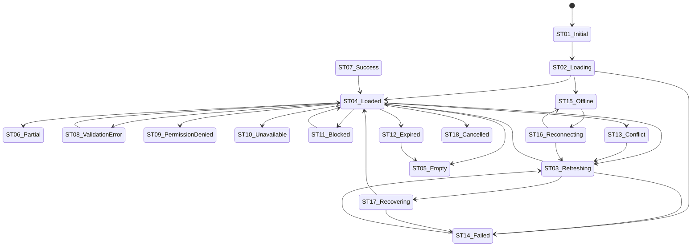

# B-13C companion — Interaction states, feedback, validation and accessibility

**Parent:** [B-13C](22_interaction_flows_and_player_experience.md) (authority, conventions, requirements, Matrices A–C/E–I).
**Created:** 2026-11-13 (Prompt 13C). **Status:** specification only; no component, style, framework, API, route or runtime state exists.
**Scope:** the eighteen interaction states `ST-01`…`ST-18`; loading, empty, success and failure behaviour; the per-component state map for `UI-CMP-001`…`UI-CMP-090` and `OVL-01`…`OVL-08`; validation `VAL-01`…`VAL-20`; confirmation `CFM-01`…`CFM-10`; duplicate/uncertain submission `DUP-01`…`DUP-08`; error handling `ERR-01`…`ERR-20`; recovery `REC-01`…`REC-10`; accessibility interaction `AXI-01`…`AXI-18` and `AX-AC-01`…`AX-AC-12`; notification scenarios `NTF-01`…`NTF-18`; offline/reconnection `OFF-01`…`OFF-12`; Matrix D.

**State-name discipline.** `ST-` identifiers name **interaction scenarios**. They do not rename the thirteen 13A application states or the eleven 13B component states (`default`, `hover`, `focus-visible`, `active`, `disabled(+reason)`, `loading`, `success`, `warning`, `error`, `pending`, `suppressed`). A component's declared state remains a 13B state (`REQ-1014`); an `ST-` code describes when and why a component enters it. No parallel component-state vocabulary is created.

---

## 1. State model

### 1.1 Dimensions

An interaction state has four dimensions:

1. **Data condition** — what the authoritative data is (fresh, stale, partial, absent, suppressed, conflicted).
2. **Action condition** — what can be done (available, blocked, denied, expired, pending, in flight, cancelled).
3. **Connectivity condition** — online, offline, reconnecting or recovering.
4. **Feedback condition** — what the player has just been told and what remains to be confirmed.

An `ST-` state fixes the dominant combination. More than one may co-occur; the highest-severity persistent condition wins the primary presentation (permission/blocked/offline/failed), while secondary conditions remain visible as labels.

### 1.2 Transient and persistent

| Class | States | Rule |
|---|---|---|
| Transient | `ST-01`, `ST-02`, `ST-03`, `ST-07`, `ST-18` | May resolve without player action; never the sole record of a consequential outcome. |
| Persistent | `ST-04`…`ST-06`, `ST-08`…`ST-17` | Survive navigation and reload; reconstructed from authoritative state or the stored action state. |

### 1.3 Transition overview

The diagram is explanatory; the written rules in §2 govern.

---

## 2. State catalogue (ST-01…ST-18)

| ID | State | Definition | Typical triggers | Presentation | Player actions | Persistence |
|---|---|---|---|---|---|---|
| `ST-01` | **Initial** | The screen shell is present and no data request has completed. | First navigation; deep link; restore. | Shell with heading and empty primary region; no values. | Navigate; wait. | Transient |
| `ST-02` | **Loading** | The authoritative data for the current screen/section is in flight. | Navigation; first load; opening a detail. | Skeleton within component bounds; "Loading <thing>" label; shell persists. | Navigate away; wait; cancel a non-committing load where supported. | Transient |
| `ST-03` | **Refreshing** | Confirmed data is visible and a newer read is in flight. | Manual refresh; reconnection; boundary check. | Existing values labelled with as-of turn; subtle refresh indicator; no blanking. | Continue permitted reads; wait; retry. | Transient |
| `ST-04` | **Loaded** | The authoritative data is present and current for its as-of turn. | Completed read; settled boundary. | Full screen; number types and labels; available actions. | All rule-permitted actions. | Persistent base |
| `ST-05` | **Empty** | A valid read returned no records of the screen's primary kind. | New nation; no offers; no alerts; no history; no matches. | Explanation of why; next step or honest absence; governing rule link. | Next step; change filter; leave. | Persistent until data exists |
| `ST-06` | **Partial data** | Some data is missing, suppressed, provisional, forecast-only or still settling. | k=5 suppression; `INSUFFICIENT_SAMPLE`; uncomputable forecast; pending reservations; background failure of one section. | Named missing/suppressed/provisional state in place of the value; unaffected sections remain. | Use unaffected data; open explanation; wait. | Persistent |
| `ST-07` | **Success** | The owning system confirmed completion. | Settlement; recorded action; saved setting. | Receipt/inline confirmation: what changed, cost, turn, resulting state. | Next action; view record. | Transient message; persistent record |
| `ST-08` | **Validation error** | Input or form state fails presentation validation. | Required field empty; format/bounds; cross-field; exact-phrase mismatch. | Inline text linked to field + summary; input preserved. | Correct; resubmit; cancel. | Until corrected |
| `ST-09` | **Permission denied** | The viewer lacks the role, ownership, tier or scope for the requested surface/action. | Denied route; role-restricted control; admin scope. | Named restriction class; no protected object disclosure where naming it would leak; allowed route. | Return; appeal where applicable. | Persistent |
| `ST-10` | **Unavailable** | The feature or surface does not exist or is gated. | Conditional screen; `PROVISIONAL_BLOCK`; no rule exists; gate unmet. | Honest absence message; no stub, teaser or partial control. | Return; read governing explanation. | Persistent |
| `ST-11` | **Blocked by rule** | The action exists but the current state prevents it. | Cooldown; protection; NAP; same-alliance; political state; capacity; OP; limit. | Disabled control + specific reason + rule link + next eligible turn/condition. | Wait; resolve condition; choose another action. | Until condition changes |
| `ST-12` | **Expired** | The request/object's time window has passed. | Offer/treaty/settlement/objective expiry; verification link; election window. | Named expired state; what survives; next route. | Create new; view history; leave. | Persistent |
| `ST-13` | **Conflict** | The submitted intent no longer matches authoritative state. | Stale revision; concurrent change; duplicate; one-live rule. | "This changed since you loaded it"; current state; safe re-read. | Re-read; reapply if intended; cancel. | Until re-read |
| `ST-14` | **Failed** | A read or write failed for a non-validation, non-blocking reason. | Server error; unexpected response; dependency failure. | Failure anatomy: happened/changed/completed/retry/next; support route. | Retry where safe; return; support. | Until retry/leave |
| `ST-15` | **Offline** | The client has no usable connection. | Network loss; device sleep; DNS/edge failure. | Offline banner; last confirmed data labelled; writes disabled. | Read loaded data; retry; wait. | Until reconnection |
| `ST-16` | **Reconnecting** | Connectivity is returning and state is being re-established. | Network restored; tab resumed. | Reconnecting label; no duplicate action; refresh progress. | Wait; choose to re-read. | Transient |
| `ST-17` | **Recovering** | The system is recovering an interrupted turn or an uncertain action. | `INTERRUPTED` boundary; operator recovery; uncertain submission. | Named recovery state; no invented outcome; what is known/pending. | Wait; view status; support if prolonged. | Until resolved |
| `ST-18` | **Cancelled** | The player or the rule cancelled before commitment. | Cancel; Escape; withdraw; dismissal. | "Nothing was changed/charged/reserved"; safe return. | Return; restart. | Transient message; record if the rule keeps one |

---

## 3. Loading states

| Situation | What remains visible | What is disabled | Progress feedback | Stale identification | Navigation away | Never completes |
|---|---|---|---|---|---|---|
| Initial screen load | Shell, heading, breadcrumb, alert indicator, turn state | Data-dependent actions | Skeleton + "Loading" label | Not applicable | Allowed | After a threshold, show `ST-14` with retry; keep shell |
| Navigation load | Shell and prior context where safe | Destination actions | Skeleton in destination | Prior context labelled if retained | Allowed | Destination failure with return |
| Section load (dashboard) | Other sections and shell | Only the loading section's actions | Section skeleton | Other sections keep as-of | Allowed | Section `ST-14`; other sections usable |
| Table load | Header, filter row, pagination frame | Row actions until rows exist | Skeleton rows; exact count once known | As-of label on the table | Allowed | `ST-14` with retry |
| Chart load | Title, units, legend, alternative link | Chart interaction | Loading label; text alternative remains if cached | As-of label | Allowed | Chart failure; text/table alternative still available where data exists |
| Search load | Query, scope | Result actions | "Searching" announced once | Not applicable | Allowed | No-result vs failure distinguished |
| Form submission | Form values; confirmation content | The submitting control and any duplicate action | Button in-flight + pending label | Not applicable | Allowed; reconcile on return | `ST-17`/`ST-14` with uncertainty; never assume |
| Action execution (boundary) | Owning screen and pending row | Duplicate submission only | Pending row with resolution phase | As-of | Allowed | Pending persists until settlement or named recovery |
| Background refresh | Full screen | No read action | Subtle indicator | Previous as-of visible | Allowed | Silent failure is labelled stale; not a modal |
| Slow response | As above | As above | "Still loading" with a cancel/return path | As-of | Allowed | `ST-14` after the owning timeout; retry |
| Interrupted request | As above | As above | Named interrupted/recovering state | As-of | Allowed | `ST-17` |

Do not use a full-page spinner; do not blank confirmed content merely to refresh; do not show placeholder zeros.

---

## 4. Empty states

| Kind | Why it is empty | Required content | Next step |
|---|---|---|---|
| No records exist | The player has no objects of this kind yet | Plain explanation, the rule that creates records, honest zero-state | The legitimate creating action or guide |
| No matching results | Filters/search exclude all rows | Active filters, clear action, true result count | Clear/change filters |
| No pending actions | Nothing awaits the player | Reassurance + digest link + next boundary | Open digest or section |
| No notifications | No events in the window | Explanation of what generates alerts; non-opt-out note | Adjust mute where permitted or return |
| No historical records | Retention window or new nation | Retention explanation; as-of | Current-state screen |
| No eligible actions | Rule gates exclude all actions | The blocking conditions, grouped and rule-linked | Resolve a condition or wait until a turn |
| Feature not available | Conditional/Provisional/gate unmet | Named absence reason; no teaser | Return; read rule/guide |
| Permission-restricted | Content exists but the viewer may not see it | Restriction class only where disclosure is safe; allowed route | Return; appeal where applicable |

An empty state never renders a fake value, a disabled-looking control for an absent feature, or a "0" where truth is suppressed.

---

## 5. Success states

| Success kind | Confirmed when | Required message | Persistent record |
|---|---|---|---|
| Form submission | The owning system stored the value | What was saved, where, and the as-of | The record itself |
| Recorded action (immediate) | The action resolution completed | What changed, cost charged, new state | Object/ledger |
| Request accepted (pending) | Acceptance recorded, not settled | Accepted; pending; where/when it resolves | Inbox/object pending state |
| Boundary execution | The phase produced a published outcome | Result, cost, effect, failure factor if any | Digest + object |
| Cancellation | The cancel was recorded | Nothing committed/charged/reserved; what remains | Object state |
| Update (settings/preferences) | Stored and confirmed | Scope of change; whether it applies now or next turn | Settings history |
| Recovery | Access/state restored | What was restored; next security step | Security record |
| Navigation success | Not an action success | No success message; title/focus update only | — |

A "request accepted" is not "completed". A 2xx response alone does not justify a success state unless the owning system confirms the effect.

---

## 6. Failure states

### 6.1 Failure anatomy (every failure)

1. **What happened** in the owning system's player language.
2. **Whether anything changed.**
3. **Whether the action completed** (yes/no/unknown).
4. **Whether retrying is safe.**
5. **What the player can do next.**
6. **Whether support is necessary.**

### 6.2 Failure classes

| Class | Example condition | State | Changed? | Completed? | Retry safe? | Next step |
|---|---|---|---|---|---|---|
| Network error | Connection lost mid-request | `ST-15`/`ST-14` | Unknown until reconciled | Unknown | Only after reconciliation | Wait/retry |
| Server error | Unexpected 5xx/edge failure | `ST-14` | No, unless settlement occurred | No/unknown | Yes for reads; reconcile writes | Retry/support |
| Authentication expiry | Session invalid | `ST-12` gate | No | No | After re-auth | Sign in; return |
| Authorization failure | Role/ownership/tier denied | `ST-09` | No | No | No | Return/appeal |
| Validation failure | Field/form invalid | `ST-08` | No | No | After correction | Correct |
| Resource conflict | Concurrent change/stale revision | `ST-13` | Authoritative state may differ | No | After re-read | Re-read/reapply |
| Stale state | As-of older than current | `ST-06`/`ST-03` | Unknown | No | After refresh | Refresh |
| Duplicate submission | Same intent already recorded | `ST-07`/`ST-13` | No additional change | Yes (original) | No | View original record |
| Expired request | Window passed | `ST-12` | No | No | No | New request |
| Rule-based rejection | Block/cooldown/limit | `ST-11` | No | No | After condition changes | Resolve/wait |
| Rate limiting | Action cap/window | `ST-11` | No | No | After reset | Wait |
| Unexpected response | Unparseable/unknown | `ST-14` | Unknown | Unknown | No auto-retry | Support |

No stack trace, SQL, secret, token, internal path, detection threshold or another player's data appears. A support reference may be shown if it is opaque and safe.

---

## 7. Component state mapping (90 components + 8 overlays)

Legend for **Applicable ST**: state codes that the component must be able to present. **Avail.** = interaction availability; **Focus** = focus behaviour; **Persist.** = whether the state survives reload; **Screen dependency** = the owning screen state that supplies it. This table is Matrix D at component level.

### 7.1 Application shell (`UI-CMP-001`…`UI-CMP-011`)

| Component | Name | Applicable ST | Visible feedback | Avail. | Focus | Transitions | Persist. | Screen dependency |
|---|---|---|---|---|---|---|---|---|
| `UI-CMP-001` | Global application shell | 01,02,03,15,16,17 | Skeleton regions; offline/reconnect banners | Nav stays | Heading on route change | Any → any | Yes | All screens |
| `UI-CMP-002` | Primary navigation | 04,09,10,11 | Active section; denied destination absent | Restricted | Standard | Loaded↔denied | Yes | Shell role/context |
| `UI-CMP-003` | Secondary navigation | 04,05,11 | Active tab; empty tab state | Restricted | Standard | Loaded↔empty | Yes | Section object |
| `UI-CMP-004` | Page heading | 02,04,14 | Loading title; error title | None | Focus target | Loading→loaded/failed | Yes | Screen identity |
| `UI-CMP-005` | Breadcrumb / context locator | 04,09 | Truncated/permission-limited path | Links only | Standard | Loaded↔denied | Yes | Route context |
| `UI-CMP-006` | Account & nation context | 04,09,11,12 | Unverified/restricted/closed states | Read | Standard | Loaded↔state | Yes | Account/nation state |
| `UI-CMP-007` | Turn & settlement indicator | 02,03,04,12,15,16,17 | Open/locked/resolving/interrupted/failed/stale | Read | Polite live region | Boundary/state changes | Yes | Turn/settlement |
| `UI-CMP-008` | Global notification indicator | 04,05,06,15 | Count; pending/danger; non-opt-out | Read/open | Polite, no steal | Count changes | Yes | Event source |
| `UI-CMP-009` | Contextual navigation | 04,09,10 | Permission-limited/conditional-absent | Restricted | Standard | Loaded↔denied/absent | Yes | Object/section |
| `UI-CMP-010` | Admin entry & role-gated nav | 04,09,11 | Denied/step-up/emergency | Role-gated | Standard | Role states | Yes | ADM role |
| `UI-CMP-011` | Footer / help access | 04,14 | Degraded-support state | Standard | Standard | Loaded↔degraded | Yes | All screens |

### 7.2 Information display (`UI-CMP-012`…`UI-CMP-030`)

| Component | Name | Applicable ST | Visible feedback | Avail. | Focus | Transitions | Persist. | Screen dependency |
|---|---|---|---|---|---|---|---|---|
| `UI-CMP-012` | Statistic card | 02,03,04,05,06 | Loading/zero-real/forecast/suppressed/stale label | Read | Standard | load→loaded/partial | Yes | Owning metric |
| `UI-CMP-013` | Metric group | 02,04,06 | Partial/suppressed members named | Read | Standard | load→loaded/partial | Yes | Metric set |
| `UI-CMP-014` | Financial summary | 02,04,05,06 | Negative projection; zero; forecast; stale | Read | Standard | load→loaded/partial | Yes | Treasury |
| `UI-CMP-015` | Resource balance display | 04,05,06 | Reserved/empty/capacity/suppressed | Read | Standard | loaded↔partial | Yes | Resource |
| `UI-CMP-016` | Progress indicator | 02,04,06,07,14 | Pending/success/warning/error/indeterminate | Read | Announced on change | progress states | Partial | Action/project |
| `UI-CMP-017` | Status banner | 04,07,11,12,14,15,17 | Informational/pending/success/warning/danger/locked | Context | Announced once | state transitions | Yes | Owning state |
| `UI-CMP-018` | Warning panel | 04,06,11 | Condition, consequence, end turn, actions | Context | Standard | loaded↔blocked | Yes | Warning condition |
| `UI-CMP-019` | Information panel | 02,04,05,10,14,15 | Loading/empty/provisional/failure | Read | Standard | any | Yes | Screen |
| `UI-CMP-020` | Historical record | 04,05,06,12 | Retention boundary; restricted; retired | Read | Standard | loaded↔empty/expired | Yes | History class |
| `UI-CMP-021` | Timeline | 04,05,06,07 | Pending/completed/voided/suppressed | Read | Standard | event transitions | Yes | Object lifecycle |
| `UI-CMP-022` | Data table | 02,03,04,05,06,09,14 | Loading/empty/sorted/filtered/limited | Restricted | Header/row nav | load→loaded/empty | Yes | List query |
| `UI-CMP-023` | Filter row | 04,05,08,11 | Active filter/invalid/clear | Standard | Standard | loaded↔invalid | Yes | Query |
| `UI-CMP-024` | Pagination | 04,05 | Exact counts/bounds | Standard | Standard | page change | Yes | Query |
| `UI-CMP-025` | Saved view | 04,08,09 | Dirty/invalid/permission-denied | Restricted | Standard | loaded↔dirty | Yes | User view |
| `UI-CMP-026` | Search and jump | 02,04,05,09,14 | No-result/denied/loading/error | Standard | Stays in field | typing→results | No | Query |
| `UI-CMP-027` | Object reference link | 04,09,12 | Visited/denied/retired | Link | Standard | loaded↔denied/retired | Yes | Object visibility |
| `UI-CMP-028` | Object peek preview | 02,04,05,09,10 | Loading/empty/denied/suppressed | Read | Dismissible | open→loaded/denied | No | Object |
| `UI-CMP-029` | Detail section | 02,04,05,10 | Collapsed/empty/provisional | Read | Standard | toggle/load | Partial | Object |
| `UI-CMP-030` | Comparison panel | 04,06 | Partial/suppressed/not-comparable | Read | Standard | loaded↔partial | Yes | Compared sources |

### 7.3 Economic and political (`UI-CMP-031`…`UI-CMP-042`)

| Component | Name | Applicable ST | Visible feedback | Avail. | Focus | Transitions | Persist. | Screen dependency |
|---|---|---|---|---|---|---|---|---|
| `UI-CMP-031` | Treasury summary | 02,04,06 | Zero/negative projection/stale | Read | Standard | load→loaded | Yes | Treasury |
| `UI-CMP-032` | Income & expenditure breakdown | 02,04,06 | Capex/opex/forecast/incomplete | Read | Standard | load→loaded | Yes | Ledger |
| `UI-CMP-033` | Total/reserved/available register | 04,06 | Three figures together; reserved/zero/suppressed | Read | Standard | loaded↔partial | Yes | Balance |
| `UI-CMP-034` | Capacity bar | 04,06,11 | Full/reserved/derated/unmaintained | Read | Standard | loaded↔blocked | Yes | Capacity |
| `UI-CMP-035` | Production chain | 04,06,11 | Running/target/idle/unmaintained/power-short | Read | Standard | state changes | Yes | Chain |
| `UI-CMP-036` | Construction queue item | 04,06,07,11,12,14 | Pending/resolving/cancelled/failed/complete | Restricted | Standard | lifecycle | Yes | Order |
| `UI-CMP-037` | Research project card | 04,10,11,12 | Locked/available/in-progress/complete/prereq | Restricted | Standard | lifecycle | Yes | Research |
| `UI-CMP-038` | Approval & stability presentation | 02,04,06,11 | Six supports; warning; crisis/recovery | Read | Standard | load→loaded | Yes | Politics |
| `UI-CMP-039` | Political state banner | 04,11,12,17 | Six states + cause/end/locks | Read | Announced once | state transitions | Yes | DMP-268 |
| `UI-CMP-040` | Policy control | 04,08,11 | Cooldown/blocked/confirmation | Restricted | Standard | available↔blocked | Yes | Axis state |
| `UI-CMP-041` | Election date presentation | 04,12 | Scheduled/open/closed/delayed/resolved | Read | Standard | lifecycle | Yes | Election |
| `UI-CMP-042` | Campaign action control | 04,07,11 | Available/charged/blocked/limit | Restricted | Standard | available↔charged | Yes | Contest |

### 7.4 Diplomacy and alliance (`UI-CMP-043`…`UI-CMP-053`)

| Component | Name | Applicable ST | Visible feedback | Avail. | Focus | Transitions | Persist. | Screen dependency |
|---|---|---|---|---|---|---|---|---|
| `UI-CMP-043` | Diplomatic relationship indicator | 04,06 | Friendly/neutral/tense/hostile/unknown | Read | Standard | loaded↔unknown | Yes | Pair posture |
| `UI-CMP-044` | Directional relationship presentation | 04,06 | Both directions/embargo/suppressed | Read | Standard | loaded↔partial | Yes | Pair |
| `UI-CMP-045` | Treaty status | 04,07,12 | Proposed/pending/active/terminated/expired/record-only | Read | Standard | lifecycle | Yes | Agreement |
| `UI-CMP-046` | Proposal summary | 04,07,12 | Pending/countered/accepted/rejected/withdrawn/expired | Restricted | Standard | lifecycle | Yes | Proposal |
| `UI-CMP-047` | Negotiation panel | 04,08,11,18 | Counter/withdraw/blocked/confirmation | Restricted | Cancel first | open→submitted | Partial | Proposal |
| `UI-CMP-048` | Publication status | 04,07,12 | Pending-private/active-public/record-only | Read | Standard | lifecycle | Yes | Publication |
| `UI-CMP-049` | Alliance membership row | 04,05,09 | Member/applicant/non-covered/officer/former | Restricted | Standard | membership changes | Yes | Membership |
| `UI-CMP-050` | Applicant status | 04,05,12 | Pending/admitted/declined/expired/withdrawn | Restricted | Standard | lifecycle | Yes | Application |
| `UI-CMP-051` | Alliance financial summary | 04,05,06,10 | Four categories; zero-fallback; unavailable purpose | Read | Standard | loaded↔unavailable | Yes | ARL |
| `UI-CMP-052` | Alliance receipt | 04,07 | Issued/immutable/corrected-by-append | Read | Standard | loaded | Yes | Receipt |
| `UI-CMP-053` | Restriction explanation | 09,11 | Role/pair/NAP/alliance/state/security reason | Read | Standard | loaded↔denied | Yes | Permission |

### 7.5 Warfare (`UI-CMP-054`…`UI-CMP-062`)

| Component | Name | Applicable ST | Visible feedback | Avail. | Focus | Transitions | Persist. | Screen dependency |
|---|---|---|---|---|---|---|---|---|
| `UI-CMP-054` | War summary | 04,07,12 | Declared/active/interrupted/settled/surrendered | Read | Standard | lifecycle | Yes | War |
| `UI-CMP-055` | War status strip | 04,11,12,17 | Lifecycle + protection + settlement availability | Read | Standard | lifecycle | Yes | War |
| `UI-CMP-056` | Operations summary | 04,07,11,14 | Reserved/executing/failed/released | Restricted | Standard | lifecycle | Yes | Operations |
| `UI-CMP-057` | OP balance & reservation | 04,06,11 | Capped/reserved/regenerated-zero/spend | Read | Standard | loaded↔partial | Yes | OP pool |
| `UI-CMP-058` | Threat & odds band | 04,06 | Low/moderate/high/severe/unknown | Read | Standard | loaded↔unknown | Yes | Disclosure |
| `UI-CMP-059` | Battle record | 04,09,10 | Public summary/participant detail/suppressed | Restricted | Standard | loaded↔denied | Yes | Battle |
| `UI-CMP-060` | Battle outcome | 04,12 | Win/loss/stalemate/interrupted/voided | Read | Standard | loaded↔expired | Yes | Battle |
| `UI-CMP-061` | Military history | 04,05,06 | Retention/restricted | Read | Standard | loaded↔empty | Yes | Archive |
| `UI-CMP-062` | Nation-owner operation controls | 04,07,11,18 | Disabled+reason/confirmation/executing/released | Owner only | Cancel first | available→pending | Partial | War board |

### 7.6 World and notification (`UI-CMP-063`…`UI-CMP-073`)

| Component | Name | Applicable ST | Visible feedback | Avail. | Focus | Transitions | Persist. | Screen dependency |
|---|---|---|---|---|---|---|---|---|
| `UI-CMP-063` | Event card | 04,05,06,12 | Scheduled/active/resolved/expired/suppressed | Read | Standard | lifecycle | Yes | Event |
| `UI-CMP-064` | Event consequence presentation | 04,06 | Cause/effect/mitigation/historical | Read | Standard | loaded↔partial | Yes | Event |
| `UI-CMP-065` | Objective card | 04,05,07,12 | Available/accepted/progress/completed/deferred/expired | Optional | Standard | lifecycle | Yes | Objective |
| `UI-CMP-066` | Achievement card | 04,05,10 | Locked/earned/historical/deferred-claim | Read | Standard | lifecycle | Yes | Achievement |
| `UI-CMP-067` | Ranking row | 04,05,06 | Ranked/tied/ineligible/suppressed/historical | Read | Standard | loaded↔partial | Yes | Standing |
| `UI-CMP-068` | Ranking summary | 04,05,06 | Denominator/window/no-live/empty | Read | Standard | loaded↔empty | Yes | Standing |
| `UI-CMP-069` | Notification item | 04,05,12 | Informational/pending/warning/danger/muted/non-opt-out | Restricted | Standard | unread↔read | Yes | Event |
| `UI-CMP-070` | Pending-action item | 04,07,11,12 | Pending/due-soon/overdue/cancellable/non-cancellable | Restricted | Standard | lifecycle | Yes | Owning action |
| `UI-CMP-071` | Chronicle record | 04,05,06 | Public/class-P/class-O-boundary/retired | Read | Standard | loaded↔empty | Yes | Chronicle |
| `UI-CMP-072` | Suppression indicator | 06 | Suppressed/insufficient-sample/not-disclosed | None | Announced | persistent | Yes | Aggregate |
| `UI-CMP-073` | Historical reward record | 04,05,07 | Granted/deferred/voided/corrected | Read | Standard | lifecycle | Yes | Reward |

### 7.7 Forms and actions (`UI-CMP-074`…`UI-CMP-090`)

| Component | Name | Applicable ST | Visible feedback | Avail. | Focus | Transitions | Persist. | Screen dependency |
|---|---|---|---|---|---|---|---|---|
| `UI-CMP-074` | Text input | 04,08,11 | Error/success/read-only/disabled+reason | Restricted | Field | edit→valid/error | No | Form |
| `UI-CMP-075` | Numeric input | 04,08,11 | Integer-only; out-of-range; error | Restricted | Field | edit→valid/error | No | Form |
| `UI-CMP-076` | Select control | 04,08,11 | Open/selected/error/disabled | Restricted | Control | open→selected | No | Form |
| `UI-CMP-077` | Multi-select control | 04,08,11 | Selected-many/limit/error | Restricted | Control | edit→valid/limit | No | Form |
| `UI-CMP-078` | Checkbox | 04,08,11 | Checked/indeterminate/error | Restricted | Control | toggle | No | Form |
| `UI-CMP-079` | Radio control | 04,08,11 | Selected/error | Restricted | Arrow keys | select | No | Form |
| `UI-CMP-080` | Toggle | 04,07,08,11 | On/off/pending/error | Restricted | Control | toggle→pending | No | Setting |
| `UI-CMP-081` | Date/turn selector | 04,08,11 | Turn range/invalid/provisional | Restricted | Control | edit→valid | No | Query/form |
| `UI-CMP-082` | Search field | 02,04,05,09,14 | Typing/results/no-result/denied/loading | Standard | Stays | typing→results | No | Query |
| `UI-CMP-083` | Form field group | 04,08 | Required/optional/error/group help | Read | Group legend | loaded↔error | No | Form |
| `UI-CMP-084` | Validation message | 08,11,14 | Inline/summary/error/warning/success | Read | Focusable summary | error↔clear | No | Validation |
| `UI-CMP-085` | Primary action button | 04,07,08,11,14,18 | Loading/success/pending/disabled+reason | Restricted | Control | idle→pending→result | No | Action |
| `UI-CMP-086` | Secondary action button | 04,11,18 | Disabled+reason; no success state | Standard | Control | idle→navigate/cancel | No | Action |
| `UI-CMP-087` | Destructive action button | 04,11,18 | Confirmation-required; separated | Restricted | Control | idle→confirm | No | Destructive action |
| `UI-CMP-088` | Confirmation panel | 04,07,08,11,13,14,18 | Effect/cost/cooldown/phase/consequence | Confirm/cancel | Cancel first | open→pending→result | No | Commit |
| `UI-CMP-089` | Disabled action with reason | 11,09 | Reason visible; rule-linked | None | Focusable | reason states | Yes | Rule block |
| `UI-CMP-090` | Exact-phrase confirmation field | 08,11 | Mismatch/match/disabled | Restricted | Field | type→match | No | Destructive action |

### 7.8 Overlays (`OVL-01`…`OVL-08`)

| Overlay | Name | Applicable ST | Visible feedback | Avail. | Focus | Transitions | Persist. | Screen dependency |
|---|---|---|---|---|---|---|---|---|
| `OVL-01` | Confirmation dialog | 04,07,08,11,13,14,18 | Open/pending/error/success | Confirm/cancel | Trap; cancel first | open→result | No | Committing control |
| `OVL-02` | Destructive exact-phrase dialog | 08,11,18 | Mismatch/match/pending | Restricted | Trap; cancel first | open→match→confirm | No | Destructive control |
| `OVL-03` | Reason popover | 09,11 | Reason/rule/next condition | Read | Dismissible | open→dismiss | No | Disabled control |
| `OVL-04` | Definition / cause-chain drawer | 02,04,05,10 | Loading/empty/deep-linked page | Read | Trap/drawer | open→loaded | No | Explanation |
| `OVL-05` | Object peek card | 02,04,05,09,12 | Loading/denied/suppressed/retired | Read | Dismissible | open→loaded | No | Object link |
| `OVL-06` | Boundary-effect notice | 04,07,12,15,16,17 | Settled/pending/failed/interrupted | Read/dismiss | Polite | event outcome | No | Boundary |
| `OVL-07` | Suppression notice | 06 | Suppressed/insufficient sample | Read | Announced | persistent | No | Aggregate |
| `OVL-08` | Claim-vocabulary badge | 04,09 | Suspected/under review/confirmed/inconclusive | Read | Text | loaded | No | B-12 notice |

---

## 8. Validation specifications

### 8.1 Principles

| ID | Rule |
|---|---|
| `VAL-01` | **Immediate format hints only.** Character counters, integer/bp suffixes and obviously disallowed characters may be indicated while typing; no full error message fires on every keystroke. |
| `VAL-02` | **Blur validation** for format, length, integer/basis-point bounds, e-mail shape, exact-phrase match and select validity. |
| `VAL-03` | **Submit validation** for required fields, cross-field rules (e.g. at least one line, allocation totals), and completeness; focus moves to the summary/first invalid field. |
| `VAL-04` | **Server-authoritative validation** for permission, ownership, resource availability, capacity, cooldowns, state, eligibility, duplicate requests and rule constraints. Presentation validation never substitutes for it. |
| `VAL-05` | **No invented limits.** Bounds come from the owning rule; the interface may display a bound only where the rule defines it. |
| `VAL-06` | **Message anatomy:** field/action; problem; why; correction; input preserved. Player language; no unexplained codes. |
| `VAL-07` | **Association:** every error is linked to its field and summarised at the form top; the summary is focusable. |
| `VAL-08` | **Preservation:** rejected input stays in the fields except where retaining it would be unsafe (credentials, secrets). |
| `VAL-09` | **Cross-field:** errors attach to the specific pair/group, not a generic form error. |
| `VAL-10` | **Confirmation is not validation.** Passing presentation validation never authorises the action; the authoritative check still runs. |
| `VAL-11` | **Required-field messaging** states what is needed and why, not merely "required". |
| `VAL-12` | **Numeric messaging** states the unit, the permitted range and the entered value. |
| `VAL-13` | **Stale/conflict:** a revision/state conflict is not a field error; it routes to `ST-13` with re-read. |
| `VAL-14` | **Server rule rejection** routes to `ST-11` with the owning reason, not `ST-08`. |
| `VAL-15` | **Exact-phrase** validation is case-sensitive only where the rule says; mismatch text names the expected phrase source (current nation name). |
| `VAL-16` | **Success feedback** is not repeated per field; one form-level result. |
| `VAL-17` | **Localization-ready:** messages are complete sentences with placeholders, not concatenated fragments. |
| `VAL-18` | **Accessibility:** `aria-invalid`, described-by error, announced summary. |
| `VAL-19` | **No secrets echoed:** passwords, recovery codes and tokens are never re-displayed in errors. |
| `VAL-20` | **No client-only enforcement claim:** the interface never reports "valid" as "approved". |

### 8.2 Action validation checklist (presentation-side)

Every committing action checks: required fields (`VAL-03`); formats (`VAL-02`); numeric boundaries (`VAL-02/12`); available resources (`VAL-04`); available capacity (`VAL-04`); ownership (`VAL-04`); permissions (`VAL-04`); eligibility (`VAL-04`); cooldowns (`VAL-04`); turn/phase restrictions (`VAL-04`); current object state (`VAL-04`); duplicate requests (`DUP-01`…`DUP-03`); existing game rules (governing source). The owning rule supplies every numeric limit.

---

## 9. Confirmation specifications

| ID | Rule |
|---|---|
| `CFM-01` | Every committing action passes exactly one confirmation surface (`UI-CMP-088`; `OVL-01`/`OVL-02`). |
| `CFM-02` | The confirmation states the exact action, known cost, resource impact, cooldown, turn/phase, important consequences, confirm and cancel. |
| `CFM-03` | Confirm is never preselected, default-focused, remembered or inferred; cancel is the safe first focus. |
| `CFM-04` | Confirmation content is supplied by the owning rule (08C §12.3 ten fields; WAR-152; RRL-006 consequence list; MOD-002 accusation statement). |
| `CFM-05` | A secondary control, keyboard shortcut or deep link may not bypass confirmation. |
| `CFM-06` | If a precondition changes while the confirmation is open, confirm disables with the reason and a re-read; it never proceeds on stale terms. |
| `CFM-07` | Destructive actions use the separated destructive pattern; where RRL-006/admin exact confirmation applies, the exact phrase is required and never remembered across turns. |
| `CFM-08` | A confirmation never becomes the only place a fact exists; the page equivalent shows the same content (`D-215`). |
| `CFM-09` | Dismissal (Escape/backdrop/cancel) never commits. |
| `CFM-10` | Confirmation content must be readable and announced in full before the confirm control is reachable. |

---

## 10. Duplicate submissions and uncertain outcomes

| ID | Scenario | Required behaviour |
|---|---|---|
| `DUP-01` | Double-click / repeated tap | Single-flight: the first activation starts the request; further activations while in flight are ignored; the control shows a pending/loading state. |
| `DUP-02` | Keyboard repeat / Enter held | One intent per activation; no auto-repeat submission. |
| `DUP-03` | Refresh while submitting | On reload, re-read the object; show pending or resolved state; do not resubmit automatically. |
| `DUP-04` | Navigate away while submitting | The submission is not cancelled by the view; on return the object/inbox shows the authoritative state. |
| `DUP-05` | Timeout / lost response | Show `unknown — retrying`/`ST-17`; reconcile by re-reading the object before offering a retry; never assume failure. |
| `DUP-06` | Retry after uncertain outcome | Retry only after reconciliation; where the owning system defines an idempotency key, reuse it; never invent a client idempotency mechanism. |
| `DUP-07` | Same action from two screens | The owning object state prevents a second live instance (e.g. one settlement, one offer per pair, one active project); the second screen shows the existing object/`ST-13`. |
| `DUP-08` | Duplicate notification/receipt | Deduplicate by source event/object; show one grouped notice; the record remains single. |

Backend idempotency is an implementation dependency, not a 13C invention. Where the owning rule does not define a safe key, the interface must reconcile rather than auto-retry.

---

## 11. Error handling catalogue (ERR-01…ERR-20)

Every failure state answers: **what happened; whether anything changed; whether the action completed; whether retrying is safe; the next step; whether support is necessary.** No stack trace, secret, internal path, detection threshold or another player's data is shown.

| ID | Condition | State | Message content | Changed? | Completed? | Retry safe? | Next step |
|---|---|---|---|---|---|---|---|
| `ERR-01` | Network unavailable | `ST-15` | Offline; last confirmed as-of; writes disabled | No new change | No | After reconnect | Wait; re-read |
| `ERR-02` | Request timed out | `ST-17` | Outcome unknown; do not resubmit yet | Unknown | Unknown | Only after reconcile | Re-read object |
| `ERR-03` | Server/edge error | `ST-14` | Request failed; nothing published | No (unless settlement) | No | Yes for reads | Retry/support |
| `ERR-04` | Session expired | `ST-12` gate | Sign in again; destination preserved | No | No | After auth | Sign in |
| `ERR-05` | Account unverified | `ST-11` | Verification required before play | No | No | After verify | `SCR-006` |
| `ERR-06` | Authorization/role denied | `ST-09` | Restriction class; allowed route | No | No | No | Return/appeal |
| `ERR-07` | Ownership/scope denied | `ST-09` | Not your object/scope | No | No | No | Return |
| `ERR-08` | Field validation failed | `ST-08` | Field-specific correction | No | No | After correction | Correct |
| `ERR-09` | Cross-field invalid | `ST-08` | The specific pair/group | No | No | After correction | Correct |
| `ERR-10` | Duplicate submission | `ST-13`/`ST-07` | Already recorded; view original | No additional | Yes (original) | No | View record |
| `ERR-11` | Stale revision/state | `ST-13` | Changed since load; re-read | Authoritative may differ | No | After re-read | Re-read |
| `ERR-12` | Expired request/object | `ST-12` | Window passed; what survives | No | No | No | New request |
| `ERR-13` | Rule block (protection/NAP/state/cooldown) | `ST-11` | Specific reason; next condition | No | No | After condition | Resolve/wait |
| `ERR-14` | Capacity/resource insufficient | `ST-11` | Exact limiting factor | No | No | After change | Adjust |
| `ERR-15` | Rate limit reached | `ST-11` | Window and reset turn | No | No | After reset | Wait |
| `ERR-16` | One-live/limit reached | `ST-11` | Existing live object/limit | No | No | No | Open existing |
| `ERR-17` | Settlement failed after acceptance | `ST-14`/`ST-17` | Exact failure factor; what released | Reservation released | No | Per rule | Re-read; correct |
| `ERR-18` | Turn interrupted/failed | `ST-17` | Delay, not lost turn; actions pending | No published outcome | No | Wait | `SCR-016` |
| `ERR-19` | Unexpected/unparseable response | `ST-14` | Cannot confirm; support reference | Unknown | Unknown | No auto-retry | Support |
| `ERR-20` | Permission/visibility conflict across screens | `ST-09` | Same restriction class; authoritative revalidation | No | No | No | Return |

No failure message may quote a stack trace, secret, SQL, internal threshold, detection method or another player's data.

---

## 12. Accessibility interaction specifications

**Standard.** The target is **WCAG 2.2 Level AA as design intent**; no conformance is claimed and no assistive-technology test has been run. These are implementation requirements and future acceptance criteria.

### 12.1 Keyboard (`AXI-01`…`AXI-05`)

| ID | Requirement |
|---|---|
| `AXI-01` | Tab order follows reading order; a skip-to-content link precedes navigation; no positive `tabindex`. |
| `AXI-02` | Enter/Space activate per convention; Space toggles checkboxes/toggles; links activate with Enter. |
| `AXI-03` | Escape closes non-committing overlays and cancels confirmations; it never confirms and never dismisses a destructive confirmation without explicit cancel. |
| `AXI-04` | Arrow keys operate tablists, radio groups, menus and turn/date selectors; they do not hijack text entry. |
| `AXI-05` | Tables, filters, search and pagination are fully keyboard-reachable; row actions do not require hover. |

### 12.2 Screen reader (`AXI-06`…`AXI-10`)

| ID | Requirement |
|---|---|
| `AXI-06` | Every control has an accessible name; every input has a programmatic label; placeholders are not labels. |
| `AXI-07` | Errors are text-linked to fields and summarised; the summary is focusable; `aria-invalid` is set. |
| `AXI-08` | Tables expose header/row/column scope; card fallbacks preserve labels and order; chart alternatives exist. |
| `AXI-09` | Numbers announce units, basis points, as-of turn and band labels. |
| `AXI-10` | States are announced once at appropriate politeness; countdown ticks are not announced; dynamic updates announce a summary, not every cell. |

### 12.3 Focus (`AXI-11`…`AXI-14`)

| ID | Requirement |
|---|---|
| `AXI-11` | Screen transitions move focus to the heading; page title updates. |
| `AXI-12` | Modal focus is trapped, cancel-first, and restored to the invoker; no trap outside a modal. |
| `AXI-13` | Validation failure focuses the summary or first invalid field; submission result focuses the result heading. |
| `AXI-14` | Asynchronous notifications do not steal focus; table updates keep focus where the row still exists. |

### 12.4 Responsive and sensory (`AXI-15`…`AXI-18`)

| ID | Requirement |
|---|---|
| `AXI-15` | Reflow at 320 CSS px; 200% text resize and 200% zoom without loss or horizontal page scroll. |
| `AXI-16` | Touch targets ≥24×24 CSS px and the DS-14 token; destructive controls separated. |
| `AXI-17` | Reduced motion respected; no state depends on motion; colour is never the sole channel. |
| `AXI-18` | Portrait and landscape both usable; no gesture-only or device-motion interaction; keyboard entry works with a hardware or on-screen keyboard. |

### 12.5 Acceptance criteria (`AX-AC-01`…`AX-AC-12`)

| ID | Criterion | Check method (future) |
|---|---|---|
| `AX-AC-01` | Every essential journey is completable by keyboard alone. | Built-UI keyboard walkthrough per journey |
| `AX-AC-02` | Every modal traps and restores focus; Escape cancels safely. | Keyboard + screen-reader test |
| `AX-AC-03` | Every route change updates title and heading focus. | Route-transition test |
| `AX-AC-04` | Every validation error is programmatically associated and summarised. | Automated + manual form audit |
| `AX-AC-05` | Every persistent state change is announced once. | Assistive-technology state test |
| `AX-AC-06` | Every table has semantic headers and every chart has a reachable alternative. | Semantics/alternative audit |
| `AX-AC-07` | 320 px reflow and 200% resize/zoom lose no content. | Responsive zoom test |
| `AX-AC-08` | Touch targets meet the minimum; destructive controls are separated. | Touch measurement |
| `AX-AC-09` | Reduced-motion mode removes non-essential motion without losing state. | Media-query test |
| `AX-AC-10` | Every tutorial is keyboard-operable and has an accessible skip. | Tutorial walkthrough |
| `AX-AC-11` | Notification arrival is announced politely without focus theft. | Live-region test |
| `AX-AC-12` | No conformance claim is made before all criteria are tested on a built UI. | Documentation review |

These are requirements, not test results. No WCAG conformance is claimed.

---

## 13. Notification interaction scenarios (NTF-01…NTF-18)

Category/source coverage is in the parent §18.9; this table fixes the interaction.

| ID | Scenario | On arrival | Opening | Dismiss/mute | Failure/expiry |
|---|---|---|---|---|---|
| `NTF-01` | Boundary settled | Indicator + digest row | `SCR-013`/object | Ambient dismiss where permitted; digest record stays | Stale digest labelled |
| `NTF-02` | Turn interrupted/failed | Indicator; `SCR-016` banner | `SCR-016` | Cannot mute the turn state | Named state; no lost-turn claim |
| `NTF-03` | Pending act due | Indicator + inbox row | `SCR-014` → owning screen | Cannot dismiss the act itself | Expired act → `ST-12` |
| `NTF-04` | Trade offer received/countered/expired | Indicator + inbox | `SCR-035`/`SCR-037` | Defer; mute where permitted | Chain expired → `ST-12` |
| `NTF-05` | Trade settled/failed | Indicator + digest | `SCR-037`/`SCR-040` | Ambient dismiss | Exact failure factor |
| `NTF-06` | Production blocked/`UNMAINTAINED` | Warning indicator | `SCR-032`/`SCR-044` | Mute where permitted | Block reason persists |
| `NTF-07` | Political state change | Indicator + banner | `SCR-021`/`SCR-028` | Cannot mute the state banner | State end turn shown |
| `NTF-08` | Election window/result | Indicator + digest | `SCR-025`/`SCR-027` | N2/N7 cannot be suppressed while a decision is open | Delayed state shown |
| `NTF-09` | Diplomatic proposal/expiry | Indicator + inbox | `SCR-049` | Mute per DIP rules | Withdrawn/expired → `ST-12` |
| `NTF-10` | Agreement activation/expiry | Indicator + digest | `SCR-050`/`SCR-051` | Mute per DIP rules | No stale active badge |
| `NTF-11` | Alliance application/tax/treaty | Indicator (permissioned) | `SCR-054`/`SCR-056`/`SCR-058` | Mute where permitted | Applicant privacy preserved |
| `NTF-12` | War declared/operation/battle | Indicator + digest | `SCR-061`/`SCR-063`/`SCR-064` | Mute per WAR rules | Field-filtered on open |
| `NTF-13` | Settlement offered/expired | Indicator + inbox | `SCR-067` | Cannot mute a live settlement | One-live state shown |
| `NTF-14` | World event announced/active | Indicator + digest | `SCR-069`/`SCR-070` | Ambient mute where permitted | Event state preserved |
| `NTF-15` | Objective progress/reward | Indicator | `SCR-071`/`SCR-073`/`SCR-075` | Mute where permitted | Deferred stays visible |
| `NTF-16` | Standing published | Indicator + digest | `SCR-072` | Ambient mute | No live rank |
| `NTF-17` | Security/recovery notice | Indicator; non-opt-out | `SCR-080` | Cannot mute | One-time code never re-shown |
| `NTF-18` | Moderation decision/appeal | Indicator; non-opt-out | `SCR-082`/`SCR-083` | Appeal route never muted | Seven elements preserved |

No scenario creates a new event. Arrival never steals focus. Grouping is by source event and object. Opening a notification does not mark an unrelated item read.

---

## 14. Offline, interruption and recovery (OFF-01…OFF-12)

| ID | Situation | What the player sees | Actions available | Input preserved | Confirmed data | Freshness restoration | Final authoritative result |
|---|---|---|---|---|---|---|---|
| `OFF-01` | Initial offline access | Offline banner; cached/last confirmed data if available; otherwise `ST-15` | Read only | — | Labelled as-of | On reconnect | Re-read |
| `OFF-02` | Connection loss during navigation | Destination `ST-15`/`ST-14`; previous screen reachable | Back/retry | — | Previous context | Retry | Destination load |
| `OFF-03` | Loss during form entry | Inline offline notice; fields editable | Edit locally; no submit | Yes for the open form | — | Reconnect | Explicit submit |
| `OFF-04` | Loss during submission | Pending then `unknown — retrying` | No duplicate submit | Submitted intent shown | — | Re-read object | Pending or resolved |
| `OFF-05` | Session expiration | Re-auth gate; intended destination | Sign in | Safe unsent input where safe | Prior reads | After auth | Re-read |
| `OFF-06` | Authentication interruption | Same as `OFF-05`; no credential echo | Sign in/recover | No secrets retained | — | After auth | Re-read |
| `OFF-07` | Browser refresh | Re-read; pending action state | Resume/reconcile | Not promised except saved views | As-of | On load | Authority |
| `OFF-08` | Browser closure | Nothing promised | — | No | — | Next login | Digest/inbox |
| `OFF-09` | Extended absence | Re-entry summary groups missed turns | Normal play | — | As-of | On login | Current state |
| `OFF-10` | Reconnection | `ST-16` then refreshed values | Normal | Unsent input offered for review | Replaced with labels | Automatic re-read | Current state |
| `OFF-11` | Stale/conflicting data | `ST-06`/`ST-13` with as-of | Re-read; reapply if intended | Preserved where safe | Prior labelled | Re-read | Current state |
| `OFF-12` | Uncertain action outcome | `ST-17`; what is known/pending | Wait; view status | — | Prior labelled | Reconciliation | Completed or failed |

No offline gameplay, no queued committing action, no offline settlement, no simulated boundary result, no automatic retry without a safe key. A failed/interrupted turn is a delay, not a lost turn (`TR-080`).

---

## 14A. Recovery scenarios (REC-01…REC-10)

| ID | Recovery scenario | Required behaviour | Safe retry | Governing anchor |
|---|---|---|---|---|
| `REC-01` | Re-read after a failed load | Re-request the owning data; preserve shell/context; do not fabricate values | Yes (read) | TR-039; `ERR-03` |
| `REC-02` | Reconcile an uncertain submission | Re-read the object and its activity; show pending/resolved; no automatic repeat | Only after reconcile | TR-075; `DUP-05` |
| `REC-03` | Re-authenticate and resume | Preserve intended destination and safe unsent input; discard secrets; return after auth | Yes after auth | D-041; `OFF-05` |
| `REC-04` | Refresh stale data | Replace values with authoritative read; label new as-of; surface conflicts before resubmission | Yes (read) | TR-039; `OFF-10` |
| `REC-05` | Resolve a revision conflict | Show current state; require explicit re-read/reapply; never merge silently | After re-read | `ERR-11`; `DUP-07` |
| `REC-06` | Recover an interrupted turn | Show `INTERRUPTED`/`FAILED` as delay; accepted actions remain pending; no manual rerun by the player | Wait | TR-080; `OFF-12` |
| `REC-07` | Re-enter after a blocked action | Re-read the condition; when the cooldown/state changes, re-enable with a fresh confirmation | After condition | `ERR-13`; `ST-11` |
| `REC-08` | Replace an expired object | Start a new request/object where the rule permits; keep the expired record for history | New object only | `ERR-12`; `ST-12` |
| `REC-09` | Recover a lost session during a task | Return to the task after auth; preserve safe input; never retain credentials | After auth | `OFF-05`; `AXI-11` |
| `REC-10` | Recover from a client crash/refresh | Re-read object/inbox/digest; show authoritative state; no assumption about the in-flight request | After reconcile | `DUP-03`/`DUP-04` |

## 15. Cross-screen feedback consistency rules

| ID | Rule |
|---|---|
| `FBC-01` | One action produces one primary result message; at most one grouped notification follows. |
| `FBC-02` | A pending state appears in the Inbox, on the object and in the digest from the same record. |
| `FBC-03` | A resolved action updates every surface at the same as-of turn; no surface may keep a stale "pending" after resolution without a stale label. |
| `FBC-04` | A failure message uses the same class and wording family wherever the same failure appears. |
| `FBC-05` | A block reason uses the same rule anchor on the control, in the tooltip/popover and in the guide. |
| `FBC-06` | A suppressed value is suppressed everywhere; another screen may not reveal it through a total or difference. |
| `FBC-07` | Object status labels are identical across lists, detail, digest and notifications. |
| `FBC-08` | Success messages never appear on one screen for an action the owning record shows failed. |
| `FBC-09` | Notification read state is independent of object state; reading never implies completion. |
| `FBC-10` | Screen-reader announcements do not duplicate the same outcome from two live regions. |

---

## 16. Matrix D — State-to-component coverage (summary and register location)

The authoritative per-component mapping is §7 (98 rows: `UI-CMP-001`…`UI-CMP-090` and `OVL-01`…`OVL-08`). Family summary:

| Family | Components | Dominant states | Coverage note |
|---|---|---|---|
| Application shell | `UI-CMP-001`…`UI-CMP-011` | 01–04, 09–17 | Shell persists through every state; no full-page spinner |
| Information display | `UI-CMP-012`…`UI-CMP-030` | 02–06, 09, 14 | Loading/empty/partial/suppression dominate; every table has card fallback |
| Economic/political | `UI-CMP-031`…`UI-CMP-042` | 02, 04, 06, 07, 11, 12 | Balances, forecasts, cooldowns and state banners |
| Diplomacy/alliance | `UI-CMP-043`…`UI-CMP-053` | 04, 05, 07, 09, 12 | Pending/expired/denied/permission |
| Warfare | `UI-CMP-054`…`UI-CMP-062` | 04, 07, 09, 11, 12, 17 | Owner-only, blocks, uncertainty |
| World/notification | `UI-CMP-063`…`UI-CMP-073` | 04, 05, 06, 07, 12 | Empty/pending/expired/suppressed |
| Forms/actions | `UI-CMP-074`…`UI-CMP-090` | 04, 07, 08, 11, 13, 14, 18 | Validation, confirmation, single-flight, destructive |
| Overlays | `OVL-01`…`OVL-08` | 04, 06, 07, 08, 11, 12, 13, 14, 18 | Page equivalent required for every state |

**Exemptions.** `UI-CMP-072` and `OVL-07` intentionally have no success/loading action state: they present a persistent suppression condition. `SCR-068` renders no component and therefore has no component-state row. Conditional components do not render before their gate, so their states are specified but dormant (`D-216`).

---

## 17. Validation and evidence boundary

- This document is a specification. No component, style, route, state store or API exists.
- The `ST-`, `VAL-`, `CFM-`, `DUP-`, `ERR-`, `REC-`, `AXI-`, `NTF-` and `OFF-` identifiers are documentation identifiers for future implementation and test design.
- `AX-AC-01`…`AX-AC-12` are future acceptance criteria; no accessibility test has been executed.
- The dedicated validator checks structure and traceability, not semantic correctness or runtime behaviour. Its results are reported in the parent §21.
