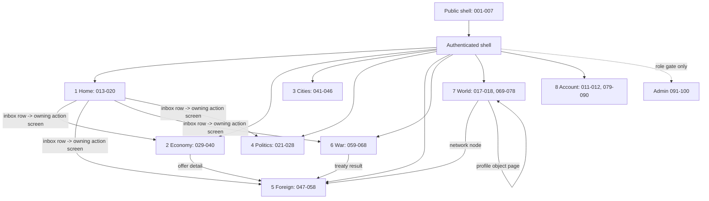

# 13A — Master screen inventory, screen hierarchy and navigation relationships

**Prompt:** Stage 2 Prompt 13A (Deliverables C and D).
**Created:** 2026-11-11. **Reconciled:** 2026-11-12 (Prompt 13A-C1 semantic cross-reference reconciliation). **Status:** proposed inventory at the research/design-foundations level. **No screen is specified in final detail, built, or approved as a product commitment** — 13B turns these into screen and component specifications; every row is a *candidate* whose class records how firmly existing requirements compel it.
**Companions:** [research register](13A_politics_and_war_ui_research.md) · [principles and architecture](13A_ui_design_principles_and_architecture.md) · [responsive and design-system foundations](13A_responsive_and_design_system_foundations.md) · [requirements and acceptance](13A_ui_requirements_open_questions_and_acceptance.md)

---

## 1. Method and reading rules

1. **Requirement-driven, benchmark-informed.** Every row names the Nation Supremacy rule family that *compels* the surface (B-02…B-12 rule/REQ identifiers). P&W research rows (`13A-FND/BP`) appear only as *reference*, and rows whose genre-shape was learned from P&W say so. No screen exists merely because P&W has one; screens with no governing NS rule are marked **Provisional** or excluded (the brief's anti-inflation rule).
2. **Class vocabulary.** `Mandatory` = existing accepted rules cannot be honoured without it; `Conditional` = compelled only if/when its gate or owner decision opens (Global Trade G-1…G-6, favorites); `Provisional` = plausible surface whose governing rule does not yet exist — kept visible as an open design question, not silently dropped.
3. **Object pages vs task screens.** Reading objects (profile, war, treaty, alliance) follow the P&W one-page-sectioned model adapted with progressive sectioning (`13A-BP-003`, `13A-BP-019`, `13A-DR-005`); task surfaces (compose offer, confirm reroll) follow the NS confirmation-first model (`13A-PR-09`).
4. **Admin separation.** `SCR-091…SCR-100` form the administrative family, reachable only through the role-gated admin entry — ordinary players never see these destinations at all (`13A-DR-013`; least privilege D-042; DIP-121 no-implicit-admin-view discipline).
5. **Overlays are not screens.** Modal/drawer inventory (§6) is registered separately; nothing appears in both lists.
6. **Identifier family.** `SCR-001`… contiguous, unique project-wide (verified: the token `SCR-` is unused in every pre-existing document except the Stage-1 Report 05 heading "13A." which is a section number, not an identifier). Allocated by **D-200**.

## 2. Summary register (100 screens)

Counts: **90 player-facing** (85 Mandatory, 4 Conditional, 1 Provisional) + **10 administrative** (10 Mandatory). Parent column uses the eight authenticated sections of the architecture document (`Home, Economy, Cities, Politics, Foreign, War, World, Account`) plus `Public` and `Admin`.

| ID | Screen | Parent | System | Class | Governing rules (primary) |
|---|---|---|---|---|---|
| `SCR-001` | Landing / public introduction | Public | B-03 | Mandatory | ACC entry; D-007 brand; `13A-SRC-001` |
| `SCR-002` | Registration | Public | B-03 | Mandatory | ACC/D-029/D-032; multi-account disclosure `13A-BP-014` |
| `SCR-003` | Login | Public | B-03 | Mandatory | ACC-018; persistent-frame lesson `13A-SRC-017` |
| `SCR-004` | Password reset initiation | Public | B-03 | Mandatory | D-041; `13A-SRC-017` link pattern |
| `SCR-005` | Recovery-code entry | Public | B-03 | Mandatory | D-041 recovery codes |
| `SCR-006` | E-mail verification / pending state | Public | B-03 | Mandatory | D-029 |
| `SCR-007` | Nation creation | Public→Home | B-03/B-04 | Mandatory | NAT-015/016; D-038 naming; D-063 standard start |
| `SCR-008` | Onboarding guide (account-level, in real shell) | Home | B-03 | Mandatory | D-040; ONB-009…017/036/038; `13A-BP-001`, `13A-SRC-017` |
| `SCR-009` | First-turn objectives entry | Home | B-03/B-11 | Mandatory | ONB surfaces; B-11 objective categories (entry only) |
| `SCR-010` | Public nation profile (12-section object page) | Public/World | B-03/B-06/B-10/B-11 | Mandatory | NAT-015/RRL-020; visibility classes TR-021; `13A-FND-003` |
| `SCR-011` | Account home | Account | B-03 | Mandatory | D-041 lifecycle; MSG register |
| `SCR-012` | Account closure flow | Account | B-03 | Mandatory | D-041 7-day closure; retention D-026 |
| `SCR-013` | Command Digest (home) | Home | B-02 | Mandatory | TR-089 digest-first; REQ-022 re-entry; SYS-017 |
| `SCR-014` | Inbox / pending actions queue | Home | B-02+B-systems | Mandatory | three-class timing contract; D-016/D-030 pending states; `13A-DR-001`, `13A-BP-018` |
| `SCR-015` | National Overview dashboard | Home | B-04/B-05/B-06/B-10 | Mandatory | ECN-176 question list; URB-052; DMP-073 |
| `SCR-016` | Turn & settlement status | Home | B-02 | Mandatory | TR-049/075/080; P-phase catalogue |
| `SCR-017` | National Chronicle (history browser) | Home/World | B-11 | Mandatory | chronicle class-P; D-026; `13A-BP-024`, `13A-DR-020` |
| `SCR-018` | Network View (mapless world surface) | World | B-02/B-08/B-09 | Mandatory | FO-013; REQ-041; DP-003; `13A-BP-006`, `13A-BP-016`, `13A-DR-003` |
| `SCR-019` | Alerts & notification history | Home | B-02+B-11 | Mandatory | notification matrices (DIP N1–N9, AN-01…16, WAR §12.1, MSG); REQ-731 |
| `SCR-020` | Pinned objects / favorites manager | Home | cross | Conditional | convenience; no rule compels — owner/policy note `13A-OQ-012` |
| `SCR-021` | Political Panel (with state banner) | Politics | B-06 | Mandatory | DMP-256 item; DMP-268 banner on every political screen |
| `SCR-022` | Government structure & institutions | Politics | B-06 | Mandatory | D-084/D-085 permanence; DMP-079…083 |
| `SCR-023` | Approval & stability detail (six supports) | Politics | B-06 | Mandatory | DMP-073 show-why; F-PD-004…009 |
| `SCR-024` | Policy axes management | Politics | B-06 | Mandatory | D-087 one-axis-per-12-turns; `13A-BP-010`, `13A-DR-009` cooldown-on-control |
| `SCR-025` | Election dashboard | Politics | B-06 | Mandatory | DMP-256; campaign dates `campaign_open_turn`-anchored |
| `SCR-026` | Campaign actions centre | Politics | B-06 | Mandatory | D-094 three actions; charge-once rule; read-only during blocks |
| `SCR-027` | Election result & transition view | Politics | B-06 | Mandatory | DMP-184 outcome-dependent banner; D-097/D-098 |
| `SCR-028` | Crisis & recovery digest view | Politics | B-06 | Mandatory | DMP-163 visible-and-actionable recovery; crisis/recovery states |
| `SCR-029` | Treasury dashboard | Economy | B-04 | Mandatory | ECN-176/177/178 six-number-type law; `13A-BP-026` inline bars |
| `SCR-030` | Budget & national wealth | Economy | B-04 | Mandatory | D-051 capex/opex; D-062 wealth; austerity ECN-009 |
| `SCR-031` | Economic reports & history | Economy | B-04 | Mandatory | ledger/records; ECN-142 explainability |
| `SCR-032` | Production policy & standing orders | Economy | B-04 | Mandatory | D-053 standing/manual; batch model |
| `SCR-033` | Resources & warehouse view (total/reserved/available) | Economy | B-04/B-05 | Mandatory | MKT-053 three-balance law; capacity ECN-006 |
| `SCR-034` | Power grid view | Economy | B-04/B-05 | Mandatory | grid-unit power D-048 |
| `SCR-035` | Directed-trade inbox | Economy | B-07 | Mandatory | 07C screen list; REQ-465 |
| `SCR-036` | Compose / counter offer | Economy | B-07 | Mandatory | MKT-060 five lines; MKT-038 pledge; atomic acceptance UX |
| `SCR-037` | Offer detail & two-sided record | Economy | B-07 | Mandatory | complete both-sided records (ECON-013); parties-only terms D-017 |
| `SCR-038` | Global Trade board | Economy | B-07 | **Conditional** | G-1…G-6 NOT MET; D-122 mandatory *long-term* scope; REQ-513 |
| `SCR-039` | Listing detail & execution confirmation | Economy | B-07 | **Conditional** | same gate; partial-fill honesty (D-111) |
| `SCR-040` | Trade history & reference prices | Economy | B-07 | Mandatory | post-gate statistics rule D-117 keeps pre-gate rows minimal; history class P/S |
| `SCR-041` | Cities overview (twelve-city single screen) | Cities | B-05 | Mandatory | URB-031; D-067 |
| `SCR-042` | City detail (infrastructure, housing, slots) | Cities | B-05 | Mandatory | URB-052 capacity display; housing formula display |
| `SCR-043` | Construction queue & preview | Cities | B-05 | Mandatory | URB-148 preview; D-073 one slot per city; refund disclosure D-074 |
| `SCR-044` | Production facility chains | Cities | B-05 | Mandatory | URB-149; UNMAINTAINED chain states |
| `SCR-045` | Research view (projects, technologies, programmes) | Cities | B-05 | Mandatory | URB-150; D-076 one active project; URB-152 forecast labelling |
| `SCR-046` | Found new city flow | Cities | B-05 | Mandatory | D-068 cost gate; no cooldown |
| `SCR-047` | Diplomatic overview (posture register) | Foreign | B-08 | Mandatory | 08C §12.2 six views; DIP-030 posture visibility |
| `SCR-048` | Pair screen (relationship detail) | Foreign | B-08 | Mandatory | pair screen named in B-08 §13; NET-023 player-visible restriction state |
| `SCR-049` | Proposal & negotiation flow | Foreign | B-08 | Mandatory | D-030 pending visibility; confirmation panel 08C §12.3 |
| `SCR-050` | Agreement / treaty detail | Foreign | B-08 | Mandatory | DP-T01…T03 lifecycle; DP-A01 embargo record |
| `SCR-051` | Publication & visibility state view | Foreign | B-08 | Mandatory | DIP-108…113 publication moment, k=5 |
| `SCR-052` | Relations history (class P/S split) | Foreign | B-08 | Mandatory | class-P/S history rules; retired-page discipline 08C §12.6 |
| `SCR-053` | Alliance home (public page) | Foreign | B-09 | Mandatory | ALL-086 applicant privacy; profile model `13A-SRC-006` |
| `SCR-054` | Alliance membership & applicants | Foreign | B-09 | Mandatory | founding/membership rules; UD-040 owner-reserved policy flagged |
| `SCR-055` | Alliance governance & roles | Foreign | B-09 | Mandatory | D-135 player-authored constitution; permission matrix AN/ALL; 15-permission benchmark noted only |
| `SCR-056` | Alliance tax brackets & member assignment | Foreign | B-09 | Mandatory | roadmap Prompt-13 B-09 dependency (brackets, per-asset %, effective turn, policy version, history, receipts); `13A-SRC-021`, `13A-DR-022` |
| `SCR-057` | Alliance finances (ARL receipts, contributions, operational funding) | Foreign | B-09 | Mandatory | ARL four categories; unavailable-purpose failure states; UD-045/UD-046 boundaries rendered as states |
| `SCR-058` | Alliance diplomacy (treaty offers, NAP coverage) | Foreign | B-09 | Mandatory | AT-E00/E01 record-only vs NAP effect; per-nation coverage visibility; block-reason without leak (WAR-149) |
| `SCR-059` | Military overview (readiness, OP balance) | War | B-10 | Mandatory | OP pool display (D-015 as amended 10B-C3); readiness layer SYS-011 |
| `SCR-060` | Forces & upkeep | War | B-10 | Mandatory | military Food upkeep (10B-C); unit roster display |
| `SCR-061` | **War Operations Board** (nation-owner, owner-only) | War | B-10 | Mandatory | roadmap Prompt-13 boundary paragraph; WAR-148 alliance isolation; §12.3 confirmation minimum |
| `SCR-062` | Conflicts ledger (public war list) | War/World | B-10 | Mandatory | thin-list + deep-detail pattern `13A-BP-008`, `13A-DR-008` |
| `SCR-063` | War detail (declared facts, visibility-filtered) | War | B-10 | Mandatory | WAR-085…088 odds/threat bands (four bands, never exact); visibility classes |
| `SCR-064` | Battle report view | War | B-10 | Mandatory | field list remains `SECONDARY` hypothesis (`13A-SRC-034`) — 13B must specify from B-10 rules, not P&W memory |
| `SCR-065` | War reports & losses summary | War | B-10 | Mandatory | losses/settlement ledger contract (Report 07 §22.4 lineage; WAR rules) |
| `SCR-066` | Military history archive | War | B-10/B-11 | Mandatory | class-P permanent records; D-026 |
| `SCR-067` | Settlement & peace proposal flow | War | B-10 | Mandatory | surrender off-ramp (UD-032 Option A); treaty objects |
| `SCR-068` | Strategic intelligence view | War | B-10 (none) | **Provisional** | espionage **excluded** from B-10 (10B "honest espionage exclusion") — this row exists **only** to record that any intelligence surface needs a future rule decision first (`13A-OQ-010`); builds nothing |
| `SCR-069` | Events Centre | World | B-11 | Mandatory | WPC-14 six named surfaces |
| `SCR-070` | Event detail & consequence view | World | B-11 | Mandatory | `13A-BP-007` pair hazard with effect; WEP presentation exclusions 057/058/134 |
| `SCR-071` | Objectives & Challenges | World | B-11 | Mandatory | twelve objective categories; WEP-713 named surface |
| `SCR-072` | Standings (named lists) | World | B-11 | Mandatory | WEP-324 denominator+window; WEP-325 no live standing; `13A-BP-005`, `13A-BP-020`, `13A-DR-007` |
| `SCR-073` | Achievements & rewards | World | B-11 | Mandatory | six reward classes; named surface list (18_) |
| `SCR-074` | National Progress (eight layers) | World | B-11 | Mandatory | progression layers; named surface |
| `SCR-075` | Reward History | World | B-11 | Mandatory | named surface; audit-consistent claims (deferred claims WEP flow) |
| `SCR-076` | World Chronicle | World | B-11 | Mandatory | domain D chronicle; TR-049 |
| `SCR-077` | World Health aggregates (charts) | World | B-11 | **Conditional** | k=5/D-027 must pass per-figure; P&W world-graphs as pattern only (`13A-SRC-015`) |
| `SCR-078` | World Guide & glossary (in-context help index) | World/help | all | Mandatory | F-010 jargon burden; DP-004; `13A-BP-009`, `13A-DR-010` |
| `SCR-079` | Privacy settings centre | Account | B-12 | Mandatory | PRV classes; player-visible class list PRV-009; D-042 inventory |
| `SCR-080` | Security settings (sessions, recovery codes, e-mail change) | Account | B-03/B-12 | Mandatory | D-041 dual-confirmation e-mail change; recovery codes |
| `SCR-081` | Report creation | Account/support | B-12 | Mandatory | MOD-002 intake fields; FR-001/006 degraded intake |
| `SCR-082` | Report status & decision view | Account/support | B-12 | Mandatory | MOD-017 seven-element notice; EVD-009 claim vocabulary |
| `SCR-083` | Appeal view | Account/support | B-12 | Mandatory | MOD-013 appeal route never blocked; ladder transparency |
| `SCR-084` | Restrictions & sanctions view (player-visible) | Account | B-03/B-12 | Mandatory | NET-023; ACC-018 status≠label; no public accusation (NET-050) |
| `SCR-085` | My data: access, export, retention disclosures | Account | B-03/B-12 | Mandatory | D-026; data categories; SEC-032 inventory |
| `SCR-086` | Review explanation surfaces (shared-network) | Account | B-03 | Mandatory | B-03 §16/§17 (roadmap Prompt-13 carry-in); D-033/D-034 states |
| `SCR-087` | Support centre (in-game help shell for SCR-078 content + contact) | Account | B-12 | Mandatory | support path; MOD intake separation from reports |
| `SCR-088` | Change disclosures (changelog-grade) | Home/World | B-02/B-12 | Mandatory | TR-049; `13A-BP-012`, `13A-DR-014` |
| `SCR-089` | Protection state view (newcomer/return protection) | Home | B-03 | Mandatory | ONB-020/022 visibility-only protection; WAR-115…117 execution-time states |
| `SCR-090` | Reroll confirmation (exact-phrase destructive dialog page) | Account | B-03 | Mandatory | RRL-006 exact-name confirmation; D-039; blocked-while-active campaign states |
| `SCR-091` | Admin console home (role-scoped index) | Admin | B-12 | Mandatory (admin) | ADM roles catalogue; least privilege |
| `SCR-092` | Moderation queue | Admin | B-12 | Mandatory (admin) | ADM-021/022 reviewer views |
| `SCR-093` | Case & evidence workspace | Admin | B-12 | Mandatory (admin) | EVD matrix; 16 violation classes V-01…V-16 |
| `SCR-094` | Sanctions administration (ladder, two-person rule) | Admin | B-12/B-08 | Mandatory (admin) | six-tier ladder; separation-of-duties |
| `SCR-095` | Shared-network review workspace | Admin | B-03/B-12 | Mandatory (admin) | D-034 five states + review status |
| `SCR-096` | Audit ledger viewer | Admin | B-12 | Mandatory (admin) | SEC-031 spine; preservation orders (COR) |
| `SCR-097` | Turn-engine operations monitor | Admin | B-02 | Mandatory (admin) | FAILED turn handling (TR-080); checkpoints |
| `SCR-098` | Data operations (retention, compaction, preservation) | Admin | B-12 | Mandatory (admin) | D-026; preservation orders |
| `SCR-099` | Announcement / global notice composer | Admin | B-12/B-09 | Mandatory (admin) | MOD-017 content rules; ALL-164 announcement moderation |
| `SCR-100` | Admin roles & permission management | Admin | B-12 | Mandatory (admin) | ADM-021/022; emergency authority FR postures |

## 3. Category detail records (per-screen fields beyond the register)

Fields per screen: important information; primary actions; secondary actions; dependencies; permission considerations; responsive note; P&W research reference; rationale. Cells are brief by design — 13B expands them into full specifications.

### 3.1 Entry and account experience (`SCR-001…012`)

| ID | Information shown | Primary actions | Secondary actions | Dependencies / permissions | Responsive / P&W / rationale |
|---|---|---|---|---|---|
| 001 | What the game is; fictional-world statement; no live-player counts that breach k=5 | Start Playing; Login | Terms, Rules, Privacy | public | `13A-SRC-001`; R-01: NS is browser-only identity per D-007 brand rule |
| 002 | E-mail + confirm, referrer, terms checkbox, multi-account warning *at entry* | create account | recovery link | verified e-mail gate before nation creation (D-029) | `13A-SRC-018`; REQ-070 family (B-03 registration rules) |
| 003 | Credentials; keep-me-logged-in; language | login; reset | shell preview (zero-state frame allowed) | public shell only; no data leak in shell (`13A-SRC-017` caution: P&W shows strip structure at zero values — NS may show *frame*, never others' data) | privacy caution adopted deliberately against the benchmark |
| 004–006 | verification/recovery states, dual-confirmation e-mail change | per D-041 | — | recovery never creates accounts (D-041) | REQ-085/089/090/092 family |
| 007 | nation name/short name + reserved-list feedback (NFC + fold rules), colour, flags, start-state summary, "awaiting first turn" | create nation | rename rules help | D-038 naming; D-063 start; pair-restriction checks pre-create | `13A-SRC-001` entry funnel; ONB entry |
| 008–009 | guided first-turn checklist inside the real shell; objectives entry | complete guided steps | skip (protection unaffected display) | D-040 one-time, never re-granted | `13A-BP-001`, `13A-SRC-017` zeros-in-real-frame |
| 010 | public profile sections mirroring `SCR-015` fields minus private classes; activity; score-over-time within visibility rules | read; contact via declared channels only | report-this-nation | TR-021 classes; RRL-020; **no** raw network data ever (D-036) | `13A-FND-003` profile-as-diplomacy-substrate; k=5 applies to any aggregate shown |
| 011–012 | account state chips (ten-state machine ACC), sessions, closure | manage; close | support | ACC-018 wording discipline | REQ-038/070/075 |

### 3.2 Main strategic interface (`SCR-013…020`)

| ID | Information | Actions | Dependencies / permissions | Refs |
|---|---|---|---|---|
| 013 | yesterday's settlements explained with cause chains; pending totals; due-this-boundary items; alerts digest tier | drill to any cited object | consumes **existing** notification events only (REQ-731) | `13A-DR-001`; TR-089; ECN-055/059/063 digest lines |
| 014 | every pending: offers (D-016 no-reserve-at-create), proposals (D-030 named-counterparty visibility), invitations, confirmations, applications — ordered by due boundary | act / defer / cancel where rules allow | row-level permissions from owning system | `13A-DR-001`; MKT/DIP/ALL/AT lifecycles |
| 015 | headline national state: treasury band, stability/approval, readiness, protection, population/housing, power balance — six-number-type register honoured | jump to owning section | exact values only where class allows (D-027) | ECN-176/177; URB-052; DMP-073/163 |
| 016 | current slot, next boundary UTC countdown, phase position, this nation's queued actions and their target phase, last settlement status incl. FAILED/"unknown — retrying" honest states | none (read) | TR-075/080 | `13A-PR-01` |
| 017 | permanent class-P history stream per nation with filters | read; deep-link | D-026 boundary labelled (`13A-DR-020`) | `13A-FND-019`, `13A-BP-024` |
| 018 | relational world surface: nations/alliances as nodes; posture/treaty classes as edges; filters; selected-node side panel; **no geographic coordinates anywhere** | explore; deep-link node | edges drawn only from published/declared relations (D-030) | `13A-BP-006`, `13A-BP-016`, `13A-DR-003`; FO-013; REQ-041 |
| 019 | alert list with tiers; per-item mute where the owning rule allows opt-out (DIP N-series are non-mutable "cannot opt out"; CN alert-opt-out pattern noted `13A-SRC-029`) | triage; clear | notification events immutable | `13A-DR-011`, `13A-BP-027`; AN-01…AN-16; WAR §12.1 14 rows |
| 020 | user-pinned objects (allies, rivals, markets of interest) | pin/unpin | **Conditional** — privacy/abuse review first (`13A-OQ-012`) | — |

### 3.3 Politics (`SCR-021…028`)

All eight carry the **political state banner** (DMP-268) — `TRANSITION`, `CRISIS`, `RECOVERY`, `ELECTORAL`, `SUCCESSION`, `NORMAL` — and read-only behaviour during blocks (DMP authority matrix).

| ID | Information | Actions | Notes / refs |
|---|---|---|---|
| 021 | government identity (permanent, never a change verb — D-084), leader/administration separation (DMP-079…083), state banner | navigate politics sub-screens | DMP-256 "seven required surfaces" enumeration is the floor for this category |
| 022 | institutions and channels (five numeric channels only, D-086) | read; manage within role | REQ-269/276/317–321 family |
| 023 | approval = weighted mean of six supports with per-support cause chain; stability band; derived legitimacy shown as derived | read; drill each support | DMP-073 no hidden aggregate; F-PD-004…019 |
| 024 | two axes with current position, per-axis change cost/effect preview, 12-turn cooldown on the control | change axis value (confirmation) | D-087; `13A-BP-010`, `13A-DR-009`; under-10% spread target labelled |
| 025 | cycle dates anchored on `campaign_open_turn` (T−24/T−12/T−2 labelled on-time only, D-106/D-107), turnout weights published, challengers as published rows | register/manage campaign | D-092/093/095; REQ-352/361 |
| 026 | exactly three action types (free platform 6 points; rally/advert crown costs), single-charge-at-submit state | run actions; view effects as ephemeral-effect disclosure | D-094; read-only during `TRANSITION/CRISIS` (B-06 §36 market analogue honoured) |
| 027 | result, transition state (12 turns, administration replaced, government never), stability penalty figure disclosed (800 bp) | acknowledge; read causes | DMP-184; D-097/098; REQ-358/367 |
| 028 | retention-threshold proximity, crisis state (18 turns, stability-only effect), recovery window and immunity | act to raise approval via levers (never via new formulas) | D-099/100; DMP-163 recovery actionable |

### 3.4 Economy and market (`SCR-029…040`)

| ID | Information | Actions | Notes / refs |
|---|---|---|---|
| 029 | the ECN-176 question set (what do I have / commit / expect / owe / change) rendered as the six number types in separate registers | allocate; set reserves | forecast weight distinct (ECN-178) |
| 030 | opex vs capex split (D-051), wealth D-062, austerity order state when triggered | — | no-debt honesty (D-050) |
| 031 | ledger rows (append-only view), per-turn aggregates, exports | filter; export | SEC-031 spine alignment; `13A-BP-024`, `13A-DR-020` |
| 032 | standing production policy, batch limits, manual orders with reservation preview | submit/modify orders | D-053; ECN-181 affordability twice (submit + boundary) |
| 033 | total / reserved / available per resource (MKT-053 — "a screen showing only a total is a defect"), capacity bars, book values | reorder | CN one-row-chart density `13A-BP-026` |
| 034 | grid-unit power generation/demand, never stored (D-048) | — | |
| 035 | incoming/outgoing directed offers; no-reservation-at-creation state explicit | accept/decline/counter/cancel | 07C list; MKT-125 legibility |
| 036 | five-line offer (MKT-060), pledge disclosure (MKT-038), imbalance disclosure for weaker side (R-16 lineage) | compose | parties-only terms (D-017); rate-limit visible on screen (MKT-061) |
| 037 | both-sided complete record, settlement state | — | atomicity shown as all-or-nothing (R-19) |
| 038 | board *only if gate passed*: listings, band (3,000 bp) state, `INSUFFICIENT_SAMPLE` as a named state (MKT-110) | post/take | **Conditional on G-1…G-6** (all NOT MET except G-4 PARTIAL today); pre-gate this screen is *absent*, and UI must not fake it (D-117 no statistic before the gate) |
| 039 | execution confirmations with partial-fill representation | — | same gate |
| 040 | own trade history; day-window reference prices where disclosed | filter; export | class P/S split |

### 3.5 Cities, infrastructure, production and research (`SCR-041…046`)

| ID | Notes / refs |
|---|---|
| 041 | twelve cities + capital on one screen (URB-031), per-city DC, limits, status chips | D-067/D-070/071 |
| 042 | infrastructure 10–500 with the two effects, housing formula components, development capacity model displayed | URB-124…127 housing contract; D-069/079 |
| 043 | one-slot-per-city state, 25% demolition refund disclosure, capex-at-boundary preview, queue with cancel | URB-148; D-073/074/080; URB-152 no projection promise |
| 044 | chain health incl. `UNMAINTAINED`; extraction/processing chain view | ECN-147a allocation visible in explanation |
| 045 | 12-tech tree, one active project, banked RP vs programme spend, integer modifier classes | D-076/077/078; URB-150; predictions labelled forecasts |
| 046 | founding cost gate (crowns + steel), no cooldown, naming within D-038 rules | D-068 |

### 3.6 Diplomacy and alliances (`SCR-047…058`)

| ID | Notes / refs |
|---|---|
| 047 | posture register per pair (directional), agreements list, embargo state; six-view floor from 08C §12.2; empty states from §12.5 | REQ-012/030; DIP-155 provisional labelling |
| 048 | bilateral facts: posture, agreements, breach **count as fact not score** (DIP-086/088), pair restriction state where player-visible (NET-023) | 08C §12.7 error tone |
| 049 | proposal lifecycle with counterparty-named pending visibility (D-030); confirmation panel field-by-field (08C §12.3) | no delegation anywhere (player sovereignty) |
| 050 | DP-T01 NAP / T02 consultation / T03 crown aid / DP-A01 embargo records; amendment/renewal/termination state | REQ-590/670 |
| 051 | publication moment timeline; k=5 aggregate disclosures | DIP-108…113 |
| 052 | private vs public history split (DPE-054 lineage), retired-page discipline | 08C §12.6 |
| 053 | public alliance facts: name, acronym, colour, leadership roles, member count within disclosure rules | ALL-086; `13A-SRC-006` shape |
| 054 | applicants (visitor sees *only* applicants per benchmark? NS decides: members list is permissioned), application flow terminating **in-product** (`13A-BP-017` reject-Discord) | UD-040 flagged as owner-reserved on this screen's empty states |
| 055 | constitution view, role matrix, permission toggles with per-role explanation; permission-denied states per roadmap paragraph | D-135; AN matrix; REQ-553 render-grants-nothing rule |
| 056 | bracket editor: name + separate Crowns and resource percentage rates (integer, 0–100%), member assignment, effective turn + policy version *shown before confirmation*, tax history, receipts | roadmap Prompt-13 dependency verbatim; `13A-SRC-021`, `13A-DR-022`; ambiguity-fallback state (0% protective fallback, UD-040 Open labelled) |
| 057 | ARL four categories, donation receipts (ALL-193), purpose-limited operational funding with **unavailable-purpose explanatory failure state** (UD-045/046 boundary) | ECN-213/213a accrual visible in receipts |
| 058 | alliance-to-alliance treaty objects, per-nation NAP coverage state ("your nation is a non-covered member"), block reasons without leak (WAR-149), same-Alliance attack ban explanations | AT-E00/E01; D-140; UD-047 boundary respected: **no** collective-position controls until owner decides |

### 3.7 Warfare and military (`SCR-059…068`)

| ID | Notes / refs |
|---|---|
| 059 | OP balance (regeneration at P3.7 opening, cap, carry) exactly as 10B-C3; readiness layer; no hidden OP anywhere | D-015 amended; REQ-672/675 Prompt-13 handoff row |
| 060 | forces, upkeep consequences (military Food at P3.7), impairment carrying-value basis (WAR-109f…m) | REQ-682/684 |
| 061 | **owner-only**: this nation's operations, reservations, battles; confirmation minimum (WAR §12.3); prohibited-communication list (§12.4) shapes in-product war messaging — allies see *nothing private* (AX-18; REQ-589…591; WAR-148) | roadmap Prompt-13 boundary paragraph verbatim |
| 062 | public conflicts ledger: date, belligerents, declared state — thin at list level, honest about what detail requires | `13A-BP-008`, `13A-DR-008` |
| 063 | declared facts + odds/threat **bands, four bands, never exact numbers** (WAR-085…088); per-field visibility filter | REQ-687 |
| 064 | battle report content = B-10 ruleset output; layout to be specified in 13B **from rules**, because P&W's report internals were `NOT-RETRIEVABLE` (`13A-SRC-034`) — no benchmark imitation claim | |
| 065 | losses summary with conservation accounting; settlement ledger contract display | Report-07 §22.4 lineage |
| 066 | permanent war archive within retention classes | D-026 |
| 067 | surrender/peace flow as the sanctioned off-ramp (UD-032 Option A; reroll block honoured) | REQ-692 region |
| 068 | **Provisional placeholder with no build authority**: espionage/intelligence is *excluded* from B-10 (10B-C "honest espionage exclusion"); row retained solely so the inventory records the frontier (`13A-OQ-010`), preventing a silent assumption that intelligence UIs exist | |

### 3.8 World and progression (`SCR-069…078`)

| ID | Notes / refs |
|---|---|
| 069–076 | the six WPC-14 named surfaces (Events Centre, Objectives & Challenges, Standings, Achievements, National Progress, Reward History) + World Chronicle + event detail; each event pairs hazard→consequence (`13A-BP-007`); standings never "live" (WEP-325) and always carry denominator+window (WEP-324); no composite headline metric (WEP-361/362); deferred claims visible in Reward History (WEP-705/713 Prompt-13 deferrals honoured here) | REQ-708/713/717/728 |
| 077 | **Conditional**: world charts render only figures passing k=5 with complementary suppression (D-027); suppression itself displayable as `suppressed` state | `13A-SRC-015` pattern |
| 078 | in-game guide structured by the game's own section vocabulary (`13A-BP-009`, `13A-DR-010`), because benchmark evidence shows off-platform knowledge is a frustration vector (F-010; `13A-FND-029`) | DP-004 headline differentiator UXD-001 |

### 3.9 Player protection and support (`SCR-079…090`)

| ID | Notes / refs |
|---|---|
| 079 | privacy centre lists the nine privacy classes in player language (PRV-009); class-SEC content **never appears on any surface** (PRV-014) | REQ-801…804 |
| 080 | sessions list, recovery-code custody (D-041), dual-confirmation e-mail change, verification states (D-029) | REQ-768 |
| 081 | report form = MOD-002 field list exactly; degraded-intake path (FR-001/006) when tools degrade | REQ-821/822 |
| 082 | decision notices render MOD-017's seven elements; EVD-009 four claim tiers never upgraded silently ("suspected" ≠ "confirmed") | REQ-826/831 |
| 083 | appeal entry + status ladder; route never blocked (MOD-013); owner-reserved rows (UD-052…060, UD-017) surface here as *stated* unresolved branches, not fake closures | REQ-833/848 |
| 084 | restriction states with their *kind* and reason class; no public accusation (NET-050); pair restriction ≠ suspension (D-031) | REQ-865 region |
| 085 | my-data export/access request states; retention disclosure by data class (D-026) | SEC-032 lineage |
| 086 | shared-network explanation surfaces per B-03 §16/§17 carry-in — state names + what clearance means, no technical exposure | D-033/D-034 |
| 087 | support contact separated from conduct reporting (intake taxonomy) | MOD ladder §12 lineage |
| 088 | change disclosures: rules-affecting changes published player-readably (TR-049); security-incident disclosure pattern from benchmark (`13A-SRC-019`) bounded by B-12 honesty rules | |
| 089 | protection window display as a *state* (visibility-only, never re-granted — D-040; ONB-020/022) | REQ-090 |
| 090 | reroll exact-phrase confirmation naming permanent destruction; blocked-while-campaign/settlement/hold states displayed with reasons (D-039) | RRL-006/010 |

### 3.10 Administration family (`SCR-091…100`) — separate navigation root

| ID | Notes / refs |
|---|---|
| 091 | role-scoped index; nothing reachable without a role; deep-link refusal for non-holders | ADM 8-role catalogue |
| 092 | queue with triage states; reviewer views ADM-021/022 | REQ-865 region |
| 093 | evidence-matrix workspace (EVD classes; 16 violation classes V-01…V-16) | |
| 094 | sanctions ladder (six tiers), two-person rule display, separation-of-duties | D-042 |
| 095 | five shared-network states + separate review status (D-034) with observation-window countdown in turns | |
| 096 | audit spine viewer; preservation-order application (COR rules) | SEC-031 |
| 097 | turn monitor: slot history, checkpoints, FAILED-state operator path, "unknown — retrying" semantics | TR-075/080 |
| 098 | retention/compaction/preservation operations console (D-026 idempotent compaction) | |
| 099 | announcement composer bound to MOD-017 content rules and ALL-164 moderation | |
| 100 | permission/role management with least-privilege checks and emergency-authority posture display (FR) | |

**Admin boundary rules:** no privileged administrative information appears in any player screen; the shell's Admin entry is visible only to holders; admin screens reuse the design system but never the player digest/inbox (role-based permissions preserved per instruction §8.I; D-042; DIP-121).

## 4. Proposed screen hierarchy

Cross-system transitions that must exist (beyond parent→child):

| From → To | Why | Anchor |
|---|---|---|
| Digest row → any pending action (Inbox rows) | every alert deep-links | `13A-PR-13`; REQ-022 |
| Anywhere → object view (nation/alliance/war/treaty/offer/event) | identifier-as-link grammar | `13A-FND-001` |
| War detail → treaty objects; Battle report → war → operations board (owner only) | settlement off-ramp reachability | SCR-067; WAR rules |
| Alliance tax screen → ARL receipts → national treasury view | money must be followable across the boundary | ECN-213 lineage; roadmap B-09 paragraph |
| Political state banner → owning consequence screens (market read-only, campaign blocks) | blocks must be visible where they bite | DMP authority matrix; MKT-051 |
| Restriction view → appeal view → case status | recourse route never blocked | MOD-013 |
| Any disabled control → governing rule page | explain-before-click | `13A-PR-10`; SCR-078 |

## 5. Navigation-quality audit (instruction §9 self-inspection)

| Risk | Where it appears in this draft | Mitigation adopted |
|---|---|---|
| Excessively deep navigation | Global Trade listing detail is 3 clicks from Home; war battle reports 2 from board | Breadcrumb + quick-go; 13B journey-measure ≤3 clicks for every Mandatory screen (`13A-UR-045`) |
| Too many top-level categories | Eight sections risks P&W-style catalogue sprawl | Section count *capped*; sub-screens use tabs, not menu items; Trade folded into Economy |
| Duplicated destinations | Profile appears under Public, World and Account paths | One canonical object route, aliases render the same screen (deep-link identity, PR-13) |
| Hidden critical information | Protection expiry / austerity / political blocks | Banner system (DMP-268) + alert tiers + digest-first mandate; nothing rule-consequential lives only in a modal |
| Confusing system boundaries | Foreign section holds both diplomacy and alliances | Two tabs with distinct headers; each screen names its governing B-section (`13A-DR-009`, `13A-DR-010`, `13A-UR-044`) |
| Excessive modal usage | confirmation flows could balloon | Overlays discipline (architecture §5.3): modals only where confirm/block/explain; all modal content page-reachable |
| Important actions hard to find | campaign window (24 turns), counter-offers | Inbox priority by due-boundary + Home "act now" band; cooldowns on controls |

## 6. Overlays, dialogs and reusable elements (registered separately, not `SCR-`)

| ID | Element | Duty | Appears on |
|---|---|---|---|
| `OVL-01` | Confirmation dialog (effect/cost/cooldown summary) | PR-09 | every committing control |
| `OVL-02` | Destructive exact-phrase dialog | RRL-006 pattern | SCR-090, admin sanctions |
| `OVL-03` | Reason popover (disabled control explanation) | PR-10 | every disabled control |
| `OVL-04` | Definition/cause-chain drawer | PR-04 | all read surfaces |
| `OVL-05` | Object peek card (hover/long-press identifier) | deep-link preview | lists everywhere |
| `OVL-06` | Boundary-effect toast/notice (settled receipt) | PR-06 | shell |
| `OVL-07` | Suppression notice (`suppressed` tone) | D-027 | aggregates |
| `OVL-08` | Claim-vocabulary badge (suspected/under review/confirmed/inconclusive) | EVD-009, B-12-owned | SCR-082/084 |

Reusable composite elements (tables, charts, object links, banners, countdowns, number registers) are specified at foundations level in the [design-system document](13A_responsive_and_design_system_foundations.md); 13B turns them into component specs.

## 7. Inventory arithmetic (for the acceptance register)

Player-facing: 90 (Mandatory 85; Conditional 4 — `SCR-020/038/039/077`; Provisional 1 — `SCR-068`). Administrative: 10 (Mandatory). Total screens **100**; overlays 8; sections 8 + Public + Admin roots. Every screen's identifier is unique (validator check `13A-11` in the acceptance companion).
